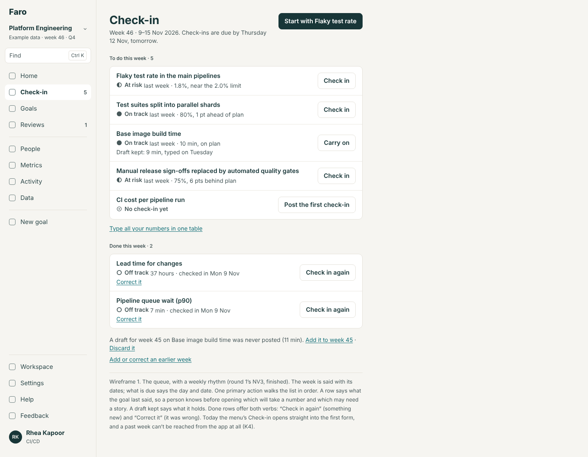
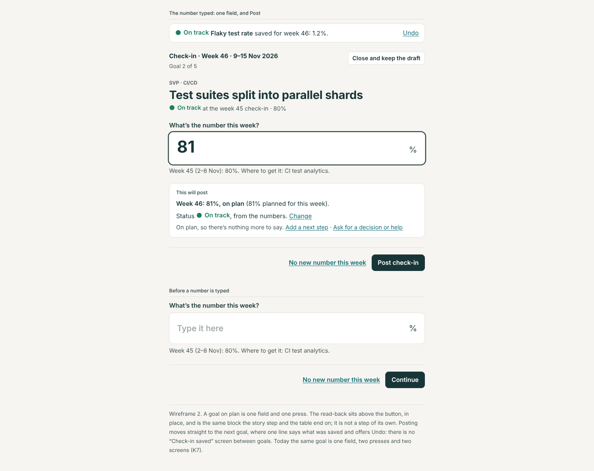
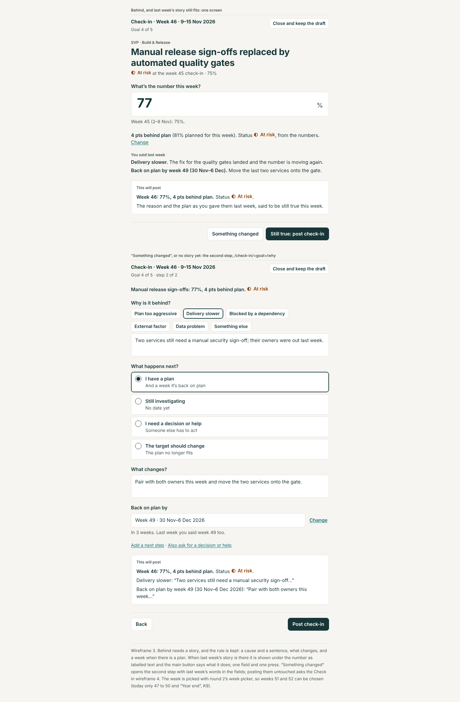
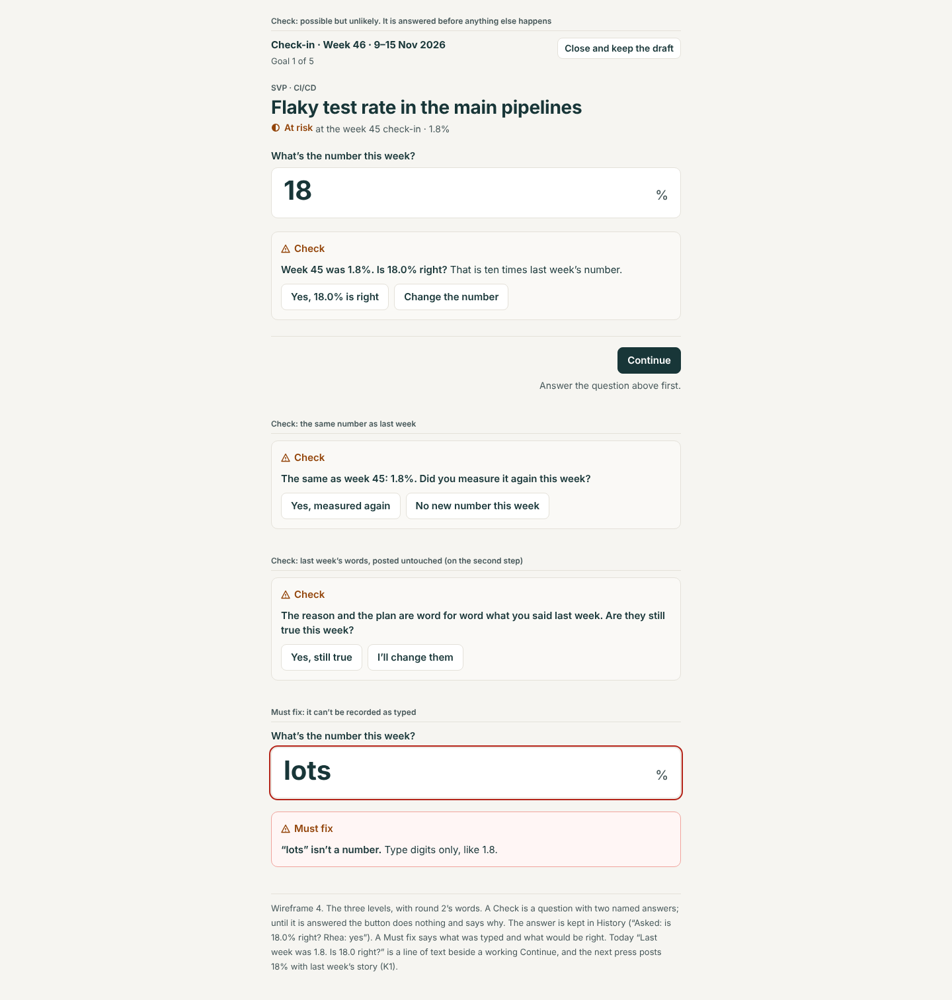
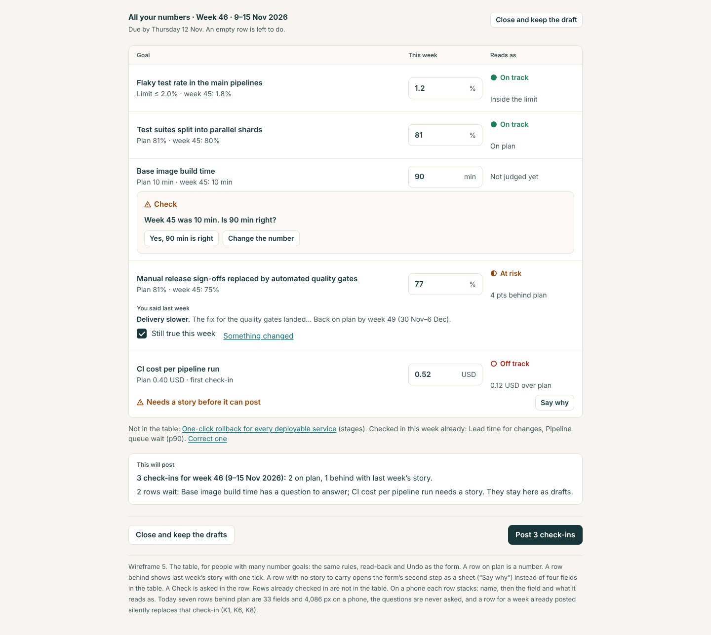
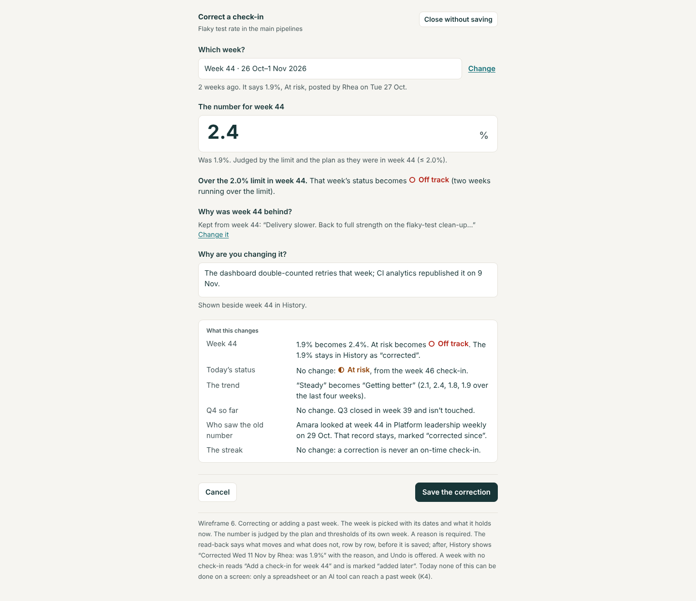
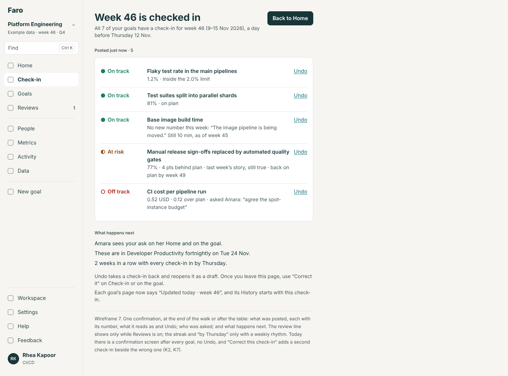
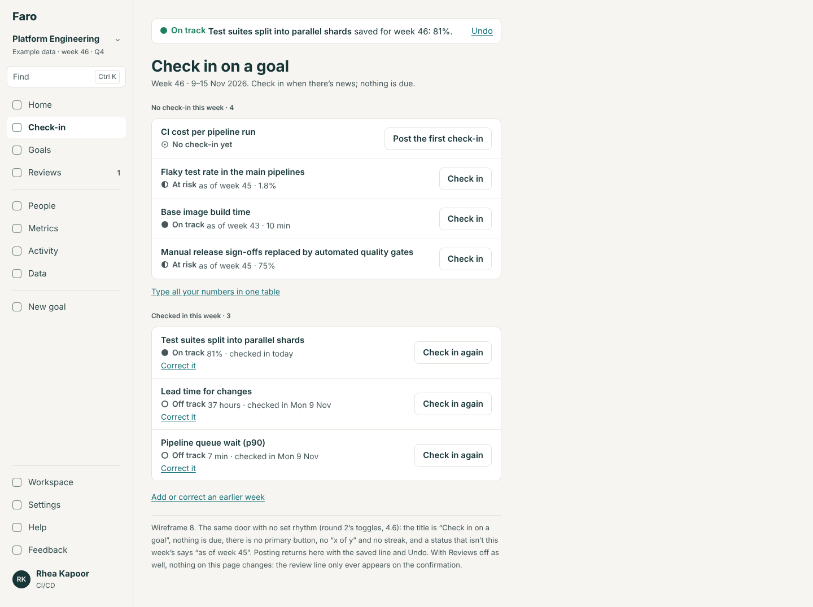
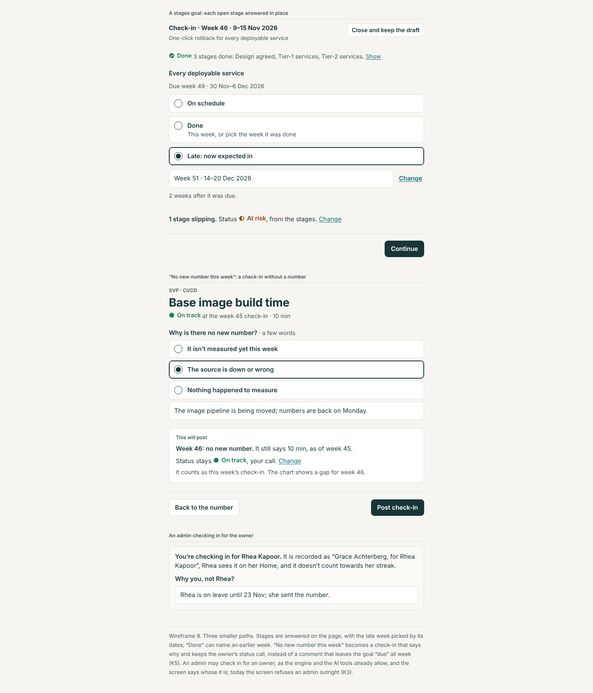

# The check-in: the evaluation and the design

11 November 2026. Area 1 of round 3 (`docs/design/round-3/README.md`). Design and spec only: no app code was changed, and nothing here is built. The build spec is `spec.md` beside this file. The wireframes in `wireframes/` are rendered from `mockups/` (`node docs/design/check-in/mockups/build.cjs`) at 1440 and 390 px.

It covers everything a goal's owner does to say where a goal stands: the queue (`/check-in`), one goal at a time, all the numbers in one table, a second check-in in a week, correcting or adding a past week, checking in for someone else, stages, a keep-in-range goal, a week with no number, the confirmation, drafts, and the phone. It builds on round 1's NV3 (the queue), GT1 (the owner's buttons) and OB2 (the first check-in), and round 2's FT1 (no set rhythm), GE9 (the week picker) and MT4 (a number from a source), none of which is on main, and says in "What this changes in rounds 1 and 2" every place it changes them.

## The idea in six lines

1. **A goal on plan is one number and one press.** What will be posted is read back above the button, in place; posting goes straight to the next goal with one line that says what was saved and offers Undo.
2. **Behind needs a story, and the rule is kept**, but last week's story is shown under the number and the button says "Still true: post check-in". Only a changed story opens a second step.
3. **Three levels, with round 2's words.** A Must fix says what was typed and what would be right. A Check is a question with two named answers that has to be answered before anything is posted. Fine says nothing.
4. **One way to save.** The form, the table, the import and the AI tools post through the bulk-change engine, so "check in again", "correct it" and "undo" mean one thing each at every door.
5. **A past week can be corrected or added on a screen**, with a reason, after a read-back that says what it changes: that week, today's status, the trend, the quarter, who saw the old number, the streak.
6. **Designed four ways at once.** With no set rhythm nothing is due and there is no walk, count or streak; with Reviews off no line names a review. Nothing is greyed out.

## The jobs people come to do

| Who | Job | How often | Today |
|---|---|---|---|
| Owner with a few goals (Tunde, 2) | Say where each goal stands this week | Weekly | One field and two presses a goal on plan; a confirmation screen after each |
| Owner with many (Rhea, 8; 5 to do) | The same, quickly | Weekly | Ten to thirteen screens one by one; or a table where every row behind is four more fields |
| Owner | Say something changed mid-week | Monthly | "Check in again" adds a second check-in; it is compared with the first as if that were last week |
| Owner | Fix a number typed wrong | Monthly | "Correct this check-in" adds another beside the wrong one; no Undo |
| Owner | Fix or add an earlier week | A few times a year | Not possible on a screen: a spreadsheet or an AI tool only |
| Owner | Say there is no number this week | Monthly, for some | A comment; the goal stays "to do" all week |
| Owner | Ask for a decision or help; add a next step | When behind | Inside the story step; works |
| Admin (Grace) | Check in for someone who is away | Rarely | The screen refuses; the import and the AI tools allow it |
| Anyone with no rhythm | Check in when there is news | Irregular | Designed in round 2 (FT1), not built |
| An assistant (MCP) | Post or correct for its person | Daily, for some | `post_check_in` replaces the week's record; no reason asked for a past week |

## How long it takes

No person was timed. These are counts from the walk; Home's own estimate is 45 seconds a goal (`Home.tsx:80`: "About 4 min" for five).

| What | Today | The design |
|---|---|---|
| One goal on plan | 1 number, 2 presses (Post, Next), 2 screens | 1 number, 1 press, 1 screen |
| One goal behind, last week's story still true | 1 number, 3 presses (Continue, Still true, Next), 3 screens | 1 number, 1 press, 1 screen |
| One goal behind, a new story | 3 typed answers, 2 or 3 choices, 4 presses, 4 screens. Required: number, cause, a sentence, what changes, a week | The same 5 required answers, 2 presses, 2 screens |
| Rhea's five (three on plan, two behind and unchanged) | 5 numbers, 12 presses, 13 screens | 5 numbers, 5 presses, 5 screens and one summary |
| The same in the table | 5 numbers and, for the two behind, 8 more fields typed again from nothing; 1 press | 5 numbers, 2 ticks, 1 press, then the summary |
| Seven rows behind in the table, on a phone | 33 fields, 4,086 px | 7 fields and up to 7 ticks |

The presses roughly halve. Most of the minutes are spent finding each number outside Faro; the design can't shorten that except where a source supplies it (round 2's MT4, kept as designed).

## Findings

From the walk of 11 Nov 2026, 10:53 to 11:20 UTC, on the live demo (`/demo?today=2026-11-11`) as Rhea Kapoor (5 to do), Tunde Bakare (2 goals, both in), Grace Achterberg (admin) and Oskar Lindgren (owns none), at 1440 × 900 and 390 × 844; and from the code named. Severity: **High**, **Medium**, **Low**.

| # | Sev. | What | Evidence |
|---|---|---|---|
| K1 | High | **A question is shown and never asked.** Rhea typed 18 where last week was 1.8. The form said "Last week was 1.8. Is 18.0 right?" beside a working "Continue"; the next press, "Still true: post check-in", posted 18.0% with last week's story ("Recovering: back to the planned pace…"). One number and two presses. Tunde's 41 against "top 40" read "That’s past the target of 40 pairs. Is 41 right?" above a button that said "Post check-in"; 300 pairs against a plan of 4 to 40 only asked for a reason for being ahead. The table shows the same lines the same way | `/check-in`, `/quick-check-in`. `checkin.ts:112-122` returns `block: false`; `CheckInFlow.tsx:415,426` shows it as a hint; `QuickCheckIn.tsx:158` |
| K2 | High | **A corrected mistake is kept as the comparison.** After the 18.0%, "Got something wrong? Correct this check-in" opened a second check-in: "You checked in for week 46 already. This adds another check-in". Typing 1.9 there said "Last week was 18.0. Is 1.9 right?" Once posted, the goal's page said "VS LAST WEEK · 16.1 pts better · was 18.0% in week 46", and History folded the wrong one into "Weeks 45–46 · The same reason as week 46, above" with no mark that it was a mistake | `/check-in/lead-flaky`, `/goals/lead-flaky`. `CheckInFlow.tsx:210,227-228,402` (`previous` is the latest record, not the latest earlier week) |
| K3 | High | **Three answers to "who may check in".** The screen refuses an admin: "Only Rhea Kapoor checks in on this goal · The owner’s call is the official status, so it comes from them." The engine lets the owner or an admin; the AI tool says "Only the goal’s owner or an admin can post"; round 1's goal spec gives an admin "Check in for {owner}" | `CheckInFlow.tsx:74-83`; `changeset.ts:339,679`; `mcp/tools.ts:263`; `docs/design/goal/spec.md` section 3 |
| K4 | High | **A past week can't be corrected or added on any screen.** The form is always this week's. Only a spreadsheet row or `post_check_in` reaches an earlier week, and neither asks for a reason or says what the change does to the status, the trend or a quarter | `CheckInFlow.tsx:224` (`week` is the app's); `changeset.ts:621-638`; `mcp/tools.ts:263` |
| K5 | Medium | **"No new number this week" is a comment, not a check-in.** The sheet says "The check-in stays due." So an owner who did the honest thing stays "to do" until the week ends, loses the on-time streak, and can't change the status or the story without a number | `CheckInFlow.tsx:110-134` (`addNote`); seen on Base image build time |
| K6 | Medium | **The same act has three results.** A second check-in in a week from the form adds a record; from the table it replaces the week's record; from the AI tool it replaces it. Replacing from the table, Rhea chose "Week 49" for Pipeline queue wait and the goal's page then said "No date until the decision or help arrives.": the table judged the row as a plan and the engine kept the old record's "Need a decision or help", so the week she picked was dropped | `state.tsx:593-609` (the form calls `toCheckIn` itself); `changeset.ts:636,659`; `QuickCheckIn.tsx:76` |
| K7 | Medium | **A screen between every goal, nothing read back, no Undo.** Each post lands on "Check-in saved" with "Next: {goal}". Five goals on plan are ten screens. What will be posted is never said before the press, and after it the only way back is a second check-in; Delete exists but only on the goal's page | `CheckInFlow.tsx:188-213`; `RemoveControls.tsx:92` |
| K8 | Medium | **The table is slower than the form for a goal behind.** It never offers last week's story, so each row behind opens a cause, a sentence, "How it gets back on plan" and a week: seven rows were 33 fields and 4,086 px on the phone. It has no status call, no "Still investigating", no ask, no next step; it lists the two goals already checked in first; and its summary says "path to green" | `QuickCheckIn.tsx:39,76,109,161-190` |
| K9 | Medium | **"Back on plan by" can't say week 51 or 52.** The form offers "Week 47", "48", "49", "50" and "Year end, week 53"; the table lists every week; neither shows a year or anything past the year's end. A late stage offers the same short list | `CheckInFlow.tsx:631-642` |
| K10 | Medium | **A missed week can be repaired after the fact.** A past week loaded later is stamped as posted on that week's due day, and the streak counts any check-in by the owner "on or before the review day". *Read from the code, not run* | `changeset.ts:707-708`; `progress.ts:66` |
| K11 | Medium | **Back leaves the check-in.** On the story step the browser's Back went to Home, not to the number. The draft was kept ("Pick up where you left off") and a reload kept the step and "1 of 5". The menu's Check-in still opens straight into the first form, not a list (NV3 is not built) | `/check-in` at the story step; `CheckInFlow.tsx:249-258` (steps are state) |
| K12 | Low | **A greener call is two taps deep and takes any ten characters.** "Change" opens a sheet; "Because I say so ok" was accepted for On track against At risk, and the path back was then no longer asked for. Nothing reads the reason back before posting | `CheckInFlow.tsx:602-627`; `checkin.ts:204` |
| K13 | Low | **The story step reads as a form.** Six causes, a box, four states, a box, five weeks, three links and a tick: 1,582 px on the phone | `/check-in`, "Something changed" |
| K14 | Low | **"0/1 check-ins" for someone who owns no goal.** Grace and Oskar on `/check-in` see a ring that says 0 of 1 above "Nothing to check in" | `CheckInFlow.tsx:146` (`Math.max(1, …)`) |
| K15 | Low | **A draft disappears when the week turns.** Drafts are kept per goal and week; Friday's unposted number is not offered on Monday. *Read from the code* | `drafts.ts:48` |
| K16 | Low | **Small words.** The form's header says "Week 46" with no dates (the table has them); "Last week was 1.8" has no unit; a stage marked Done is always stamped this week; the source line says "Typed in by hand." | `CheckInFlow.tsx:94,410,739`; `checkin.ts:122` |
| K17 | Low | **The words assume reviews and a rhythm.** "after the review day", "shown at the top of the goal and in reviews", "the review sees it was done" | `progress.ts:39`; `CheckInFlow.tsx:539`; `Respond.tsx:66` |

**What works and is kept:** the number first; the verdict as one sentence the moment a number is typed; one number check shared by the form, the table and the import (#77); "Something changed" can't be posted unedited (#77); the week in the header (#77); a double press posts once (tried on the form and the table); a reload keeps the draft and the step; decimals offered in one step ("Keep 2 decimal places for this goal"); the four honest answers to "what happens next".

## The design

### 1. The door: `/check-in` (wireframes 1 and 8)

One list of the viewer's goals, in two groups. With a weekly rhythm: "To do this week" and "Done this week", the week with its dates, the day it is due with its date, and one primary action, "Start with {goal}", which walks the list. With no set rhythm: "Check in on a goal", "No check-in this week" and "Checked in this week", no primary action, no count, no streak (round 2's toggles design, kept).

Each row says the goal's status and what it last said, so a person can see which will be a number and which may need words. A row with a draft says what the draft holds. A done row has the button "Check in again" and the link "Correct it": two verbs, because they are two acts (section 5). Under the list: "Type all your numbers in one table" (two or more number goals), a line for any draft left from an earlier week, and "Add or correct an earlier week".

### 2. One goal (wireframes 2, 3, 9)

- **The number step.** The header says "Check-in · Week 46 · 9–15 Nov 2026" and "Goal 2 of 5". One field. Under it, last week's number with its dates, and where to get it.
- **The read-back, in place.** As soon as the number can be judged, a block above the button says "This will post": the week, the number, what it reads as, the status and whose call it is. It is the same block on every path, and it is not a step.
- **On plan:** the button says "Post check-in". Two quiet links offer a next step and an ask.
- **Behind or ahead, with last week's story:** the story is shown as labelled text ("You said last week"), the read-back says it will be posted as still true, the main button is "Still true: post check-in" and the plain button "Something changed".
- **The second step** (`/check-in/<goal>/why`) only for a new or changed story: why (a cause and a sentence), what happens next (one of four), what changes, and a week picked with round 2's week picker. It ends on the same read-back.
- **After posting:** the next goal opens with one line at the top, "{goal} saved for week 46: 1.2%." and "Undo". After the last, the confirmation (section 7).
- **Stages:** each open stage is answered on the page: "On schedule", "Done" (this week, or pick the week it was done), "Late: now expected in" with the week picker.
- **A keep-in-range goal** is the number step with the limit's words ("Inside the 2.0% limit", "Near the limit", "Over the limit"); a breach takes the story path.
- **A number from a source** (round 2's MT4): its block sits above the field exactly as designed there; its `stale` and `jump` questions are Checks in this design's sense, and its "Use {value}" is the step's primary action.

### 3. The three levels (wireframe 4)

| Level | In a check-in |
|---|---|
| **Must fix** | Not a number; more decimal places than the goal keeps; below zero for a count or a duration; over 100% for a share; no cause or sentence when behind or ahead; no "what changes", or no week after this one, when at risk or off track; a call greener than the numbers with no reason; "I need a decision or help" with nobody chosen; a correction with no reason |
| **Check** | More than three times, or less than a third of, the last number; far outside the goal's plan; past a count's target; over 100% where that is possible; the same number as last week ("Did you measure it again this week?"); last week's words posted untouched ("Are they still true this week?"); a third week running with no new number; a source's stale or jumping number (MT4) |

A Check has two named answers. Until it is answered the button stays where it is and says "Answer the question above first." One answer covers one number: change the number and it is asked again. The answer is kept in History ("Asked: is 18.0% right? Rhea: yes").

### 4. The table (wireframe 5)

`/check-in/table`, for someone with two or more number goals not yet checked in. Three columns: the goal with its plan and last week's number; this week's number; what it reads as. The same rules, in the same words:

- on plan: nothing more;
- behind or ahead with last week's story: the story as labelled text and one tick, "Still true this week"; "Something changed" opens the form's second step as a sheet over the table and comes back;
- behind with no story to carry: "Needs a story before it can post" and "Say why" (the same sheet);
- a Check: asked in the row.

Goals already checked in this week, and stages goals, are named under the table with links, not listed in it. The read-back above the button counts what will post and names what waits; rows that wait stay as drafts. One Undo takes the whole post back from the confirmation.

### 5. Again, correct, undo: three words, one meaning each

| Word | Means | Where |
|---|---|---|
| **Undo** | Take back what was just posted and reopen it as a draft. For as long as it is the goal's newest check-in and you are still in the walk or on the confirmation | The saved line; the confirmation |
| **Check in again** | Something new happened this week. A second check-in is added; both are kept; the newer is the week's status; comparisons still use last week | A done row; the goal's page (GT1) |
| **Correct it** | It was wrong. The week's record is replaced; the old one stays in History as "corrected", with the reason | A done row's link; the confirmation's hint; a week's row in the goal's History; "Add or correct an earlier week" |

The second check-in's form opens with: "You checked in on Mon 9 Nov: 37 hours, Off track. This adds a second check-in for week 46. If that one was wrong, correct it instead."

### 6. A past week (wireframe 6)

`/check-in/<goal>/correct/<week>`. The week is picked with its dates and what it holds ("Week 44 · 26 Oct–1 Nov 2026 · 1.9%, At risk" or "· no check-in"). The number is judged by the plan and thresholds of its own week (the engine's `goalAsOf` does this today). The week's story is kept unless the new number needs one it doesn't have. "Why are you changing it?" is required. Then "What this changes", row by row: that week; today's status; the trend; the quarter; who saw the old number; the streak. A row that doesn't change says "No change".

- **Closed quarters keep the rule of their day**: a correction is judged by that week's plan and thresholds, never today's. The number itself is a fact, so when a correction changes a closed quarter's result the read-back says so ("Q3: Met becomes Not met") and the quarter is marked "corrected {date}". A cycle that has ended can't be corrected here.
- **A week with no check-in** reads "Add a check-in for week 44", is marked "added later", and never counts as on time.

### 7. The confirmation (wireframe 7)

One page, at the end of a walk or after the table: "Week 46 is checked in" or "3 of 5 checked in for week 46"; what was posted, each with its status, number, what it reads as and "Undo"; then what happens next: who was asked and where they see it; with Reviews on, which review these are in and when; with a rhythm, what is still due by which day, or the streak. The primary action is "Check in on {next goal}" while something is due, else "Back to Home".

### 8. No number this week (wireframe 9)

"No new number this week" becomes a check-in without a number: a reason (one of three, and a few words), the status as the owner's call (it starts as last week's), and the read-back "Week 46: no new number. It still says 10 min, as of week 45." It counts as this week's check-in; the chart shows a gap; a third week running asks a Check.

### 9. For someone else (wireframe 9)

The owner, or an admin for the owner: what the engine and the AI tools already enforce. An admin reaches it from the goal's "…" menu ("Check in for Rhea", GT1) and sees whose it is, says why, and the record reads "Grace Achterberg, for Rhea Kapoor". It never counts towards the owner's streak (true today: the streak counts only the owner's own). There is no deputy in Faro's data, so none is invented; it is written as a platform requirement (decision 3).

### 10. Drafts, Back and reload

Steps are addresses, so Back goes from the story to the number. A draft is kept as typed, per goal; the queue says what it holds. "Close and keep the draft" is the one way out (navigation 2.5); "Discard the draft" is in the same menu. A draft left from an earlier week is offered once on the queue: "Add it to week 45" or "Discard it".

## Each screen's one primary action

| Screen | Primary action |
|---|---|
| Queue, weekly rhythm, something to do | "Start with {goal}" (one to do: "Check in on {goal}") |
| Queue, nothing to do; queue with no set rhythm | None |
| Number step | "Continue", then "Post check-in" or "Still true: post check-in" once the number says which |
| Story step | "Post check-in" |
| No new number | "Post check-in" |
| Table | "Post {n} check-ins" |
| Correct or add a past week | "Save the correction" / "Add the check-in" |
| Confirmation | "Check in on {next}" while any is due, else "Back to Home" |

## Role differences

| | Owner | Admin | Anyone else |
|---|---|---|---|
| `/check-in` | Their goals | Their own goals; never other people's | "You don’t own a goal in {ws}…" with two links (NV3) |
| A goal's form | Yes | "Check in for {owner}", from the goal's "…" | No button; the address typed by hand says "{owner} or an admin can check in on this goal." with "Open the goal" |
| Correct a week | Their goal's | Any | Not shown |
| Undo | What they posted | Any | Not shown |

## The phone

- The queue's rows wrap to three lines; each button is 44 px high and sits under its row when the title is long.
- The number field is the first thing on the screen and opens the number keyboard; the read-back and the button follow without a scroll for a goal on plan.
- The story step's footer (Back, Post) stays in view; the week picker is a full sheet (round 2).
- The table stacks: the name, then the field beside what it reads as; a question or a story under them.
- The read-back for a correction is one column: each "what changes" row is a label over its sentence.

## Wireframes

*1. The queue with a weekly rhythm: the week with its dates, what is due by which day, one primary action, rows that say what each goal last said, both verbs on a done row. Phone: `wireframes/01-queue-390.png`.*

*2. One goal on plan: one field, the read-back in place, one press; the line above says what was just saved, with Undo. Phone: `wireframes/02-on-plan-390.png`.*

*3. Behind: last week's story shown under the number and posted as still true in one press; and the second step for a changed story. Phone: `wireframes/03-behind-story-390.png`.*

*4. The levels: three Checks with their two answers, and a Must fix. Phone: `wireframes/04-check-question-390.png`.*

*5. The table: a number a row, a tick for a story that still holds, a question asked in its row, and a read-back in counts. Phone: `wireframes/05-table-390.png`.*

*6. Correcting a past week: the week picked with what it holds, a reason, and what the change does. Phone: `wireframes/06-correct-past-week-390.png`.*

*7. The confirmation: what was posted, Undo on each, and what happens next. Phone: `wireframes/07-confirmation-390.png`.*

*8. The door with no set rhythm: nothing due, no walk, "as of week 45". Phone: `wireframes/08-no-rhythm-390.png`.*

*9. Stages answered in place; a check-in with no number; an admin checking in for the owner. Phone: `wireframes/09-stages-no-number-for-someone-390.png`.*

## What this changes in rounds 1 and 2

| Where | What it said | What this design says |
|---|---|---|
| Navigation 2.4 (NV3), the queue | Done rows: "Correct it". Home's "Start check-in" goes to `/check-in?start=1` | Done rows: the button "Check in again" and the link "Correct it". `?start=1` is kept. The subtitle says the date as well as the day; rows say what a draft holds; two lines are added under the list |
| Navigation 2.4, empty states | Four states | Kept, plus the stale-draft line |
| Goal 2.1 (GT1), "Ask for a decision or help" | Opens this week's check-in at its "What do you need?" step | Opens `/check-in/<goal>/why?need=1`: the same idea, the step now has an address. When the goal is on plan the ask is a field on the number step |
| Goal section 3 (GT1), "Check in for {owner}" | An admin, from "…" | Kept, and designed here (section 9) |
| Goal 2.2 (GT2), History | A row per week | A corrected week's row says "Corrected {date} by {name}: was {old}" and the reason; a week added later says "added later"; an earlier check-in of the same week is listed under the week's newest, never folded into another week |
| Onboarding 2.7 (OB2), the first check-in | "Continue" then `/check-in/<id>/why`; a confirmation "Check-in saved…" | The re-base question is a Check in this design's block, with its two answers as written there. The confirmation's words move to the saved line and the summary; "The plan now starts from {value}." and its Undo are kept |
| Toggles 4.6 (FT1), no set rhythm | After posting: back to the list with a toast | Back to the list with the saved line and Undo (a toast can't be undone once it has gone) |
| Toggles 2.3, `checkInList` | A new rule | Kept; this design adds the draft and "what it last said" to each row |
| Goal entry 2.13 (GE9), the week picker | Four fields use it | Two more: "Back on plan by" and "Late: now expected in" (from the week after this one to the cycle's last week), and "Which week?" on a correction (week 1 to this week) |
| Metrics 2.8 (MT4) | Its block above the number field; "the check-in's read-back (its last step)" | The block is kept as designed. The read-back is not a last step but the block above the button; MT4's line about where the number came from goes there |
| Import (IM2), the Check for a number | "a number ten times the last" as an example | A check-in's threshold stays three times or a third (`valueProblem`, today's rule); the source's own jump stays ten times (MT4) |

## Decisions for Lane

One batch; the recommended answer is first. `spec.md` section 10 says what changes for each other answer.

1. **An unlikely number** (K1).
   - (a) A Check: answered before anything is posted, and the answer kept in History. *Recommended.*
   - (b) Ask only for ten times or a tenth; smaller jumps stay a hint.
   - (c) As today: a hint.
2. **Fixing a mistake in this week's check-in** (K2, K6).
   - (a) Undo straight after; "Correct it" replaces the week's record with a reason; "Check in again" is only for news. *Recommended.*
   - (b) Every second check-in replaces the first (no "again").
   - (c) As today: every correction is a second check-in.
3. **Who may check in on a goal** (K3).
   - (a) The owner, or an admin for the owner with a reason, marked as such. A deputy is written as a platform requirement. *Recommended; it is what the engine enforces today.*
   - (b) Also the lead of the goal's team (a new right in R1).
   - (c) The owner only: tighten the engine and the AI tool to match the screen.
4. **A past week** (K4).
   - (a) The owner or an admin may correct or add any week of the running cycle, with a reason and the read-back. *Recommended.*
   - (b) Only the last four weeks; older ones need an admin.
   - (c) Keep it to spreadsheets and AI tools, and add the reason there.
5. **A correction inside a closed quarter.**
   - (a) Judged by that week's plan and thresholds; if the quarter's result changes, the read-back says so and the quarter is marked "corrected". *Recommended.*
   - (b) The quarter keeps the result it closed with; the corrected number shows beside it.
   - (c) Closed quarters can't be corrected.
6. **No new number this week** (K5).
   - (a) A check-in without a number: a reason, the owner's status call, counts for the week. *Recommended.*
   - (b) As today, a comment, but worded "It stays to do until there’s a number."
7. **A week added later, and the streak** (K10).
   - (a) Never counts as on time. *Recommended.*
   - (b) As today.
8. **Between goals** (K7).
   - (a) No screen: the next goal opens with a saved line and Undo; one summary at the end. *Recommended.*
   - (b) Keep "Check-in saved" after each, and add Undo to it.
9. **The table** (K8).
   - (a) Numbers, a tick for a story that still holds, and a sheet for a new story. *Recommended.*
   - (b) Numbers only: any row that needs words is sent to the form.
   - (c) As today: every field in the row.
10. **How much to build.**
    - (a) CK1 to CK5 after NV3, FT1 and GE9: one way to save, the levels, the one-screen path, Undo and the queue. Decide the rest when they land. *Recommended.*
    - (b) All ten items.
    - (c) Only CK1 and CK2 now, as fixes.

## What was not covered

No person was timed. K10 and K15 are read from the code, not run. The import of a past week and `post_check_in` were read, not run. A workspace with no set rhythm or with Reviews off doesn't exist to walk; those ways are designed from round 2's spec. Whether the database refuses a number goal's check-in with no value was checked only by reading the migrations (no constraint found). The wireframes are drawings; numbers in them are illustrative.
