# The end of a cycle: the wrap-up, results, and carrying goals into a new year

11 November 2026. Design and spec only: no app code is changed, and nothing here is built. Round 3 (`docs/design/round-3/README.md`), area "The end of a cycle", items CY. Build spec: [spec.md](spec.md).

The live demo was walked between 10:54 and 11:06 UTC on 11 November 2026 (`https://goals-app-puce-five.vercel.app/demo`), at 1440×900 and 390×844, as Tunde, Rhea and Amara, with the clock moved to 14, 21 and 28 December 2026 and 4 and 11 January 2027. Everything stayed in the browser. The scripts and screenshots are in the session's scratchpad, not the repo.

## The idea in a few lines

1. **A year ends on its last day, by itself.** Results close, the quarter closes, and the app says "2026 ended on Sun 3 Jan 2027". Today the clock stops at the last week and nothing ever ends.
2. **Starting the next year prepares it; it does not move anyone.** Everyone stays in 2026 until its last day, so the last check-ins and the wrap-up carry on. Today the press moves all 97 people into 2027 two weeks early and shuts 2026.
3. **The result is worked out; the owner says whether it is fair.** The wrap-up shows "Not met: 36 hours against a target of 24" and asks. Nothing is chosen for the owner. A different view needs a word and a reason and never changes the result.
4. **A carried goal brings its past and says what was assumed.** Its metric, watchers, open next steps, place in reviews and last year's History come with it; its plan starts from the final number in week 1; one Check line says so.
5. **A goal that met its target finishes.** It is not carried as "95% → 95%".
6. **Before a new year starts, the admin reads it back in counts**: carry on, finish, stop, not wrapped up yet. After, Undo, until someone has used the new year.
7. **Last year is always one choice away**: on Goals, Data, Export and the results page, and by any old link or key.

## Jobs, by role and how often

| Role | Job | How often |
|---|---|---|
| Owner | Give the year's final number for each goal | Once a year, in its last two weeks |
| Owner | Say whether each goal's result is fair, what was learned, and whether it carries on | Once a year; about a minute a goal |
| Owner | Check a carried goal's plan on day one | Once a year |
| Owner | See how a quarter closed | Four times a year; nothing to do |
| Manager | See which of the team's goals are wrapped up, and ask for the rest | A few times in the last weeks |
| Leader | Read the year's results: how many met, which did not and why | Once a year, and at each quarter |
| Admin | Start the next year, having read what it will do; undo it if it was wrong | Once a year |
| Anyone | Find a goal from last year | Now and then, all year |
| Admin of a new workspace | Start late in a year, or with next year | Once |

## How the walk was done, and one thing about the demo

The example is rebuilt around whatever `today=` says: on `today=2026-12-21` it is "Mar 2026–Feb 2027, week 43 of 52", and the wrap-up "opens in week 51. That’s in 8 weeks" (`src/data/store.ts:251`). It is pinned to the day it was built only once something has been saved. So the walk opened the demo on 11 Nov 2026, saved an empty change, then moved the clock: that gives 2026 as a 53-week year, week 52 on 21 Dec and week 53 on 28 Dec. The example's check-ins stop at week 46, so five week-52 check-ins were added in the browser for Tunde's and Rhea's goals, and one goal (G-125) was given a To in 2027. This is finding Y17.

## Findings

High means a person is misled or loses work; Medium means it costs time or trust; Low is polish.

### Y1. Starting the next year moves everyone into it at once, up to two weeks before the old year ends. High.

- **Saw:** as Amara on Mon 21 Dec 2026 (week 52 of 53), "Start it" then "Start next year". Home at once: "week 0 · Q1 · All goals · 124 · 124 not started". As Tunde the same minute: "The year starts this week · Your first check-in is next week".
- **Why:** `currentCycle` shows the latest cycle that starts within seven days (`src/domain/cycle.ts:18–24`), and the new cycle's week 0 is the old one's last week (`cycle.ts:116–117`). So 2027 is current from 21 Dec.
- **Cost:** 119 of 126 goals had no wrap-up, and now cannot have one: `/retro` is about 2027 ("The wrap-up opens in week 51. That’s in 51 weeks"). Weeks 52 and 53 of 2026 can never be checked in to: on 28 Dec, "Check-ins start in week 1".

### Y2. Once the next year exists, last year cannot be reached. High.

- **Saw:** `/goals/cfr-contract` (the link every 2026 message and bookmark holds): "This goal doesn’t exist". `/goals/G-10` (a goal stopped at the wrap-up): "This goal doesn’t exist", though every goal page says "it never changes, and /goals/G-37 opens it". Goals' search: "No goal matches “G-10”." Data: "Check-ins 0 · Asks 0". The export is named `…-2027-2026-12-28.zip` and its Check-ins sheet is empty. Cycles: "2026 · over · 126 goals · 5,351 check-ins", with no action.
- **Why:** every screen reads `scopeToCycle(snapshot, currentCycle)`; nothing chooses a cycle. The Workspace spec's "See its goals → `/goals?cycle=<id>` if Goals takes it" was not built: `?cycle=cycle` is ignored.
- **Left:** only Activity still shows 2026.

### Y3. A carried goal arrives with no past. High.

- **Saw:** G-37 on day one: "Not started · No value yet · The scorecard starts with the first check-in", "History · All 0 · Nothing here yet", "Watched by: Nobody yet", "Not discussed yet. It isn’t in a review", "No next steps or asks yet". Its About says "33 pairs → 40 pairs", so the page holds the number and says there is none.
- **Counted in the stored data after the start:** 0 of 12 metric links point at a 2027 goal; 0 of 62 watches of a goal or a tree; 0 of 18 open next steps and asks; four reviews are scoped to trees by last year's ids (`ns-lead`, `ns-ci`…), so "Developer Productivity fortnightly" has no goals. Reviews in January: "Last held: Not yet · Open actions 0".
- **Why:** `nextCycle` copies the goal under a new id and nothing else (`cycle.ts:115–147`).

### Y4. The carried plan is wrong in five ways. High.

Read from the stored goals after the start, and from their pages.

| What | Saw | Where |
|---|---|---|
| **From week kept** (round 2's E12, now confirmed) | G-126 "CI cost per pipeline run", set up in week 45 of 2026: `{ start: 0.42, target: 0.3, fromWeek: 45 }` in 2027. Its plan table starts "Week 45 · 8–14 Nov"; "Q1 None due · Q2 None due · Q3 None due". G-124 keeps `fromWeek: 12` | `cycle.ts:134` |
| **Direction flips** when the last number has passed the target | 11 of 92 carried number goals. G-86 "Long-lived cloud access keys" becomes 26 → 50: a plan to add keys. G-124 "Incidents with an AI-drafted timeline": 72% → 70%, "Lower is better" | Direction is read from start and target; `cycle.ts:132–134` |
| **A stage due in a week that doesn't exist** | 18 of 18 carried stage goals have a stage due in week 53 of 2027, a 52-week year: "All Java suites · Due week 53 · on schedule" | `cycle.ts:141` spreads over `old.weeks` |
| **Finished goals carried** | G-22, called done in week 38: carried as 95% → 95%, "Not started". G-20, all three stages done in week 34: all three carried again, not done | `cycle.ts:120`, `:140` (`left.length ? left : g.stages`) |
| **Hand-set plan numbers kept on last year's weeks** | Read from the code, not seen: `{ ...g.plan, start: last }` keeps `points` | `cycle.ts:134` |

The one case that works is a goal due beyond the year: G-125 (To week 66) keeps its plan with `fromWeek: −8, endWeek: 13`. Its page then prints "Week -4 · 30 Nov–6 Dec 2026" and shows none of 2026's numbers.

### Y5. A year never ends by itself, so its results never close. High.

- **Saw, with no next year started:** on Mon 11 Jan 2027, Home says "week 53 · Q4", Cycles says "2026 · running · Week 53 of 53", Tunde's Home says "Check-ins were due Thursday · 11 days late", and Check-in opens "Week 53 check-in".
- **Why:** `currentWeek` stops at `cycle.weeks` (`src/domain/plan.ts:13–17`). A result needs the week to be past the due week (`story.ts:47`, `:71`); a quarter needs it past the quarter's end (`year.ts:79`). In the last week neither is true, and it never becomes true.
- **Saw in the export on 28 Dec 2026 (week 53):** the Results sheet, "For year-end reporting", has an empty Result for G-1, G-11, G-37 and G-126, and Q4 "In progress: plan 24 hours by week 53" for every running goal. After the start the sheet holds 2027. There is no day on which Faro can print 2026's results.

### Y6. The wrap-up's suggestion is a silent default, drawn from the status, and the result is not on the form. High.

- **Saw:** "How did it land? (your view)" with one of "Hit it · Partly · Missed" already pressed, under "Picked from where it ended. Change it if the numbers don’t tell the whole story." For G-10, with 3 of 4 stages done and the last 3 weeks late: "Hit it". For G-11, at 1.8% inside its 2.0% limit but with no recent update: "Missed". "Carry it on" is always pressed. "Save and continue" then saves both.
- **Why:** `suggestedResult` maps the status (done or on track → hit, at risk → partly, anything else → missed) (`cycle.ts:91–96`). The goal's result (Met, Met late, Not met) is a different rule (`story.ts:33`) and is not shown anywhere in the wrap-up.
- **Also:** "ok fine yes" is accepted as what was learned (`MIN_LEARNED = 10`, `actions.ts:284`). The change log calls the owner's view "Result" (`actions.ts:294`).

### Y7. People learn the wrap-up is open only if nothing else is due. Medium.

- **Saw:** Rhea on 21 Dec, 8 goals to wrap up: Home's main block is "5 check-ins to do"; the wrap-up is not mentioned. Tunde, who had checked in, got "The year ends next week · Wrap up your 2 goals". There is no menu row; the other ways in are a plain "Wrap up" button on Goals and Workspace → Cycles.
- **Why:** Home shows the wrap-up only when no check-in is due (`src/screens/Home.tsx:86–105`).
- **After wrapping up:** Home says "You’re all set for week 52". The goal's page shows nothing but a History row; a goal its owner chose to stop still reads "On track" with "Check in again".

### Y8. The admin's read-back is one sentence, and its counts are of the wrong things. Medium.

- **Saw:** at the foot of the wrap-up, after 126 rows (19,450 px down on a phone), a card with a plain button: "Start next year · 124 goals carry on, 2 stop. 119 not wrapped up yet; they carry on unless their owner says stop. · Start it". The sheet: "124 goals move into next year, starting from where they ended. Owners can change targets in the first week. This year and its retros stay in the change log. · 119 goals haven’t been wrapped up."
- **Missing:** a date; that everyone moves now; that 8 of the 124 are finished; what happens to links, watchers, asks and reviews; Undo.

### Y9. The start can be undone only by "Delete…" on another page, and only until the first check-in. Medium.

- **Saw:** Workspace → Cycles → "Delete…" → "Delete 2027 and its 124 goals? Nobody has checked in to it." → 2026 came back with its 7 wrap-ups. It works, but nothing calls it Undo and the toast ("2027 has started") offers none.
- **Starting twice:** after the delete, "Start it" worked again and made a second 2027; the first then cannot be restored ("Another cycle starting 2026-12-28 has been set up since, so this one can’t come back."). The data now holds three copies of G-37.
- **Why:** `deleteCycle` (`removal.ts:385`) refuses once any check-in exists.

### Y10. The first days of a new year say things that are not true. Medium.

| Saw | When | True |
|---|---|---|
| "The year starts this week · Your first check-in is next week… by Thursday 7 Jan" | 21 Dec 2026 | The year starts in two weeks; 7 Jan is 17 days off |
| Cycles: "2027 · running · Week 1 of 52"; Home: "week 0 · Q1" | 21 and 28 Dec | Neither: 2027's week 1 begins 4 Jan |
| Cycles: "2026 · over" | 21 Dec | 2026 has 13 days left |
| "124 not started" on the leader's Home | 21 Dec to 3 Jan | Every one has a year of numbers |
| First check-in, 34 against a plan of 33: "Why is it ahead? … Well ahead of plan" | 4 Jan 2027 | One pair over a plan nobody chose |
| "No recent update — No check-in this cycle yet" for all 124 | 11 Jan | Week 2 |

This is also what a workspace set up with round 2's "Start with 2027" (ST10) would read for its first weeks; its spike is answered here.

### Y11. Dates at the year's end are wrong or have no year. Medium.

- Cycles: "2026 · Week 52 of 53 · 22 Dec 2025 to 27 Dec 2026". Week 53 runs to Sun 3 Jan 2027, so the end is a week early; the start given is week 0, the set-up week.
- Home, in week 53: "The year has ended"; in week 52: "The year ends next week" (`Home.tsx:102`). It ends the week after.
- "The wrap-up opens in week 52. That’s next week." and `saveRetro`'s refusal "(from week 52)": bare week numbers.
- "by Thursday 7 Jan", "Session Thu 7 Jan": no year, across a year's turn.

### Y12. A goal stopped at the wrap-up leaves no trace. Medium.

It is not in Recently removed (it was never stopped, only not copied), its page said nothing before the start, and after the start its page and key are gone (Y2). The owner's reason for stopping is nowhere but the wrap-up's "what was learned".

### Y13. The results that leave Faro leave out what the owner said. Medium.

The Results sheet has Result and Q1 to Q4 and no owner's view, no "what was learned" and no "carries on or stops" (`src/domain/columns.ts:295–311`). `get_wrap_up` gives the codes `hit`, `partly`, `missed` and "opensWeek: 52" (`src/mcp/workTools.ts:295–305`). There is no page of results: the wrap-up shows "Owner’s view: 3 hit it · 1 partly · 3 missed" over 126 rows.

### Y14. A manager has no view of their team's wrap-up. Medium.

The page lists every goal in the workspace in one order for everyone. Rhea, who manages 16 goals, has to read 126 rows to see which are done.

### Y15. A quarter closes silently, on whatever number came last. Low.

The strip on a goal's page changes from "In progress" to "Met" or "Not met" and the flag "Last quarter not met" may appear. Nothing says a quarter closed. It is judged on the last check-in at or before the quarter's end, however old (`year.ts:73–75`): a week-30 number closes Q3 with no "as of".

### Y16. Words. Low.

- `docs/design-rules.md:35` still says "Results (Completed, Completed late, Did not meet)"; the vocabulary retired those for Met, Met late, Not met (`vocabulary.ts:201–222`). This design uses the vocabulary's.
- The page is "Wrap up the year" at `/retro`; the log says "Result" for the owner's view; Cycles offers "Wrap it up" as its main action to someone with nothing left to wrap up.
- The requirement id `CARRY-OVER` given to this area is taken (`evals/requirements.json:25`, the check-in's "Still true"). The spec uses `CARRY-GOALS`.

### Y17. The demo cannot be walked to its year's end. Low.

Described above. `docs/handover.md` says "About's wrap-up 21 Dec 2026", but opening `/demo?today=2026-12-21` shows a different year. Anyone demonstrating the wrap-up meets this first.

## The design

### 1. The year has four states, each said with its dates

`cycleState(cycle, today, hasNext)` (spec rule 1) gives one of:

| State | When (2026) | The frame says | Cycles says |
|---|---|---|---|
| Running | To Sun 20 Dec 2026 | "2026 · week 46 · Q4" | "2026 · running" |
| Ending | Mon 21 Dec 2026 to Sun 3 Jan 2027: the last two weeks | "2026 · week 53, the last week" | "2026 · ending · The wrap-up is open until Sun 31 Jan 2027" |
| Ended, wrap-up open | Mon 4 Jan to Sun 31 Jan 2027 | (the frame is in 2027, or "2026 has ended" if no next year exists) | "2026 · ended Sun 3 Jan 2027 · the wrap-up is open until Sun 31 Jan 2027" |
| Closed | From Mon 1 Feb 2027 | — | "2026 · ended Sun 3 Jan 2027" |

- The year's dates are week 1's Monday to the last week's Sunday: "29 Dec 2025 to 3 Jan 2027". Week 0 is the set-up week and is not the year.
- The wrap-up opens two weeks before the end (as today) and stays open four weeks after it (`RULES.wrapUpWeeksAfter`, new). The settings area may make either a setting; nothing here depends on the numbers.
- **When a year's last day has passed, it has ended**, whether or not anyone started the next. Results and Q4 close on the numbers there are (rule 2). If no next year exists, the frame says "2026 ended on Sun 3 Jan 2027", nothing is due or late, and an admin's Home and About say "Start 2027". Check-in then offers only "the final number" for a goal without one.

### 2. Starting the next year prepares it

- An admin can start the next year from the day the wrap-up opens, from `/workspace/cycles/next`, a page with the read-back (wireframe 5).
- **Nobody moves until the old year's last day has passed.** `currentCycle` (rule 3) shows a later cycle only from its week 1 when an earlier one exists. Until then 2026 carries on: check-ins, reviews, the wrap-up.
- The goals are copied when the admin presses. A number reported in 2026 afterwards is brought across: until a carried goal has a check-in or a change of its own, its copy is worked out again from last year’s final number (rule 6, `recarry`, run when a late check-in or a wrap-up is saved).
- A wrap-up saved after the press acts on 2027: "Stop it here" removes the copy (it has no check-ins); "Carry it on" on a goal that was not copied adds it. Both say so before saving.
- Pressing twice is impossible: the page is replaced by "2027 is ready", and `startNextCycle` refuses when a later cycle exists.
- **Undo** is on the toast, on Cycles and in Activity, for as long as nobody has checked in to, or changed, anything in the new year. It removes the year and puts back the watches, asks and review scopes it moved. After that the row says why not, and what to do instead.

### 3. The wrap-up: the result, then the owner

One goal at a time, a focused form (wireframe 2), in this order:

1. **The final number, if it is missing.** A last number older than the year's final two weeks is a Check: "The last number, 84%, is from week 46 (9–15 Nov 2026). Is it still right at the end of the year?" → "Yes, 84% is the final number" or "Give the final number". Either saves a check-in for the year's last week, so the result is worked out from a number someone stood behind.
2. **What the numbers say.** The result in its words (`goalResult`, unchanged), one sentence of why with dates, how far it got, and the four quarters.
3. **"Is that a fair account of the year?"** "Yes" or "Not the whole story". Nothing is chosen for the owner. "Not the whole story" asks for their view (Hit it, Partly, Missed: the vocabulary's owner's-view words) and "Why the numbers don’t tell it". The result does not change; the view is shown beside it everywhere, labelled, with the reason.
4. **"What did you learn?"** One sentence, required, as today.
5. **"What happens to it in {next}?"** Not chosen for the owner. Each choice says what it will do:
   - Not met, or a range: "Carry it on" (with the plan it would start with) or "Stop it here" (with what loses its "Feeds into").
   - Met or Met late: "It’s finished" or "Set {next}’s goal from it", which opens New goal filled in (goal entry's rule 8, `prefill`) with the baseline at the final number and no target.
   - Not due until next year: nothing to wrap up. The list says so and the goal carries on with its plan.

The list (wireframe 1) is the owner's goals, to do first, each row starting with its result. "My team" (for someone whose team has goals) and "Everyone" are the same list wider, with the owner's name and no buttons on other people's rows; a manager's row for a goal not wrapped up has "Ask {name}" (the existing ask for an update).

### 4. Carrying a goal: one rule per goal

`carryOf(goal, ctx)` (rule 5) says what happens to one goal and why; `nextCycle` and the wrap-up's sentences both read it.

| The goal at the year's end | What happens | Its plan next year |
|---|---|---|
| Not due until next year (To after the year's end) | Carries on | Unchanged; its weeks are counted from the new year's start |
| Met or Met late; or its last number has reached the target; or every stage is done | **Finishes.** Not carried | — |
| Its owner said "Stop it here" | Stops | — |
| A number, not met | Carries on | Baseline: the final number. From: week 0 of the new year (so its first plan week is week 1). Target: unchanged. To: the new year's end. Shape kept; hand-set weekly numbers dropped, and said |
| Stages, not all done | Carries on | The stages not done, spread evenly over the **new** year's weeks |
| A range | Carries on | Unchanged |
| Not wrapped up | As its row above; said in the read-back, and on its page: "Carried from 2026 without a wrap-up" |

With each carried goal come: its key, owner, team, level, name, definition, source, unit and decimals; its metric link and "which part"; its parent if the parent also carries (otherwise the read-back and the goal say it lost its "Feeds into"); the people who watch it or its tree; its open next steps and asks; its place in any review scoped to it or its tree. The copy's History ends with a row for last year (wireframe 6).

A carried goal's page says what was assumed in one Check line (goal entry's 2.11, now with dates and the reason it might be wrong), and reads "No check-in yet · 33 pairs at the end of 2026", never "Not started · No value yet". Its first check-in offers last year's final number as "last time", and round 1's re-base (OB2) applies: a first number that differs restarts the plan from it, with no "Why is it ahead?".

### 5. Results: a page

`/results/<year>` (wireframe 4): four counts in the result words, then one row per goal through the list bar. "The year" and "Q1" to "Q4" are the same table. It is open to everyone as soon as the wrap-up opens ("so far") and is the year's record afterwards. The Results sheet gains Owner's view, Why, Learned and Next year.

### 6. A quarter closing

Nothing is asked (wireframe 3). In the week after a quarter ends: one line on the goal's page for its owner until "Got it" or the week's end; the strip marks the quarter that closed; History has a worked-out row "Q3 closed: not met". A quarter judged on a number older than its last two weeks says "as of week {n}".

### 7. Last year

A year choice appears on Goals, Data, Export and Results once a workspace has more than one year (wireframe 7). A past year is read-only and its rows start with the result. A goal's old link opens it as it ended. A key opens this year's goal; Find lists the earlier year's under it; `/goals/G-10?year=2026` opens that year's.

### 8. Before a year's first week

`beforeStart(cycle, today)` (rule 4): the frame says "2027 starts Mon 4 Jan 2027", Home says "2027 starts on Mon 4 Jan 2027, in 2 weeks. Nothing is due until then.", Cycles says "starts Mon 4 Jan 2027", and a goal reads "No check-in yet · first check-in due Thu 7 Jan 2027". This is what set-up's "Start with 2027" shows until January, and what an admin sees when looking at a prepared year.

### 9. Four ways, and the wrap-up as a switch

| | Every week | No set rhythm |
|---|---|---|
| **Reviews on** | The last check-in is Home's main action ("These are the year’s final numbers"); the wrap-up is a row under it; reviews say their last session of the year | The wrap-up is the main action and asks for each final number itself |
| **Reviews off** | The same without the review row. No line speaks of a final review | The core alone |

With no set rhythm nothing is late at the year's end either: the final-number Check is the only ask.

If the switches area makes the wrap-up a switch, off removes the owner's form, the owner's view, "what was learned", Home's wrap-up rows and the four owner columns of the Results sheet. The core still: ends the year on its last day; works out every result; shows the results page; lets an admin start the next year with the read-back and Undo; carries by rule 5 (not met carries, met finishes); and keeps last year reachable. Stopping a goal is then the ordinary "Stop this goal".

## Each screen's one primary action

| Screen | Primary action |
|---|---|
| The wrap-up, an owner with goals to do | "Wrap up {the next goal}" |
| The wrap-up, nothing left to do | None |
| One goal's wrap-up | "Save and go to the next" / "Save" |
| Results | An admin while no next year exists: "Start {next}". Otherwise none |
| Start {next} | "Start {next}" |
| Cycles, after the start | None; "Undo" is plain |
| A carried goal's page | Its usual one: "Check in for week 1" |
| Goals with a past year chosen | None |

## Who sees what

| | Owner | Manager | Leader | Admin |
|---|---|---|---|---|
| The wrap-up list | Mine | Mine, My team | Mine, Everyone | All three |
| Wrap up a goal | Their own | Their own | Their own | Any |
| "Ask {name}" on a goal not wrapped up | — | Their team's | Any | Any |
| Results | Read | Read | Read | Read, and "Start {next}" |
| Start the next year; undo it | No button; "An admin starts 2027." | The same | The same | Yes |
| A past year | Read | Read | Read | Read |

Every line is enforced by an action that exists (spec section 3). A member who opens `/workspace/cycles/next` sees the read-back without the button and "An admin starts 2027: Amara Nwosu, Grace Achterberg or Hamid Rezaei."

## The phone

- The wrap-up list is rows with one full-width button each; the tabs wrap.
- One goal's wrap-up is one column; the choices are full-width rows 44 px tall; "Save and go to the next" is at the foot.
- Results' counts are two by two; the table becomes stacked rows; filters go behind "Filter and sort".
- "Start 2027" is one column: the counts, the lines, then the button. It is a page, so it scrolls; nothing is 19,000 px down.
- The year choice is a full-width pair.

## Wireframes

Drawn with the shared kit at 1440 and 390 px (`node docs/design/cycle-end/mockups/build.cjs`). Numbers are examples.

**1. The wrap-up for an owner: the list.**
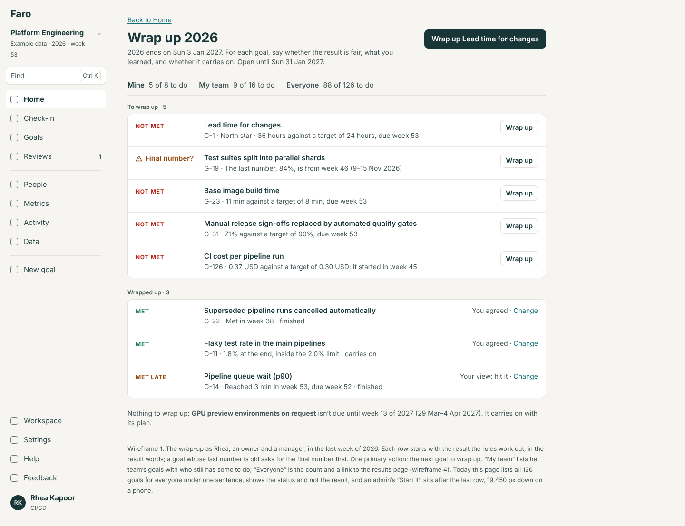
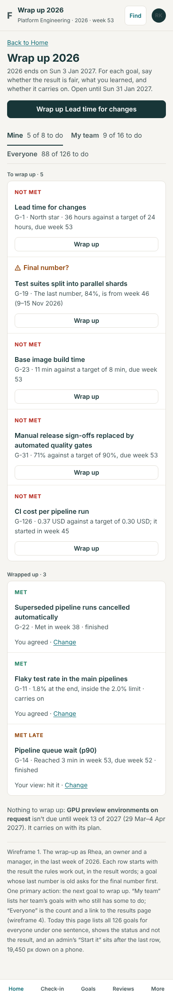

**2. One goal's result:** (a) not met, and the owner sees it differently; (b) the final number asked first; (c) a goal that met its target; (d) what must be fixed.
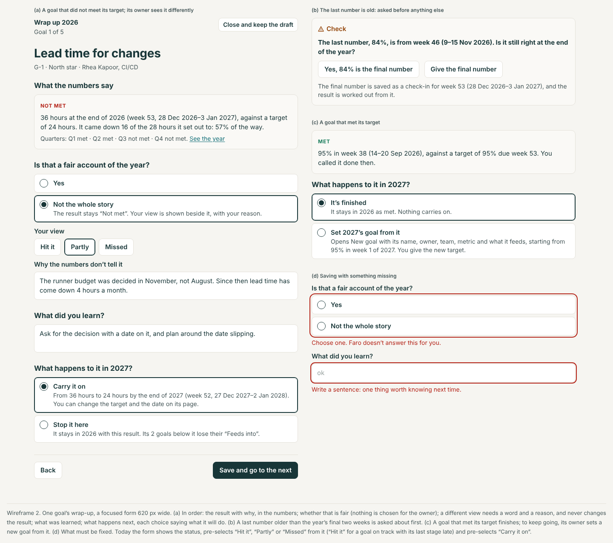
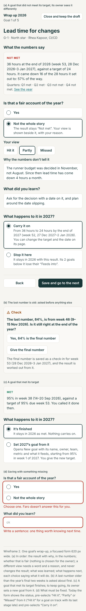

**3. A quarter closing on a goal's page.**
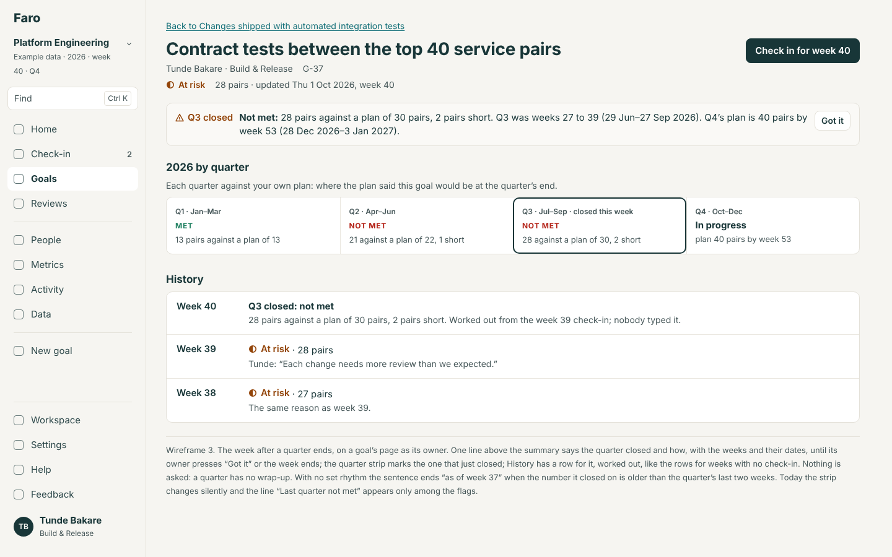
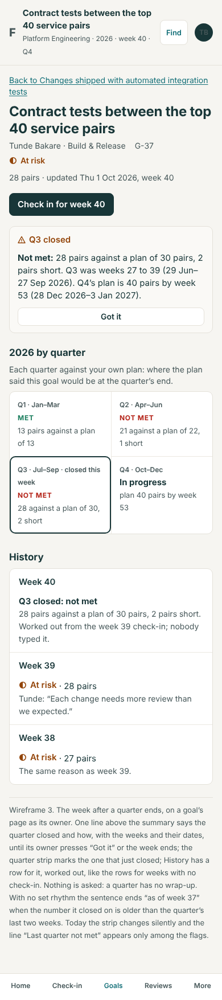

**4. The leader's results.**
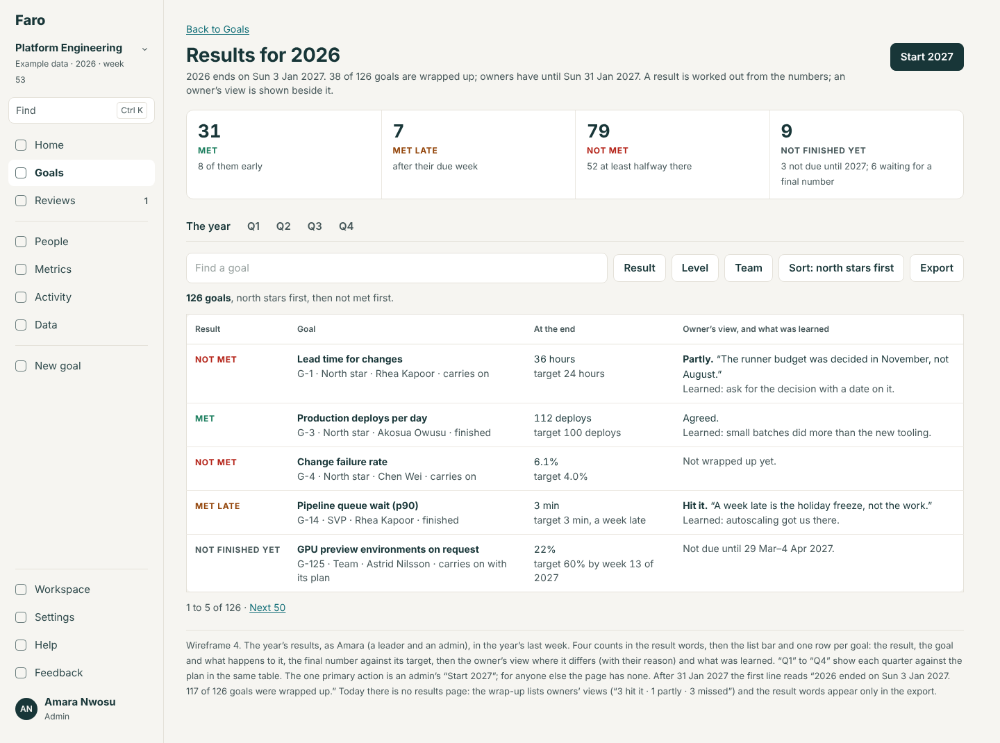
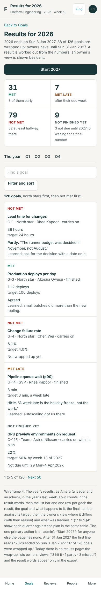

**5. "Start 2027" with its read-back, and afterwards.**
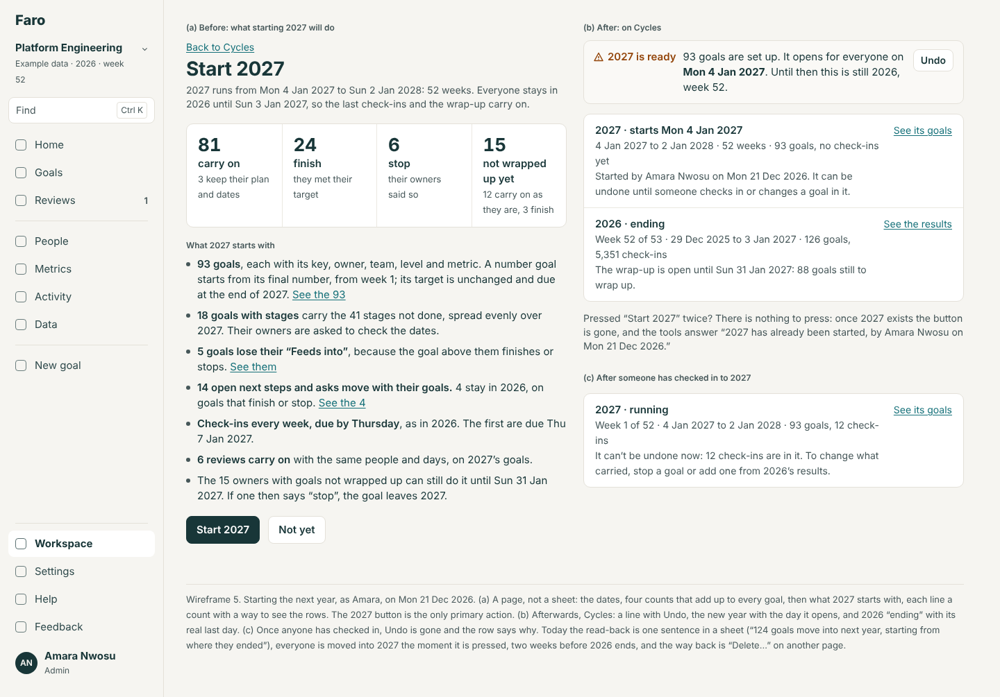
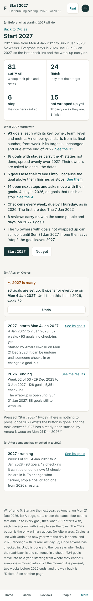

**6. A carried goal's page on day one.**
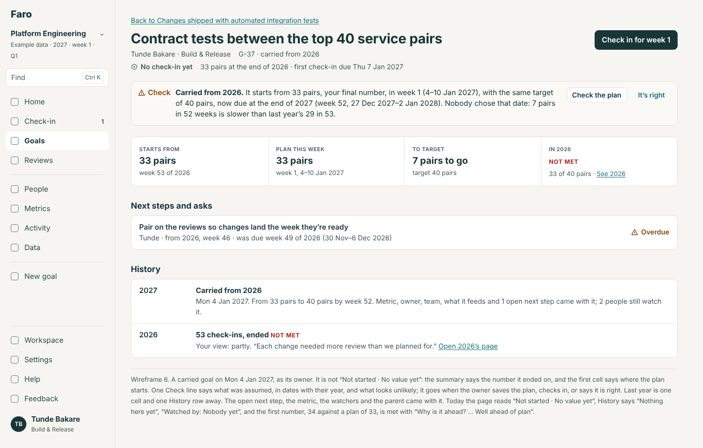
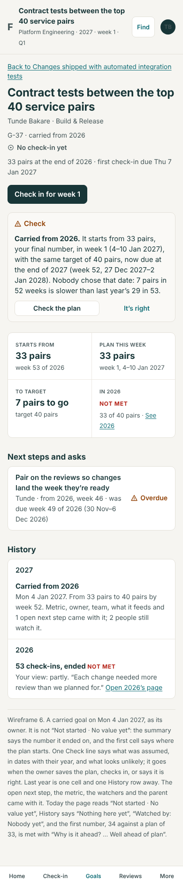

**7. Last year's goals.**
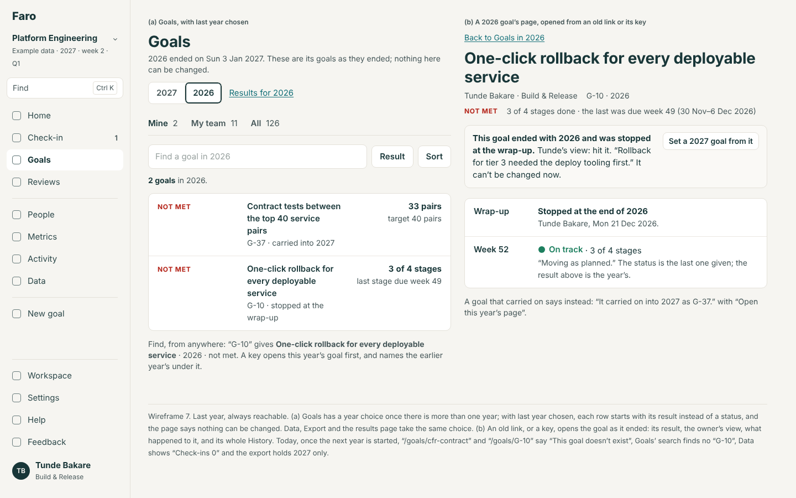
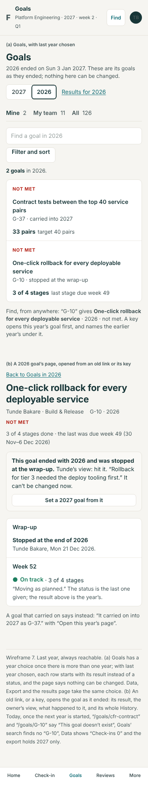

**8. Home's rows at the year's end, four ways.**
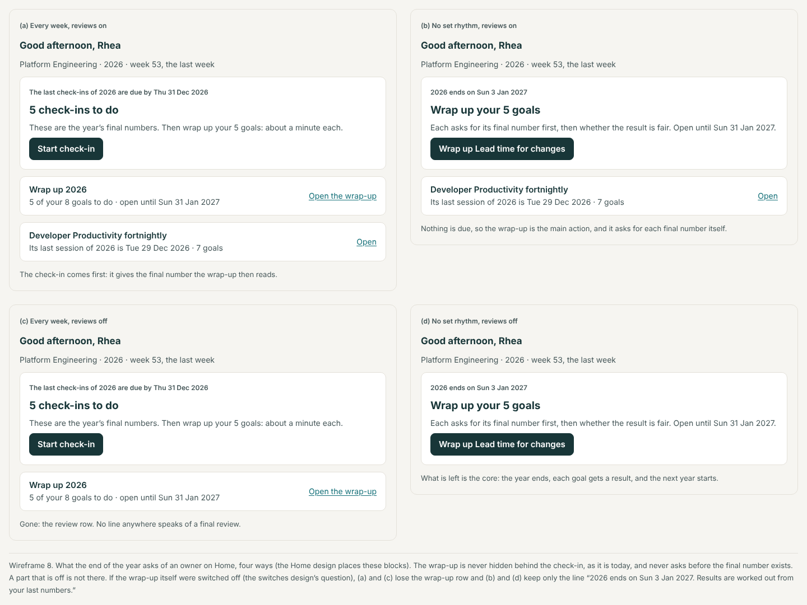
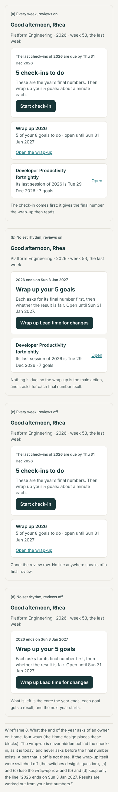

## What this changes in rounds 1 and 2

| Where | Was | Becomes |
|---|---|---|
| Workspace spec 2.6, Cycles | "{name} · over"; "Wrap it up" → `/retro`; "Start the next cycle" only after every goal is wrapped up; "See its goals → `/goals?cycle=<id>` if Goals takes it"; "Delete…" | The four states with dates; "Open the wrap-up" → `/wrap-up`; "Start {next}" from the day the wrap-up opens → `/workspace/cycles/next`; "See its goals" → `/goals?year=<name>`, built; "Undo" for a year started from the wrap-up ("Delete…" stays for a cycle made any other way) |
| Workspace spec rule 6, `yearLine` | "The wrap-up opens on {date}." / "The wrap-up is open: {n} goals still to wrap up." | Adds the last day and the closing date: "…open until Sun 31 Jan 2027: 88 goals still to wrap up."; adds "2026 ended on Sun 3 Jan 2027." and "2027 starts Mon 4 Jan 2027." The first conformance row's dates change to week 1's Monday and the last Sunday |
| Goal entry 2.11 and rule 11 (GE8) | The carried line, two sentences; goes on "It’s right" | Kept, with dates and their year, the reason the plan may be wrong, and "without a wrap-up" where true. GE8 is built as CY6 (or CY6 takes it over) |
| Goal entry rule 13, last bullet (GE9) | "A number goal that restarts from its last number takes `fromWeek: 0`" | Confirmed by the walk (Y4) and moved into rule 5 here with the other four carry faults. GE9 keeps its other parts |
| Goal entry decision 11 | A stage is due within this goal year "until carrying over is reworked" | Carrying over is reworked here, but stages still spread evenly: allowing a stage next year stays a later decision |
| Goal entry 2.6, the edit page | "The cycle has ended. A goal carried into {next} is changed there." | The same line, on a past year's goal, with "Open this year’s page" |
| Set-up rule S8, ST10 | "A spike first on how the app reads before a cycle’s week 1" | The spike is done (Y10); rule 4 here is the answer. ST10 depends on CY2 |
| Feature toggles 1.1 | `startNextCycle` copies `checkInWeeks` and sets `rhythmFrom` to the new cycle's start | `rhythmFrom` is week 1's Monday of the new year (the start date is week 0) |
| Round 1, Goals spec | Tabs, list bar, address | Adds `year=` to the address and the year choice above the tabs when there is more than one year |
| Round 1, goal spec (GT1), History | Weeks with no check-in are worked-out rows | Two more worked-out rows: "Q3 closed" and "2026: 53 check-ins, ended …" |
| Round 1, Find (FS1) | A key finds a goal | A key finds this year's goal, then earlier years' under it |
| Import spec, the field table | Results sheet: Result, Q1–Q4 | Adds four worked-out columns: Owner's view, Why, Learned, Next year |
| Navigation spec | `/retro` in the form list | `/wrap-up/<goal>` is the form; `/retro…` redirects |
| `docs/design-rules.md` line 35 | "Completed, Completed late, Did not meet" | Should read "Met, Met late, Not met" (a docs fix for the build; not edited here) |

Round 2's shared decisions are used as they are: three levels (the final number and a carried plan are Checks), see it before it is saved (the read-back), everything can be taken back (Undo), off means absent, weeks with dates and year.

## Decisions for Lane

One batch; the recommended answer is first. The spec's section 10 says what changes for each other answer.

1. **When does everyone move into the new year?**
   - (a) On the old year's last day; starting it earlier only prepares it. *Recommended.*
   - (b) When the admin presses, but never before the old year's last week, and last year stays reachable.
   - (c) As today: at once.
2. **Whose word is the result?**
   - (a) The rules'. The owner says whether it is fair; a different view sits beside it with a reason. *Recommended: it is the vocabulary's rule today.*
   - (b) The owner may change the result itself, with a reason.
   - (c) As today: the owner's view only, pre-selected.
3. **A goal that met its target.**
   - (a) It finishes; "Set 2027’s goal from it" makes a new goal. *Recommended.*
   - (b) It carries on and its owner must give a new target before the first check-in.
   - (c) As today: carried as it is.
4. **A goal nobody wrapped up.**
   - (a) It follows the rule (carries on if not met, finishes if met), said in the read-back and on its page; its owner can still wrap it up for four weeks. *Recommended.*
   - (b) The next year can't start until every goal is wrapped up.
   - (c) It stops.
5. **How long the wrap-up stays open after the year ends.**
   - (a) Four weeks. *Recommended.*
   - (b) Until an admin closes it.
   - (c) It closes on the last day.
6. **What comes across with a carried goal.**
   - (a) Its metric, watchers, open next steps and asks, and place in reviews; last year's History one row away. *Recommended.*
   - (b) The same, without the open next steps and asks (they stay with last year).
   - (c) As today: the goal alone.
7. **The owner's reason for a different view.**
   - (a) Its own field, one new column on `okr_retros`. *Recommended.*
   - (b) No migration: the reason is written at the start of "what was learned".
8. **A quarter closing.**
   - (a) Said once on the goal's page and in History; nothing asked. *Recommended.*
   - (b) Also a line on Home for a week.
   - (c) As today: silent.
9. **How much to build.**
   - (a) CY1 to CY4 first (the year ends, the start prepares, last year reachable, the carry rule): they fix what loses work. Then CY5 to CY7. *Recommended.*
   - (b) All of it before January.
   - (c) Only CY1 and CY4 now, as fixes.

## What was not covered

- Nothing was timed. The walk used the example with five check-ins and one plan added by hand in the browser; the example's other goals had no number after week 46, so most suggestions seen were for goals with no recent update.
- Hand-set plan numbers surviving a carry (Y4, last row) and the quarter judged on an old number (Y15) were read from the code, not seen.
- The real app (`/?store=browser`) and the AI tools were not run; `wrap_up_goal` and `start_next_cycle` were read from `src/mcp/workTools.ts`.
- A cycle shorter than a year, and a goal year starting in a month other than January, were not walked; the rules are written for both.
- "No set rhythm" and "Reviews off" are not built, so those halves of the four ways are drawn from the toggles design.
- Telling people the wrap-up has opened by message or digest is left to the platform (R5), as round 3 says.
