# More switches: which other features can be modules a workspace switches off

11 November 2026. Round 3 of the redesign (`docs/design/round-3/README.md`), area 5. Analysis, a recommendation and a design, in the manner of round 2's answer for Reviews and the rhythm (`docs/design/feature-toggles/README.md`), whose test, read-back, "switched off" address line and Features page are reused here, not reinvented. Nothing here is built, and no app code was changed. The build spec is [spec.md](spec.md).

## The answer in eight lines

1. **Five more switches, and no more.** Watching, AI access, Feedback (with markup), the Goal map and the Wrap-up. With round 2's Reviews and the two modules that exist (Metric library, Spreadsheets), a workspace has eight.
2. **Two are worth doing now, behind an honest switch:** AI access (a company's security team asks for it first, and it is a day's work) and Watching (it is what round 2's Reviews switch quietly leans on).
3. **Two are real moves with no half step:** Feedback, which the architecture page already names as next and which lives mostly in one folder, and the Goal map, which owns no records.
4. **One waits:** the Wrap-up. One core rule reads its records today (`nextCycle` reads each wrap-up's "carry on or stop"), and the cycle-end area is redesigning it now.
5. **The forecast and "Getting worse" are core.** A flag that makes a goal need attention is a rule, and its two numbers go to the settings area.
6. **Asks stay core: confirmed.** `flagsFor` and `handledFor` read them. So do Activity, saved views, the Table, Board and History layouts, the one-pager and What's new, each for its own reason below.
7. **No module needs another.** Every `needs` is empty. The three places where one feature shows inside another are single links, hidden by one question the core answers.
8. **The smallest Faro is still Faro:** goals, check-ins, the status rules, asks and next steps, the change log. Ten menu rows, and a Home with one thing to do.

## The question as asked

> "Which other features of Faro can be isolated as modules that a workspace switches off?"

**The test** (round 3's shared decision 1): a feature can be switched off if no core rule reads its records. A number the rules turn on is a setting, not a switch. What stays core: goals, check-ins, the status rules, asks and next steps, the change log with undo.

Two more questions sort what the test lets through:

- **Would anyone switch it off?** A switch nobody uses is a row on a page and a CI job for nothing.
- **Does isolating it teach the team that copies Faro something the others don't?** If it only repeats the pattern, it goes late or not at all.

## How this was checked

- **The code**, by search and by reading: `src/core/module.ts`, `registry.ts`, `app.tsx`, `src/App.tsx`, the two `module.json` files, every file of `src/domain` named below, the screens, `src/mcp`, `server/mcp.ts`, `supabase/migrations`, `evals/requirements.json`, `evals/journeys.cjs`, `evals/run.mjs`, `evals/touches.cjs`, `.github/workflows/ci.yml`, `src/help/guide.ts`, `spec/`.
- **The demo**, walked at `/demo?today=2026-11-11` between 10:55 and 11:02 UTC on 11 Nov, as Amara (admin, leader), Rhea (manager, owner), Tunde (owner) and Oskar (watches, owns nothing), at 1440×900 and 390×844: Home, Goals (List, Board), Watching, a goal's page with every section open, Activity, People, Data, Workspace (About, Cycles, Access, Features, Privacy), Settings, Help, What's new, Feedback, the wrap-up and the research page. Requests to the database were blocked.
- **Counts.** "Files" are source files outside tests that name the feature's records or rules. Of 158 requirements, 69 journeys, 78 AI tools (by name, in seven tool files; round 2 said 82) and 27 tables.
- **Not run:** unit tests and evals (`node_modules` is not installed).

## Jobs, by role and how often

| Who | Job | How often |
|---|---|---|
| An admin setting up | Decide what this workspace uses. As little to decide as possible | Once |
| An admin later | Switch one thing off, knowing what it will do; switch it back | A few times a year |
| A security or platform owner (an admin here) | Stop AI tools acting in this workspace, at once, and see that it held | Rarely; urgently when it happens |
| Everyone else | Never meet a switch. See an app that has what the workspace uses and nothing that says what is missing | Every day |
| A person following an old link | Be told the thing exists and is off here, and who can change that | Rarely |
| The team copying Faro | See which parts are the product's spine and which can be left out, with a proof for each | Once, carefully |

## Findings

| Id | Level | Finding | Evidence |
|---|---|---|---|
| **S1** | High | **"The optional parts of Faro" lists two of the nine features the architecture names as modules.** Seven features' records are fields of the core's workspace: watches, reviews, wrap-ups, feedback, tokens, saved views, asks | Features says "The optional parts of Faro, for everyone here." above two rows (`src/screens/Workspace.tsx:368`; the demo). `Snapshot` in `src/domain/types.ts:330–354`. `docs/architecture.md:11` lists "reviews, asks, Watching, the goal map, markup and inbox, spreadsheets, observability" |
| **S2** | High | **An admin cannot stop AI tools acting in a workspace except by revoking tokens one at a time**, and revoking can't be undone. The server already knows which modules are off and refuses only a module's own tools | Workspace, Access: "MCP tokens" with a Revoke per row (`src/ui/AiAssistants.tsx:29`). `server/mcp.ts:113–136` loads `modulesOff`; `src/mcp/tools.ts:371` refuses "…is switched off in…" only for a tool that came from a module |
| **S3** | High | **A year can already be started with nothing wrapped up, and every goal carries, done ones included.** The rule defaults a goal with no wrap-up to "carry"; the action doesn't ask for wrap-ups; only the screen holds its button back | `src/domain/cycle.ts:120` (`?? 'carry'`); `startNextCycle` checks admin and the week only (`src/domain/actions.ts:302–305`); the button shows at `left === 0` (`src/screens/Workspace.tsx:282`); the `start_next_cycle` tool calls the action. Read from the code, not run. Handed to the cycle-end area |
| **S4** | Medium | **Round 2's Reviews switch leans on Watching without saying so.** With Reviews off a leader's one action becomes "20 goals you watch need attention". With Watching off as well it would lead nowhere | `docs/design/feature-toggles/spec.md` 4.4, "Leader's lead". Amara owns no goal; her Home is "All goals · 126", "Platform leadership weekly · 20 goals to discuss · Open the review", "Goals you watch 56" |
| **S5** | Medium | **Someone who owns nothing is told to use Watching as their one way in.** Oskar's Home: "You don't own a goal. Watch the ones you care about, or set one up in about 3 minutes." with "Find goals to watch" | `src/screens/Home.tsx:152`; the demo as Oskar. Day one's row "Watch the goals you care about, and they'll show here." (`src/domain/dayOne.ts:97`) |
| **S6** | Medium | **Watching's rules are filed under reviews and read in 36 files**, and the Goals page's tabs, a goal's plain button, About's "who watches it", Activity's filter, the bulk bar, a person's sheet and `get_my_work` each name it directly | `src/domain/review.ts:32–53`, `:304`; `src/domain/goalsPage.ts:12`, `:47`, `:50`; `src/domain/goalPage.ts:158–166`; `src/screens/GoalScreen.tsx:945`, `:1042–1047`; `src/domain/activity.ts:31`; `src/screens/BulkEdit.tsx:28`; `src/ui/ProfileSheet.tsx:11`; `src/mcp/workTools.ts:126–157` |
| **S7** | Medium | **Feedback sits in the menu group "This workspace and you" and is neither.** It says so itself: "From every workspace and the demo." A workspace cannot opt out, and its own copy of what people sent rides in the workspace's records | `src/domain/navigation.ts:24`, `:31`; `src/screens/Feedback.tsx:25`; `Snapshot.feedback` (`types.ts:342`) |
| **S8** | Medium | **A module cannot add four things the candidates need:** a button on a goal's bar, a tab on Goals, a menu row in the last group, or anything that lies over every page. "Settings" is listed as an extension point and has no place | `goalPage.ts:158–166` (Watch); `goalsPage.ts:47` (the tab); `ModuleNav.group` is `work` or `lookup` (`src/core/app.tsx:66`); the markup layer and its key in the shell (`src/ui/Shell.tsx:28`, `:167`, `:364`); `docs/architecture.md:10` against `PLACES` (`src/core/module.ts`) |
| **S9** | Medium | **The quick gate thins as modules leave, and nothing proves two off at once.** Its six journeys include the review and a Watching journey; "without reviews" would run four | `SMOKE_JOURNEYS = ['U1','U2','U3','U5','U16','U33']` (`evals/run.mjs:37`); U3 is the weekly review, U16 lists `WATCHING`. One job per module (`.github/workflows/ci.yml:76–87`) |
| **S10** | Medium | **`needs` describes no real dependency.** Both manifests leave it empty; the architecture's own example, "reviews need asks", stopped being true when asks became core. The dependencies that do exist are links from one feature's screen into another's, which `needs` can't say | `docs/architecture.md:18`; "Connect Claude" makes a token from inside the inbox (`src/markup/Connect.tsx:64`); round 2's MT7 (the Metrics sheet in Spreadsheets) |
| **S11** | Medium | **The forecast is one rule, two bare numbers and a flag that makes a goal need attention.** It can't be switched without changing what "On track" means, and neither number can be set | `PROJECTION_WEEKS = 8` (`src/domain/plan.ts:109`); `TREND_SPAN = 3` (`src/domain/thresholds.ts:15`); "On track today, but the recent trend heads for…" (`src/domain/trend.ts:93`) raised as `trend` (`src/domain/attention.ts:80–81`), one of the eight flags that need attention (`vocabulary.ts:149`) |
| **S12** | Low | **Something saved can point at a feature that is gone, and only one case is handled.** A saved view with the Map layout, a link to `/watching`, Activity's `?watching=` | Only a removed layout is caught, with a note (`src/screens/GoalsScreen.tsx:75`) |
| **S13** | Low | **The Map is a layout, not a page, so a manifest can't describe it.** `routes` would be empty; nothing says "a way of looking at Goals" | `LAYOUTS` (`src/screens/GoalViews.tsx:16`); `?view=map` |
| **S14** | Low | **Recording is a workspace switch that lives on another page with its own action and tool.** That is right (it is about privacy, and it asks before it goes on), but Features never mentions it | `setRecording`, `setModule` (`src/domain/actions.ts:410`, `:421`); `set_recording`, `set_feature` |
| **S15** | Low | **A walkthrough can name its module, and the Map's doesn't** | `Tour.module` (`src/app/tours.ts:27`); the `map` tour at `:62` has none |

## 1. Each candidate

Effort: **S** under a day, **M** a release, **S–M** between, **L** more than one. "(i)" is an honest switch with the debt declared in `module.json` `elsewhere`, as round 2's FT2 does for Reviews; "(ii)" is the real move into `src/modules/<id>/`.

### 1.1 The verdicts

| Candidate | Core rule reads its records? | Verdict | (i) | (ii) | Teaches something new? |
|---|---|---|---|---|---|
| **Watching** | No | **Switch now** (i), move after the records extension point | S–M | M | Yes: a per-person record, and a tab on a core list declared as data |
| **AI access** (MCP) | No | **Switch now** (i), move later | S | S–M | Yes: a switch the server must enforce, and one that asks before it comes back on |
| **Feedback and markup** | No | **Switch now, as the real move** | (S) | M | Partly: a module with its own ports and its own store, about nothing in the core |
| **The Goal map** | Owns none | **Switch later, as the real move** | — | S–M | No: Spreadsheets again, with a bigger screen |
| **The Wrap-up** | **Yes, one** (`nextCycle`) | **Switch later**, after cycle-end is rebuilt | S–M | M | A little: turning a read around so the core owns the decision |
| Forecasts, projections, "Getting worse" | Owns none; it *is* a rule | **Core, with two settings** | | | |
| Asks | **Yes** | **Core** (round 2 confirmed) | | | |
| Activity | It is the change log | **Core** | | | |
| Saved views | No | **Core** (part of Goals) | | | |
| Table, Board, History | Own none | **Core** | | | |
| Print, the one-pager | Owns none | **Core** | | | |
| The demo, walkthroughs, the research page | Not a workspace's | **Not a switch**: the deployment's | | | |
| Recording (telemetry) | No | **Stays a setting on Privacy** | | | |
| What's new | Not a workspace's | **Core Help** | | | |

### 1.2 Watching

**What it is today.** 36 files; six rules in `src/domain/review.ts` (`watchScope`, `watchedGoals`, `watchOf`, `coveringWatches`, with `treeOf` and `goalsIn` shared with reviews) and two actions (`watch`, `unwatch`, `actions.ts:244–262`); one screen file (`src/screens/Watching.tsx`, 160 lines) and one route (`/watching`); three AI tools (`list_watching`, `watch`, `unwatch`) and part of `get_my_work`; one table (`okr_watches`, migration 0006); requirements `WATCHING`, `ONE-WATCHING` and one more in the area, 17 that mention it; six journeys (U7, U8, U9, U16, U31, U80); one Help article; the `quiet` walkthrough starts at `/watching`.

**What reads its records from the core.** No status or attention rule. These do:

| Where | What | 
|---|---|
| `home.ts:77–83` | Home's "Goals you watch" block and its count line |
| `goalsPage.ts:47`, `:50` | The Watching tab, and Goals opening on it for someone who owns nothing |
| `goalPage.ts:158–166`, `ui/goalRows.tsx:171–219` | The plain button on a goal's bar, and its sheet |
| `GoalScreen.tsx:945`, `:1042–1047` | "Watched by" in About, and who a comment reaches |
| `activity.ts:31` | Activity's "in goals I watch" |
| `dayOne.ts:97`, `Home.tsx:152` | The first-week row and the non-owner's lead |
| `BulkEdit.tsx:28`, `ProfileSheet.tsx:11` | "Watch" for selected goals; "watches 12" on a person |
| `removal.ts`, `cycle.ts:53`, `rows.ts`, both adapters, `export.ts:115` | Keeping, removing, restoring and scoping the records |

**Faro without it, by person.**

| | Today | Watching off |
|---|---|---|
| **Amara** (owns nothing, watches 56) | Home: "Goals you watch 56 · 20 need attention". Goals opens on tabs My team 1 · Watching 56 · All 126 | No block. Tabs My team 1 · All 126. Her lead is the review's while Reviews is on; with Reviews off, "41 goals need attention · See them" (all goals) |
| **Rhea** (owns 8, watches 12) | Home ends with "Goals you watch 12 · 5 need attention" | Home ends after "Your goals". Tabs Mine 8 · My team 17 · All 126 |
| **Tunde** (owner) | The same shape as Rhea | The same |
| **Oskar** (owns nothing, watches 3) | Home: "You don't own a goal. Watch the ones you care about…", "Find goals to watch", then "Goals you watch 3" | "You don't own a goal. Set one up in about 3 minutes." with **See all goals** and "Set up a goal". Goals opens on All |
| Everyone, a goal's page | "Watch" or "Watching" beside the main button; About says "…and who watches it" with "Watched by" | Neither. Wireframe 5 |
| Everyone, elsewhere | "Watch" in the bulk bar; "watches 12" on a person; Activity's filter; Help's "Watching goals" | None of them |

**Is it worth a switch?** Yes. A small workspace where everyone owns goals has no use for it, and it is the piece a company replaces first: following a goal is notification, which the internal platform provides (R5). Isolating it shows the rebuild exactly what to swap.

**What moves, and what it needs.**

| Needed | For | New? |
|---|---|---|
| The records extension point | `Snapshot.watches`, the store, both adapters, removal, scoping | AS part 2 (planned, held) |
| `home.blocks` | "Goals you watch" | Exists |
| `home.lead` | The non-owner's lead ("Goals you watch · 20 need attention") | FT3's, reused |
| **A filter shown as a tab** | The Watching tab on Goals | **Widens `filters`** (AR2): one more field, `tab: true`, on a filter already declared as data |
| **`goal.actions`** | The plain button on a goal's bar | **New place.** Given the goal and whether the viewer owns it. Second user: the Wrap-up ("Wrap up this goal") |
| `goal.facts` | "Watched by Amara and 4 more" | Exists; the line leaves About |
| `people.person` | "Watches 12 goals" | Exists |
| `goals.tools` | "Watch these 12 goals" for what is shown | Exists; replaces the bulk bar's button |
| Activity's "in goals I watch" | | **Not added.** The block's own "what changed this week" keeps the job; Activity keeps its goal, tree, team and level filters |
| A row in day one | | **Not added.** The block's empty state says the same |

`needs`: none. Watching does not need Reviews, and Reviews does not need Watching: both use the tree rules (`treeOf`, `goalsIn`), which are the core's and go to `src/domain/scope.ts`.

**Risk.** Low to medium. Home and Goals' tabs are on the talk's path, and U16 is in the quick gate.

### 1.3 AI access (MCP)

**What it is today.** The server (`server/mcp.ts`, `api/mcp.js`), the protocol and the tool files in `src/mcp` (12 files), and the tokens: `ApiToken` in 14 files, two actions (`createToken`, `revokeToken`, `actions.ts:368–390`), one component file with three views (`src/ui/AiAssistants.tsx`, 118 lines: Workspace → Access, Settings, a person's sheet), three tools (`list_tokens`, `create_token`, `revoke_token`), one table (`okr_api_tokens`, 0010), five requirements (`MCP-TOKENS`, `MCP-PARITY`, `TOKENS-SERVER-ONLY`, `MCP-PICTURES`, `MCP-FEEDBACK`), two journeys (U22, U62), one Help article.

**What reads its records from the core.** Nothing in the rules. The store knows tokens specially (the secret is hashed on the way in: `src/data/store.ts:337`, `adapters/supabase/goalsStore.ts:129–157`, and the store's contract test).

**What the switch is.** Not the tools: every screen keeps its tools, and MCP parity stays a rule. The switch is the door. Off, the server answers any token of this workspace with one sentence and does nothing; the three token views are absent; the Help article is hidden.

**Faro without it.** Amara: Access is "Admins · 3" and nothing else. Rhea, Tunde, Oskar: Settings has no "Your MCP tokens". Feedback's "Connect Claude" link is absent. Changes already made by AI tools stay in Activity, marked "via MCP".

**Tokens while it is off.** Kept and not revoked: a revoked token can never come back (its secret is not stored), so revoking would break "nothing is deleted". That makes switching **on** the risky direction: it brings old tokens back to life. So this is the one switch that reads back before it comes on (wireframe 2b).

**What moves, and what it needs.** A Workspace section "AI access" after Access (`sections`: exists), a person's tokens in `people.person` (exists; your own are on your own page, so Settings loses its block and links there), the three tools, the Help article, the table. The server's check is one line beside the one that already loads `modulesOff`. No new place.

**Effort.** (i) S. (ii) S–M, after the records extension point learns "a record whose secret the store hashes".

**Risk.** Medium: it is the security path. An AI tool can switch it off with `set_feature` and cannot switch it back; the read-back says so.

**Default.** On in Faro, where the tools are a headline. For the internal app the default is the platform's call, written as a requirement.

### 1.4 Feedback and markup

**What it is today.** `src/markup/` (11 source files, about 2,500 lines with tests), `src/screens/Feedback.tsx`, two tool files (`markupTools.ts`, `feedbackTools.ts`: seven tools, and `send_feedback` in the core's file), two ports (`MarkupStore`, `FeedbackStore`), three adapter files, the shell's sheet, layer and key (`Shell.tsx:82–110`, `:167`, `:364`), Help's "What you raised" (`Help.tsx:134`), four tables (`okr_markups`, `okr_markup_ids` and `okr_builders` from migration 0024, `okr_feedback` from 0007) and a pictures bucket, eight requirements (the area "Feedback"), seven journeys (U40–U42, U47, U51–U53), two Help articles. 42 files name markup.

**What reads its records from the core.** Nothing. It reads the core in four places (who is viewing, the page's address, Help's articles, What's new).

**Does markup need the inbox?** They are one feature with two ends: sending (a mood and a few words, or a marked-up picture of the screen) and reading (the inbox, its statuses, the AI tools that work it). The sheet that sends offers the markup; the inbox shows both. Splitting them would give two switches where no workspace wants one without the other. **One module, `feedback`, named "Feedback".**

**Faro without it.** For all four people: the menu's last group is Workspace, Settings, Help. No "Send feedback", no "Mark up this screen", Ctrl+Shift+M does nothing. Help has no "What you raised". What people here already sent stays in the builders' inbox, which was never this workspace's.

**What it needs.**

| Needed | For | New? |
|---|---|---|
| A menu row in the last group | "Feedback" | **Widens `ModuleNav.group`** with `you` |
| **`shell.layer`** | The sheet and the markup, which lie over whatever page is open, and the key | **New place.** Given the address. One user now; the price of taking the feature out of the shell |
| Routes, tools, Help | | Exist |
| Its own ports | `MarkupStore`, `FeedbackStore` move into the folder with their contracts | No new mechanism: a module may own a port. The layers lint gains "only `src/adapters` and the module import it" |

`needs`: none. "Connect Claude" becomes a link shown only while AI access is on.

**Effort.** One step, M. It is "markup first" in the architecture's own order and needs nothing that is held: its records were never in the core's store. An honest half step would save little.

**Risk.** Medium: three adapters, the server and a storage bucket move files; no rule changes.

**For the rebuild.** The company will have its own way to hear about its app. A folder that deletes cleanly is the whole lesson, and the research page (`/research`, `okr_research_notes`) travels in the same folder, since it serves the same people.

### 1.5 The Goal map

**What it is today.** `src/screens/GoalMap.tsx` (442 lines, loaded only when opened) and the drawing half of `src/domain/map.ts` (`layout`, `layoutIndented`, `pack`, `edges`, `bounds`, `shownOnMap`, `findOnMap`, `threatReason`); one of five layouts on Goals (`?view=map`); no route, no table, no AI tool; requirement `GOAL-MAP`; journeys U26, U30, U34 and check F6; one Help article; the `map` walkthrough; the spec's `map.md`. Seven files.

**What stays core from the same file.** The roll-up and the tree (`rollup`, `rollupText`, `ROLLUP_ORDER`, `criticalPath`, `withAncestors`, `above`, `under`, `troubled`): Goals' tree headers and a goal's page use them (`ui/goalRows.tsx:14`, `GoalScreen.tsx:20`, `GoalsScreen.tsx:36`).

**Faro without it.** Goals' layout control has four choices. A saved view or link with `view=map` opens the List and says so once.

**What it needs.** No new place. The module adds a route of its own, `/goals/map`, that takes the same address parameters as Goals and uses the core's list bar; its way in is a "Map" control in `goals.tools`, which exists and sits after the layouts. That answers S13: the Map becomes a page, which is what the design rules already call it ("the map gets the whole work area").

**Effort.** (ii) only, S–M. **Risk.** Low. **Teaches** nothing the Spreadsheets module doesn't. It goes late, and it is the first to drop if the list must be cut.

### 1.6 The Wrap-up, and what must stay so a year can end

**What it is today.** `src/screens/Retro.tsx` (188 lines), two routes (`/retro`, `/retro/:goalId`), one action (`saveRetro`), two tools (`get_wrap_up`, `wrap_up_goal`), one table (`okr_retros`, 0007), requirement `RETRO`, journey U10, one Help article, one named flow. 26 files name it.

**What stays core, whatever is switched.**

| Stays core | Why |
|---|---|
| Results: Met, Met late, Not met; each quarter's result | Worked out from the plan and the check-ins (`story.ts:33`, `year.ts:74`). No wrap-up is read |
| The year's dates, and when it ends | The cycle's |
| **Starting the next year**, and what carries into it | `startNextCycle`, `nextCycle`. An admin's act, on Cycles |
| **Carry on or stop**, for each goal | A year can't end without it. Today it is a field of the wrap-up; it must be the core's |
| Stopping a goal, with a reason | `stopGoal` (`removal.ts:276`) |

**What is optional:** the owner's own account. How it landed in their words ("Hit it", "Partly", "Missed", always shown as their view), one thing learned, and the screens that collect them.

**The tangle.** `nextCycle` reads `retro.next` (`cycle.ts:120`). Under the test that is a core rule reading the feature's records, so it can't be switched yet. The fix turns the read around: `nextCycle` takes the goals not to carry; the wrap-up, while on, is one of two places that choice is made (the other is "Stop this goal").

**Faro without it.** In the year's last two weeks: Home has no "Start the wrap-up"; Goals has no "Wrap up" button; Cycles says "The year ends on 27 Dec 2026." and, for an admin, offers **Start 2027** with a read-back: how many goals carry on, how many are done or stopped and don't. Results are on every goal as today.

**Verdict.** Switch later, after the cycle-end area's build (it owns these screens and S3). Default on.

### 1.7 Forecasts, projections and "Getting worse"

It owns no records: it is arithmetic over check-ins. It shows as the scorecard's "Will it hit 3.0?", the chart's range, the tree header's "On its recent trend it ends at about 37 hours…", the `trend` flag, and columns in the export and `get_goal`.

**Not a switch**, for two reasons. The `trend` flag is one of the eight that make a goal need attention, and "On track" is defined with it ("If the recent trend says it will still finish short, it is flagged as getting worse": `vocabulary.ts:48`). Switch it off and the same goal means something else. And there is nothing to keep in the record: off would be a blindfold, not a feature put away.

**It is core, with settings.** Handed to the settings area (section 6).

### 1.8 Asks: core, confirmed

Round 2 said core because "Being handled" needs them. The code agrees twice over:

- **A flag reads them.** An open decision or help raises `decision`, "Waiting on…", whatever the goal's status (`attention.ts:76–77`, `asks.ts:46`).
- **"Being handled" reads them.** An agreed next step with an owner and a week, or an answered request (`attention.ts:127–137`, `:149`).
- **A check-in writes them** ("What do you need?": `asks.ts:136`).

56 files, 41 of 158 requirements, 14 of 69 journeys. It is the spine, not a limb.

### 1.9 The rest, briefly

| Candidate | Verdict | Reason |
|---|---|---|
| **Activity** | Core | It is the change log's page, and where Undo for older changes lives. Three files |
| **Saved views** | Core | No rule reads them, so the test passes; the other two questions fail. Unused, they are already absent (no rows under Goals). Nobody would switch them off, and the menu's own rule reads them (`navigation.ts`, `menuViews`). 25 files for no gain |
| **Table, Board, History** | Core | They are how Goals is read. Which layouts to offer is taste, and Lane has already cut one (Cards) for everyone |
| **Print and the one-pager** | Core | Two files and one menu item. A review's print goes with Reviews (FT3) |
| **The demo and walkthroughs** | Not a workspace's switch | The demo is a way the app is started (`mode === 'demo'`), not something a workspace holds. Walkthroughs already follow their module (`Tour.module`). Whether the internal app ships an example is a line in the handover, not a switch |
| **The research page** | Not a switch | For people testing Faro. It goes in the Feedback folder when that moves |
| **Recording** | Stays on Privacy | Already a workspace setting with its own action, wording and consent step. Features links to it (S14). Observability itself is the platform's (CLAUDE.md), so it is not made a module |
| **What's new** | Core Help | It is Faro's news, the same for every workspace. Whether Home shows its line is a personal choice at most, and not worth a control |
| The Motion lab (Settings) | Not a candidate | "Purely for fun", per person, already off |

## 2. The dependency picture

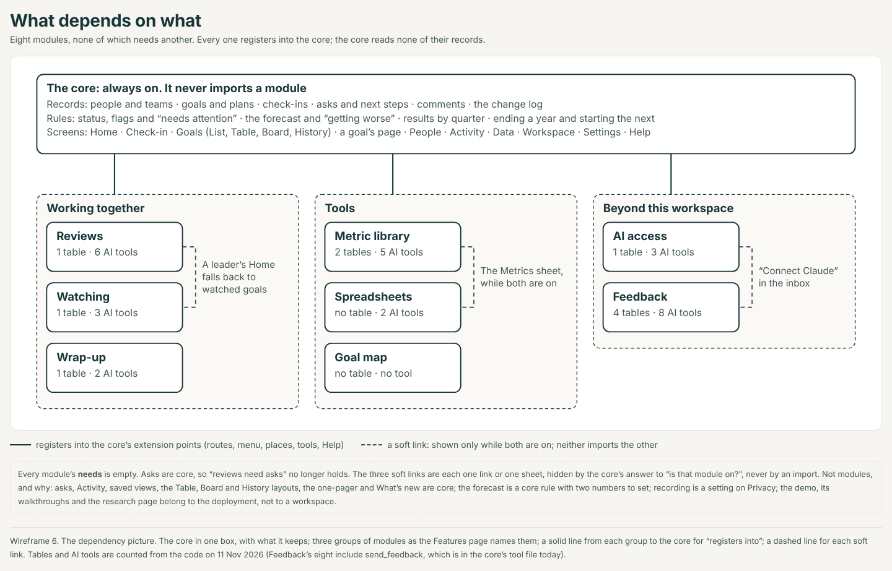
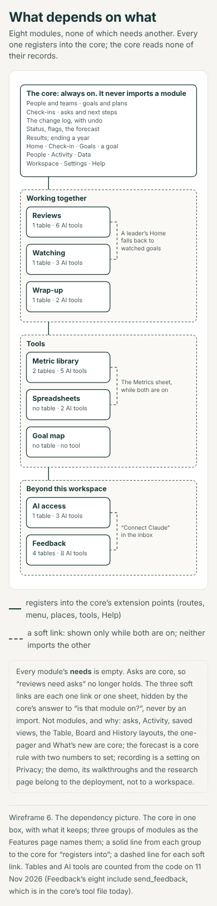

- **`needs` is empty for all eight.** None imports another, and the layers lint already forbids it.
- **Three soft links**, each one link or one sheet shown only while the other module is on:
  - Reviews → Watching: with Reviews on, a leader's lead is the review's; without it, the watched goals'; without both, the core's.
  - Spreadsheets → Metric library: the Metrics sheet (round 2's MT7).
  - Feedback → AI access: "Connect Claude".
- **How a soft link is built.** One small core component, `ModuleLink` (given a module's id): it draws its children only while that module is on. It is not an extension point and not an import. The first link above needs nothing: `home.lead` shows the first module that has something, in the order Reviews, Watching, then the core's own.

## 3. The design

Exact wording, states and rules are in [spec.md](spec.md), section 4.

### 3.1 The Features page

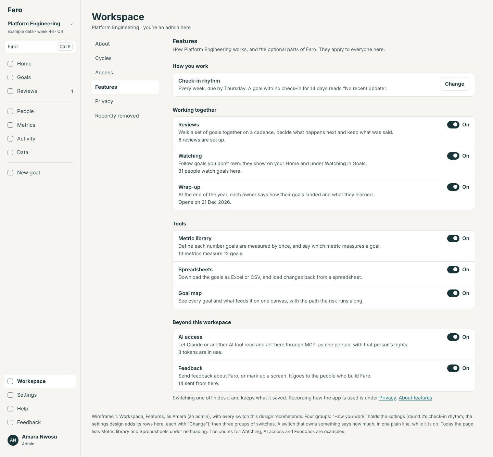
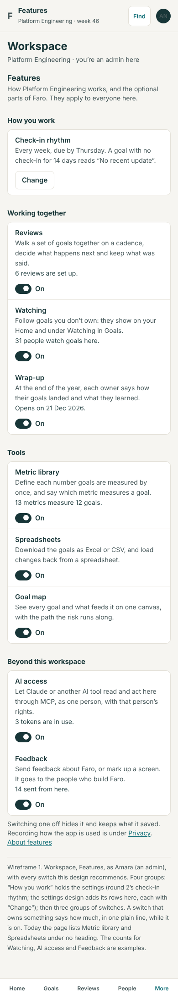

Four groups. The first is round 2's and the settings area's; the other three are switches.

| Group | Row | One sentence | While on, it says |
|---|---|---|---|
| **How you work** | Check-in rhythm, and the settings area's rows | (theirs) | What is set, with "Change" |
| **Working together** | Reviews | Walk a set of goals together on a cadence, decide what happens next and keep what was said. | "6 reviews are set up." |
| | Watching | Follow goals you don't own: they show on your Home and under Watching in Goals. | "31 people watch goals here." |
| | Wrap-up | At the end of the year, each owner says how their goals landed and what they learned. | "Opens on 21 Dec 2026." |
| **Tools** | Metric library | Define each number goals are measured by once, and say which metric measures a goal. | "13 metrics measure 12 goals." |
| | Spreadsheets | Download the goals as Excel or CSV, and load changes back from a spreadsheet. | |
| | Goal map | See every goal and what feeds it on one canvas, with the path the risk runs along. | |
| **Beyond this workspace** | AI access | Let Claude or another AI tool read and act here through MCP, as one person, with that person's rights. | "3 tokens are in use." |
| | Feedback | Send feedback about Faro, or mark up a screen. It goes to the people who build Faro. | "14 sent from here." |

Under the lists: "Switching one off hides it and keeps what it saved. Recording how the app is used is under Privacy. About features".

The page has no primary action until a sheet is open. A group with no installed module is not drawn.

### 3.2 What switching off says first, and what stays in the record

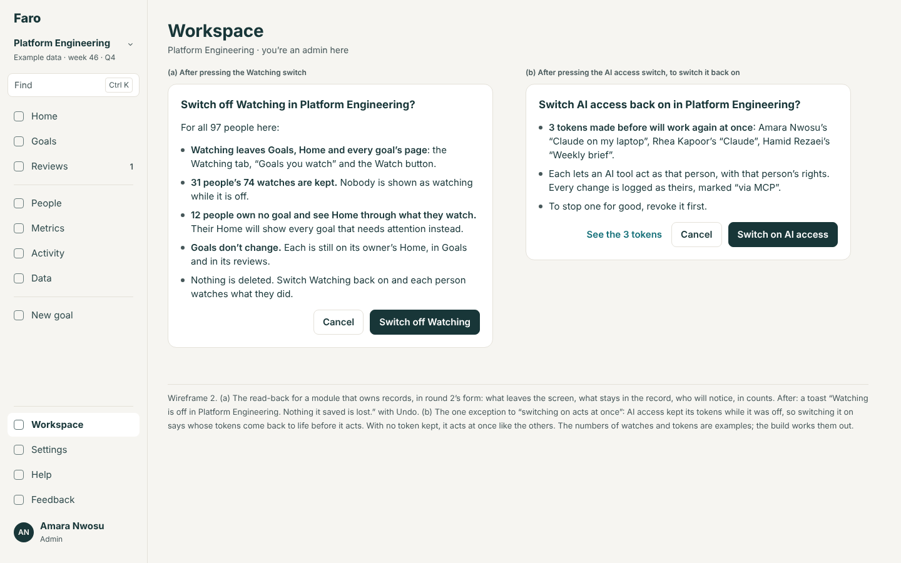
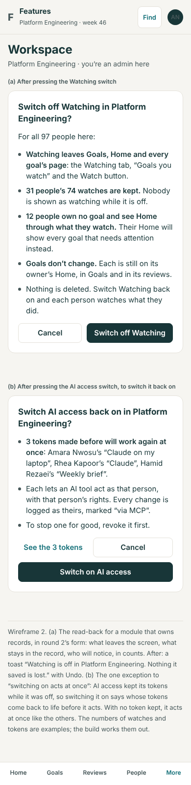

Round 2's rule stands: a module that owns records asks before it goes off; one that owns none acts at once; each ends in a toast with Undo.

| Switch | Says first (each line only when its count is above zero) | Stays in the record |
|---|---|---|
| **Watching** | Leaves Goals, Home and every goal's page. "31 people's 74 watches are kept." "12 people own no goal and see Home through what they watch. Their Home will show every goal that needs attention instead." | Every watch, for when it comes back |
| **AI access** | "3 tokens stop working at once", with whose. "They are kept, not revoked. To end one for good, revoke it first." "AI tools can't switch this back on; an admin does, here." | The tokens; every change already made, marked "via MCP" |
| **Feedback** | Leaves the menu, with "Send feedback" and "Mark up this screen". "14 things people here sent stay in the builders' inbox; 5 are still open." | Everything sent. The inbox was never this workspace's |
| **Wrap-up** | Leaves Home, Goals and Cycles. "41 wrap-ups already written stay in each goal's History." "6 goals were marked Stop at their wrap-up. That is not used while it is off: stop them from their own pages if they shouldn't carry on." "The year still ends: an admin starts 2027 from Cycles." | Every wrap-up, as written |
| **Goal map** | Nothing first (it owns nothing). The toast adds, when true: "2 saved views that opened the Map now open the List." | Nothing to keep |
| Reviews, Metric library, Spreadsheets | As rounds 1 and 2 have them | |

### 3.3 Defaults, and what set-up asks

- **A new workspace starts with every switch on**, Reviews by set-up's answer (round 2).
- **Set-up asks nothing more.** Its two questions stand: the rhythm, and reviews. Its last step gains one line: "Everything else optional is on. An admin can change that in Workspace, Features."
- **No "start simple" preset.** Three reasons:
  - **Most of these are quiet until used.** Watching shows nothing on Home until you watch; the Wrap-up shows nothing for fifty weeks; the Map is one control on Goals; Feedback is one menu row. The whole difference in the menu is three rows of thirteen.
  - **A preset is a third question about things nobody has seen yet**, and round 2 worked to get set-up down to two.
  - **A preset hides what it did.** Eight plain switches on one page, each saying what it does, are easier to trust than one word that flips some of them.

### 3.4 The smallest Faro

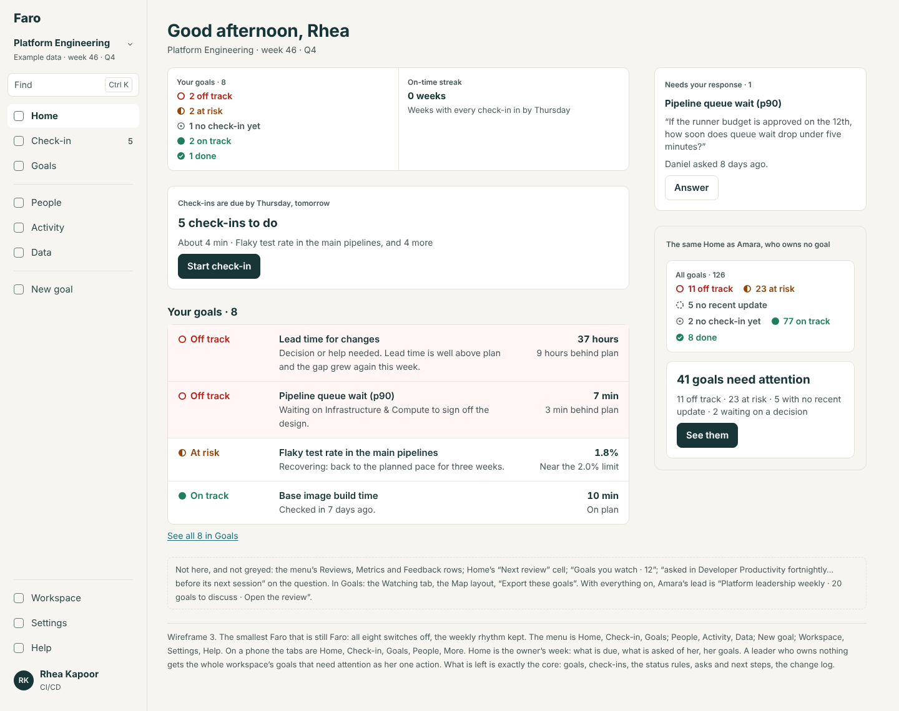
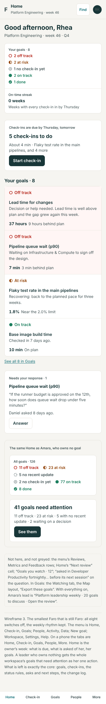

All eight off, the weekly rhythm kept (round 2's wireframe 3 shows Home with no set rhythm).

- **The menu:** Home, Check-in, Goals; People, Activity, Data; New goal; Workspace, Settings, Help. Ten rows.
- **The phone's tabs:** Home, Check-in, Goals, People, More for an owner; Home, Goals, People, Activity, More for anyone else (round 2's rule for Reviews off).
- **Home's one primary action:** an owner's check-ins. For someone who owns nothing: "41 goals need attention · See them". For someone who owns nothing in a workspace where nothing needs attention: "See all goals".
- **Goals:** tabs Mine, My team, All; layouts List, Table, Board, History; no Export.

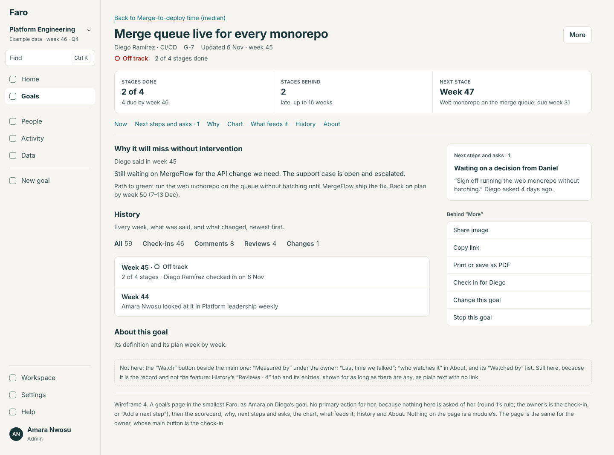
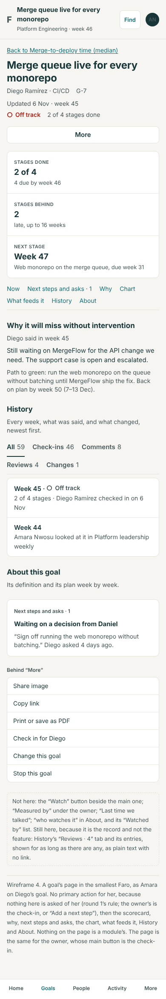

A goal's page keeps everything that is the goal's: its status, the scorecard, why, next steps and asks, the chart with its forecast, what feeds it, the year by quarter, History and About.

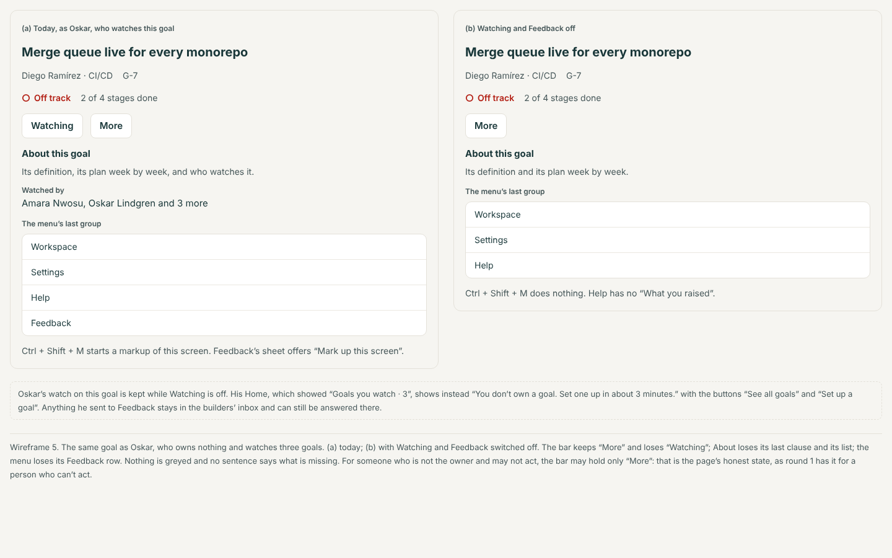
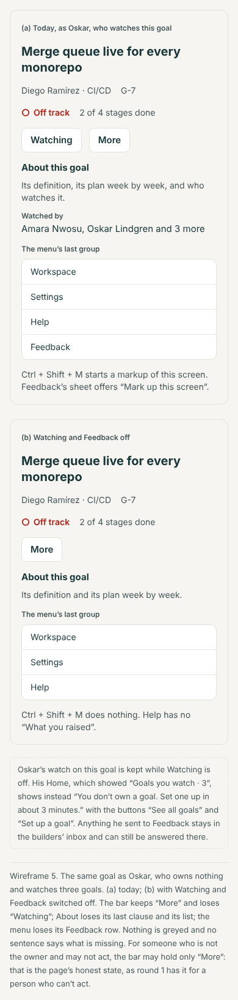

### 3.5 Switching back on

| Switch | What comes back | What does not happen |
|---|---|---|
| Watching | Each person watches what they did. A watch on a goal removed meanwhile went with the goal | No flood: "changed this week" counts real changes only |
| AI access | **Asks first when tokens were kept** (wireframe 2b), naming them. With none, at once | Nothing is re-issued; a token revoked while off stays revoked |
| Feedback | The row, the sheet, the key. Answers given meanwhile show in Help's "What you raised" | |
| Goal map | At once. Saved views that named it open it again | |
| Wrap-up | In the last two weeks, Home leads with it again; wrap-ups written before are there, and their "Stop" choices count again | A year started while it was off is not reopened |

### 3.6 Who sees what

| | Admin | Everyone else |
|---|---|---|
| Features | Sees it and switches (`setModule`: "Only admins can switch features on or off.") | Not in their menu, as today |
| A switched-off feature | Absent, like everyone | Absent |
| A switched-off feature's address | "… is switched off in … An admin can switch it on in **Workspace, Features**." (a link) | The same words, no link |
| AI access, on again | Reads the tokens that will work again | Their own tokens work again; nothing tells them (nothing told them when it went off) |

No permission is invented. One gap, flagged as a decision: today "anyone can change a status" in the Feedback inbox, including someone in a workspace where Feedback is off, through another workspace. That is as designed (the inbox is open); it is said, not changed.

### 3.7 The phone

Every screen is one column. Features' rows stack name, sentence, count, then the switch and its word on their own line (44 px). A read-back is a full-width sheet with its primary button at the bottom, full width. The dependency picture has its own tall drawing. Nothing is hidden on a phone that is shown on a desk.

### 3.8 One primary action per screen

| Screen | Primary action |
|---|---|
| Features | None, until a sheet is open |
| A read-back | "Switch off {name}", or "Switch on AI access" |
| Home in the smallest Faro | "Start check-in"; or "See them"; or "See all goals" |
| A goal's page | Round 1's rule, unchanged (a module's button is never it) |
| A switched-off address | "Go to Home" (the not-found page's) |

## 4. What CI must prove, and what it costs

- **One job per module, as today:** "Core journeys without <module>" builds with `FARO_WITHOUT=<id>` and runs the quick gate without that module's journeys. Two today; three with FT2; eight with all of this.
- **One new job: "Core journeys with every module off"** (`FARO_WITHOUT=all`). It is the smallest Faro, and it is the only practical guard for combinations: eight switches have 256 states, and one-at-a-time proves eight of them. Because no module imports another, the two ends (each alone off, all off) are where the core's own mistakes show.
- **The quick gate keeps a core that names no module.** Today's six journeys lose U3 without Reviews and U16 without Watching (S9). The gate's list becomes: journeys every build runs (U1, U2, U5, U33, and the new U129), plus those a module adds when present (U3, U16).
- **The cost.** Each job is one machine for under fifteen minutes (its limit today); they run side by side, so the wait for a pull request does not grow. Machine time grows by one job per module: about two today, about nine at the end. The repository is public, so the minutes are free; the cost is queueing.
- **When it is too many** (past about ten): pull requests run "all on" and "all off" and the job for each module the change touches (`evals/touches.cjs` already knows); "without each" runs on main after the merge, beside the full suite, and a failure opens an issue the same way.
- **An honest switch is weaker proof than a move.** While a module's code is still in the core (`elsewhere`), "without it" proves the screens, not the imports. Each manifest says so, and its rebuild stage stays an outline until the move.

## 5. The order, against rounds 1 and 2

Round 1 holds AS part 2 (the records extension point) and ML1–ML3 until after the talk. Round 2 puts FT2 (Reviews' switch) first of its track, FT1 (the rhythm) after, FT3 (Reviews moved) last of all.

| # | Item | Why here |
|---|---|---|
| 1 | **FT2** (round 2) | It brings the read-back, the address line and the grouped page |
| 2 | **SW1** The page for eight, and the "all off" job | Small; rides with FT2 or straight after |
| 3 | **SW2** AI access behind its switch | Needs nothing held; the server already loads what is off |
| 4 | **SW3** Watching behind its switch | After FT2 (they share Home's lead) and after round 1's GL2 and FS4 leave Goals and Home |
| 5 | **SW4** Feedback moved | "Markup first" in the architecture's order. Needs nothing held |
| 6 | **SW5** The Goal map moved | After GL2 (it edits Goals' view bar) |
| — | *AS part 2, ML1–ML3 (round 1)* | The records extension point, proved on metrics |
| 7 | **SW6** Watching moved | **The second module to use the records extension point, before Reviews.** One table, 36 files and no walk, against Reviews' 52 files and the talk's centrepiece. It is FT3's rehearsal |
| 8 | **SW7** AI access moved | Teaches the extension point a record with a secret |
| 9 | **SW8** The Wrap-up, switch and move | After the cycle-end build |
| 10 | **FT3** (round 2) | Still last |

What this changes in the earlier orders: nothing moves earlier than it was; FT3 gains two rehearsals in front of it. If only two things are built, build SW2 and SW3.

## 6. What the rebuild kit gains, and what teaches something

A stage per module (`rebuild` in each `module.json`, written to `spec/rebuild/`), an outline while the code is `elsewhere`, a drill once it has moved and has conformance rows.

| Module | Stage | Teaches the copying team |
|---|---|---|
| Reviews (FT3) | drill | The hardest module, and three additions to the contract. **New** |
| **Watching** | outline, then drill (a watch's scope has worked examples already) | A record that belongs to one person; a tab on a core list declared as data, so a server can apply it; the first thing a company replaces with its own notifications. **New** |
| **AI access** | outline | A switch that is enforced where the request arrives, not on the screen; a switch that is dangerous to turn *on*. **New** |
| **Feedback** | outline | A module that owns its ports and its store and is about nothing in the core: delete the folder and nothing else changes. **Partly new** |
| Wrap-up | outline | Turning a read around: the core owns "carry on or stop"; the module only collects words. **A small lesson** |
| Goal map | outline (its rules page moves from the core's) | **Repeats** Spreadsheets |
| Metric library, Spreadsheets | as today | Already the worked examples |

Also for the kit: `spec/core/` shrinks to what wireframe 6's core box holds, which is the first time the core is stated as a list a rebuild can check itself against; and "the ports at company scale" gains "a workspace's switches are part of what a query is asked with".

## 7. Handed to the settings area

Numbers and lists the core's rules turn on, found while testing the candidates. They are settings (`docs/design/workspace-settings/`), not switches:

| What | Today | Where |
|---|---|---|
| How many check-ins "Getting worse" looks back over | 3 | `TREND_SPAN`, `thresholds.ts:15` |
| How many weeks the forecast is fitted over | 8 | `PROJECTION_WEEKS`, `plan.ts:109` |
| Which flags make a goal need attention (in particular "Getting worse" and "Called greener than the numbers") | All eight | `ATTENTION_FLAGS`, `vocabulary.ts:149` |
| How long before the year's end the wrap-up opens | The last two weeks | `wrapUpOpen`, `cycle.ts:88` (part of the year's shape) |

And one fact for them: recording stays on Privacy; Features links to it.

## 8. What this changes in rounds 1 and 2

- **Round 2, feature-toggles, Features' groups.** "How you work" held the rhythm and Reviews; "Tools" held the rest. Now "How you work" is settings only (round 3's shared decision 2), and Reviews heads a new group, "Working together". "Tools" gains the Goal map. A fourth group, "Beyond this workspace", is new.
- **Round 2, "Switching on acts at once for all"** (spec 4.2). One exception: AI access reads back before it comes on, when tokens were kept.
- **Round 2, FT2's `src/domain/watch.ts`.** Split in two: the tree rules both features use (`treeOf`, `goalsIn`) go to `src/domain/scope.ts` and stay core; the four watch rules go to `src/domain/watch.ts` now and to the module with SW6.
- **Round 2, a leader's Home with Reviews off** (spec 4.4): "20 goals you watch need attention" holds only while Watching is on. The chain is: the review's lead; else the watched goals'; else "41 goals need attention · See them" (all goals).
- **Round 2, FT3's three additions** (`ModuleNav.count`, `home.lead`, `home.glance`) are reused as they are. This design adds two places (`goal.actions`, `shell.layer`) and widens two types (`filters` with `tab`; `ModuleNav.group` with `you`).
- **Round 2, FT3 "last".** Still last; SW6 and SW7 now come before it on the same extension point.
- **Round 2, the read-back's rule** ("a module that owns records asks first") is unchanged. The Goal map, which owns none, adds one clause to its toast when saved views point at it.
- **Round 1, goals: "Watching is a scope of Goals"** (tabs Mine, My team, Watching, All; `/watching` leads to it). It stays so while Watching is on. Off, the tab is absent and `/watching` gives the "switched off" line.
- **Round 1, goal (GT3): "Watch" as the plain button beside the main one.** It stays there, drawn by the module through `goal.actions`. "Watched by" leaves About for one line in the summary (`goal.facts`).
- **Round 1, goals: the Map as a layout.** With SW5 it is a page, `/goals/map`, entered from the same control in the same place, with the same filters in its address.
- **Round 1, navigation: the menu's last group** (Workspace, Settings, Help, Feedback) is three rows when Feedback is off; the phone's More follows.
- **Round 1, architecture, "fewer extension points".** Two are added against that advice, each with its user named and its alternative given in the spec's "If Lane decides otherwise". Two things a module might have added are refused in the same spirit: a row in day one, and a filter on Activity.
- **`docs/architecture.md`** (not a design round, but it will need the words): "reviews need asks" is no longer an example of `needs`; "asks" leaves the list of features still to move; "observability" leaves the list of example modules.

## 9. Decisions for Lane

The recommended answer is first.

1. **Which switches?**
   - (a) Five more: Watching, AI access, Feedback, the Goal map, the Wrap-up. *Recommended.*
   - (b) Three: Watching, AI access, Feedback. The Map and the Wrap-up stay core.
   - (c) Two now (AI access, Watching); decide the rest after they land.
   - (d) None: write each into the spec as "could be left out" and build nothing.
2. **Feedback and markup: one switch or two?**
   - (a) One, "Feedback". *Recommended.*
   - (b) Two: sending, and the inbox.
3. **AI access off: what happens to tokens?**
   - (a) Kept and refused; switching back on names them first. *Recommended.*
   - (b) All revoked when it goes off (can't be undone; says so).
   - (c) Kept and refused; back on at once, with no read-back.
4. **A "start simple" preset at set-up?**
   - (a) No. Everything on; set-up says where to change it. *Recommended.*
   - (b) Yes: a third question, "Everything" or "Just goals and check-ins".
   - (c) No question, but a new workspace starts with AI access off.
5. **The Watch button with Watching as a module.**
   - (a) A new place on a goal's bar, `goal.actions`. *Recommended.*
   - (b) No new place: "Watched by 4 · Watch" as a line in the goal's summary.
6. **The forecast and "Getting worse".**
   - (a) Core, with its numbers handed to settings. *Recommended.*
   - (b) A switch that hides the forecast and stops raising the flag.
7. **The Wrap-up.**
   - (a) Later, after cycle-end is rebuilt; "carry on or stop" becomes the core's. *Recommended.*
   - (b) Never: it is part of ending a year.
   - (c) Now, with the rule changed in the same item.
8. **Order.**
   - (a) SW1, SW2, SW3 after FT2; SW4 and SW5 next; SW6 and SW7 after the records extension point and before FT3. *Recommended.*
   - (b) Only the moves, no honest switches: everything waits for AS part 2.
   - (c) SW2 at once, before FT2 (it then builds the read-back itself).
9. **CI as the count grows.**
   - (a) One job per module and one "every module off", on every pull request, until there are more than ten. *Recommended.*
   - (b) "All on" and "all off" on pull requests; "without each" on main after the merge, from the start.

## 10. Not verified, and not done

- No test or eval was run. Counts of files, tools and journeys are from search.
- S3 (a year can start with nothing wrapped up, and done goals carry) is read from the code and was not tried in the demo.
- The numbers of watches (31 people, 74 watches, 12 who own nothing), tokens (3) and things sent (14, 5 open) are examples: the demo has no tokens, and its inbox was not read with the database blocked.
- The demo was walked on 11 Nov between 10:55 and 11:02 UTC; Lane presents from it today and it may have changed since.
- The Map layout was not opened in the walk (the address used was wrong); it was read from `GoalMap.tsx` and the Help article.
- Whether `okr_token_list` and the token's save path need a change for the records extension point (SW7) was not traced to the SQL.
- The other five round-3 areas were being written at the same time and were not read. The cycle-end area owns the Wrap-up's screens; the settings area owns "How you work"; the home area owns Home's blocks. Where this design names a line on those screens, theirs wins.
- The cost figures for CI are from the workflow's limits, not from measured runs.
