# Reviews and the check-in rhythm as switches

11 November 2026. Round 2 of the redesign (`docs/design/round-2/README.md`), area 4. Analysis, a recommendation and a design. Nothing here is built, and no app code was changed. The build spec is [spec.md](spec.md).

## The answer in five lines

1. **Yes to both, per workspace, both on by default.** They are two different kinds of thing and are switched in two different ways.
2. **Reviews is a module.** It gets a switch on Workspace → Features. Nothing in the status rules reads a review, so the core loses nothing true when it is off. 52 source files touch review records today; the cheap step hides them behind the switch honestly, and the real move into `src/modules/reviews` stays last in the architecture's order.
3. **The rhythm is not a feature; it is a number the core's rules already turn on.** "No set rhythm" is that number set to nothing. It is a choice ("Every week" or "No set rhythm"), not an on/off switch, and it belongs beside the due day the cycle already holds.
4. **Off means absent.** No "No recent update", nothing due, no streak, no Reviews row. What people dated themselves (stage dates, next steps, "back on plan by") stays. Nothing saved is deleted, and both come back as they were.
5. **It costs about two releases for the part people see** (FT1 the rhythm, FT2 the Reviews switch), and the full move of reviews is more than one release on top, after the records extension point (AS part 2).

## The question as asked

> "Can meeting reviews and checking based on timing be a feature that can be toggled on and off?"

Read as two questions:

- **(a) Reviews**: the review meetings, with their sessions, agendas, the walkthrough and what is decided in them.
- **(b) Check-ins on a timed rhythm**: due dates for check-ins, lateness, "No recent update", streaks, and the count of what is to do.

## How this was checked

- **The code**, traced by search and by reading: `src/domain` (every file named below), the screens, `src/mcp`, `supabase/migrations`, `evals/`, `spec/`, `src/help`.
- **The demo**, walked at `/demo?today=2026-11-11` as Amara (admin), Rhea (manager and owner) and Tunde (owner), at 1440×900 and 390×844: Home, Check-in, Goals (All and Needs attention), a goal with no recent update, Reviews, Watching, People, Activity, Data, Workspace (About, Cycles, Features), Settings, Help. Spreadsheets was switched off on Features to see what a switch does today (browser-only data).
- **Not run:** the unit tests and evals (`node_modules` is not installed, and nothing was changed that they would test).

## 1. What depends on each today

### 1.1 The first finding: the two are tangled in words, not in rules

- **The cycle already holds the rhythm.** `Cycle.reviewDay` is commented "Day of the weekly review, 0 = Monday. Check-ins are due before it" (`src/domain/types.ts:44–45`). It is the day check-ins are due by, for everyone, whether or not any review exists. Home reads it for every person (`src/screens/Home.tsx:40`, `:53`), which is the deep review's T4: Rhea's Home once named a Thursday review she isn't in.
- **No rule of status or attention reads a `Review` record.** `goalStatus` (`src/domain/status.ts:200`) and `flagsFor` (`src/domain/attention.ts:62`) take the goal, the cycle, the check-ins and today. The `due` flag only *says* "review": "Due before the review in week 46" (`attention.ts:87`).
- **"Being handled" does not need a review** (Lane's rule of 10 Nov): it needs a next step with an owner and a week, or an answered request (`attention.ts:141–151`). Only the quieter line "Looked at by Amara in Platform leadership weekly" comes from a review (`attention.ts:98–111`, notes and "reviewed" marks, which only `reviewCall` creates: `src/domain/actions.ts:154–167`).
- **Nothing changes the due day after set-up.** No action writes `reviewDay`; `src/domain/actions.ts` never names it. Cycles shows no day.

So the rhythm can go without touching reviews, and reviews can go without touching a status. The work is in words and screens.

### 1.2 The rhythm: what exists only because a check-in is expected every week

| What | Where | Count |
|---|---|---|
| The threshold | `RULES.staleDays: 14` (`src/domain/thresholds.ts:9`); read in one rule (`status.ts:211`) and said in the vocabulary (`vocabulary.ts:64–66`, `:73`) and the spec (`src/spec/rules.ts:184`, `:241`; `overview.ts:46`; `build.ts:127`) | 1 number, 9 uses |
| The status **No recent update** (`stale`, dashed ring) | Set in `goalStatus` (`status.ts:206–212`) from `daysWithoutUpdate` (`status.ts:234`) | 1 of 7 statuses; named in 42 source files |
| The flag `stale`, and its weight | `attention.ts:74`; third in `ATTENTION_FLAGS` (`vocabulary.ts:149`) | 1 of 9 flags; one of the 8 that make a goal need attention |
| The flag `due` ("Check-in due") | `attention.ts:87`; `vocabulary.ts:139–142` | 1 of 9 flags; listed, never "needs attention" |
| The first week a check-in is due | `firstDueWeek` (`src/domain/progress.ts:16`), `firstReview` (`:53`), `firstReports` (`:79`) | 4 calls in 2 files; 3 in 3; 2 in 2 |
| This week's queue | `weekProgress` (`progress.ts:19`), `weekCompletion`, `weekDoneText` (`:31–44`) | 9 calls in 6 files |
| The on-time streak | `onTimeStreak` (`progress.ts:61`), `reviewDate` (`:46`), `daysToReview` (`:74`) | 6 calls in 5 files; 8 in 4; 4 in 3 |
| Home | "Check-ins are due by Thursday, tomorrow" (`Home.tsx:42`); "5 check-ins to do · Start check-in" (`:93`); the streak cell and its note (`:50–54`, `:355–359`); "this week's are due Thu 12 Nov" (from `firstReports`) | 4 blocks |
| The menu | Check-in's count (`src/ui/Shell.tsx:207`, `:265–270`) | 1 count |
| Check-in | The queue of due goals (`src/screens/CheckInFlow.tsx:44–53`); "after the review day" (`progress.ts:39`); "It stays due until there's a number" (`CheckInFlow.tsx:119`); "{n} weeks in a row on time" (`:150`) | 1 screen |
| A goal's page | "Ask {owner} for an update" as the primary action when stale (`src/domain/goalPage.ts:154`); "Why it has no recent update" and its sentence (`goalPage.ts:85–87`, `story.ts:132–133`); "Can't say · no recent update to go on" (`scorecard.ts:151`, `:189`); "Not projected" (`summaryFacts.ts:131`, `:203`); History's "Week 45 · No check-in" rows (`goalPage.ts:550–574`); "weeks on time" (`GoalScreen.tsx:221`) | 6 places |
| Goals | The status filter's option (`query.ts:49`); "No update for N+ weeks" (`query.ts:156`, `:207`); the pinned view "No update for 2 weeks or more" made at set-up (`importer.ts:75`); "(3 with no recent update)" in the count line (`goalsPage.ts:81–84`); worst-first order (`order.ts:25`) | 5 places |
| The Map and roll-ups | `threat` (`map.ts:29`), `ROLLUP_ORDER` (`map.ts:213`), `worst` (`status.ts:248`) | 3 rules |
| Exports and the brief | Status words (`export.ts:50`); the brief's "with no recent update" section (`export.ts:208–270`) | 2 |
| AI tools | `get_my_work` (check-ins due, streak: `workTools.ts:126–157`); `get_goal` ("stale": `tools.ts:252`); `find_goals`' status filter (`tools.ts:77`) | 3 of 82 tools read it; none is only about it |
| Day one | "Post your first check-in. It's due by Thursday." (`dayOne.ts:80`) | 1 row |
| The spec | `spec/core/rules/status.md`, `flags.md`, `weeks-and-plans.md`, `scorecard.md`, `projection.md`; `llms.txt` lines 3, 9–11, 20; conformance: 44 of 5,696 status rows are `stale`, 788 of 5,696 flag rows carry `stale` or `due` | 5 rule pages |
| Evals | Journeys that read the rhythm's words: U1, U2, U3, U8, U19, U33, U38, U49, U63, U80 (10 of 69); requirements that mention it: 18 of 158, `STALE` and `STALE-RELOAD` wholly | |
| The demo | 5 goals with no recent update; Rhea's 5 to do; Tunde's 5-week streak; `docs/demo-script.md` reads these | |
| The database | `okr_cycles.review_day` only. Nothing else | 1 column |

**What is *not* the rhythm, though it has dates in it** (and so stays whatever is chosen):

- **Weeks.** The plan is weekly, a check-in belongs to a week, and there is one per goal per week (`plan.ts`, the `ONE-PER-WEEK` requirement). Weeks are the plan's ruler. The rhythm is the expectation that every goal gets a mark on every line of it.
- **Stage dates** and "Slipping" / "Late" (`status.ts:155–174`): dates in the plan.
- **"Back on plan by week 49"** and the `missed-path` flag (`attention.ts:75`): a date the owner gave.
- **Next steps' weeks** and "Overdue" (`asks.ts:56`): a date people agreed.
- **Results and quarters** (Met, Met late, Not met; `story.ts`, `year.ts`): the target's own date.
- **The trend** (`trend.ts`): the last three check-ins, however far apart.

### 1.3 Reviews: what exists only because of them

| What | Where | Count |
|---|---|---|
| Source files that read or write review records | `reviewId`, `.reviews`, `ReviewSession`, `okr_reviews`, `newReview`, `markReviewed` | **52** non-test files (138 say the word; 231 with tests and evals). `docs/architecture.md` says "about 90 files across nine folders" |
| Rules | `src/domain/review.ts` (309 lines, 35 exports), `decide.ts` (72 lines, 9 exports), the review half of `onePager.ts` (`reviewSheet`, `:116`) | 22 files import one of the three |
| …of which are **not** about reviews | `treeOf`, `goalsIn`, `watchScope`, `watchedGoals`, `watchOf`, `coveringWatches`, `dayText` live in `review.ts` (`:11–53`, `:157`, `:305`) but are Watching's and the tree's | 7 exports; `watchedGoals` alone has 10 calls in 8 files |
| Screens and routes | `src/screens/Review.tsx` (418 lines: list, home, edit, summary), the walk on a goal's page (`Inspect.tsx:26–201`, `?review=`), `ReviewPrint` (`Print.tsx`) | 7 routes (`src/App.tsx:51–56`, `:66`) |
| The menu | The Reviews row and its count (`navigation.ts:16`, `:40`, `:49`; `Shell.tsx:206–207`), a phone tab | 1 row |
| Home | The "Next review" / "Not held yet" cell (`Home.tsx:362–371`; `home.ts:39–57`); a leader's "20 goals to discuss · Open the review" (`Home.tsx:126`); "asked in {review}… Before its next session, Tue 24 Nov" on a question | 3 places |
| A goal's page | "Last time we talked" (`GoalScreen.tsx:755–772`, `goalPage.ts:464–`); History's "Reviews" tab; "agreed in {review}" on a next step (`goalPage.ts:215–221`); "Looked at by…" | 4 places |
| Attention | `lookedAt` only (`attention.ts:153–157`). Not `handled`, not any flag | 1 line |
| Elsewhere | People (the reviews someone is in), leaving (`removal.ts:129`, `:187`), set-up (always makes "Weekly review": `importer.ts:109–113`), Workspace's "No review is set up" (`workspaceAttention.ts:41`), Activity's "Reviews" kind (`activity.ts:80`), the Asks and Notes sheets' "Review" column (`columns.ts:328`, `:349`) | 6 places |
| AI tools | `list_reviews`, `get_review`, `review_call`, `save_review`, `end_review`, `delete_review`; `edit_call` in part; `get_my_work` lists them | 6 of 82, and 2 in part |
| Help | The "reviews" article and the topic "Reviews and the year" (`guide.ts:24`, `:593`) | 1 article |
| Evals | Journeys: U3, U13, U30, U36, U47, U49, U63, U67, U79, U80 (10 of 69); `evals/notes/1-reviews.cjs` (419 lines); requirements `REVIEW`, `REVIEW-SETUP`, `REVIEW-RUN`, `REVIEW-DECIDE`, `REVIEW-LIST-STATE`, `REVIEW-AGENDA` wholly, 35 more in passing | 6 requirements |
| The spec | `spec/core/rules/review-decide.md`; the screens and journeys pages | 1 rule page |
| The demo | 6 reviews; 794 entries under "Reviews" in Activity; the talk's step 5 is the walkthrough | |
| The database | `okr_reviews` (migration 0006). `okr_decisions.review_id` and `okr_requests.review_id` are columns on core tables | 1 table, 2 columns |

### 1.4 What a switch does today (Spreadsheets, as Amara)

- The switch flips at once. A toast says "Spreadsheets is off in Example: Platform Engineering. Nothing it saved is lost." with Undo. Activity logs "Amara Nwosu switched off Spreadsheets".
- Data loses its Spreadsheets menu. `/data/import` says "Page not found. There's nothing at this address."
- Nothing is said before the switch acts, and the address gives no hint that the feature exists but is off.
- Features' own summary says "Goals, check-ins, reviews and people are always on" (`src/screens/Workspace.tsx:40`).

## 2. Faro without each

### 2.1 With no set rhythm

The rule in one sentence: **a goal's status is its latest check-in's, and it says which week that is from.**

| Thing | Decision | Why |
|---|---|---|
| The status "No recent update" | **Goes entirely.** The dashed ring is never shown. A goal reads its latest check-in's status, or "No check-in yet" for as long as it has none | "Can't be trusted" is a judgement against an expectation. With no expectation it is not true |
| …and what replaces it | **A plain fact, wherever a status is shown: "as of week 44"**, under or beside the status word, whenever the latest check-in is not this week's | An "On track" from March must not look like one from Monday. The demo already says "64% · as of week 40" for a quiet goal; this makes it the rule. No threshold, so no hidden rhythm |
| The flags `stale` and `due` | **Never raised** | They are the rhythm |
| Needs attention | A goal no longer needs attention for going quiet. Said plainly in the read-back before the change: "Nothing is flagged for going quiet." | The honest cost of the choice |
| `firstDueWeek`, the streak, "due by Thursday", "5 check-ins to do", the menu's count | **Gone** | Nothing is due |
| The Check-in menu row | **Stays** for anyone who owns a goal, with no count. It opens "Check in on a goal": a list to pick from (wireframe 6) | People still check in; it is still called a check-in (one word for one thing) |
| "Ask {owner} for an update" | **Stays, as an ordinary button** on a goal's page for anyone but the owner, when the latest check-in is not this week's. Never the page's primary action | With no automatic nudge, the human one matters more. It is not owed, so it does not lead |
| "Back on plan by week 49" (`missed-path`) | **Stays** | The owner's own date |
| Overdue next steps; stage dates, "Slipping", "Late"; results and quarters | **Stay** | Dates people chose, or the plan's |
| "Will it hit 3.0?" | **Projects from the numbers there are**, and says how far they go: "Likely · on the pace to week 44". Never "Can't say" for age alone | "Can't say" was the stale rule speaking. Fewer than two numbers still gives no projection, as today |
| History's "Week 45 · No check-in" rows | **Not shown** | A week nobody was expected to check in for is not a gap |
| Worst-first order, the Map's roll-up, exports' status words | The same rules with one status fewer. The exports keep `days_without_update` as a number | |
| Goals' filters | "No recent update" leaves the status list. **"Last check-in: 2 / 4 / 8 weeks ago or more"** stays, as a filter the person sets (today's `quiet=`), and so does the sort "Longest since a check-in". The view "No update for 2 weeks or more" is not pinned at set-up | A query is not a judgement |
| "124 of 126 goals have had their first check-in" | The first sentence stays; "this week's are due Thu 12 Nov" goes | "Nothing needs attention" still only means nobody has reported |
| The habit measure (backlog L, part 1) | **Not shown.** It is "% checked in before the due day", which needs a due day | |
| Day one | "Post your first check-in, so everyone can see where it starts." (no "due by") | |

**Is "none" really a value of the rhythm?** Three options:

| Option | What it is | Cost | Verdict |
|---|---|---|---|
| A. A switch: weekly, or none | A boolean | Smallest. But the rules must still be rewritten to stop reading a bare 14, and a boolean leaves the copy with "weekly" baked in | The lead's provisional answer |
| **B. A number of weeks, where 0 means none; the screen offers two values now** | `checkInWeeks`: 1 or 0 today. "No recent update" is two missed check-ins: `14 × checkInWeeks` days | The same build as A, written once as a function of the number | **Recommended** |
| C. Every week, every two weeks, every month, none, all at once | The same number, with 2 and 4 offered | B plus period sums: which weeks are due, what a streak counts, History's gaps, Home's sentence. About half a release more, and nobody has asked | Later, as FT4, when a team asks |

B is A done honestly: 14 days is not a constant, it is "two weeks of a weekly rhythm". The team copying Faro will meet a fortnightly team in its first month; B means the rule they copy already has the dial, and C is then wording and tests.

**Where it is kept.** Beside the due day, on the cycle (`Cycle.checkInWeeks`, with `Cycle.reviewDay`), not on `Workspace`. Reasons:

- The cycle is already where the rhythm lives (1.1), and every rule that needs it already takes the cycle: 21 calls to `goalStatus` in 13 files, and the rest of the table in 1.2, change no signature. The value arrives as a parameter, never from a global.
- The migration is one column on `okr_cycles`. The save function writes whatever columns a row has (`okr_upsert`, migration 0011), so `okr_write` is not replaced. Kept on `okr_workspaces`, the migration must replace `okr_write` whole, and must remember to restate `set search_path = faro, pg_temp`, which migration 0035 put on every function and a plain `create or replace` drops.
- A past year is read by the rhythm it ran under.

On screen it is still the workspace's setting, on Workspace → Features. This is the one change to the lead's decision 6.

### 2.2 With Reviews off

| Thing | Decision | Why |
|---|---|---|
| The Reviews menu row, its count, the phone tab | **Gone.** On a phone the tab becomes People for an owner (as it already is for someone with no check-in) | |
| `/reviews…` typed or followed | The not-found page, with one more line: "Reviews is switched off in Platform Engineering. An admin can switch it on in Workspace, Features." | Someone who followed a link asked for it by name. Today a switched-off module's address looks like a typing mistake |
| Asks: questions, decisions and help, update requests | **Unchanged.** They are on the goal's page ("Next steps and asks") and on Home ("Needs your response"), and are answered there. A question loses only "Before its next session, Tue 24 Nov" | An ask was never answered *in* a session; the session was a deadline in words. `Ask.reviewId` is optional (`types.ts:456`) |
| Next steps | **Unchanged.** "Add a next step" on a goal's page (`add_action`, already "outside a review") | |
| "Being handled" | **Unchanged**: a next step with an owner and a week, or an answered request | Lane's rule of 10 Nov already took the review out of it |
| "Looked at by Amara in Platform leadership weekly" | No new ones are made. One made before the switch still shows until that goal's next check-in, without a link | It is a true fact in the record, not a feature |
| "Mark reviewed", "Accept the risk", the agenda, Finish review, carry-forward | **Gone** | They are the review |
| A leader's Home (Amara) | "20 goals to discuss · Open the review" becomes "20 goals you watch need attention · See them" (to Goals, Watching, Needs attention). The "Next review" cell goes | Her one primary action must lead somewhere that exists |
| "Last time we talked" on a goal | **Gone** as a section. The same words are still in History | |
| A goal's History and Activity | **Everything said in a review stays**, as it was written: "Amara Nwosu looked at it in Platform leadership weekly". The "Reviews" tab and filter show while there is anything under them | Nothing is deleted, and history is not a feature |
| Watching | **Stays. It is not part of reviews.** Its rules are filed in `review.ts` by accident (1.3) | |
| The one-pager | A goal's print stays. A review's print goes | |
| "Due before the review in week 46" | Becomes "Due by Thu 12 Nov", **whether or not Reviews is on** | It never was a `Review`; fixes the deep review's T4 for good |
| Set-up | Makes a "Weekly review" only if the person says so (wireframe 7) | Today it always does |
| Workspace's "No review is set up" | Not raised | |

### 2.3 With both off

Faro is a register of goals with an honest date on every status: your goals by status, what is asked of you, the goals you watch, plans, check-ins when there is news, next steps with their own dates, the wrap-up. Wireframe 3 (d). It is a smaller product and a coherent one. It is not the weekly loop the deep review called "the clear core idea", and the page that offers the choice says so.

### 2.4 Switching off with history, and back on

| | Reviews | The rhythm |
|---|---|---|
| Deleted | Nothing | Nothing |
| The past, while off | Each goal's History and Activity keep every note, mark and decision, naming the review. Open next steps and questions stay open | Every check-in keeps its date and week. A goal's History lists the check-ins there are |
| Back on | Every review, its people, cadence and record are as they were. A session whose date passed while off is not "Not held yet": sessions count from the day it came back | **Nothing is late on the day it is switched on** (the rule that already covers a goal set up mid-week, `src/spec/rules.ts:146`). The 14 days and the first due week count from the later of the latest check-in and the day the rhythm began (`Cycle.rhythmFrom`). Streaks start again from that week. History shows "No check-in" only for weeks from then on |
| Logged | "Amara Nwosu switched off Reviews" (as today) | "Amara Nwosu changed the check-in rhythm from every week to no set rhythm" |

### 2.5 Per workspace, not per team or per goal

- **A status must mean one thing in one list.** "On track" beside "No recent update" is readable only if both were held to the same expectation. A roll-up (`worst`, the Map) over goals on different rhythms can't say what its worst is.
- **The rules take one cycle.** Per team would make every rule ask "whose rhythm?", and the count line would need a footnote.
- **A workspace is the unit that shares a year, a due day and admins.** A division that works differently is a workspace.
- **For the rebuild:** the internal app decides what its "workspace" is (R6). The requirement is "one rhythm per unit that shares a goals list", whatever that unit is called.
- A goal that should be exempt already can be: done and stopped goals are never due or stale.

## 3. How the module pattern carries it

### 3.1 Reviews as a module

Two steps, because the second depends on work that is held until after the talk.

**The switch first (FT2), honestly.** `src/modules/reviews/module.json` is added now, with its routes, navigation, tools, Help, requirements and journeys, and with `elsewhere` listing the files that still live in the core. `ModuleFacts.elsewhere` exists for exactly this ("there should be none once it's fully moved", `src/core/module.ts`), and the metric library is in that state today. The core asks one question in one place, "is the module that owns reviews on?", and passes the answer down as a boolean. Is that honest under the architecture's rules?

- **Yes for the workspace:** off, there is no route, menu row, block, Help article, walkthrough or tool, and nothing is deleted. That is the whole of the rule's promise to people.
- **Yes for CI:** `FARO_WITHOUT=reviews` leaves the manifest out, the answer is "no", and the core journeys run without reviews' journeys.
- **Not yet for the code:** the bundle still carries the screens, and the core still knows the id `reviews`. The manifest says so in `elsewhere`, the rebuild stage is an `outline`, and the deep review's A3 stays open against it as it is against metrics. A switch that is not listed as a module at all would be the dishonest version.

**The move (FT3).** What goes into the folder: `Review.tsx`, the walk in `Inspect.tsx`, `ReviewPrint`; `review.ts` without its seven Watching and tree exports (those become `src/domain/watch.ts`), `decide.ts`, `reviewSheet`; six tools; the Help article; `evals/notes/1-reviews.cjs` and ten journeys; the `okr_reviews` table in `module.json`. What it needs that does not exist yet:

| Needed | For | New? |
|---|---|---|
| The records extension point | `Snapshot.reviews`, the store, both adapters, removal, what a person leaving does | AS part 2 (planned, held). It gains one thing: "what a new workspace starts with", for set-up's weekly review |
| A menu item in the `work` group | The Reviews row | Exists (AR2). The phone's tab rule must let a `work` item take the tab Reviews has today |
| **A count on a module's menu item** | "Reviews 1" | **New:** `ModuleNav.count(reads)` |
| **A place at the top of Home** | "20 goals to discuss · Open the review", "Not held yet" | **New:** `home.lead`, given the viewer; the core shows the first module that has something, else its own |
| **A place in Home's strip** | "Next review" | **New:** `home.glance` |
| A section and a fact on a goal's page | "Last time we talked" | Exists (`goal.sections`, `goal.facts`) |
| A person's page | The reviews someone is in | Exists (`people.person`) |
| Things to sort out | "No review is set up" | Exists (`toSortOut`, AR2) |
| A finder | A review's name from its id, for "agreed in {review}" on core records | Exists (`finders`, AR2), with the by-id ask the handover already lists as owed |
| The walk on a goal's page | `?review=` | No new place: the walk becomes the module's own route and imports the core's goal parts |
| Flags, "handled" or "looked at" contributed by a module | | **Not needed.** `handled` is core. `lookedAt` reads core records (notes and marks in `okr_decisions`); with the module off nobody writes new ones. Round 1 cut extension points with one user; this would be another |

Three additions to the module contract, each with a user here. `needs` is empty: asks are core since the redesign's goal page, so the architecture page's example "reviews need asks" no longer holds.

### 3.2 The rhythm as a core setting

| | |
|---|---|
| Fields | `Cycle.checkInWeeks?: number` (1 when absent; 0 = no set rhythm; 2 and 4 kept for FT4) and `Cycle.rhythmFrom?: string` (the day the present rhythm began; the cycle's start when absent). `Cycle.reviewDay` stays as stored and is called "the due day" in words |
| Action | `setRhythm` in `src/domain/actions.ts`, on the action table (AR3): admins only, logged, refused with "Only admins can change the check-in rhythm." It also changes the due day, which nothing can today |
| Where rules read it | From the `cycle` they already take. Two helpers in `thresholds.ts`: `rhythmOf(cycle)` and `staleAfterDays(cycle)` (`14 × weeks`, or none). `RULES.staleDays` becomes `RULES.staleCheckIns: 2` |
| Migration | One: `alter table okr_cycles add column if not exists check_in_weeks …, rhythm_from …`. No new table, function or grant (a column takes its table's). Full SQL in the spec |
| On screen | Workspace → Features, first, under "How you work" (wireframe 1). Cycles shows it as a line that links there |

### 3.3 What CI must prove

- **"Core journeys without reviews"**: exists as a job for every folder in `src/modules`; reviews joins it with FT2.
- **The default changed nothing**: the existing conformance rows (5,696 status rows, 5,696 flag rows, the scorecard and projection files) must not move by a byte, and the drill's stage 1 with them.
- **The rules with no rhythm**: a second set, `spec/conformance/no-rhythm/` (status, flags, scorecard, projection), the same goals and weeks worked out with `checkInWeeks: 0`. Faro's own harness must score 100% on both.
- **A new job, "Core journeys with no rhythm"**: the smoke gate against the demo with the rhythm set to none, without the journeys that need one.

### 3.4 What the spec and the rebuild kit gain

- `spec/core/rules/status.md` and `flags.md` state the rhythm as a parameter, with worked examples at 1 and 0; `weeks-and-plans.md` separates "weeks are the plan's ruler" from "the rhythm is what is expected".
- `spec/modules/reviews/` and a rebuild stage for it (an outline with FT2, a drill with FT3): the hardest module, and the proof that the core stands without it.
- `ports-at-scale.md`: the rhythm is a field of the unit that shares a goals list, and a server works out "no recent update" in its summary rows from it.

## 4. What it costs

| Item | What | Effort | Risk | Depends on |
|---|---|---|---|---|
| **FT1** | The rhythm as a number, with "No set rhythm": rules, words, the migration, Features' row and read-back, Home, Check-in's list, Goals, a goal's page, tools, conformance, the CI job | **M** | Medium: it touches Home, Goals and the goal page, where tracks 1 and 2 are still landing | After NV3 (the check-in list it reuses) and OB2 (which changes `firstDueWeek`); AR3 (done) |
| **FT2** | Reviews behind its switch, with a manifest that names what is still in the core; the read-back for modules that own records; "switched off" at a module's address; "Due by Thu", not "before the review"; Watching's rules out of `review.ts` | **S–M** | Low: mostly taking things away behind one answer | AR2 (done); best after GL2 and FS4 have left Home |
| **FT3** | The real move into `src/modules/reviews`, with the three additions to the contract | **L** | High: 52 files, the talk's centrepiece, ten journeys | AS part 2 and ML1–ML3 first (metrics is the worked example of a module with records); FT2 |
| **FT4** | Every two weeks and every month | **S–M** | Low | FT1; only when asked for |
| Set-up's two questions | Belongs to the set-up area (ST) | — | | FT1, FT2 |

**What it displaces.** Nothing in round 1's order. FT1 and FT2 go after the held items of tracks 1 and 2 (they edit the same screens). FT3 is the architecture's "reviews last", unchanged, now with a reason to do it and a first step already in place. If only one thing is built, build FT2: it is the smaller, safer one and it is the architecture's own promise.

## 5. Recommendation

Yes to both, for a whole workspace, with both on unless someone chooses otherwise. Reviews becomes a feature with a switch on Workspace → Features, like Spreadsheets: switch it off and Reviews leaves the menu and Home, while everything said in a review stays in each goal's history and every open next step stays open. The check-in rhythm becomes a choice in the same place, "Every week" or "No set rhythm": with none, nothing is due or late for want of a check-in, there is no streak and no "No recent update", and each goal instead says which week its status is from. Dates people set themselves still count. Neither change deletes anything, each says in numbers what it will do before it does it, and each can be undone. It is worth showing the team that will copy Faro for two reasons: it proves the status rules have a dial where the copy would otherwise inherit "Thursday" and "14 days" as facts of nature, and it makes reviews the worked example of the hardest module, which the architecture promised and has not yet shown. The honest caution is that the weekly loop is what makes Faro more than a list; "No set rhythm" is offered for teams that need it, with its cost said on the screen, not as an equal default.

## 6. The design

Exact wording, states and rules are in [spec.md](spec.md), section 4. In short:

- **Features** has two groups: "How you work" (Check-in rhythm, with Change; Reviews, with a switch) and "Tools" (the other modules).
- **A read-back before either acts**, in counts, then a toast with Undo. A module that owns no records (Spreadsheets) still acts at once, as today.
- **Admins only**: `setModule` (exists) and `setRhythm` (new). Everyone else doesn't see Features (as today) and reads the rhythm on Cycles.
- **Home** closes up: no empty cell, no sentence about what is off.
- **A status says its week** when it is not this week's and there is no rhythm. Shape and word unchanged; the dashed ring is simply never drawn.
- **Check-in with nothing due** is a list to choose from, with no primary button.
- **The phone** is the same content in one column; the menu's tab for Reviews becomes People.

### Wireframes

Drawn with `docs/design/_shared/kit.cjs` (`node docs/design/feature-toggles/mockups/build.cjs`); the HTML is in `mockups/`. Counts are the demo's on 11 Nov where it shows them (126 goals, 97 people, 6 reviews, 794 review entries, 5 with no recent update, Rhea's 8 goals and 5 to do); the split of those 5 and the "7 open next steps" are examples.

**1. Workspace → Features**

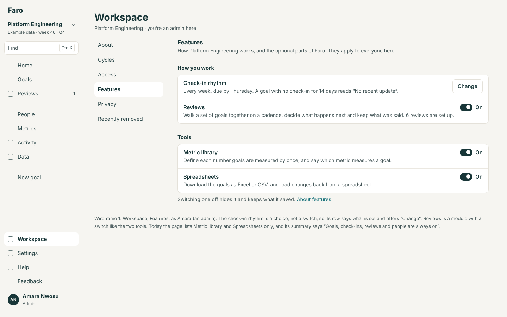
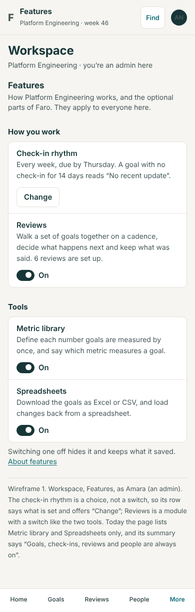

The rhythm is a choice, so its row says what is set and offers Change. Reviews is a switch, like the tools.

**2. The read-back before either changes**

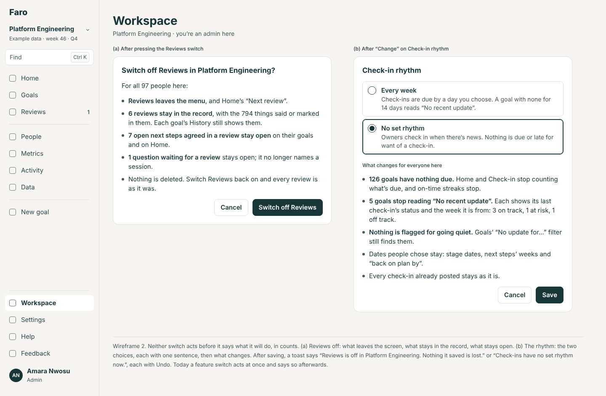
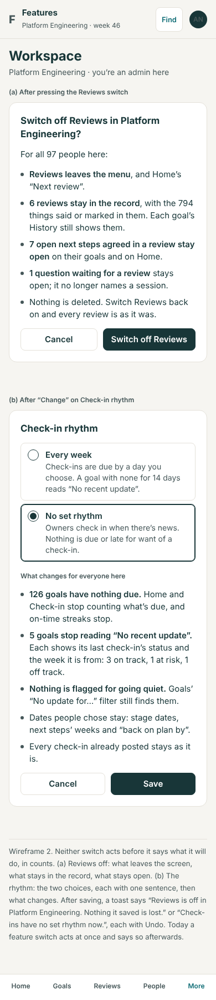

What leaves the screen, what stays in the record, what stays open, in counts.

**3. Home four ways, as Rhea**

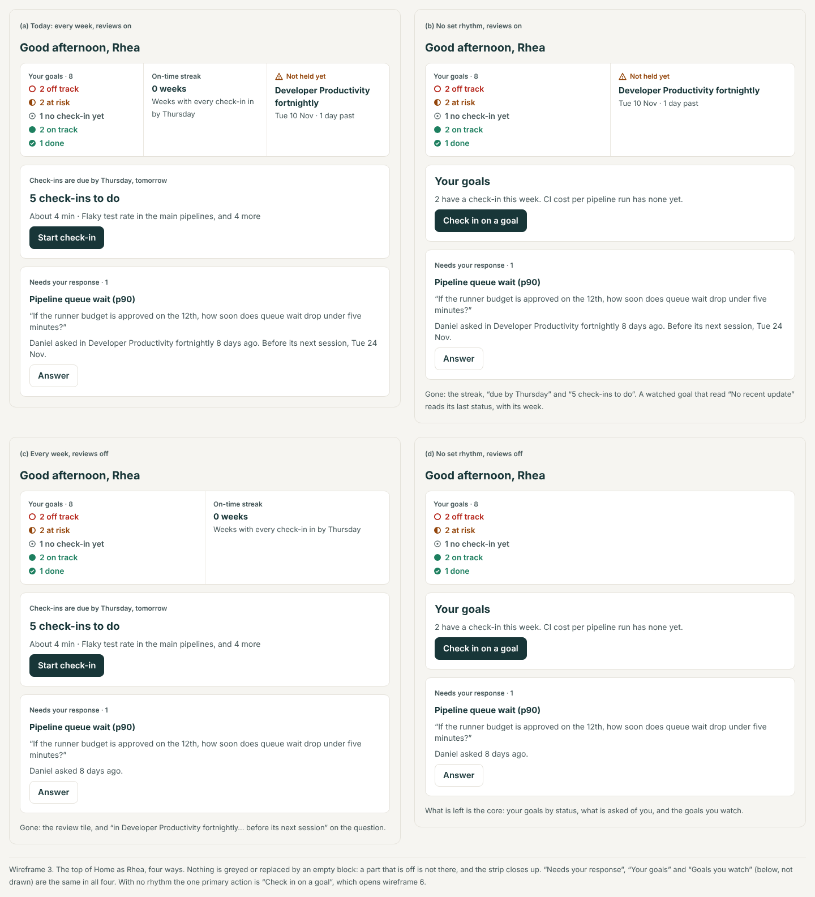
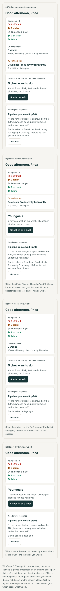

(a) today; (b) no set rhythm; (c) Reviews off; (d) both. The strip closes up; nothing is greyed.

**4. A goal's page with no set rhythm**

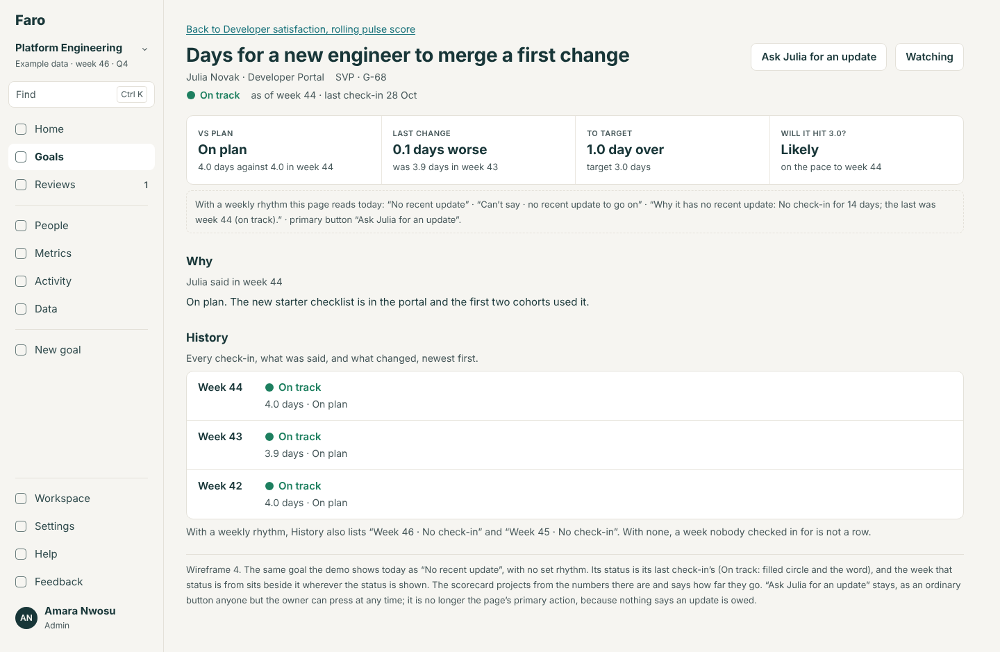
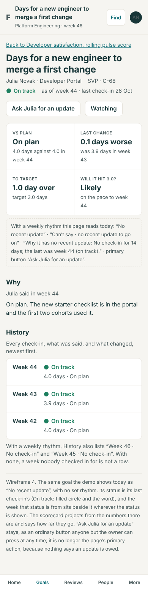

The demo's "No recent update" goal: its last status with its week, a projection that says how far its numbers go, and "Ask Julia for an update" as an ordinary button.

**5. Goals with no set rhythm**

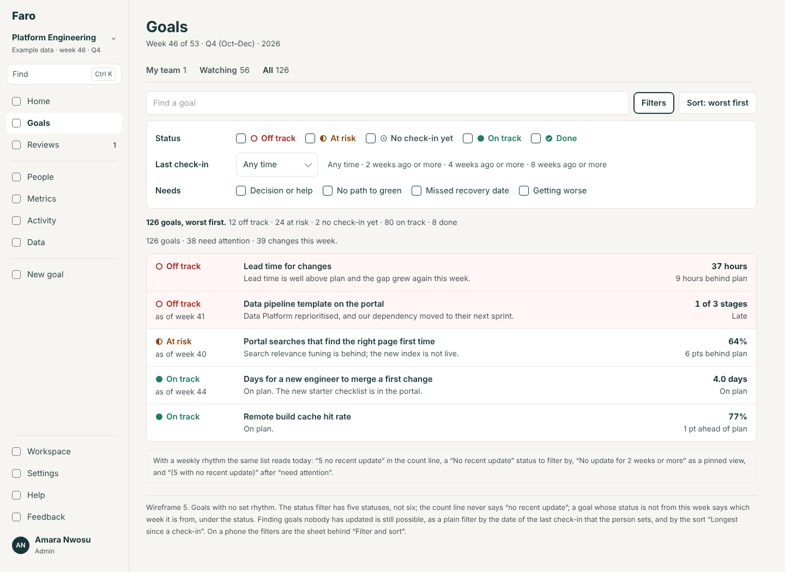
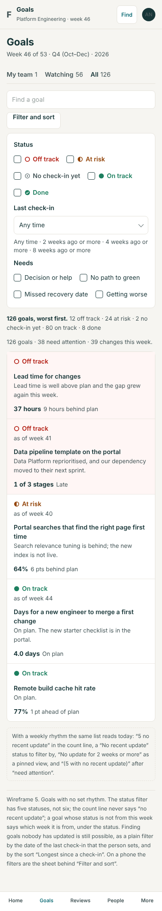

Five statuses to filter by; "Last check-in" as a filter the person sets; "as of week 40" under a status that is not this week's.

**6. Check-in with nothing due**

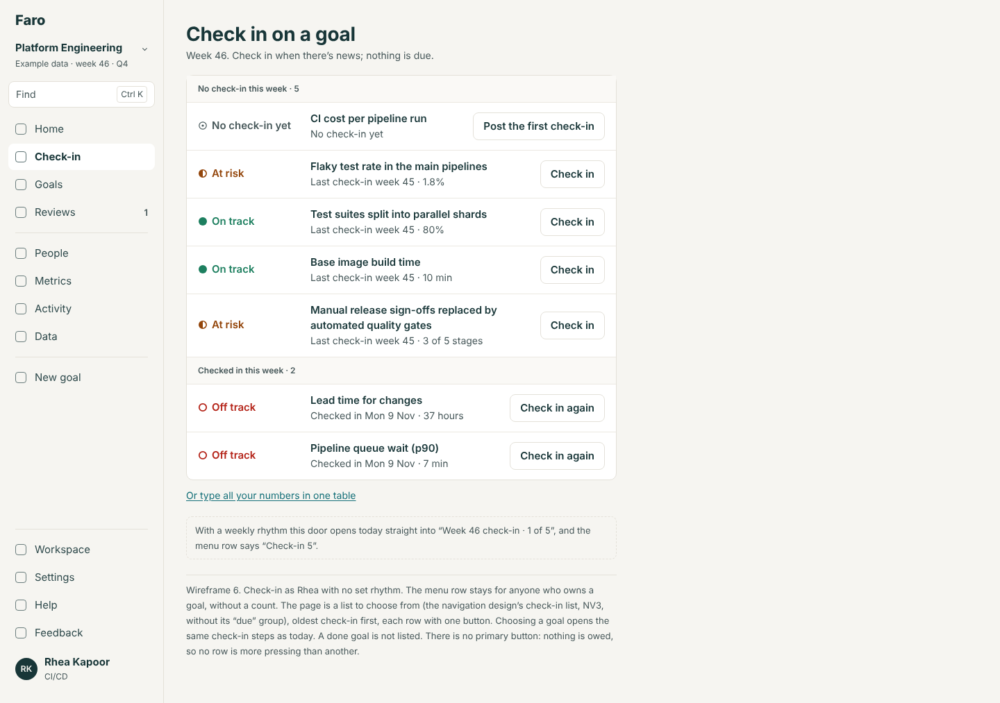
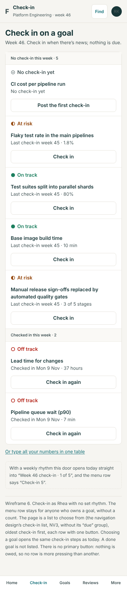

A list to choose from, oldest check-in first.

**7. Set-up's two questions** (for the set-up area to place)

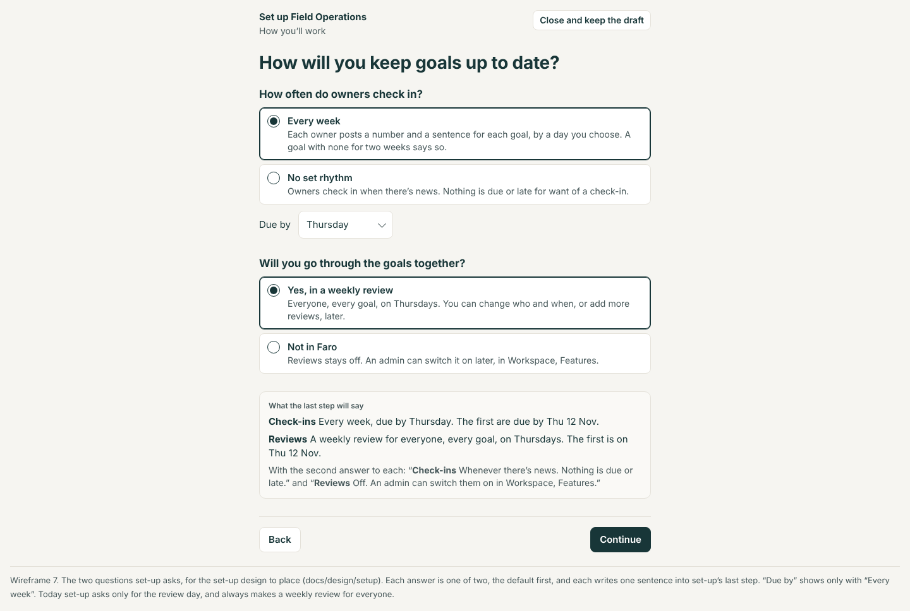
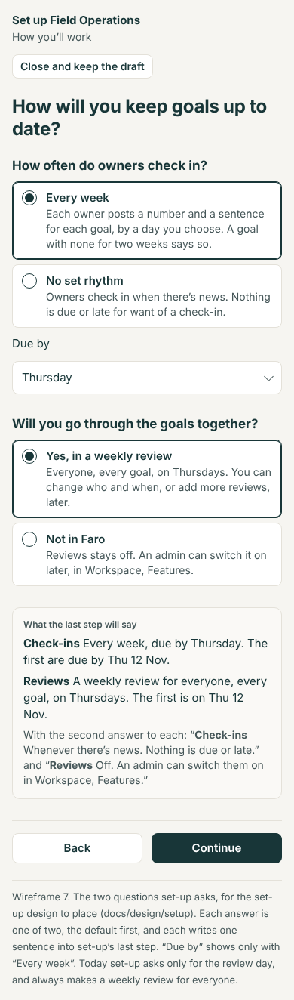

## 7. What the other three areas need to know

- **The names.** Reviews: the module `reviews`, on or off, in `Workspace.modulesOff`. The rhythm: `Cycle.checkInWeeks`, 1 ("Every week") or 0 ("No set rhythm"), with the due day `Cycle.reviewDay` ("due by Thursday"). On screen it is never "weekly/none" as a switch; it is "Check-in rhythm: Every week, due by Thursday" or "No set rhythm".
- **Set-up asks two questions** (wireframe 7), each with two answers, the default first, and the due day only with "Every week". The two are independent: reviews with no set rhythm is allowed.
- **A new goal's read-back may promise**, with a rhythm: "Its first check-in is due by Thu 12 Nov." With none: "Check in when there's news. Nothing is due." About reviews it promises nothing unless Reviews is on and a review covers the goal: "It will be in Weekly review on Thu 12 Nov."
- **No fixed "weekly" in new wording.** Round 1's New goal wireframe labels the owner "checks in weekly"; that becomes "checks in" (with none) or "checks in every week".
- **The import** never reads or writes the rhythm; a workbook's status column is worked out, so a file exported under one rhythm loads unchanged under another ("Nothing would change").

## 8. Decisions for Lane

The recommended answer is first.

1. **Both switchable?** (a) Yes, both, per workspace, both on by default. *Recommended.* (b) Reviews only; the rhythm stays weekly. (c) Neither: write both into the spec as requirements for the internal app and build nothing.
2. **The rhythm's shape.** (a) A number of weeks under the bonnet, offering "Every week" and "No set rhythm" now. *Recommended.* (b) A plain on/off. (c) Offer every two weeks and every month from the start (about half a release more).
3. **A quiet goal with no set rhythm.** (a) Its last status, with "as of week 44" beside it. *Recommended.* (b) Its last status and nothing else. (c) Keep "No recent update" as a plain grey fact after a number of weeks an admin picks (a rhythm by another name).
4. **Reviews: how far now?** (a) The switch first (FT2), the real move later, after AS part 2 (FT3). *Recommended.* (b) Wait and do only the real move. (c) The switch only; never move the code.
5. **Before a switch acts.** (a) Say what it will do, in counts, then act, with Undo after. For Reviews and the rhythm; Spreadsheets stays instant. *Recommended.* (b) Act at once with Undo, as today, for all.
6. **Order.** (a) After the held round-1 items: FT2, then FT1, then FT3 where "reviews last" already sits. *Recommended.* (b) FT1 first. (c) Both before the held items (they would collide on Home and Goals).
7. **"Due before the review" becomes "Due by Thu 12 Nov" everywhere, whatever else is decided.** (a) Yes. *Recommended.* (b) Leave it.

## 9. Not verified, and not done

- No test or eval was run; counts of calls and files are from search, not from a compiler.
- "5 goals stop reading No recent update: 3 on track, 1 at risk, 1 off track" and "7 open next steps" in the read-back are examples; the build computes them.
- Whether the Data API's column cache needs a reload after the migration was not tested (the handover says `faro` is exposed).
- The talk's script (`docs/demo-script.md`) was not re-read line by line; with both left on, nothing in it changes.
- Fortnightly and monthly rhythms (FT4) are sized, not designed.
