# Find, sort, filter and pick: the evaluation and the design

10 November 2026. Area 1 of the app redesign (`docs/design/README.md`); ranked first in `docs/reviews/2026-11-10-app-redesign-priorities.md` because every other area, and the Workspace redesign, stands on it. A design, not a build. The build spec is `spec.md` beside this file. The wireframes in `wireframes/` are rendered from `mockups/` (`node docs/design/find/mockups/build.cjs`) at 1440 and 390 px; they show layout, order and wording, not app code.

## The idea in four lines

1. **One list bar** on every list: a search field, filters, a sort, then one line that says how many, in the same words everywhere.
2. **One find-and-pick control** for every person, team, goal, metric and workspace, however few there are.
3. **Find from anywhere**: the same control, over all four kinds, behind one field in the sidebar and one key.
4. **The address is the truth**: what you searched, filtered and sorted is in it, so Back and a shared link show what you saw.

## The jobs people come to do

| Who | Job | How often | Today |
|---|---|---|---|
| Everyone | Find one goal they know by name, owner or key | Daily | Only on Goals (three steps), or the Map's own finder; "G-48" works in three places of five |
| Everyone | Find a person or a team | Weekly | Workspace → People; nowhere else |
| Owner | Pick who owns a goal, what it feeds, who does a next step | When making or changing a goal | Selects of 97 people and 127 goals |
| Manager (Rhea) | Narrow a list to her team, or to what's off track | Weekly, before the review | Goals' Filters dialog; a different dialog on Activity; a three-step wizard on Data |
| Leader (Amara) | Sort worst first; open a saved view | Weekly | Works on Goals; sort is written differently on Data |
| Review runner | Pick the people and goals of a review | Monthly | Two finders with no count, no empty message and no keys |
| Admin | Pick a lead, an admin, who a token acts as, who takes over | Monthly | Selects of everyone |
| Anyone sharing | Send a colleague "the list I'm looking at" | Weekly | Works on four pages; the search is dropped from the address on four others |
| The rebuild team | Plug their server's search in once | Once | There is no one place: each screen filters its own array |

## Findings

Evidence is from the walk of 10 Nov (the comparison table is in the priorities review's source notes) and the code. Severity as in the Workspace review: **High** (people fail or are misled), **Medium** (slower or confusing), **Low** (polish).

**S1. Nineteen places, no two alike. High.**
The places: Goals (search, sort, filters, "In the tree of"), the Map's finder, Activity (search, person, goal, kinds), Data (search, filter, column sort), a review's goal finder and attendees, New goal and goal edit (owner, team, feeds into, also helps), "Add a next step" (who), Switch person, the workspace switcher, Help, Feedback, and Workspace's People. Each was built for its screen. Nothing is shared but the text field's class.

**S2. The same words find different things. High.**
- "G-48": the goal on Goals, Data and the Map; nothing on Activity or in a review's goal finder (`src/domain/query.ts:124` knows keys; the others don't call it).
- "off track": 0 goals on Goals, 16 rows on Data, 279 changes on Activity.
- "Tunde": his goals on Goals; nothing in the Map's finder or a review's.
- Only Goals (in a tooltip) and Activity (in a hint) say what their box searches.

**S3. Six ways to pick a person, and selects of everyone. High.** (0a (2) lists them; still true.)
- A select of 97 (owner in New goal `GoalWizard.tsx`, goal edit, the Data table's Owner cell with 98 options), in directory order: Amara, Grace, Hamid, Wen, Lucía…
- A finder that adds chips (Goals' Owner filter, `GoalFilters.tsx:264–265`).
- A finder whose results are plain buttons (Activity).
- A finder that adds to a list (review attendees).
- Role cards plus a grouped list with a search (Switch person): the best of them.
- "Feeds into" is a select of 127 goals; "also helps" one of 125; Activity's goal filter one of 127.
None answers to the arrow keys and Enter; only the Map's finder is a combobox.

**S4. Five filter models under two names. Medium.**
Goals: a dialog of tick boxes that applies as you tick, closed by a button called "Show the goals". Data: "Add a filter" in three steps (property, condition, value) with its own Add button. Activity: a dialog with a select, a finder and tick boxes. Feedback: three selects in a row. People: one select. The button is "Filters" on three and "Filter" on Data. Goals has Sort twice, on the toolbar and inside the dialog (`GoalFilters.tsx:92`, `:248`).

**S5. Seven ways to say how many, eight to say none, six to clear. Medium.**
- How many: "2 of 126 goals", "54 of 6417 changes", "2 of 126 rows", "12 articles", "8 people match.", "1–1 of 1", "1 person so far". The Map and review finders say nothing.
- None: "No goals match", "No changes match", "No rows match.", "No articles match", "No one matches.", "Nothing here matches.", "No goal by that name or key", and a blank list.
- Clear: the field's ×, a chip's ×, "Clear filters", "Clear search and filters", "Clear the search", Escape (only where the field is `type=search`), and nothing at all on People, Feedback and reviews. An empty Goals page shows four of them at once.

**S6. The address keeps some of it. Medium.**
Search is in the address on Goals, Activity, Data and Help, and not on the Map, a review, Feedback or People. Sort is `sort=owner` on Goals and `s=Team~asc` on Data. On Goals, search, sort and filters replace the history entry while tabs and layouts add one (`GoalFilters.tsx:45`), so Back skips states; a layout remembered in the browser is drawn when the address has none, so Back can show the right address as the wrong layout.

**S7. No typo is forgiven. Low now; High at 30,000 goals.** "rolback" finds nothing anywhere and nothing is suggested (U29).

**S8. Nothing can be found from where you are. Medium.** No search outside those pages; no key but the markup key (NAV; R5's Cmd-K is spec only).

**S9. Chosen things are drawn as capsules. Low.** Goals' active filters and chosen owners are chips with a × (`.filter-chip`). They are not states, so the design rules allow them, but 0a asks for plain text with a remove button, and Workspace's design draws them so.

### What works and is kept

- **The goal query** (`src/domain/query.ts`): one definition of every filter and sort, read from and written to the address, shared by the screen, exports, saved views and `find_goals`. It is the model for the rest.
- **The Map's finder**: a real combobox that finds by name or key and pans to the goal.
- **Switch person's finder**: by name, job title or team, with the likeliest people first.
- **Goals on a phone**: one button opens every filter and the sort.
- **Data's column sort**, and Help's search.

## The design

### The list bar (wireframes 1, 2, 6)

Every list of things that can grow has the same bar, in the same order:

1. **Search**, first and widest. Its placeholder says what it finds: "Find by name, owner, team or key". What it matches is one rule: **the words you can see on the row** (so a status word finds its goals, and a key finds its goal everywhere a goal is listed).
2. **Filters.** On a computer, up to two filters a page uses most sit in the bar as buttons that say their value ("Team: every team"); the rest are behind **Filters**. On a phone everything is behind one button, **Filter and sort**. Either way they open one sheet, built one way: a short fixed list is tick boxes; a list that grows (a person, a team, a goal, a metric) is find-and-pick. It applies as you choose, and its closing button says what you'll get: "Show 17 goals".
3. **Sort**: one menu that says its value, "Sort: worst first". A table's column headings set the same thing.
4. Anything the page adds (Goals' Group and Layout) comes after, at the right.
5. **The count line**, always there, always in these words: "126 goals, worst first." Narrowed: "17 goals match." One: "1 goal matches."
6. **The filter line**, only when something narrows the list, as plain words: "Filtered by: Team CI/CD (Remove) · Status Off track or At risk (Remove) · Clear filters".
7. The list, then **paging** for flat lists: 50 at a time, "1 to 50 of 97" and "Next 47".

**None found** is said one way, where the list would be: "No goal matches “rolback”." with "Clear the search"; "No goals match these filters." with "Clear filters"; both when both. Before giving up, the search tries words one letter away: "No goal matches “rolback”. Showing goals that match “rollback”."

**Clearing** has one control each: the × in the field (and Escape) clears the search; "Remove" takes off one filter; "Clear filters" takes off all. The big "Clear search and filters" button goes.

**The address** holds all of it (`?q=`, the filters, `?sort=`, `?page=`). Choosing a filter, a sort, a tab or a layout adds one history entry; typing adds one when you stop. A choice the browser remembered is written into the address when the page opens, so the address always says what is drawn.

**Keys:** `/` puts the cursor in the page's search; Escape clears it, then leaves it.

### Find-and-pick (wireframes 3, 4)

One control wherever a person, team, goal, metric or workspace is chosen, even when there are five of them (Lane, 7 Nov (d)). Fixed short lists (weekdays, weeks, sort orders, levels) stay plain.

- **Closed**, it is a field that shows what is chosen as plain words with "Change": "Rhea Kapoor · CI/CD". Several chosen are a short list of rows, each with "Remove".
- **Open**, it is a search field over a list: a panel under the field on a computer, a full sheet on a phone. Before you type it suggests: you, your team, what you chose lately. As you type it finds, says how many ("4 match"), and takes the arrow keys, Enter and Escape.
- **A row is two lines**, the same in every picker and in Find:
  - a person: name, then job title and team;
  - a team: name, then lead and size;
  - a goal: status (shape and word) and title, then key, owner and team;
  - a metric: name, then unit, direction, owner and how many goals use it.
- Where "none" is an answer it is a named row at the top ("Nothing: top of its own tree"). Where making one in place is allowed, the last row is "Add “queue wait” as a new metric".
- Its options come from **one function** per kind, asked for a page of results. That function is the seam where the internal app plugs in its server's search.

### Find from anywhere (wireframe 5)

The sidebar's first row is **Find**; on a phone it is a button in the top bar; `Ctrl K` (`Cmd K` on a Mac) opens it from anywhere. It is find-and-pick over goals, people, teams and metrics at once, grouped under those four headings, three rows each until you choose a heading. Enter opens the page. Before you type it lists what you opened lately. It has no results page of its own: "See all 14 goals" opens Goals with the search filled in.

### Where each of the nineteen goes

| Today | Becomes |
|---|---|
| Goals: search, Filters dialog, two Sorts, "Decision or help needed", "In the tree of" | The list bar. Owner, team and "in the tree of" are find-and-pick inside Filters. One Sort. The toggle becomes a filter (see `docs/design/goals`) |
| The Map's "Find a goal or key" and its "Needs attention" box | The bar's own search, which on the Map finds and pans instead of narrowing |
| Activity: search, "Any time", Filters dialog, kinds | The list bar: When and Kind in the bar; Who and Goal (find-and-pick) in Filters |
| Data: search, "Filter", column sort | The list bar; "Add a filter" (any column, a condition, a value) stays as the last block of its Filters sheet, since a table has columns the sheet can't know; sort moves to `?sort=` |
| A review's goals and people | Find-and-pick, several at once |
| New goal, goal edit: owner, team, feeds into, also helps | Find-and-pick |
| Add a next step: who | Find-and-pick |
| Workspace and People: team filter, lead, "who it acts as", hand over to, add an admin | Find-and-pick (the Workspace spec already says "once 0a lands") |
| Data's Owner cell | Find-and-pick, opened from the cell |
| Switch person | Find-and-pick for people, with the demo's role cards as its suggestions |
| The workspace switcher | Find-and-pick for workspaces from six up (as the Workspace spec says) |
| Help | The list bar's search and count line |
| Feedback | The list bar: Kind in the bar; Page and Person in Filters; the search in the address |
| The metric library's list and "Measured by" | The list bar; find-and-pick with "add a new one" |

## Each part's one primary action

| Part | Primary action | Everything else |
|---|---|---|
| The list bar | None: it belongs to the page, whose own primary action stands | Search, Filters, Sort, the count line |
| The Filters sheet | **Show {n} {things}** (closes it; the list has already changed behind it) | "Clear filters" |
| Find-and-pick | Choosing a row. Several: **Done** | "Remove", the "none" row, "Add … as new" |
| Find | Enter on the first row | "See all {n}" |

## Role differences

None in what the parts do: reading is open inside a workspace (R1, rule 3), so everyone searches everything. Only the suggestions differ, because they start from who is looking:

| | Amara (leader, admin) | Rhea (manager) | Tunde (owner) | Oskar (owns none) |
|---|---|---|---|---|
| Person suggestions | Herself, Office of the VP, recent | Herself, CI/CD (7), recent | Himself, Build & Release, recent | Himself, Developer Experience, recent |
| Goal suggestions | Her goal, the north stars, recent | Her 8, the goals they feed, recent | His 2, the goals they feed, recent | What he watches, recent |
| Team suggestions | The team she leads, recent | CI/CD, recent | Build & Release, recent | Developer Experience, recent |
| "Add as new" (a metric) | Yes | Yes | Yes | Yes (anyone adds a metric) |

## The phone

- The bar is two things: the search field, full width, and **Filter and sort** beside it (it says how many filters are on: "Filter and sort · 2"). The count line and the filter line wrap under them.
- Filters and find-and-pick open as full sheets with the search field at the top and the keyboard up; rows are 56 px; the closing button is fixed above the keyboard.
- Find is a button in the top bar on every page, a goal's page included.
- Limits (held by the new N check): no sideways scroll; the first result of a picker within 200 px of the top with the keyboard open.

## Wireframes

| # | Screen | 1440 | 390 |
|---|---|---|---|
| 1 | The list bar, on Activity | 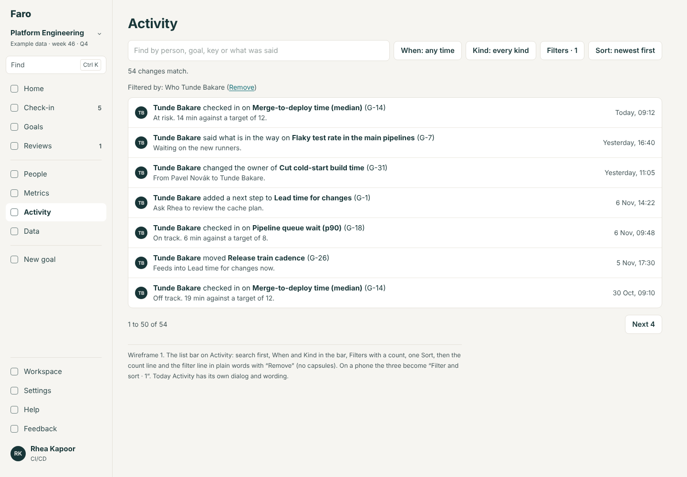 | 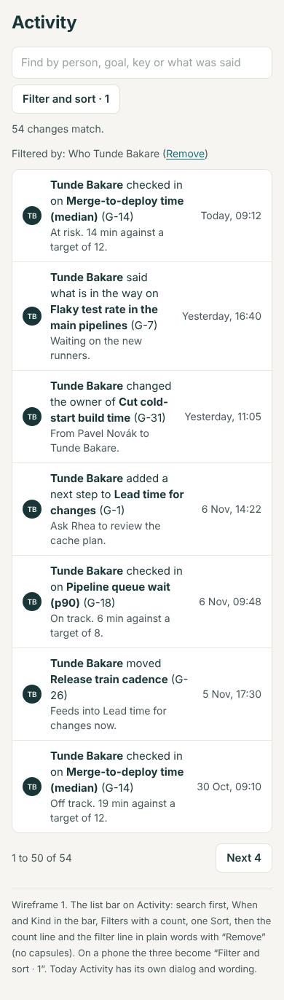 |
| 2 | The Filters sheet | 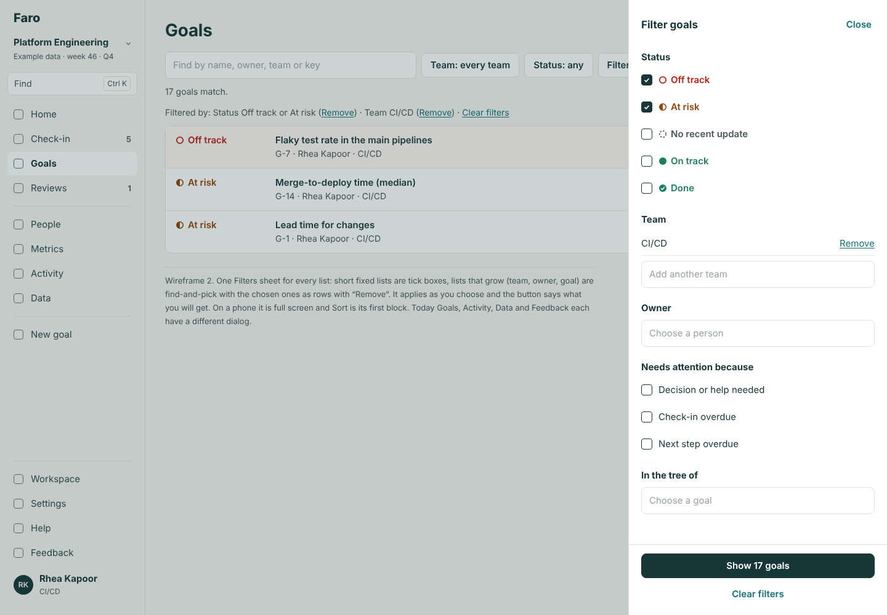 | 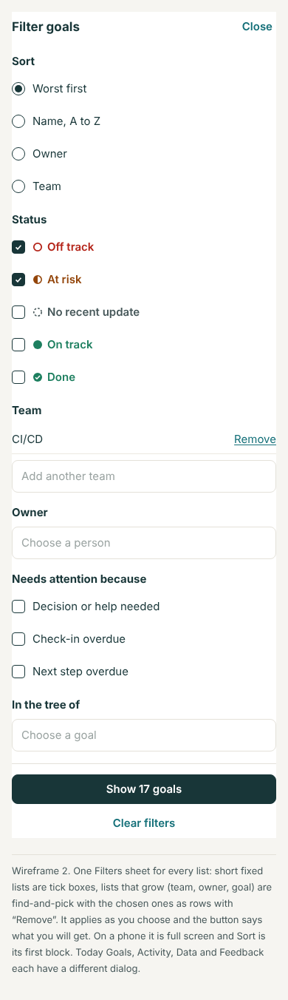 |
| 3 | Find-and-pick: a person, before typing | 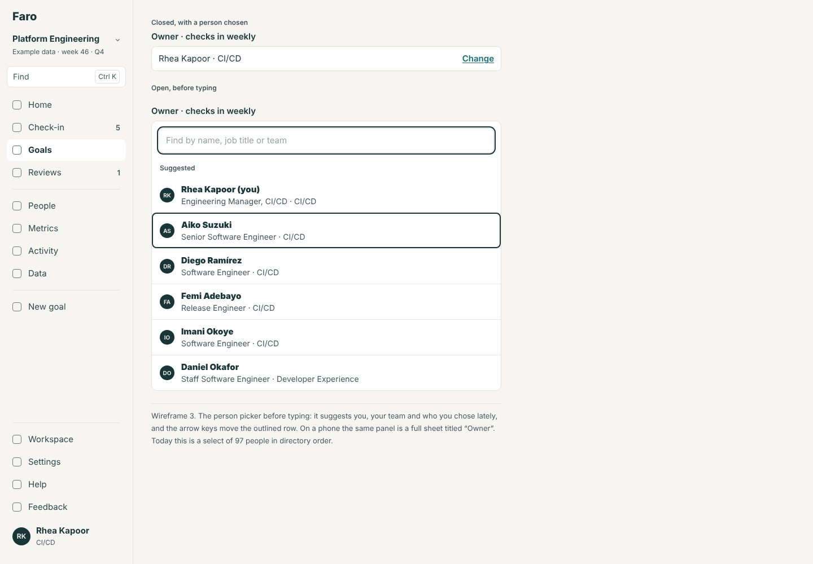 | 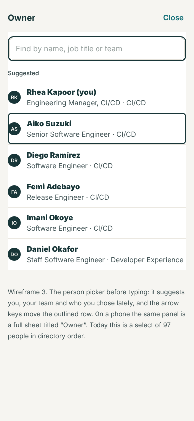 |
| 4 | Find-and-pick: a goal and a metric, while typing | 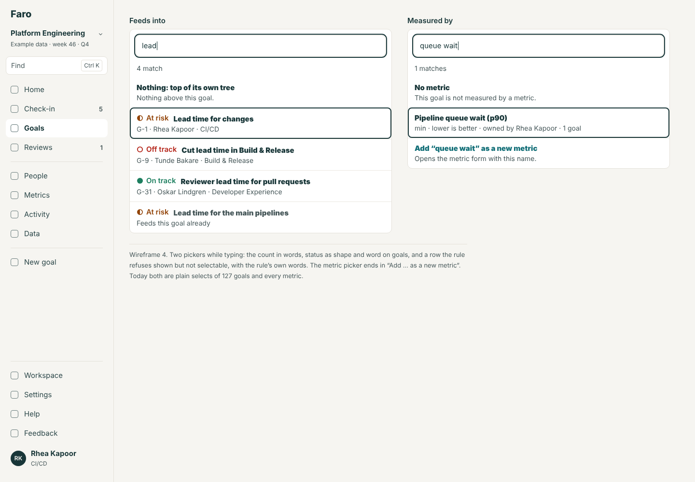 | 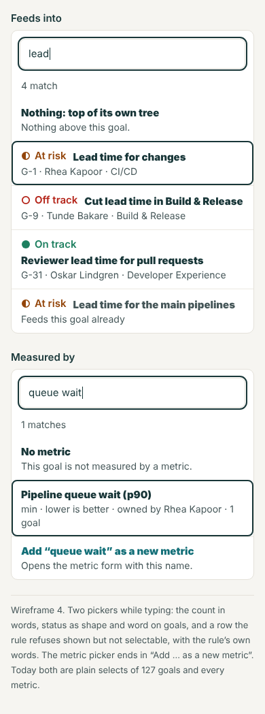 |
| 5 | Find from anywhere | 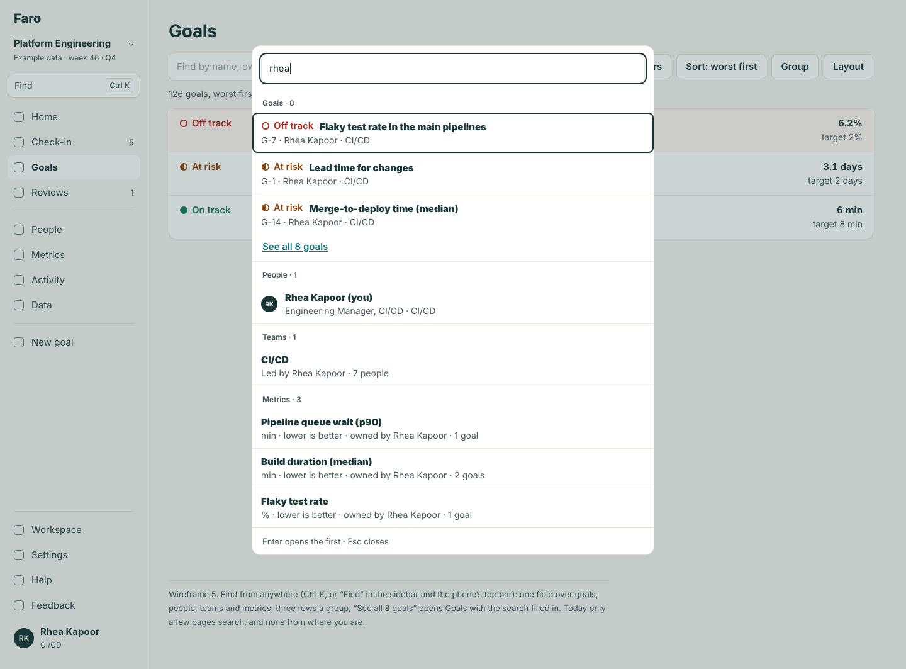 | 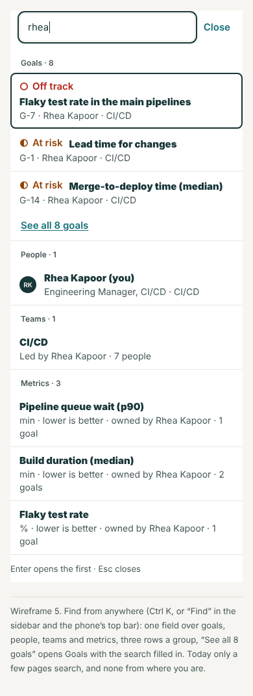 |
| 6 | Nothing found, and a near miss | 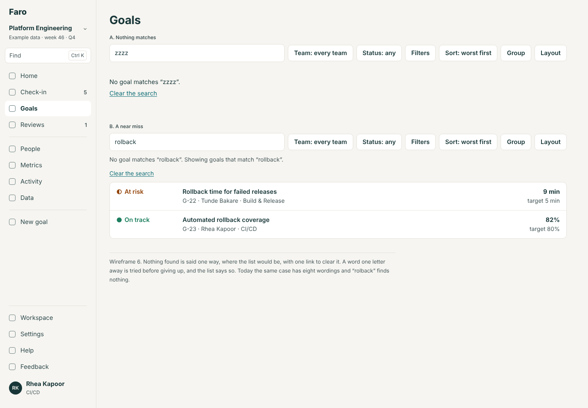 | 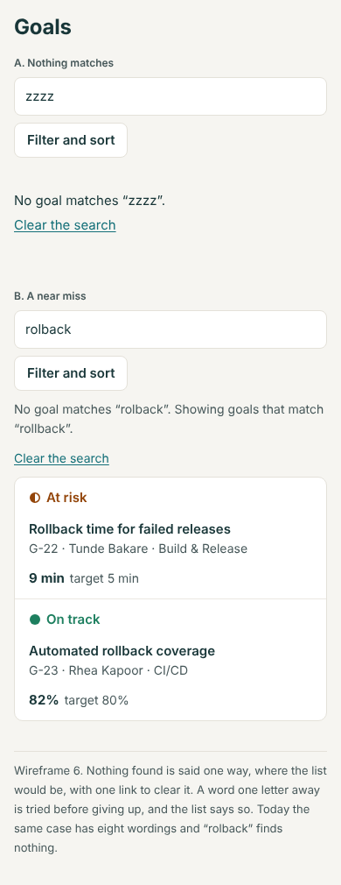 |

## For the rebuild (spec only)

- **Search is the server's** (R4): each list and picker asks one function for a page of results; Faro answers from the loaded workspace, the internal app from its search service, with the same words, order and paging.
- **Typos:** Faro's one-letter rule is a stand-in; the server's search should do better (U29).
- **Scope** (R6a, rule 5) is a filter like any other here: a team and everything under it, chosen with the team picker.
- **Find** is R5's "Cmd-K search". Faro builds it only if Lane says so (decision 1); the rule for what it finds is in the spec either way.

## Backlog

- **Replaces 0a (1), (2) and (4)** in full: the control, every place it goes, and the check that keeps it so. 0a (3) is replaced by the Workspace redesign and 0a (5) was done in WS.
- **Takes** U29 (typos), U28's leftovers (keys everywhere), and R5's Cmd-K if decision 1 is (a).
- **Already built, kept:** key search on Goals (#79), the Map's finder (#76).

## Decisions for Lane

1. **Find from anywhere.** (a) Build it in Faro: it is the picker with a door, and the sidebar and phone are designed around it. *Recommended.* (b) Keep it spec only (R5), and leave the sidebar's Find row out.
2. **What a search matches.** (a) The words on the row, so "off track" finds off-track goals and a key works everywhere. *Recommended.* (b) Names and keys only; status stays a filter.
3. **Near misses.** (a) Try words one letter away when nothing matches, and say so. *Recommended.* (b) Leave typos to the internal app's server.
