# Goal entry: the evaluation and the design

11 November 2026. Area 2 of round 2 (`docs/design/round-2/README.md`). Design and spec only: no app code was changed, and nothing here is built. The build spec is `spec.md` beside this file. The wireframes in `wireframes/` are rendered from `mockups/` (`node docs/design/goal-entry/mockups/build.cjs`) at 1440 and 390 px.

It covers every way one goal is made or changed by hand: **New goal**, **the edit page**, and **adding a goal from somewhere else** (set-up, a review, a parent goal, a team, a copy of another goal). It builds on round 1's OB1 to OB3 and GT3 (`docs/design/onboarding`, `docs/design/goal`), none of which is on main yet, and says in "What this changes in round 1" every place it changes them. Many goals at once is the import area's (`docs/design/import`).

## The idea in five lines

1. **What a goal needs is said once, and every door agrees.** The form, set-up, the import and the AI tools read one field table and run one check, so "required" means the same thing in each.
2. **Three levels, in place.** A Must fix sits under its field and is counted once at the button. A Check is a question answered where it arises. Fine says nothing.
3. **Nothing is saved before it is read back**, in sentences: what was typed, what was left as usual, what happens after, and how it can be taken back.
4. **A change says what it will do** to status, history and who may act, before it is saved; and it can be undone.
5. **A goal starts where the thought does**: under the goal it feeds, on a team's page, from a copy, or in a review, where it is agreed in ten seconds and set up properly by its owner afterwards.

## The jobs people come to do

| Who | Job | How often | Today |
|---|---|---|---|
| Owner (Tunde, Rhea) | Add a goal of their own | A few times a year | 3 typed answers and 4 presses for the simplest; eight things decided for them without a word |
| Owner | Correct a goal: its name, target, stages | Monthly | One page; a plan change asks why; nothing says what the change does |
| Owner | Hand a goal to someone else | Yearly | One select and "Saved."; they are locked out at once |
| Manager (Rhea) | Get a goal made for one of her people | Each quarter | She can make it herself, owned by them, though the rules say only an admin may |
| Leader (Amara) in a review | Record a goal the room agreed | Most reviews | A next step in words: "Decide whether to split … into their own goal" |
| Admin (Grace) | Add goals for others; fix a goal's unit or level | Weekly at first | New goal; unit and decimals only through a spreadsheet |
| Whoever sets up | The first three or four goals | Once | A shorter form with its own words for the same faults |
| Anyone | Start a goal, be interrupted, come back | Often | One draft per browser, found only by pressing New goal |
| An assistant (MCP) | Add or change a goal for its person | Daily, for some | The engine's rules; questions come back as notes and are saved |

## Findings

From the walk of 11 Nov on the live demo (`/demo?today=2026-11-11`) as Rhea Kapoor, Tunde Bakare and Amara Nwosu at 1440 × 900 and 390 × 844; set-up at `/?store=browser` with every request to the database blocked, on the template and the blank path; the review walkthrough as Amara; and the code named. Severity: **High**, **Medium**, **Low**.

**How long the simplest goal takes today**

| Type | Typed answers | Presses | Decided without asking |
|---|---|---|---|
| Move a number | 3: name, today, target | 4: Continue × 3, Publish | Type, unit "%", decimals 0, due at year end, steady, owner, team, level Team, feeds nothing |
| Keep in range | 2: name, limit | 5 | The same, and "at most", "warn within 1" |
| Dated stages | 3: name, a stage, its week | 5 | Owner, team, level, feeds nothing |

That speed is worth keeping. What is wrong is that the defaults are silent and the checks uneven.

### The rules

**E1. The form does not run the engine's rules: anyone can publish a goal owned by anyone, at any level. High.**
- As Tunde (not an admin), `/demo/goals/new`, step 3: Owner is a select of 97 people. Chose **Amara Nwosu**, Level **North star**, Feeds into **"Jenkins jobs still running"** (a Team goal). Check read "Amara Nwosu owns it and checks in weekly … North star level. It feeds “Jenkins jobs still running”, by about 3 jobs." Published as G-127.
- The goal's page then offered "Amara posts its check-ins. Ask for the first one now?", and `/goals/<id>/edit` told Tunde "Only its owner can change this goal". He cannot delete what he made; Amara has a north star she never saw; the Platform leadership weekly, which walks every north star, gains it.
- The import refuses the same thing: "You can add goals you own. Ask an admin to add goals for other people." (`src/domain/changeset.ts:385`). The form never asks: `saveGoal` commits directly (`src/app/state.tsx:615`), and there is no `saveGoal` in the action table (`src/app/actions.ts`). R1's row "Add a goal: anyone, for a goal they own; an admin, for anyone" names `planChanges`, which the form does not call.

**E2. Nothing says what is required, and the doors disagree. High.**

| Field | New goal | Set-up | Import and AI tools |
|---|---|---|---|
| Owner | You, silently | "No owner yet" allowed | Required: "A new goal needs an owner: Owner email, or Owner." (the AI tool fills in its person) |
| Team | Yours, else **the first team in the list** (`GoalWizard.tsx:83`) | Yours | The owner's, else the first team (`changeset.ts:390`) |
| Type | "Move a number" pre-chosen | Template's | Empty means metric (`changeset.ts:403`); the AI tool requires it |
| Unit | **"%" pre-filled** (`goal.ts:44`) | Empty | "%" when the file has no Unit column |
| Decimals | 0, a field: "Between 0 and 3." | Worked out from the numbers | Worked out from the numbers (`changeset.ts:406`) |
| Start missing | "Enter where it starts." | "Add today’s number." (`Onboarding.tsx:204`) | The form's words, joined in one line |
| Same name, same team | Allowed, with a note | Allowed | **Refused** (`changeset.ts:376`) |
| Warn this close | 1, whatever the limit (`goal.ts:45`) | 1 | 1 |

- On screen only "How it’s measured · optional" and "Data source (optional)" say anything about need. A person learns the rest by pressing Continue.
- A goal about days, typed the fast way, is published in "%".

**E3. Questions are shown and not asked. High.**
- New goal, step 2: today −5, target 5, unit %: the line "Below zero %. Fine for a change or a balance; otherwise check the sign." appears and **Continue goes on**. The same for "Over 100%. Fine for growth; but if this is a share of something … check the target." (50 → 150) and "The target is under a 100th of the start (3,000,000,000 to 5). Is that right?" (`planHint`, `goal.ts:113`).
- 10 → 1500 % shows only the over-100% line: one hint hides another.
- In the import and the AI tools the same lines are "notes", saved under "Read as:" (`changeset.ts:454`, `mcp/tools.ts:136`).
- On the edit page the same kind of doubt is a tick box that must be ticked ("This makes higher better … Yes, make higher better"; `planQuestion`, `goal.ts:129`). So one level has three strengths.

**E4. Round 1 cites a rule that isn't there: nothing stops or questions a goal feeding a goal below it. Medium.**
- The onboarding spec (2.3, row 4) says a goal at the same or a lower level is "not selectable … (today's rule)". There is no such rule in the code (no "can’t feed" anywhere in `src`); E1's north star feeds a Team goal. The only link rule is the loop check (`src/domain/tree.ts:31`).
- Nor is there any rule on who may set a level. `LevelField`'s hint is all there is: "Flag SVP or North star only for goals reported at major reviews."

### Entering

**E5. Numbers are read generously and reported unevenly. Medium.**
- "12 days" typed into a "%" goal is read as 12 without a word (`parseNumber` drops trailing letters, `checkin.ts:85`). "12%" is read as 12, rightly.
- "abc" gives "“abc” isn’t a number. Type digits only, like 29.4." on a whole-number goal: the deep review's U10 was fixed for the check-in only (`goal.ts:77` calls `notNumberText` without the decimals).
- "1,5" on a whole-number goal: "1,5 has 1 decimal place, but this goal keeps whole numbers, so it would show as 2. Type 2, or set the goal’s Decimals to 1." Good words; in New goal the field is on the same step, on the edit page it doesn't exist (E8).
- Decimals 7 or "x": "Between 0 and 3.", which names nothing.
- A range "at most 12%" with "Warn this close" 20 is accepted (always at risk); the limit −4% and 150% pass with no line once Continue is pressed; Check reads "with a warning within 1", no unit (`GoalWizard.tsx:297`).
- A plan from 10% to 5% in whole numbers reads 9, 9, 8, 7, 6, 6 in the table.
- Number fields ask for the decimal keypad (`inputMode="decimal"`), which on an iPhone has no minus key. Not verified on a device.

**E6. Stages are bare week numbers, and every fault shares a sentence. Medium.**
- "Due week" is a number field with no dates and nothing saying this is week 46 (390 px and 1440 px alike).
- Empty, "abc", 60 and 0 all give "Every stage needs a due week between 1 and 53."; the message goes under one row.
- Two stages both called "Design" are accepted. The import then matches stages by name (`changeset.ts:437`), so the two can't be told apart in a file.
- Stages typed out of order are sorted without a word. Check says "1 stages" (`GoalWizard.tsx:298`).
- A stage in week 1 is accepted in week 46 (round 1's O4; OB2 is built and held).

**E7. The read-back leaves out what happens next and what was decided for you. Medium.**
- "Rhea Kapoor owns it and checks in weekly. It moves from 10% to 5% by week 53 (28 Dec–3 Jan 2027), steady. It’s at the top of its own tree." Then three rows with "Change".
- Not said: that the unit and decimals were defaults; when the first check-in is due; who will see the goal; that it can be deleted only until its first check-in.
- "checks in weekly" is fixed text (`GoalWizard.tsx:295`), which will be untrue in a workspace with the rhythm switched off (round 2, decision 6).

### Changing

**E8. The edit page saves a hand-over in one press, with no read-back, no reason and no way back. High.**
- As Rhea on `/demo/goals/lead-ci-time/edit` (46 check-ins): Owner → Tunde Bakare (another team), Level → North star, a new name; "Save changes" → the toast "Saved." The History says "Rhea Kapoor changed name, owner, level".
- Reopening the page: "Only its owner can change this goal. Tunde Bakare owns it." Rhea cannot take it back. Tunde is told nothing. The team stayed CI/CD though its owner is in Build & Release.
- A one-minute change to the target asks "Why change it?"; giving the goal away asks nothing.
- The page cannot change **Unit or Decimals** at all (no field in `GoalEdit.tsx`), though the number errors send people to "the goal’s Decimals". It never says the **type** can't change, or why; the engine's words exist only for a spreadsheet ("A goal’s type can’t change. Add a new goal instead.", `changeset.ts:400`).
- Someone who may not change the goal gets a dead end, not the page without its action (round 1's rule for a person who can't act).
- An unsaved edit is kept whole and laid over the goal next time (`GoalEdit.tsx:46`): if someone else changed the goal in between, saving puts their change back without saying so.

### Adding from elsewhere

**E9. A goal agreed in a review can't be added there. Medium.**
- The walkthrough (`/goals/<id>?review=weekly`) offers "Add the next step", "We accept the risk", "Add a note", "Ask Akosua a question", "Skip for now".
- The example data shows what people do instead: "Camille agreed: Decide whether to split data-backed environments into their own goal. by Thu 26 Nov". A goal, recorded as a sentence, with no route from it to New goal.

**E10. New goal has one door and doesn't know where you came from. Medium.**
- The form reads `?parent=` (`GoalWizard.tsx:82`), but no link in the app sets it. A goal's "What feeds it" lists its feeders and has no way to add one; a team's page says "See its 17 goals" and no more.
- An unpublished draft swallows the link: opening New goal with a draft shows "You have a goal you didn’t publish", and Resume ignores the address.
- There is no way to start from a goal like one you have.

**E11. One draft, unlisted, easily lost. Medium.**
- One draft per browser and workspace, whoever is using it (`goalDraftKey`, `drafts.ts:50`). Home and Goals don't mention it (walked). It is found only by pressing New goal: "You have a goal you didn’t publish … Resume / Start another goal. Starting another throws the unpublished one away."
- The exit is an icon whose only words are an `aria-label`, "Close and keep the draft"; after it, nothing says where the draft went.

**E12. Goals carried into a new cycle get dates nobody chose. Low.**
- `nextCycle` (`src/domain/cycle.ts:139`) spreads the stages left evenly over the new cycle, and restarts a number from its last value with the old target. The admin reads "{n} goals move into next year, starting from where they ended. Owners can change targets in the first week." No owner is shown what was assumed for their goal.

**E13. The form has fields the sheet and the AI tools lack. Low.**
- "Also helps" and "It’s a guardrail" are in the form (`GoalDraft`, `goal.ts:20`) and in no column of the Goals sheet (`columns.ts:184`); the AI tools also lack the effect. For the field table to be the form, it needs these rows (a note for the import area).

### What works and is kept

- **Three typed answers for the simplest goal**, one question a step, a card per type.
- **Errors that say what to type**: the decimals sentence; "Give the goal a name of at least three characters."
- **A plan change after check-ins needs a reason**, keeps the old plan dotted, and judges earlier weeks against the plan of their day (`replanned`, `goal.ts:222`).
- **The direction question** on the edit page: asked in place, answered with words that say what yes means, asked again when the numbers change. It is the model for the Check level.
- **Delete before the first check-in, Stop after** (`src/domain/removal.ts:276`), each with its own words.
- **One engine** for the import, the Data tables, bulk edit and the AI tools (`planChanges`), with a preview before anything is saved.
- **Set-up's short goal card** (name, type, today, target, unit, owner), and "No owner yet" (OB3, built).

## The design

### 1. What a goal needs, said once

One row per field, in the shared field table (`docs/design/import/spec.md`; in code `src/domain/columns.ts`). The form's labels, hints, examples and errors are printed from it; so are set-up's, the import's and the AI tools'. The full table with formats and wording is in `spec.md`, section 3. In short:

| | Fields | Starts as |
|---|---|---|
| **Required** for every goal | Name · Type · Owner · Team · Level | Type: a number to move. Owner: you. Team: the owner's. Level: Team (or one below what it feeds). Each is shown, never silent |
| **Required for a number to move** | Unit · Today · Target | Empty |
| **Required for a number to keep in range** | Unit · Must stay · Limit | Must stay: at most |
| **Required for dated stages** | At least one stage; each stage's name and due week | One empty row |
| Optional, with the default said | Decimals (worked out from what you type) · By when (the cycle's end) · How progress comes (steady) · Warn this close (no early warning) · Feeds into (nothing) · How much, and why it helps · Also helps (none) · Guardrail (no) · Measured by / How it’s measured · Where the number comes from | As said |
| Worked out | Key · the plan week by week · which way is better · status and everything after it | By Faro |

**How a step says it.** A step where most fields are needed says once, under its heading, "Everything here is needed unless it says optional." and marks the optional ones "· optional". A step with one needed field says nothing. A default that was taken is a sentence with "Change" ("Kept as whole numbers, as you typed them."), not a filled-in field that looks typed (wireframe 1).

### 2. Three levels in a form

| Level | When it shows | Where | What the button does |
|---|---|---|---|
| **Must fix** | On leaving the field, once it has been touched; all of the step's on "Continue" | Under the field, with the warning mark; the field outlined on every side. Says what was read and what would be right | "Continue" stays pressable; pressed, it moves to the first one and says once above itself "2 things to fix above: Unit and Target." |
| **Check** | As soon as the values that raise it are complete | A flat block under the field: the warning mark (quieter), the question, two answers that say what each does | "Continue" waits for an answer: "Answer the question above, under Feeds into." |
| Fine | — | Nothing | Goes on |

- An answer is kept with the values it was about. Change them and it is asked again. Come back to the step and it reads as a line: "You said 150% is right. Change".
- A Check never changes the goal by itself; where an answer does ("Move it to Office of the VP"), its words say so.
- Every answer is repeated on the read-back ("You said") and kept in the goal's History with its creation.
- **The questions** (exact words in `spec.md`, section 4): a stage already past (round 1's, unchanged); a number below zero, over 100%, a hundred times the other, or a billion; a target on the wrong side for the metric it is measured by; a number far from that metric's latest; the same name in the same team; an owner outside the goal's team; a goal feeding one at a lower level; a level above Team set by someone who isn't an admin; a warning margin as large as the limit; a hand-set plan that leaves most of the change to the last weeks.
- **Not questions.** A target equal to the start is a Must fix that offers the way out: "The target is the same as today (10%). To hold a number where it is, make this a number to keep in range." with the button "Keep it at 10% or under". A due week before the start week can't be chosen in the form; in a file or a tool it is a Must fix, in today's words.

### 3. The read-back (wireframe 3)

New goal's last step. A title, then rows of sentences, each with "Change" to its step:

- **What**: "A number to move: from 40% today to 90% by week 53 (28 Dec–3 Jan 2027), the same amount each week. Higher is better."
- **Who and where**: "Tunde Bakare owns it, in Build & Release. It’s a Team goal and feeds “…” (G-41)."
- **Measured by**: the metric, or "No metric" and the description.
- **Left as usual**: every default taken, in one line: "Whole numbers. Due at year end. Not a guardrail. Helps no other goal."
- **You said**: each Check answered.

Then one block, **After you publish**:

- With a weekly rhythm: "Its first check-in is due by Thursday 12 Nov, then every week. The first number sets where it stands; the plan says 47% for week 47."
- With no rhythm: "It shows as “No check-in yet” until {owner} posts its first number. Nothing is due." No day is named anywhere on the step, and the owner field's label is "Owner", not "Owner · checks in weekly".
- For someone else: "{Owner} sees it on {her} Home the next time {she} opens Faro. Faro doesn’t send email."
- With reviews on: "It joins {review}, which walks every north star." or "It joins no review yet." With reviews off: no line.
- Always: "Until its first check-in you can change anything, or delete it. After that, a change to the plan needs a reason."

### 4. Changing a goal (wireframe 4)

`/goals/<id>/edit`, round 1's page (GT3): one page, sections "What it is", "Plan and target", "Who and where", "More details", one exit. Round 2 adds:

- **The same fields and words as New goal**, made from the same table. Unit and Decimals join "Plan and target", shown as a sentence with "Change".
- **What can't change, and why**, under the name: "A number to move. The type can’t change: 46 check-ins were judged as a number against a plan. To measure it another way, stop this goal and add a new one." With no check-ins: "… The type can’t change. This goal has no check-ins, so you can delete it and add it again another way: Duplicate as a new goal."
- **What will change**, a last section that appears with the first change: one sentence per change, saying what it does.
  - Plan: "Target: 3 min becomes 5 min. From this week it is judged against the new plan: week 46 would read At risk, not Off track. Weeks 1 to 45 and the closed quarters keep the plan of their day, and the old plan stays on the chart, dotted."
  - Owner: "Rhea Kapoor hands it to Tunde Bakare. Tunde checks in from week 47 and sees it on his Home. After this, only Tunde or an admin can change it."
  - Unit after check-ins: "Unit: min becomes hours. The 46 numbers already checked in are not converted: 7 will read 7 hours."
  - Decimals down: a Must fix when a check-in has more places than the goal would keep.
- **A reason** where the plan changes after check-ins, as today, asked inside "What will change": "Why is the plan changing?" With a hand-over, "A note for {name} · optional".
- **One button that counts**: "Save 2 changes". Nothing changed: "Nothing to save" and no button.
- **Undo**: the toast "Saved 2 changes to “{goal}”. Undo", and the same link at the top of the goal's page until the person leaves it; it puts every field back as one change, a hand-over included.
- **Who may**: the owner and admins. Anyone else opening the address sees the goal's facts under "{Owner} or an admin can change this.", with "Ask {owner} a question" and no button.
- **Stop, delete, duplicate** stay out of the form, as GT3 placed them (the goal's "…" menu), and are repeated as plain links at the page's foot: "Other things you can do: Duplicate as a new goal · Stop this goal…" (or "Delete this goal…" before its first check-in). Handing over is the Owner field; there is no second door for it.
- **An unsaved edit** keeps only the fields the person changed. If the goal has changed since, the page opens with "{Name} changed this goal on 10 Nov, after you started. Your unsaved changes: Target 5 min. Keep them / Discard them", and "What will change" is always worked out against the goal as it is now.

### 5. Adding a goal from where you are (wireframes 5 and 6)

**One form.** Every door opens New goal's four steps with what is already known filled in, and step 1 says it in a line: "It will feed “Lead time for changes”, as an SVP goal in CI/CD, owned by you. Change". Nothing is a second form.

| Door | Where | Opens | Fills in |
|---|---|---|---|
| "Add a goal that feeds this" | Under a goal's "What feeds it" | `/goals/new?parent=<id>` | Feeds into; the level one below |
| "Add a goal for {team}" | A team's page, beside "See its {n} goals" | `/goals/new?team=<id>` | Team |
| "Duplicate as a new goal" | A goal's "…" menu; the edit page's foot | `/goals/new?like=<id>` | Type, unit, decimals, shape, team, level, what it feeds, how it's measured, the stages' names. Not the name, the numbers, the dates or the owner |
| "Set up the goal" | A next step that asks for a goal (below) | `/goals/new?from=<askId>` | Name, owner, what it feeds |
| "Adding several? Paste a table or import a file" | The foot of New goal's step 1 | The import's paste door (`docs/design/import`) | — |

**Set-up's goal steps** are the same field rows in their short arrangement, which exists already: name, type, the type's required fields, unit, how it's measured, owner. Round 2 changes only their words and checks to the table's (so "Add today’s number." becomes "Enter where it starts today."), and the Check questions appear under each card. The level, what it feeds, the due week and the shape are set by the step, and the set-up's own Check step says them. The rest of set-up is `docs/design/setup`.

**A goal agreed in a review.** Decided: **the room records who and what; the owner sets it up afterwards.**

- The walkthrough's choices gain "Agree a new goal". It asks four things: what it should be called, who will own it (starting as the owner of the goal on screen), what it will feed (starting as the goal on screen; "Nothing" allowed), and by when it should be set up (the next session's week).
- It saves a **next step** for that person: "Set up a goal: {name}". That is a record Faro already has, so it appears in the review's "Last time", in the goal's "Next steps and asks" and on the owner's Home, with the button **"Set up the goal"** where an ordinary step has "Mark done".
- The button opens New goal filled in. Publishing marks the step done: "Set up as G-131".
- **Why not make the goal in the room:** the numbers aren't known there, and a goal with invented numbers is the fault OB2 exists to prevent. **Why not an unpublished goal record:** Faro has no such state (every goal is live and counted), adding one needs a migration and touches every list, and the rebuild's planning round (R6c: draft, propose, agree) is that feature done properly. A next step is honest about what exists: an agreement, not yet a goal.
- **The same door without a review:** in New goal, someone who isn't an admin and chooses another person as owner is offered "Ask {name} to set it up" in place of "Continue" (R1 lets only an admin add a goal for someone else). It saves the same next step. With Reviews switched off, "Agree a new goal" is simply absent; this door remains.

**Goals carried into a new cycle** keep being made by the wrap-up. Each carried goal's page says once, to its owner, what was assumed ("Carried from 2026. It starts from 7 min, your last number, with the same target. Check the plan" / "… Its 2 stages left were spread evenly: check their dates."), until they save the plan or check in.

### 6. Drafts (wireframe 7)

- **Several, per person.** Up to five goals not yet published, each kept as it was left. They go through the `Prefs` port (per person and workspace), so in Faro they stay in this browser and in the internal app they follow the person.
- **Listed in two places**: at the top of New goal's first step ("Not published yet · 3", each with its type, where it stopped and "kept until 9 Dec", "Carry on" and "Discard"), and as one quiet line at the foot of Goals, Mine. Never on Home: a draft is nobody's problem but its author's.
- **A goal someone asked you to set up** heads the same list ("Pavel asked you to set this up in Reliability weekly · by week 48"), and is also on Home, because someone is waiting.
- **Kept 30 days** from the last change (the same 30 days as Recently removed). The row says the date. An expired draft is gone without a notice.
- **"Close and keep the draft"** returns to where the person came from, with the toast "Draft kept until 11 Dec. It’s under Goals, Mine. Open it". With nothing typed the button reads "Close" and keeps nothing.
- **One draft and no context in the address** opens straight at its step, as round 1 designed. Otherwise step 1 shows the list above "Or start a new one".

### 7. Examples, not templates

New goal offers no gallery. Each type's card keeps its one example; every field's hint is the field table's example for it ("%, days, hours, incidents"; "e.g. 30"); and "Duplicate as a new goal" is the way to start from a goal like one you have. Templates stay where a workspace starts from nothing (set-up).

### 8. The AI tools say the same

`create_goal`, `update_goal`, `set_plan_numbers` and `bulk_change` already run the engine. Round 2 makes their answers the same two levels in the same words: "Not saved. Must fix: …" lists what the form would put under fields; "Not saved. Check with the person first: …" lists every question, not only the direction one, and `confirm: true` answers them. Today's "Read as:" notes that are really questions move up a level. The tools gain the form's missing fields (also helps, guardrail, effect) once the field table has their rows.

## Each screen's one primary action

| Screen | Primary action | Everything else |
|---|---|---|
| New goal, steps 1 to 3 | **Continue** (or **Ask {name} to set it up**, for a non-admin who chose someone else) | "Back"; "Close and keep the draft"; "Change" on a default; a question's answers |
| New goal, Check | **Publish goal** | "Change" beside each row; "Back" |
| The edit page | **Save {n} changes** | "Close and keep the draft"; the foot's links |
| The edit page, for someone who can't | None | "Ask {owner} a question" |
| "Agree a new goal" in a review | **Agree it** | "Cancel" |
| A next step that asks for a goal | **Set up the goal** | "Withdraw" (whoever asked) |
| The drafts list | The page's own **Continue**; "Carry on" and "Set up the goal" are plain buttons | "Discard" |

## Role differences

| | Amara, Grace (admins) | Rhea (manager, not an admin) | Tunde (owner) | Oskar (owns none) |
|---|---|---|---|---|
| New goal for themselves | Yes | Yes | Yes | Yes |
| New goal owned by someone else | Yes | "Ask {name} to set it up" | The same | The same |
| Level above Team | Yes, no question | Asked: "North star goals are reported at the top. Is this one?" | The same | The same |
| Change a goal | Any | Hers | His | The facts, and who can |
| Hand a goal over; undo it | Any; yes | Hers; for ten minutes | His; for ten minutes | — |
| "Agree a new goal" in a review | Yes | Yes | Yes | Yes |
| "Add a goal that feeds this", "Duplicate" | Yes | Yes | Yes | Yes |
| Change a goal's unit after check-ins | Any, with a reason | Hers, with a reason | His, with a reason | — |

Every line is enforced by a rule that exists (`spec.md`, section 5): adding and changing by `planChanges`, the next step by `addAction`, stop and delete by `stopGoal` and `deleteGoal`. Two gaps are Lane's to decide, not invented here: who may set a level above Team, and whether a team's lead may add goals for their people.

## The phone

- Each step is one column; the foot ("Back", "Continue") is fixed above the keyboard; the count of things to fix sits just above it, so it is seen without scrolling.
- A question's two answers stack, each 44 px high, full width.
- **Numbers** open the decimal keypad. Where a number may be below zero (the unit isn't a share, a time or money, or the person has already said a negative is right) the field opens the full number keyboard instead, since the iPhone's decimal keypad has no minus. To be checked on a device.
- **Stages**: each is a block, the name and then "Due", a list of weeks with their dates ("Week 48 · 23–29 Nov"); no bare week numbers.
- **The plan week by week** is a sheet, one row per week ("Week 47 · 16–22 Nov", then the field), not a table.
- **The read-back**: each row's "Change" is beside its label; "After you publish" is the last thing before the foot.
- **The edit page**: the section links scroll sideways inside themselves (round 1); "Save {n} changes" is full width and never covers a field.
- **Limits** (F18): on every step at 390 × 844 the first field and the primary button are on the first screen with the keyboard closed; no step is taller than two screens; nothing scrolls sideways; every control is at least 44 px.

## Wireframes

| # | Screen | 1440 | 390 |
|---|---|---|---|
| 1 | What a step needs, and Must fix: a number to move, and dated stages | 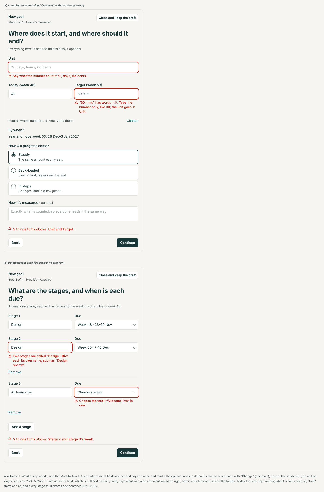 | 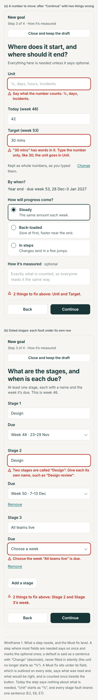 |
| 2 | A Check question in place (as an admin choosing another owner), and a number asked once | 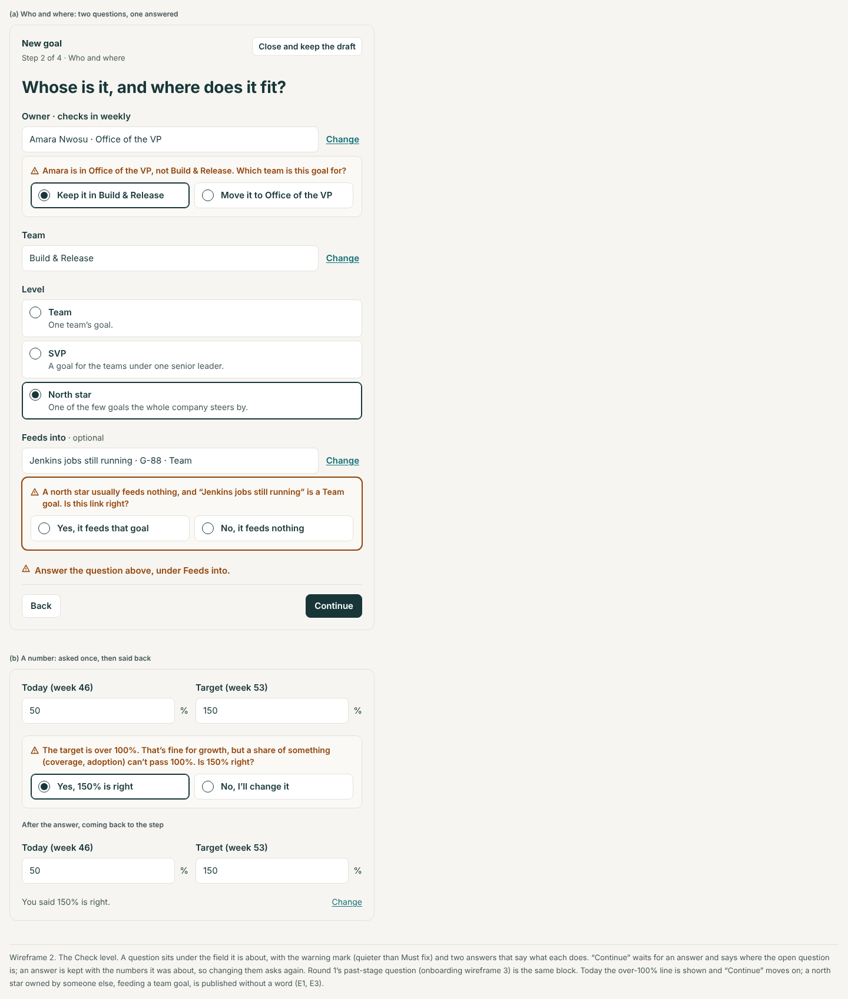 | 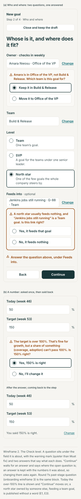 |
| 3 | The read-back, with a weekly rhythm and with none | 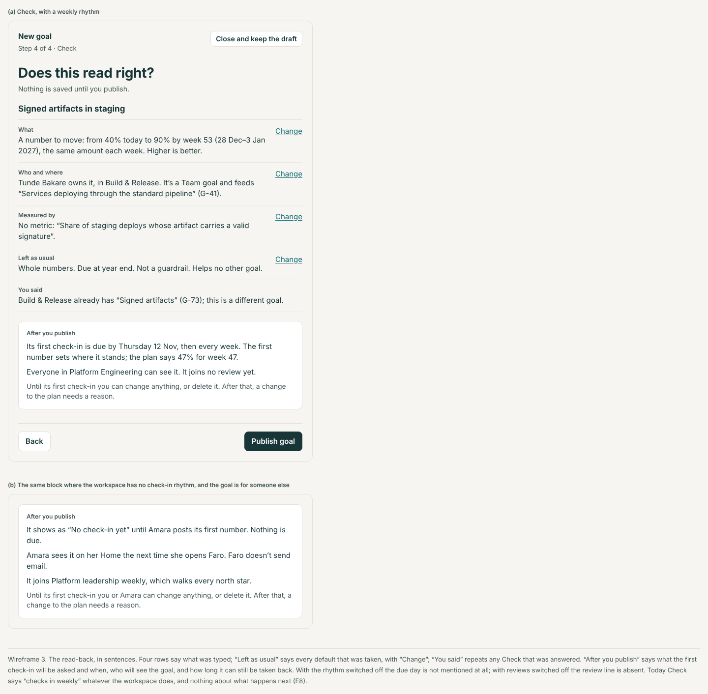 | 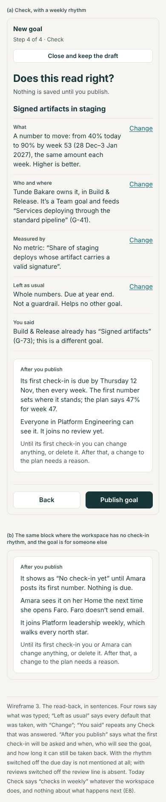 |
| 4 | The edit page: what will change, a reason, Undo, and the page for someone who can't change it | 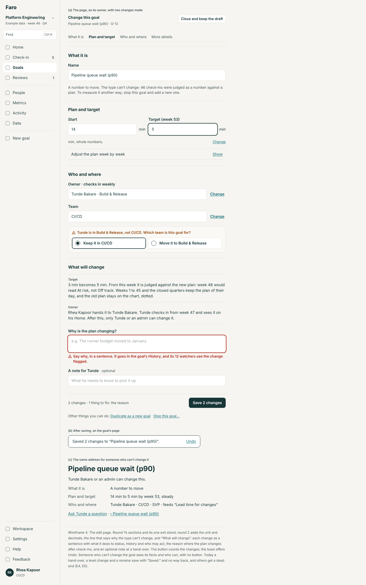 | 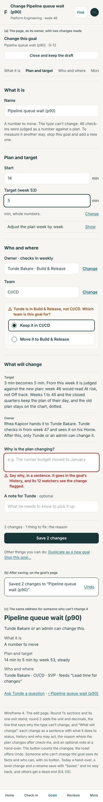 |
| 5 | A goal agreed in a review, and what its owner then sees | 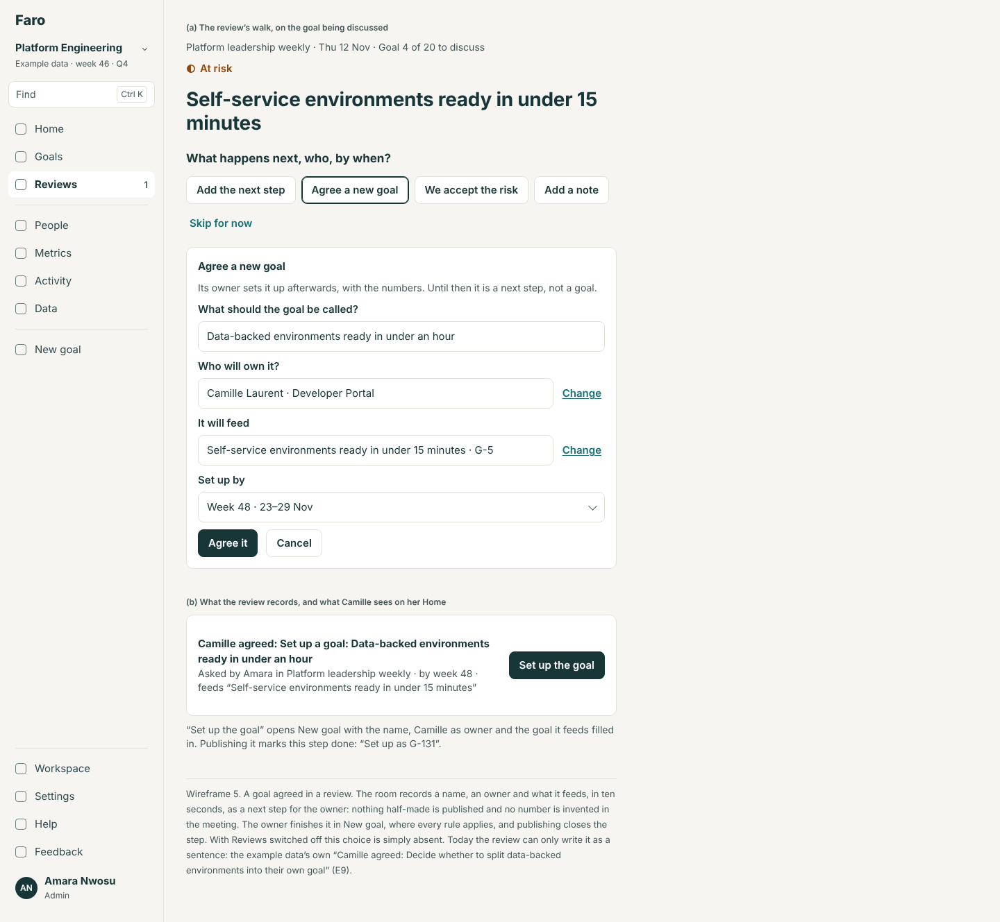 | 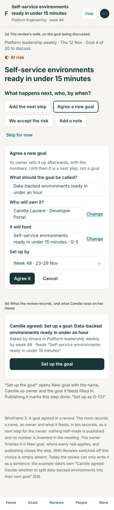 |
| 6 | New goal from a parent goal; "Adding several?" | 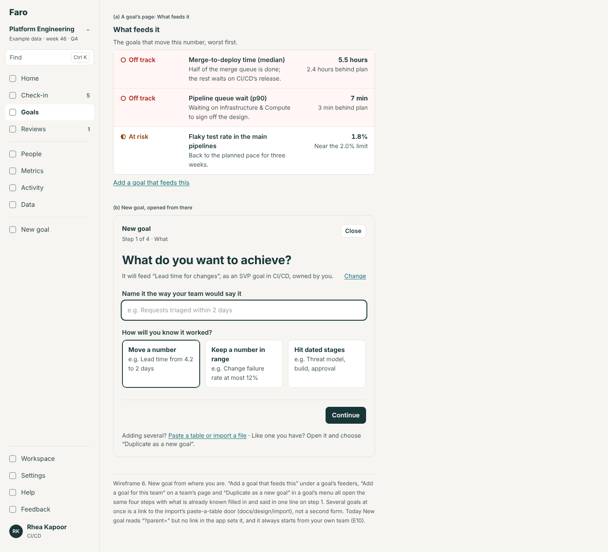 | 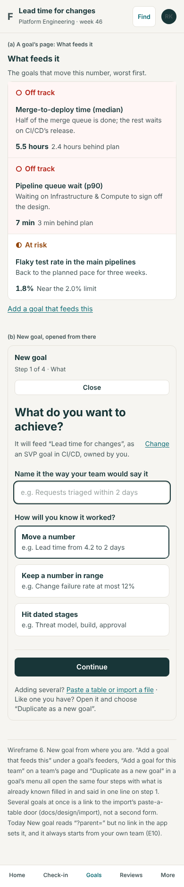 |
| 7 | Drafts: on New goal, on Goals, and after closing | 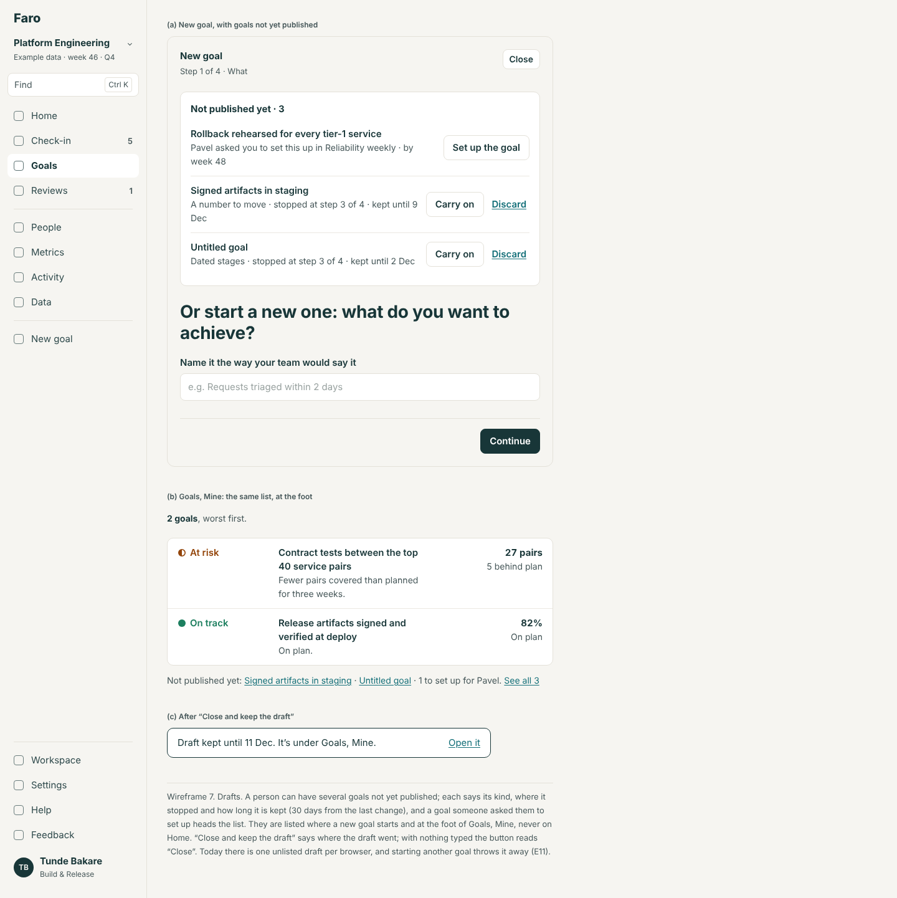 | 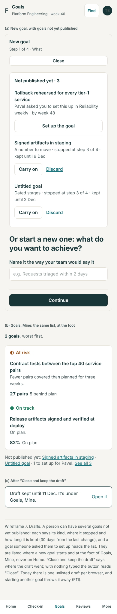 |

Round 1's wireframes for the steps' order, the pickers, the past-stage question and the first check-in (`docs/design/onboarding/wireframes`) stand and are not redrawn.

## Changes to today's rules

For the lead to reconcile with the import area's field table. Each is a change to what the engine accepts or defaults, so it changes the import and the AI tools too.

| # | Field or rule | Today | Proposed | Level |
|---|---|---|---|---|
| 1 | Unit, number and range goals | "%" when nothing is said | Required: "Say what the number counts: %, days, incidents." | Must fix |
| 2 | Decimals | The form: a required field starting at 0. The import and set-up: worked out | Optional everywhere; worked out from the numbers typed, and said | — |
| 3 | Team | The owner's, else the first team in the list | The owner's; with none, required: "Choose a team." | Must fix |
| 4 | Same name in the same team | The form notes it; the import refuses it | A question at every door | Check |
| 5 | The four number hints (below zero, over 100%, a hundredfold, a billion) | Shown or noted; saved unanswered | A question that must be answered; all that apply are asked | Check |
| 6 | A typed unit that isn't the goal's ("12 days" in a % goal) | Read as 12 | "“12 days” has words in it. Type the number only, like 12; the unit goes in Unit." A typed "%" in a % goal stays fine | Must fix |
| 7 | Two stages with one name | Accepted | "Two stages are called “Design”. Give each its own name." | Must fix |
| 8 | Warn this close | 1, in the goal's unit | Optional; empty means no early warning, and is said. As large as the limit: a question | Check |
| 9 | Owner outside the goal's team | Accepted | A question | Check |
| 10 | A goal feeding one at a lower level | Accepted | A question (decision 3) | Check |
| 11 | A level above Team, set by someone who isn't an admin | Accepted | A question (decision 2) | Check |
| 12 | Who may add a goal for someone else | The engine: admins. The form: anyone | The form asks the engine; no rule changes | Must fix |
| 13 | "Also helps", "Guardrail", and the effect in the AI tools | Form only | Rows in the field table | — |
| 14 | Unit or decimals on an existing goal | Import only | Also on the edit page; after check-ins the unit is a plan change (a reason) | — |

Formats, unchanged but now stated per field: a number is digits with an optional decimal point or comma, thousands separators allowed, a sign in front; a week is a whole number shown with its dates; a name is 3 characters or more.

## What this changes in round 1

| Round 1 | Says | Round 2 |
|---|---|---|
| Onboarding spec 2.1, drafts | One draft; `/goals/new` goes to its step; "Start a new one" discards it | Several drafts. It goes straight to the step only with exactly one draft and nothing in the address; otherwise step 1 with the list. Nothing is discarded by starting another |
| Onboarding spec 2.1, errors | Under their field on "Continue" | Also on leaving a touched field, and counted once above the button |
| Onboarding spec 2.2, the same-name note | A note naming the other goal | In the same team it is a question; in another team the note stands as OB1 words it |
| Onboarding spec 2.3, row 1 | Other people are "listed but not selectable" for someone who isn't an admin | They are selectable, and the step's button becomes "Ask {name} to set it up" (GE6). Until GE6, as OB1 says |
| Onboarding spec 2.3, row 4 | A goal at the same or a lower level is not selectable, "today's rule" | There is no such rule today (E4). A lower-level parent is a question; the same level is allowed |
| Onboarding spec 2.4, unit and decimals | Fields when no metric is chosen | The unit starts empty and is required; decimals are a sentence with "Change" |
| Onboarding spec 2.4, the past-stage question | Its own block, "Say whether this stage is done." | The same words and answers, as the first use of the shared Check block |
| Onboarding spec 2.5, Check | "The sentence and the rows as today, with…" | Replaced by the read-back (section 3); OB1's additions (Measured by, where it fits, stages said correctly) are rows of it |
| Onboarding spec 2.8, set-up's goal steps | Today's words | The field table's words and the Check questions |
| Onboarding spec, rule 4 (re-base) | For a goal created at most 4 weeks ago | Unchanged; it now also covers a goal carried into a new cycle, which is "created" at the cycle's start |
| Goal spec 2.7 (GT3's edit page), item 5 | The notice and the reason field "as today" | The reason is asked inside "What will change". Today's "a change made from one part always asks why" goes with `?part=`; a reason is required only where the plan changes after check-ins |
| Goal spec 2.7 | Four sections, find-and-pick, a sticky Save | Adds unit and decimals, the type line, "What will change", the counting button, Undo, the patch draft, the foot's links, and the page for someone who can't change the goal |
| Goal spec 2.1 and the "…" menu | "What feeds it"; Share, Copy, Print, Change, Stop | Adds "Add a goal that feeds this" and "Duplicate as a new goal" |
| Navigation spec 2.5 | "Close and keep the draft" on New goal | With nothing typed it reads "Close"; after it, a toast says where the draft is |
| Metrics spec 2.4 (ML2) | The pick passes the metric and its slice | The pick also passes which way is better and the metric's latest number for that slice, so two questions can be asked. No screen of ML2 changes |
| Find spec | — | Nothing changes |

## For the rebuild (spec only)

- **Agreeing a goal becomes R6c's round**: draft, propose, agree. "Agree a new goal" is its seed; the next step becomes a draft goal the owner proposes.
- **Owners and teams come from the directory** (R6a); "an owner outside the goal's team" then asks against the reporting line.
- **Drafts sit behind the `Prefs` port**, so they follow the person once the internal app keeps preferences on the server.
- **Who may set a level** is a role in the internal app (R1); Faro's question stands in for it.

## Decisions for Lane

One batch; the recommended answer is first. `spec.md`, section 10, says what changes for each other answer.

1. **A goal agreed in a review.**
   - (a) Record it as a next step for its owner, "Set up a goal: …", which opens New goal filled in and is done when the goal is published. *Recommended: nothing half-made, no invented numbers, no migration.*
   - (b) A real unpublished goal, visible as "Proposed" (needs a new state on goals and a migration; it is R6c's shape).
   - (c) Open New goal inside the review.
2. **Who may set a level above Team.**
   - (a) Anyone, as today; someone who isn't an admin is asked once, and the read-back names the reviews it joins. *Recommended.*
   - (b) Admins only: a new line in R1's table and in `planChanges`.
   - (c) Leave it unasked.
3. **A goal that feeds a goal at a lower level.**
   - (a) A question. *Recommended.*
   - (b) A Must fix (round 1 assumed this rule existed).
   - (c) Nothing.
4. **The unit.**
   - (a) Required for number and range goals; never "%" by default, in the form, a file or a tool. *Recommended.*
   - (b) Optional; an empty unit is asked about once.
   - (c) As today.
5. **The same name in the same team.**
   - (a) A question at every door. *Recommended (round 2's shared decision 2).*
   - (b) A Must fix at every door, as the import does today.
   - (c) As today: the form notes, the import refuses.
6. **Handing a goal over.**
   - (a) Said in "What will change", with an optional note, and Undo for ten minutes by whoever did it. *Recommended.*
   - (b) The same, and a reason is required.
   - (c) The new owner must accept first (spec only; it is R6c's).
7. **Drafts.**
   - (a) Up to five, per person, kept 30 days, listed on New goal and under Goals, Mine. *Recommended.*
   - (b) One, as today, but listed.
   - (c) As today.
8. **A team's lead adding goals for their people.**
   - (a) No: R1 stands, and the lead uses "Ask {name} to set it up". *Recommended.*
   - (b) Yes: a new right for a team's lead (R1's table changes).
9. **Check answers in a goal's History.**
   - (a) Kept, as one line with the goal's creation or change. *Recommended.*
   - (b) Not kept.
