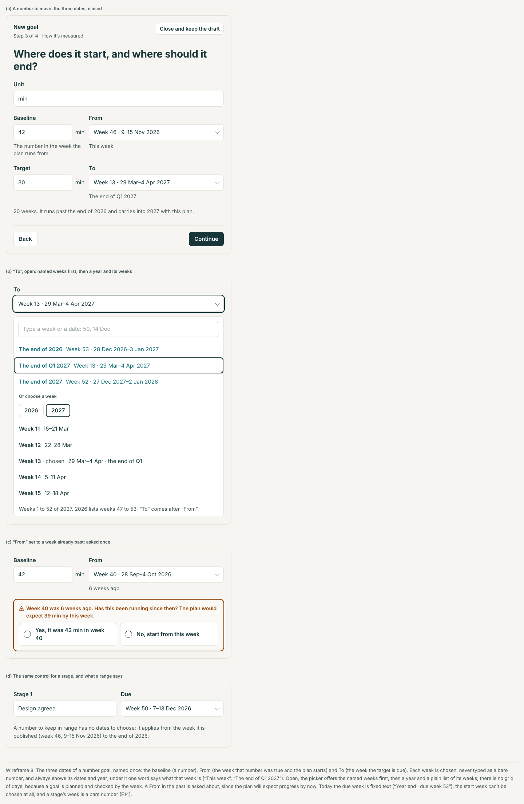
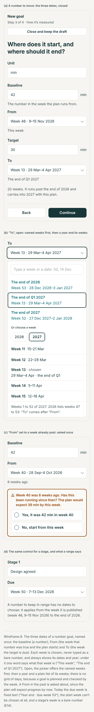
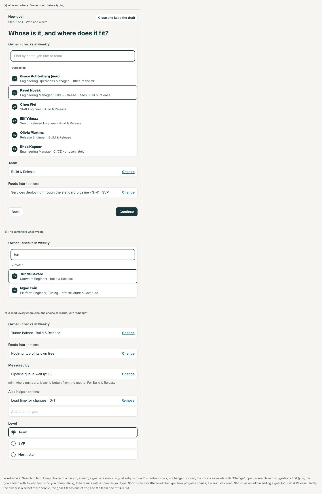
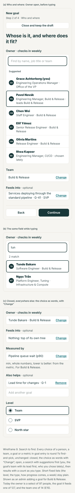
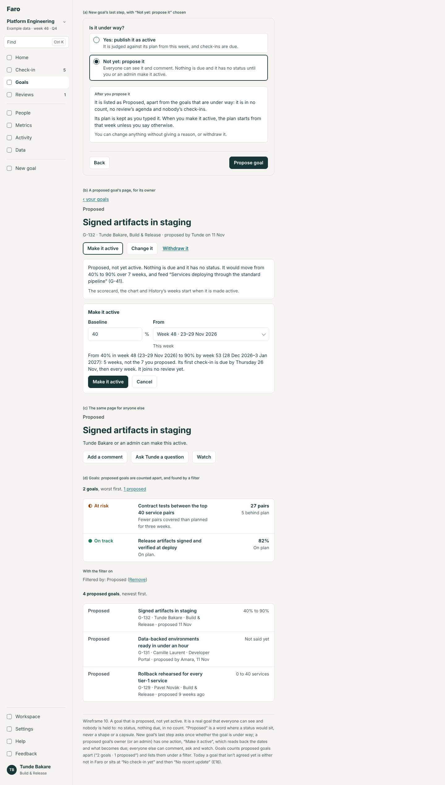
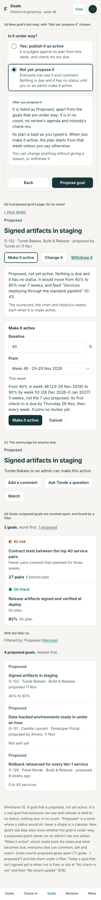

# Goal entry: the evaluation and the design

11 November 2026. Area 2 of round 2 (`docs/design/round-2/README.md`). Design and spec only: no app code was changed, and nothing here is built. The build spec is `spec.md` beside this file. The wireframes in `wireframes/` are rendered from `mockups/` (`node docs/design/goal-entry/mockups/build.cjs`) at 1440 and 390 px.

It covers every way one goal is made or changed by hand: **New goal**, **the edit page**, and **adding a goal from somewhere else** (set-up, a review, a parent goal, a team, a copy of another goal). It builds on round 1's OB1 to OB3 and GT3 (`docs/design/onboarding`, `docs/design/goal`), none of which is on main yet, and says in "What this changes in round 1" every place it changes them. Many goals at once is the import area's (`docs/design/import`).

## The idea in six lines

1. **What a goal needs is said once, and every door agrees.** The form, set-up, the import and the AI tools read one field table and run one check, so "required" means the same thing in each.
2. **Three levels, in place.** A Must fix sits under its field and is counted once at the button. A Check is a question answered where it arises. Fine says nothing.
3. **Nothing is saved before it is read back**, in sentences: what was typed, what was left as usual, what happens after, and how it can be taken back.
4. **A change says what it will do** to status, history and who may act, before it is saved; and it can be undone.
5. **A goal starts where the thought does**: under the goal it feeds, on a team's page, from a copy, or in a review, where it is agreed in ten seconds and set up properly by its owner afterwards.
6. **A goal can be proposed before anyone is held to it**: visible, discussable, with no status and nothing due, until its owner makes it active.

Additions from Lane on 11 Nov are folded in: **the dates are named and picked** (section 9 of the design, E14); **every person, team, goal and metric is found by typing** (section 10, E15); **a goal can be proposed before it is active** (section 11, E16); and his answer that **anyone may add a goal for anyone, at any level**, which turns E1's fix round (the doors must agree on his rule, so the import's refusal goes, not the form's freedom).

## The jobs people come to do

| Who | Job | How often | Today |
|---|---|---|---|
| Owner (Tunde, Rhea) | Add a goal of their own | A few times a year | 3 typed answers and 4 presses for the simplest; eight things decided for them without a word |
| Owner | Correct a goal: its name, target, stages | Monthly | One page; a plan change asks why; nothing says what the change does |
| Owner | Hand a goal to someone else | Yearly | One select and "Saved."; they are locked out at once |
| Manager (Rhea) | Get a goal made for one of her people | Each quarter | She can make it herself, owned by them, though the rules say only an admin may |
| Leader (Amara) in a review | Record a goal the room agreed | Most reviews | A next step in words: "Decide whether to split … into their own goal" |
| Admin (Grace) | Add goals for others; fix a goal's unit or level | Weekly at first | New goal; unit and decimals only through a spreadsheet |
| Whoever sets up | The first three or four goals | Once | A shorter form with its own words for the same faults |
| Anyone | Start a goal, be interrupted, come back | Often | One draft per browser, found only by pressing New goal |
| An assistant (MCP) | Add or change a goal for its person | Daily, for some | The engine's rules; questions come back as notes and are saved |

## Findings

From the walk of 11 Nov on the live demo (`/demo?today=2026-11-11`) as Rhea Kapoor, Tunde Bakare and Amara Nwosu at 1440 × 900 and 390 × 844; set-up at `/?store=browser` with every request to the database blocked, on the template and the blank path; the review walkthrough as Amara; and the code named. Severity: **High**, **Medium**, **Low**.

**How long the simplest goal takes today**

| Type | Typed answers | Presses | Decided without asking |
|---|---|---|---|
| Move a number | 3: name, today, target | 4: Continue × 3, Publish | Type, unit "%", decimals 0, due at year end, steady, owner, team, level Team, feeds nothing |
| Keep in range | 2: name, limit | 5 | The same, and "at most", "warn within 1" |
| Dated stages | 3: name, a stage, its week | 5 | Owner, team, level, feeds nothing |

That speed is worth keeping. What is wrong is that the defaults are silent and the checks uneven.

### The rules

**E1. The form does not run the engine's rules: anyone can publish a goal owned by anyone, at any level. High.**
- As Tunde (not an admin), `/demo/goals/new`, step 3: Owner is a select of 97 people. Chose **Amara Nwosu**, Level **North star**, Feeds into **"Jenkins jobs still running"** (a Team goal). Check read "Amara Nwosu owns it and checks in weekly … North star level. It feeds “Jenkins jobs still running”, by about 3 jobs." Published as G-127.
- The goal's page then offered "Amara posts its check-ins. Ask for the first one now?", and `/goals/<id>/edit` told Tunde "Only its owner can change this goal". He cannot delete what he made; Amara has a north star she never saw; the Platform leadership weekly, which walks every north star, gains it.
- The import refuses the same thing: "You can add goals you own. Ask an admin to add goals for other people." (`src/domain/changeset.ts:385`). The form never asks: `saveGoal` commits directly (`src/app/state.tsx:615`), and there is no `saveGoal` in the action table (`src/app/actions.ts`). R1's row "Add a goal: anyone, for a goal they own; an admin, for anyone" names `planChanges`, which the form does not call.
- **Which way the fix goes** (Lane, 11 Nov: "as today: anyone may create a goal above Team level or for someone else"). The finding stands: the doors disagree. But it is the engine's refusal that goes, so a file and the AI tools allow what the form allows. What is left to mend is that nobody was told anything: the read-back now says who will be able to change the goal afterwards, and a goal made for someone else starts as proposed unless its author says otherwise (section 11).

**E2. Nothing says what is required, and the doors disagree. High.**

| Field | New goal | Set-up | Import and AI tools |
|---|---|---|---|
| Owner | You, silently | "No owner yet" allowed | Required: "A new goal needs an owner: Owner email, or Owner." (the AI tool fills in its person) |
| Team | Yours, else **the first team in the list** (`GoalWizard.tsx:83`) | Yours | The owner's, else the first team (`changeset.ts:390`) |
| Type | "Move a number" pre-chosen | Template's | Empty means metric (`changeset.ts:403`); the AI tool requires it |
| Unit | **"%" pre-filled** (`goal.ts:44`) | Empty | "%" when the file has no Unit column |
| Decimals | 0, a field: "Between 0 and 3." | Worked out from the numbers | Worked out from the numbers (`changeset.ts:406`) |
| Start missing | "Enter where it starts." | "Add today’s number." (`Onboarding.tsx:204`) | The form's words, joined in one line |
| Same name, same team | Allowed, with a note | Allowed | **Refused** (`changeset.ts:376`) |
| Warn this close | 1, whatever the limit (`goal.ts:45`) | 1 | 1 |

- On screen only "How it’s measured · optional" and "Data source (optional)" say anything about need. A person learns the rest by pressing Continue.
- A goal about days, typed the fast way, is published in "%".

**E3. Questions are shown and not asked. High.**
- New goal, step 2: today −5, target 5, unit %: the line "Below zero %. Fine for a change or a balance; otherwise check the sign." appears and **Continue goes on**. The same for "Over 100%. Fine for growth; but if this is a share of something … check the target." (50 → 150) and "The target is under a 100th of the start (3,000,000,000 to 5). Is that right?" (`planHint`, `goal.ts:113`).
- 10 → 1500 % shows only the over-100% line: one hint hides another.
- In the import and the AI tools the same lines are "notes", saved under "Read as:" (`changeset.ts:454`, `mcp/tools.ts:136`).
- On the edit page the same kind of doubt is a tick box that must be ticked ("This makes higher better … Yes, make higher better"; `planQuestion`, `goal.ts:129`). So one level has three strengths.

**E4. Round 1 cites a rule that isn't there: nothing stops or questions a goal feeding a goal below it. Medium.**
- The onboarding spec (2.3, row 4) says a goal at the same or a lower level is "not selectable … (today's rule)". There is no such rule in the code (no "can’t feed" anywhere in `src`); E1's north star feeds a Team goal. The only link rule is the loop check (`src/domain/tree.ts:31`).
- Nor is there any rule on who may set a level. `LevelField`'s hint is all there is: "Flag SVP or North star only for goals reported at major reviews."

### Entering

**E5. Numbers are read generously and reported unevenly. Medium.**
- "12 days" typed into a "%" goal is read as 12 without a word (`parseNumber` drops trailing letters, `checkin.ts:85`). "12%" is read as 12, rightly.
- "abc" gives "“abc” isn’t a number. Type digits only, like 29.4." on a whole-number goal: the deep review's U10 was fixed for the check-in only (`goal.ts:77` calls `notNumberText` without the decimals).
- "1,5" on a whole-number goal: "1,5 has 1 decimal place, but this goal keeps whole numbers, so it would show as 2. Type 2, or set the goal’s Decimals to 1." Good words; in New goal the field is on the same step, on the edit page it doesn't exist (E8).
- Decimals 7 or "x": "Between 0 and 3.", which names nothing.
- A range "at most 12%" with "Warn this close" 20 is accepted (always at risk); the limit −4% and 150% pass with no line once Continue is pressed; Check reads "with a warning within 1", no unit (`GoalWizard.tsx:297`).
- A plan from 10% to 5% in whole numbers reads 9, 9, 8, 7, 6, 6 in the table.
- Number fields ask for the decimal keypad (`inputMode="decimal"`), which on an iPhone has no minus key. Not verified on a device.

**E6. Stages are bare week numbers, and every fault shares a sentence. Medium.**
- "Due week" is a number field with no dates and nothing saying this is week 46 (390 px and 1440 px alike).
- Empty, "abc", 60 and 0 all give "Every stage needs a due week between 1 and 53."; the message goes under one row.
- Two stages both called "Design" are accepted. The import then matches stages by name (`changeset.ts:437`), so the two can't be told apart in a file.
- Stages typed out of order are sorted without a word. Check says "1 stages" (`GoalWizard.tsx:298`).
- A stage in week 1 is accepted in week 46 (round 1's O4; OB2 is built and held).

**E7. The read-back leaves out what happens next and what was decided for you. Medium.**
- "Rhea Kapoor owns it and checks in weekly. It moves from 10% to 5% by week 53 (28 Dec–3 Jan 2027), steady. It’s at the top of its own tree." Then three rows with "Change".
- Not said: that the unit and decimals were defaults; when the first check-in is due; who will see the goal; that it can be deleted only until its first check-in.
- "checks in weekly" is fixed text (`GoalWizard.tsx:295`), which will be untrue in a workspace with the rhythm switched off (round 2, decision 6).

### Changing

**E8. The edit page saves a hand-over in one press, with no read-back, no reason and no way back. High.**
- As Rhea on `/demo/goals/lead-ci-time/edit` (46 check-ins): Owner → Tunde Bakare (another team), Level → North star, a new name; "Save changes" → the toast "Saved." The History says "Rhea Kapoor changed name, owner, level".
- Reopening the page: "Only its owner can change this goal. Tunde Bakare owns it." Rhea cannot take it back. Tunde is told nothing. The team stayed CI/CD though its owner is in Build & Release.
- A one-minute change to the target asks "Why change it?"; giving the goal away asks nothing.
- The page cannot change **Unit or Decimals** at all (no field in `GoalEdit.tsx`), though the number errors send people to "the goal’s Decimals". It never says the **type** can't change, or why; the engine's words exist only for a spreadsheet ("A goal’s type can’t change. Add a new goal instead.", `changeset.ts:400`).
- Someone who may not change the goal gets a dead end, not the page without its action (round 1's rule for a person who can't act).
- An unsaved edit is kept whole and laid over the goal next time (`GoalEdit.tsx:46`): if someone else changed the goal in between, saving puts their change back without saying so.

### Adding from elsewhere

**E9. A goal agreed in a review can't be added there. Medium.**
- The walkthrough (`/goals/<id>?review=weekly`) offers "Add the next step", "We accept the risk", "Add a note", "Ask Akosua a question", "Skip for now".
- The example data shows what people do instead: "Camille agreed: Decide whether to split data-backed environments into their own goal. by Thu 26 Nov". A goal, recorded as a sentence, with no route from it to New goal.

**E10. New goal has one door and doesn't know where you came from. Medium.**
- The form reads `?parent=` (`GoalWizard.tsx:82`), but no link in the app sets it. A goal's "What feeds it" lists its feeders and has no way to add one; a team's page says "See its 17 goals" and no more.
- An unpublished draft swallows the link: opening New goal with a draft shows "You have a goal you didn’t publish", and Resume ignores the address.
- There is no way to start from a goal like one you have.

**E11. One draft, unlisted, easily lost. Medium.**
- One draft per browser and workspace, whoever is using it (`goalDraftKey`, `drafts.ts:50`). Home and Goals don't mention it (walked). It is found only by pressing New goal: "You have a goal you didn’t publish … Resume / Start another goal. Starting another throws the unpublished one away."
- The exit is an icon whose only words are an `aria-label`, "Close and keep the draft"; after it, nothing says where the draft went.

**E12. Goals carried into a new cycle get dates nobody chose. Low.**
- `nextCycle` (`src/domain/cycle.ts:139`) spreads the stages left evenly over the new cycle, and restarts a number from its last value with the old target. The admin reads "{n} goals move into next year, starting from where they ended. Owners can change targets in the first week." No owner is shown what was assumed for their goal.

**E13. The form has fields the sheet and the AI tools lack. Low.**
- "Also helps" and "It’s a guardrail" are in the form (`GoalDraft`, `goal.ts:20`) and in no column of the Goals sheet (`columns.ts:184`); the AI tools also lack the effect. For the field table to be the form, it needs these rows (a note for the import area).

### Dates, and choosing

**E14. A number goal has three dates, and the form lets a person choose none of them clearly. High** (Lane, 11 Nov: "The baseline date, from and to, need to be clearer… you should be able to pick to and from years and weeks").
- **To.** New goal, step 2, week 46: "By when?" is plain text, "Year end · due week 53, 28 Dec–3 Jan 2027", because `dueOptions` offers only the year's end and the quarter ends still to come (`dueOptions` in `src/domain/year.ts`), and in Q4 that is one. No other week can be chosen. The engine takes any week up to 104 (`changeset.ts:421`), so a file can do what the form can't.
- **From.** It can't be chosen at all. A new goal's plan starts "this week" without saying so except in a label, "Today (week 46)" (`GoalWizard.tsx:202`, `goal.ts:183`); the edit page shows "Start (min)" with no week (`GoalEdit.tsx:147`). The engine takes any week from −104 to 104 ("Plan from week", `changeset.ts:414`).
- **The baseline's date.** The data holds one week for both "when the start number was true" and "when the plan starts" (`MetricPlan.fromWeek`, `types.ts:59`). No screen says that they are the same thing.
- **No year.** Weeks are counted from the cycle's start and shown as bare numbers: "week 53", "Due week" (`GoalFields.tsx:95`), "Week 13". The year is added to a date only when the week falls outside the cycle's own year (`weekDates`, `plan.ts:213`). Week 53 exists in 2026 and not in 2027; the next cycle's week 1 is this cycle's week 54, and nothing shows either.
- **Stages** take a typed week from 1 to 53 only (`goal.ts:104`): a stage can't be due next year. **A range** has no dates at all.
- **Carrying over** (read from the code, not run): a number goal carried into the next cycle keeps its "plan from week" (`cycle.ts:133` copies the plan and changes only the start), so one set up in week 46 of 2026 would have a flat plan until week 46 of 2027.
- In the sheet, "Plan from week" and "Due week" are numbers "counted from the cycle's start" (`columns.ts:199`), which only mean something beside the cycle they came from.

**E15. Every choice of a person, a team or a goal is still a list of everything. High** (round 1's O1 and S3; Lane, 11 Nov: "these should be search to find pickers").
- New goal, step 3, walked on 11 Nov: "Owner · checks in weekly" is a select of 97 people in directory order, "Feeds into" one of 127 goals, "Team" one of 14. The edit page has the same three and a fourth, "Add a goal it also helps…" (123 goals).
- FS1 built the control (`src/ui/Pick.tsx`; bulk edit uses it), but its second part is held: `scripts/pickers-left.json` still allows 3 selects in `GoalWizard.tsx`, 4 in `GoalEdit.tsx`, 1 in `Onboarding.tsx` and 2 in `RemoveSheets.tsx`.
- At company size these are selects of 15,000 and 30,000.

**E16. Faro can't tell a goal that is under way from one that is only being suggested. High** (Lane, 11 Nov: "There also needs to be a feature to identify if a goal is active or if it is just proposed").
- A goal has two states besides live: removed and stopped (`types.ts:108–114`). Every live goal is judged: `goalStatus` gives it "Not started" in week 0, "No check-in yet" for 14 days, then "No recent update" (`status.ts:208–212`).
- So a goal put in before it is agreed is counted at once and flagged a fortnight later. The demo has one: Rhea's "CI cost per pipeline run" reads "No check-in yet" on Goals, Mine and counts among her 8 and in "1 no check-in yet" on her Home.
- People keep the others out of Faro, or write them as sentences: the review's "Camille agreed: Decide whether to split data-backed environments into their own goal" (E9).
- The code has a place meant for this that nothing uses: `pending`, "a proposed plan change … kept for governance later" (`types.ts:104`).
- With anyone able to add a goal for anyone at any level (Lane's answer; E1), there is nothing between "not in Faro" and "you are now held to this".

### What works and is kept

- **Three typed answers for the simplest goal**, one question a step, a card per type.
- **Errors that say what to type**: the decimals sentence; "Give the goal a name of at least three characters."
- **A plan change after check-ins needs a reason**, keeps the old plan dotted, and judges earlier weeks against the plan of their day (`replanned`, `goal.ts:222`).
- **The direction question** on the edit page: asked in place, answered with words that say what yes means, asked again when the numbers change. It is the model for the Check level.
- **Delete before the first check-in, Stop after** (`src/domain/removal.ts:276`), each with its own words.
- **One engine** for the import, the Data tables, bulk edit and the AI tools (`planChanges`), with a preview before anything is saved.
- **Set-up's short goal card** (name, type, today, target, unit, owner), and "No owner yet" (OB3, built).

## The design

### 1. What a goal needs, said once

One row per field, in the shared field table (`docs/design/import/spec.md`; in code `src/domain/columns.ts`). The form's labels, hints, examples and errors are printed from it; so are set-up's, the import's and the AI tools'. The full table with formats and wording is in `spec.md`, section 3. In short:

| | Fields | Starts as |
|---|---|---|
| **Required** for every goal | Name · Type · Owner · Team · Level | Type: a number to move. Owner: you. Team: the owner's. Level: Team (or one below what it feeds). Each is shown, never silent |
| **Required for a number to move** | Unit · Baseline · Target | Empty |
| **Required for a number to keep in range** | Unit · Must stay · Limit | Must stay: at most |
| **Required for dated stages** | At least one stage; each stage's name and due week | One empty row |
| Optional, with the default said | Decimals (worked out from what you type) · From (this week) · To (the goal year's end) · How progress comes (steady) · Warn this close (no early warning) · Feeds into (nothing) · How much, and why it helps · Also helps (none) · Guardrail (no) · Measured by / How it’s measured · Where the number comes from | As said |
| Worked out | Key · the plan week by week · which way is better · status and everything after it | By Faro |

**How a step says it.** A step where most fields are needed says once, under its heading, "Everything here is needed unless it says optional." and marks the optional ones "· optional". A step with one needed field says nothing. A default that was taken is a sentence with "Change" ("Kept as whole numbers, as you typed them."), not a filled-in field that looks typed (wireframe 1).

### 2. Three levels in a form

| Level | When it shows | Where | What the button does |
|---|---|---|---|
| **Must fix** | On leaving the field, once it has been touched; all of the step's on "Continue" | Under the field, with the warning mark; the field outlined on every side. Says what was read and what would be right | "Continue" stays pressable; pressed, it moves to the first one and says once above itself "2 things to fix above: Unit and Target." |
| **Check** | As soon as the values that raise it are complete | A flat block under the field: the warning mark (quieter), the question, two answers that say what each does | "Continue" waits for an answer: "Answer the question above, under Feeds into." |
| Fine | — | Nothing | Goes on |

- An answer is kept with the values it was about. Change them and it is asked again. Come back to the step and it reads as a line: "You said 150% is right. Change".
- A Check never changes the goal by itself; where an answer does ("Move it to Office of the VP"), its words say so.
- Every answer is repeated on the read-back ("You said") and kept in the goal's History with its creation.
- **The questions** (exact words in `spec.md`, section 4): a stage already past (round 1's, unchanged); a number below zero, over 100%, a hundred times the other, or a billion; a target on the wrong side for the metric it is measured by; a number far from that metric's latest; the same name in the same team; an owner outside the goal's team; a goal feeding one at a lower level; a warning margin as large as the limit; a hand-set plan that leaves most of the change to the last weeks.
- **Not questions.** A target equal to the start is a Must fix that offers the way out: "The target is the same as today (10%). To hold a number where it is, make this a number to keep in range." with the button "Keep it at 10% or under". A due week before the start week can't be chosen in the form; in a file or a tool it is a Must fix, in today's words.

### 3. The read-back (wireframe 3)

New goal's last step. A title, then rows of sentences, each with "Change" to its step:

- **What**: "A number to move: from 40% in week 46 (9–15 Nov 2026) to 90% by week 53 (28 Dec 2026–3 Jan 2027), the same amount each week. Higher is better."
- **Who and where**: "Tunde Bakare owns it, in Build & Release. It’s a Team goal and feeds “…” (G-41)."
- **Measured by**: the metric, or "No metric" and the description.
- **Left as usual**: every default taken, in one line: "Whole numbers. From this week to the end of 2026. Not a guardrail. Helps no other goal."
- **You said**: each Check answered.

Then one block, **After you publish**:

- With a weekly rhythm: "Its first check-in is due by Thursday 12 Nov, then every week. The first number sets where it stands; the plan says 47% for week 47."
- With no rhythm: "It shows as “No check-in yet” until {owner} posts its first number. Nothing is due." No day is named anywhere on the step, and the owner field's label is "Owner", not "Owner · checks in weekly".
- For someone else: "{Owner} sees it on {her} Home the next time {she} opens Faro. Faro doesn’t send email."
- With reviews on: "It joins {review}, which walks every north star." or "It joins no review yet." With reviews off: no line.
- Always: "Until its first check-in you can change anything, or delete it. After that, a change to the plan needs a reason."

### 4. Changing a goal (wireframe 4)

`/goals/<id>/edit`, round 1's page (GT3): one page, sections "What it is", "Plan and target", "Who and where", "More details", one exit. Round 2 adds:

- **The same fields and words as New goal**, made from the same table. Unit and Decimals join "Plan and target", shown as a sentence with "Change".
- **What can't change, and why**, under the name: "A number to move. The type can’t change: 46 check-ins were judged as a number against a plan. To measure it another way, stop this goal and add a new one." With no check-ins: "… The type can’t change. This goal has no check-ins, so you can delete it and add it again another way: Duplicate as a new goal."
- **What will change**, a last section that appears with the first change: one sentence per change, saying what it does.
  - Plan: "Target: 3 min becomes 5 min. From this week it is judged against the new plan: week 46 would read At risk, not Off track. Weeks 1 to 45 and the closed quarters keep the plan of their day, and the old plan stays on the chart, dotted."
  - Owner: "Rhea Kapoor hands it to Tunde Bakare. Tunde checks in from week 47 and sees it on his Home. After this, only Tunde or an admin can change it."
  - Unit after check-ins: "Unit: min becomes hours. The 46 numbers already checked in are not converted: 7 will read 7 hours."
  - Decimals down: a Must fix when a check-in has more places than the goal would keep.
- **A reason** where the plan changes after check-ins, as today, asked inside "What will change": "Why is the plan changing?" With a hand-over, "A note for {name} · optional".
- **One button that counts**: "Save 2 changes". Nothing changed: "Nothing to save" and no button.
- **Undo**: the toast "Saved 2 changes to “{goal}”. Undo", and the same link at the top of the goal's page until the person leaves it; it puts every field back as one change, a hand-over included.
- **Who may**: the owner and admins. Anyone else opening the address sees the goal's facts under "{Owner} or an admin can change this.", with "Ask {owner} a question" and no button.
- **Stop, delete, duplicate** stay out of the form, as GT3 placed them (the goal's "…" menu), and are repeated as plain links at the page's foot: "Other things you can do: Duplicate as a new goal · Stop this goal…" (or "Delete this goal…" before its first check-in). Handing over is the Owner field; there is no second door for it.
- **An unsaved edit** keeps only the fields the person changed. If the goal has changed since, the page opens with "{Name} changed this goal on 10 Nov, after you started. Your unsaved changes: Target 5 min. Keep them / Discard them", and "What will change" is always worked out against the goal as it is now.

### 5. Adding a goal from where you are (wireframes 5 and 6)

**One form.** Every door opens New goal's four steps with what is already known filled in, and step 1 says it in a line: "It will feed “Lead time for changes”, as an SVP goal in CI/CD, owned by you. Change". Nothing is a second form.

| Door | Where | Opens | Fills in |
|---|---|---|---|
| "Add a goal that feeds this" | Under a goal's "What feeds it" | `/goals/new?parent=<id>` | Feeds into; the level one below |
| "Add a goal for {team}" | A team's page, beside "See its {n} goals" | `/goals/new?team=<id>` | Team |
| "Duplicate as a new goal"; "Copy from a goal" | A goal's "…" menu and the edit page's foot; New goal's step 1, which finds the goal by typing | `/goals/new?like=<id>` | Type, unit, decimals, shape, team, level, what it feeds, how it's measured, the stages' names. Not the name, the numbers, the dates or the owner |
| "Set up the goal" | A next step that asks for a goal (below) | `/goals/new?from=<askId>` | Name, owner, what it feeds |
| "Adding several? Paste a table or import a file" | The foot of New goal's step 1 | The import's paste door (`docs/design/import`) | — |

**Set-up's goal steps** are the same field rows in their short arrangement, which exists already: name, type, the type's required fields, unit, how it's measured, owner. Round 2 changes only their words and checks to the table's (so "Add today’s number." becomes "Enter where it starts today."), and the Check questions appear under each card. The level, what it feeds, the due week and the shape are set by the step, and the set-up's own Check step says them. The rest of set-up is `docs/design/setup`.

**A goal agreed in a review.** Decided: **the room records who and what; the owner sets it up afterwards.**

- The walkthrough's choices gain "Agree a new goal". It asks four things: what it should be called, who will own it (starting as the owner of the goal on screen), what it will feed (starting as the goal on screen; "Nothing" allowed), and by when it should be set up (the next session's week).
- It saves a **next step** for that person: "Set up a goal: {name}". That is a record Faro already has, so it appears in the review's "Last time", in the goal's "Next steps and asks" and on the owner's Home, with the button **"Set up the goal"** where an ordinary step has "Mark done".
- The button opens New goal filled in. Publishing marks the step done: "Set up as G-131".
- **Why not make the goal in the room:** the numbers aren't known there, and a goal with invented numbers is the fault OB2 exists to prevent. **Why not an unpublished goal record:** Faro has no such state (every goal is live and counted), adding one needs a migration and touches every list, and the rebuild's planning round (R6c: draft, propose, agree) is that feature done properly. A next step is honest about what exists: an agreement, not yet a goal.
- **"Ask {name} to set it up" is dropped.** It was the route a non-admin had to take to get a goal made for someone else; Lane's answer (11 Nov) is that anyone may simply make it. Putting a goal in front of someone without committing them is what proposing is for (section 11).

**Goals carried into a new cycle** keep being made by the wrap-up. Each carried goal's page says once, to its owner, what was assumed ("Carried from 2026. It starts from 7 min, your last number, with the same target. Check the plan" / "… Its 2 stages left were spread evenly: check their dates."), until they save the plan or check in.

### 6. Drafts (wireframe 7)

- **Several, per person.** Up to five goals not yet published, each kept as it was left. They go through the `Prefs` port (per person and workspace), so in Faro they stay in this browser and in the internal app they follow the person.
- **Listed in two places**: at the top of New goal's first step ("Not published yet · 3", each with its type, where it stopped and "kept until 9 Dec", "Carry on" and "Discard"), and as one quiet line at the foot of Goals, Mine. Never on Home: a draft is nobody's problem but its author's.
- **A goal someone asked you to set up** heads the same list ("Pavel asked you to set this up in Reliability weekly · by week 48"), and is also on Home, because someone is waiting.
- **Kept 30 days** from the last change (the same 30 days as Recently removed). The row says the date. An expired draft is gone without a notice.
- **"Close and keep the draft"** returns to where the person came from, with the toast "Draft kept until 11 Dec. It’s under Goals, Mine. Open it". With nothing typed the button reads "Close" and keeps nothing.
- **One draft and no context in the address** opens straight at its step, as round 1 designed. Otherwise step 1 shows the list above "Or start a new one".

### 7. Examples, not templates

New goal offers no gallery. Each type's card keeps its one example; every field's hint is the field table's example for it ("%, days, hours, incidents"; "e.g. 30"); and "Duplicate as a new goal" is the way to start from a goal like one you have. Templates stay where a workspace starts from nothing (set-up).

### 8. The AI tools say the same

`create_goal`, `update_goal`, `set_plan_numbers` and `bulk_change` already run the engine. Round 2 makes their answers the same two levels in the same words: "Not saved. Must fix: …" lists what the form would put under fields; "Not saved. Check with the person first: …" lists every question, not only the direction one, and `confirm: true` answers them. Today's "Read as:" notes that are really questions move up a level. The tools gain the form's missing fields (also helps, guardrail, effect) once the field table has their rows.

### 9. The three dates, named once and picked (wireframe 8)

**The words.** A number to move has two numbers and two weeks, said the same on every screen, in the sheet and by the tools:

| Word | Is | Today's names |
|---|---|---|
| **Baseline** | The number the plan starts at | "Today (week 46)", "Start", the sheet's Start |
| **From** | The week the baseline was true, and the plan starts | Not shown; the sheet's "Plan from week" |
| **Target** | The number to reach | Target |
| **To** | The week the target is due | "By when?", "When it’s due", "Due week" |

- **The baseline's date and From are one date**, as in the data. A plan is a line from a known number in a known week; a baseline measured in week 40 with a plan that "starts" in week 46 is a plan that expected nothing for six weeks, which nobody means. So the form asks for one week and, when it is in the past, asks the question that matters (below).
- In a sentence: "From 42 min in week 46 (9–15 Nov 2026) to 30 min by week 13 (29 Mar–4 Apr 2027)". A week is never shown without its dates, and the dates always carry their year.
- Stages keep "Due". A range has no dates to choose: "It applies from the week it is published (week 46, 9–15 Nov 2026) to the end of 2026."

**Picking.** One control, the week picker, for From, To, a stage's Due and a review's "Set up by":

- **Closed**: the week as words, "Week 46 · 9–15 Nov 2026", and under it what that week is: "This week", "6 weeks ago", "The end of 2026", "The end of Q1 2027".
- **Open**: a panel under the field (a full sheet on a phone).
  1. A field to type in: "Type a week or a date: 50, 14 Dec". "50" goes to week 50 of the year shown; "14 Dec" to the week that holds it; "2027 5" to week 5 of 2027.
  2. Named weeks, up to three. For To: "The end of this quarter", "The end of {year}", "The end of Q1 {next year}". For From: "This week", "The start of this quarter", "The start of {year}". For a stage: "This week", "The end of this quarter", "The end of {year}".
  3. "Or choose a week": the years as a short row of choices ("2026", "2027"), then that year's weeks as a plain list, each "Week 13 · 29 Mar–4 Apr", with the quarter ends and "this week" marked. The list opens at the chosen week.
- **Defaults, shown not silent**: From is this week; To is the goal year's last week. Both are filled in and say what they are.
- **What it offers**: To lists only weeks after From. From lists back to the first week of last year; From and To both run forward to the last week of next year. A stage lists this goal year (decision 11).
- **Keys**: it is a listbox. Up and Down move a week, Page Up and Page Down four weeks, Home and End to the year's first and last, Left and Right change the year, Enter chooses, Escape closes; typing goes to the field.
- **No calendar of days.** A goal is planned and checked by the week; a grid of days would offer 365 choices where 53 exist, and invite a day nobody will be held to. The dates are shown so the week is unmistakable; they aren't chosen.
- It is one of round 1's "short fixed lists", which stay plain (find spec, section 4): at most 53 rows under a year.

**Years.** The data keeps what it has: weeks counted from the cycle's start (`fromWeek`, `endWeek`, a stage's `dueWeek`). The picker shows a goal year and its week; one rule converts each way (`spec.md`, rule 13). In a goal year that starts in January, the year and week are the ISO ones.

| Shown | Held (cycle 2026, which has 53 weeks) |
|---|---|
| Week 46 of 2026 · 9–15 Nov 2026 | 46 |
| Week 53 of 2026 · 28 Dec 2026–3 Jan 2027 | 53 |
| Week 1 of 2027 · 4–10 Jan 2027 | 54 |
| Week 13 of 2027 · 29 Mar–4 Apr 2027 | 66 |
| Week 52 of 2025 · 22–28 Dec 2025 | 0 |
| Week 40 of 2025 | −12 |

- **To beyond this goal year is allowed**, as the engine allows today (up to week 104), and is said, not asked: "It runs past the end of 2026 and carries into 2027 with this plan." It was chosen from a list under "2027"; asking again would be nagging.
- **Nothing in the data changes.** Two rules do: carrying a goal over must move From with the cycle (E14's last point), and a goal whose From is still to come must not be due (below). Stages next year would need two more (decision 11).

**The levels on dates** (exact words in `spec.md`, section 4):

| Case | Level | What happens |
|---|---|---|
| To on or before From | Must fix | It can't be picked. In a file or a tool: "To (week 40, 28 Sep–4 Oct 2026) isn’t after From (week 46, 9–15 Nov 2026)." |
| A week that doesn't exist ("2027-W53") | Must fix | "2027 has 52 weeks. Use 2027-W52, or 2028-W01." |
| From in the past | Check | "Week 40 was 6 weeks ago. Has this been running since then? The plan would expect 39 min by this week." → "Yes, it was 42 min in week 40" / "No, start from this week". Round 1's re-base at the first check-in still applies afterwards |
| From before this goal year | Check | The same question, with the year: "Week 40 of 2025 was 58 weeks ago…" |
| To in the past (only possible when From is) | Check | "Week 44 has already passed. Was the target due then?" → "Yes, it was due in week 44" / "No, I’ll choose a later week" |
| A plan longer than a year | Check | "This plan runs 63 weeks, to week 40 of 2027. Is that right?" |
| To beyond this goal year | Fine, and said | The line above |
| From in the future | Fine, and said | "It starts in week 50 (7–13 Dec 2026). Until then nothing is due, and it reads “No check-in yet · starts week 50”." No new status word: the five stay five |

**The sheet.** "Start" stays (a file may also head it "Baseline"). Beside "Plan from week" and "Due week", which stay and still load, the sheet gains **"From"** and **"To"** as a year and a week, `2026-W46`. A stage may be written `Design@2026-W48` as well as `Design@48`. Where a number and a year-week disagree, the one that was changed counts (the rule Owner and Owner email already follow), so an old file loads as it did and an export loaded back still changes nothing.

**On the edit page** From and To are part of "Plan and target", with the same control; changing either after check-ins is a plan change and needs the reason. "What will change" says it with dates: "To: week 53 (28 Dec 2026–3 Jan 2027) becomes week 13 of 2027 (29 Mar–4 Apr 2027). It now carries into 2027."

### 10. Search to find, for every person, team, goal and metric (wireframe 9)

**The rule: no list of everything survives anywhere in goal entry.** Every choice of a person, a team, a goal or a metric is round 1's find-and-pick (`docs/design/find/spec.md`, 2.3 and rule 6), unchanged: closed, the choice as words with "Change"; open, a search with up to six suggestions first, then results with a count as you type, the same two-line rows as Find, arrow keys and Enter, a full sheet on a phone. Short fixed lists stay plain: the type, the level, how progress comes, must stay, "For" (a metric's two slices), and the week picker.

What goal entry adds is only what each use needs, set out in one table in `spec.md` (2.14): the suggestions that fit the place (the goal's team with its lead first when choosing an owner for a team's goal; the goal on screen and the review's people in a review; the people typed so far in set-up), the "none" rows ("Nothing: top of its own tree", "No metric", "No owner yet"), where "add as new" is offered (a metric; a team in set-up; never a person), what is matched (a name by word starts, a goal's key such as G-48, a whole email address), and which Must fix or Check a choice can raise once made.

New goal's step 1 gains one more use: "Like one you have? Copy from a goal" finds the goal to copy by typing.

### 11. Proposed, not yet active (wireframe 10)

**The rule.** A proposed goal is a real goal, with a key and a page, that everyone can see and nobody is yet held to. It has no status, nothing is due on it, and it is in no count, no Needs attention, no review's agenda and nobody's check-ins. It becomes active by one deliberate act, **"Make it active"**, by its owner or an admin.

**The words.** "Proposed" is the state; "active" is every other goal that isn't stopped, and is said only where the two sit side by side; the act is "Make it active" (not "approve": nobody is asked for permission; not "start": that is what From means); removing one is "Withdraw".

**What it is not.**

| Beside | The difference |
|---|---|
| A draft | A draft is unsaved and only its author sees it. A proposed goal is saved and everyone sees it |
| Not started | An active goal whose From is still to come is committed, with a date: "No check-in yet · starts week 50" (Lane's answer). A proposed goal is not committed. Two things; no "Planned" status |
| Agreed in a review | Lane chose a next step, "Set up a goal: …". Recommended now: the room proposes the goal itself (decision 15) |
| For someone else, or above Team | Anyone may make such a goal (Lane). Proposing is how to put it in front of its would-be owner or a leader first; for someone else, the last step starts on "Not yet: propose it" (decision 16) |
| Stopped | A stopped goal was active and keeps its history. A proposed goal has none: it is withdrawn |

**How it is shown.** The word alone, "Proposed", where a status shape and word would be. Never a shape, a capsule or a wash: it is a state, not a status of progress. Counts keep them apart: "126 goals, worst first. 4 proposed".

**The flow.**

- **New goal's last step** ends with one question, "Is it under way?": "Yes: publish it as active" or "Not yet: propose it", each saying what it does. The button reads "Publish goal" or "Propose goal". A proposed goal may leave how it is measured unsaid.
- **Its page** says "Proposed, not yet active. Nothing is due and it has no status. It would move from 40% to 90% over 7 weeks…" in place of the scorecard and chart. Its owner or an admin has one primary action, "Make it active" ("Finish it" while something required is missing); everyone else can comment, ask and watch, under "{Owner} or an admin can make this active."
- **"Make it active"** reads back before it acts: From becomes this week unless changed, the first check-in's date, the reviews it joins, who will see it. Then the goal is a new active goal ("No check-in yet", "Post the first check-in"). Undo is offered.
- **Changing one** needs no reason and can change its type: there is nothing to protect yet. Its owner, an admin and whoever proposed it may.
- **Withdrawing one** removes it to Recently removed for 30 days, with Undo. There is no "not taken up" pile.
- **Going stale**: after 8 weeks, whoever can make it active is asked once on Home, "… has been proposed for 9 weeks. Make it active, or withdraw it." Never a status.
- **Back to proposed**: an active goal with no check-ins can go back; one with a check-in can't (stop it).

**Everywhere else** (exact in `spec.md`, 2.15): Goals lists active goals, with "· 4 proposed" as a link to a State filter; a goal's "What feeds it" lists proposed feeders under their own heading, and a goal may feed a proposed one; Home tells you when someone proposes a goal for you; the check-in never offers one; a review never walks one, and can propose one; the wrap-up skips them and they carry as proposed; a metric lists them apart with no numbers; the sheet gains a State column and the tools a `state` and `make_goal_active`.

**No setting.** Proposing is a choice at the last step, always there. A workspace rule that every new goal starts as proposed is specified for Lane to take or leave (decision 18), not built by default.

**Data.** Two nullable columns on a goal, `proposed_at` and `proposed_by`, in one small migration (`spec.md`, section 12). No new table.

## Each screen's one primary action

| Screen | Primary action | Everything else |
|---|---|---|
| New goal, steps 1 to 3 | **Continue** | "Back"; "Close and keep the draft"; "Change" on a default; a question's answers |
| New goal, Check | **Publish goal**, or **Propose goal** when "Not yet: propose it" is chosen | "Change" beside each row; "Back" |
| A proposed goal's page | **Make it active** (or **Finish it**), for its owner or an admin; none for anyone else | "Change it"; "Withdraw it"; comment, ask, watch |
| The edit page | **Save {n} changes** | "Close and keep the draft"; the foot's links |
| The edit page, for someone who can't | None | "Ask {owner} a question" |
| "Agree a new goal" in a review | **Agree it** | "Cancel" |
| A next step that asks for a goal | **Set up the goal** | "Withdraw" (whoever asked) |
| The drafts list | The page's own **Continue**; "Carry on" and "Set up the goal" are plain buttons | "Discard" |

## Role differences

| | Amara, Grace (admins) | Rhea (manager, not an admin) | Tunde (owner) | Oskar (owns none) |
|---|---|---|---|---|
| New goal for themselves | Yes | Yes | Yes | Yes |
| New goal owned by someone else, at any level | Yes | Yes | Yes | Yes |
| Make a proposed goal active | Any | Hers | His | — |
| Change a goal | Any | Hers | His | The facts, and who can |
| Hand a goal over; undo it | Any; yes | Hers; for ten minutes | His; for ten minutes | — |
| "Agree a new goal" in a review | Yes | Yes | Yes | Yes |
| "Add a goal that feeds this", "Duplicate" | Yes | Yes | Yes | Yes |
| Change a goal's unit after check-ins | Any, with a reason | Hers, with a reason | His, with a reason | — |

Adding a goal is open to everyone, for anyone, at any level (Lane, 11 Nov): the engine's one refusal of it (`changeset.ts:385`) is removed, so every door agrees. Changing a goal stays with its owner and admins (`planChanges`), as do stop and delete (`stopGoal`, `deleteGoal`); the rest is in `spec.md`, section 5.

## The phone

- Each step is one column; the foot ("Back", "Continue") is fixed above the keyboard; the count of things to fix sits just above it, so it is seen without scrolling.
- A question's two answers stack, each 44 px high, full width.
- **Numbers** open the decimal keypad. Where a number may be below zero (the unit isn't a share, a time or money, or the person has already said a negative is right) the field opens the full number keyboard instead, since the iPhone's decimal keypad has no minus. To be checked on a device.
- **Stages**: each is a block, the name and then "Due", the week picker; no bare week numbers.
- **The week picker** is a full sheet titled by its field: the type-in field, the named weeks, the years as two or three buttons, then the weeks, each row 44 px. **Baseline and From**, and **Target and To**, stack as number then week.
- **Find-and-pick** is a full sheet, as round 1 has it.
- **The plan week by week** is a sheet, one row per week ("Week 47 · 16–22 Nov", then the field), not a table.
- **The read-back**: each row's "Change" is beside its label; "After you publish" is the last thing before the foot.
- **The edit page**: the section links scroll sideways inside themselves (round 1); "Save {n} changes" is full width and never covers a field.
- **Limits** (F18): on every step at 390 × 844 the first field and the primary button are on the first screen with the keyboard closed; no step is taller than two screens; nothing scrolls sideways; every control is at least 44 px.

## Wireframes

| # | Screen | 1440 | 390 |
|---|---|---|---|
| 1 | What a step needs, and Must fix: a number to move, and dated stages |  |  |
| 2 | A Check question in place (as an admin choosing another owner), and a number asked once |  |  |
| 3 | The read-back, with a weekly rhythm and with none |  |  |
| 4 | The edit page: what will change, a reason, Undo, and the page for someone who can't change it |  |  |
| 5 | A goal agreed in a review, and what its owner then sees |  |  |
| 6 | New goal from a parent goal; "Adding several?" |  |  |
| 7 | Drafts: on New goal, on Goals, and after closing |  |  |
| 8 | The three dates: closed, "To" open, a From in the past, and a stage |  |  |
| 9 | Search to find: the owner picker open and typing; the other choices closed |  |  |
| 10 | Proposed: the last step's question, a proposed goal's page for its owner and for others, Goals with the count and the filter |  |  |

Wireframe 5 now shows the recommended door in a review (a proposed goal; decision 15), and wireframe 7 drafts only.

Wireframes 1 to 5 were redrawn on 11 Nov to say dates the new way (Baseline, From, To; weeks with their year).

Round 1's wireframes for the steps' order, the pickers, the past-stage question and the first check-in (`docs/design/onboarding/wireframes`) stand and are not redrawn.

## Changes to today's rules

For the lead to reconcile with the import area's field table. Each is a change to what the engine accepts or defaults, so it changes the import and the AI tools too.

| # | Field or rule | Today | Proposed | Level |
|---|---|---|---|---|
| 1 | Unit, number and range goals | "%" when nothing is said | Required: "Say what the number counts: %, days, incidents." | Must fix |
| 2 | Decimals | The form: a required field starting at 0. The import and set-up: worked out | Optional everywhere; worked out from the numbers typed, and said | — |
| 3 | Team | The owner's, else the first team in the list | The owner's; with none, required: "Choose a team." | Must fix |
| 4 | Same name in the same team | The form notes it; the import refuses it | A question at every door | Check |
| 5 | The four number hints (below zero, over 100%, a hundredfold, a billion) | Shown or noted; saved unanswered | A question that must be answered; all that apply are asked | Check |
| 6 | A typed unit that isn't the goal's ("12 days" in a % goal) | Read as 12 | "“12 days” has words in it. Type the number only, like 12; the unit goes in Unit." A typed "%" in a % goal stays fine | Must fix |
| 7 | Two stages with one name | Accepted | "Two stages are called “Design”. Give each its own name." | Must fix |
| 8 | Warn this close | 1, in the goal's unit | Optional; empty means no early warning, and is said. As large as the limit: a question | Check |
| 9 | Owner outside the goal's team | Accepted | A question | Check |
| 10 | A goal feeding one at a lower level | Accepted | A question (decision 3) | Check |
| 11 | A level above Team, set by someone who isn't an admin | Accepted | Accepted, unasked (Lane, 11 Nov) | — |
| 12 | Who may add a goal for someone else | The form: anyone. The import and the AI tools: admins only, refusing "You can add goals you own. Ask an admin to add goals for other people." (`changeset.ts:385`) | **Anyone, at every door** (Lane, 11 Nov). The engine stops refusing that row; R1's "Add a goal" reads "Anyone, for anyone". Changing a goal is still its owner's or an admin's | — |
| 22 | State | Every goal is active | A new State: `active` or `proposed`; a file's goals for other people with no State are asked about once | Check |
| 13 | "Also helps", "Guardrail", and the effect in the AI tools | Form only | Rows in the field table | — |
| 14 | Unit or decimals on an existing goal | Import only | Also on the edit page; after check-ins the unit is a plan change (a reason) | — |
| 15 | From and To in the sheet | "Plan from week", "Due week": numbers counted from the cycle's start | Kept and still loaded; "From" and "To" added as `2026-W46`; where they disagree the one changed counts. A stage may be `Name@2026-W48` | — |
| 16 | The header "Start" | Start | Also read as "Baseline"; the form says Baseline | — |
| 17 | From in the past; To in the past; a plan over a year long | Accepted | Questions | Check |
| 18 | A goal whose From is still to come | Due for a check-in like any other | Nothing due until its From week (a rule beside the rhythm's) | — |
| 19 | A number goal carried into a new cycle | Keeps its "plan from week" | From becomes the new cycle's week 0 (read from `cycle.ts:133`; to be confirmed by a test) | — |
| 20 | To on or before From; a week that doesn't exist | The first is refused in today's words; the second is read as a number | Both Must fix, with dates | Must fix |
| 21 | How far ahead a plan may run | Week 104 from the cycle's start (week 51 of 2027) | The last week of the next goal year (week 52 of 2027), so "The end of 2027" can be chosen | Must fix beyond it |

Formats, unchanged but now stated per field: a number is digits with an optional decimal point or comma, thousands separators allowed, a sign in front; a week is a whole number shown with its dates; a name is 3 characters or more.

## What this changes in round 1

| Round 1 | Says | Round 2 |
|---|---|---|
| Onboarding spec 2.1, drafts | One draft; `/goals/new` goes to its step; "Start a new one" discards it | Several drafts. It goes straight to the step only with exactly one draft and nothing in the address; otherwise step 1 with the list. Nothing is discarded by starting another |
| Onboarding spec 2.1, errors | Under their field on "Continue" | Also on leaving a touched field, and counted once above the button |
| Onboarding spec 2.2, the same-name note | A note naming the other goal | In the same team it is a question; in another team the note stands as OB1 words it |
| Onboarding spec 2.3, row 1 | Other people are "listed but not selectable" for someone who isn't an admin | They are selectable, for anyone (Lane, 11 Nov), with one line saying who will be able to change the goal afterwards |
| Onboarding spec 2.3, row 4 | A goal at the same or a lower level is not selectable, "today's rule" | There is no such rule today (E4). A lower-level parent is a question; the same level is allowed |
| Onboarding spec 2.4, unit and decimals | Fields when no metric is chosen | The unit starts empty and is required; decimals are a sentence with "Change" |
| Onboarding spec 2.4, the past-stage question | Its own block, "Say whether this stage is done." | The same words and answers, as the first use of the shared Check block |
| Onboarding spec 2.5, Check | "The sentence and the rows as today, with…" | Replaced by the read-back (section 3); OB1's additions (Measured by, where it fits, stages said correctly) are rows of it. It ends in "Is it under way?" (section 11) |
| Onboarding spec 2.6, a new goal's page | "No check-in yet" and "Post the first check-in" | Unchanged for an active goal; a proposed goal's page is its own (spec 2.15) |
| Goals spec (GL1), the count line and filters | "126 goals, worst first." | Gains "· 4 proposed" and the State filter; lists show active goals |
| Onboarding spec 2.8, set-up's goal steps | Today's words | The field table's words and the Check questions |
| Onboarding spec, rule 4 (re-base) | For a goal created at most 4 weeks ago | Unchanged; it now also covers a goal carried into a new cycle, which is "created" at the cycle's start |
| Goal spec 2.7 (GT3's edit page), item 5 | The notice and the reason field "as today" | The reason is asked inside "What will change". Today's "a change made from one part always asks why" goes with `?part=`; a reason is required only where the plan changes after check-ins |
| Goal spec 2.7 | Four sections, find-and-pick, a sticky Save | Adds unit and decimals, the type line, "What will change", the counting button, Undo, the patch draft, the foot's links, and the page for someone who can't change the goal |
| Goal spec 2.1 and the "…" menu | "What feeds it"; Share, Copy, Print, Change, Stop | Adds "Add a goal that feeds this" and "Duplicate as a new goal" |
| Navigation spec 2.5 | "Close and keep the draft" on New goal | With nothing typed it reads "Close"; after it, a toast says where the draft is |
| Metrics spec 2.4 (ML2) | The pick passes the metric and its slice | The pick also passes which way is better and the metric's latest number for that slice, so two questions can be asked. No screen of ML2 changes |
| Onboarding spec 2.4, "Today (week {w})", "Target (week {due})", "By when?" | Labels with a week; "By when?" as today | "Baseline" with "From", "Target" with "To", each week picked (section 9). "By when?" goes |
| Onboarding spec 2.4, a stage's "Due" | A select of the weeks left, with "Earlier…" | The week picker; "Earlier…" is its 2026 list above this week. The past-stage question is unchanged |
| Find spec, FS1 | The control, and every select of everything replaced; its second part (GoalWizard, GoalEdit, set-up's owners, who takes over) is held | **Nothing in FS1 changes.** GE1, GE4, GE5 and GE6 now state that they need its second part, and every new choice they add is born as find-and-pick (the pickers lint already refuses a new select). `scripts/pickers-left.json` covers the goal-entry places that exist: `GoalWizard.tsx` (owner, team, feeds into), `GoalEdit.tsx` (owner, team, feeds into, also helps), `Onboarding.tsx` (a goal's owner), `RemoveSheets.tsx` (who takes over). It can't list what isn't built: the review's "Who will own it?" and "It will feed", and "Copy from a goal". Not checked: whether the selects in `src/ui/NextStepSheet.tsx` and `Review.tsx` (a next step's "who") are fixed lists, as the lint takes them to be |
| Find spec, section 4 (what stays plain) | Weeks, levels, sort orders | The week picker is the "weeks" entry, now with a year |

## For the rebuild (spec only)

- **Agreeing a goal becomes R6c's round**: draft, propose, agree. "Agree a new goal" is its seed; the next step becomes a draft goal the owner proposes.
- **Owners and teams come from the directory** (R6a); "an owner outside the goal's team" then asks against the reporting line.
- **Drafts sit behind the `Prefs` port**, so they follow the person once the internal app keeps preferences on the server.
- **Who may set a level** is a role in the internal app (R1); Faro's question stands in for it.

## Decisions for Lane

### Settled on 11 Nov (round 2's list)

| Was | Lane's answer |
|---|---|
| 1. A goal agreed in a review | A next step, "Set up a goal: {name}", that opens the form filled in. *Reopened below as 15, because Proposed now exists* |
| 2 and 8. Who may set a level above Team, or add a goal for someone else | **As today: anyone, unasked.** The `level-up` question and "Ask {name} to set it up" are not built; the engine's refusal goes |
| 4. The unit | No default; empty is asked about once (a Check, not required) |
| 6. Handing over | A read-back, an optional note, Undo for ten minutes |
| 10 and 13. Dates | One date for the baseline and From; year and week are picked; the sheet writes `2026-W46` |
| 14. A goal not yet started | "No check-in yet · starts week 50"; no "Planned" status |
| 3, 5, 7, 9 (a lower-level parent is a question; the same name is a question; several drafts; answers kept in History) | (a), as recommended |

### Open

One batch; the recommended answer is first. `spec.md`, section 10, says what changes for each other answer.

11. **Stages due next year.**
    - (a) Not yet: a stage is due within this goal year, and the picker says so. *Recommended: no rule changes.*
    - (b) Allow it now (two rule changes).
12. **A range's dates.**
    - (a) None to choose: it applies from the week it is published to the goal year's end. *Recommended.*
    - (b) "Applies from" as a picked week (a new field on a range).
15. **A goal agreed in a review, now that a goal can be proposed.**
    - (a) The room proposes the goal: a real goal with a key, a would-be owner and what it would feed, which its owner finishes and makes active. *Recommended: it is the "real unpublished goal" you passed over because it needed a migration, and Proposed brings that anyway; it also removes a text-prefix convention.*
    - (b) Keep your 11 Nov answer: a next step that opens the form.
16. **A goal made for someone else.** With anyone able to make one, this is the only guard.
    - (a) The last step starts on "Not yet: propose it", and the author can change it; a file is asked once. *Recommended.*
    - (b) It starts as active, like any other.
    - (c) It must be proposed unless an admin makes it (a rule against your 11 Nov answer).
17. **Who makes a proposed goal active.**
    - (a) Its owner, or an admin: the right that exists for changing a goal. *Recommended.*
    - (b) Also the owner of the goal it feeds, or the team's lead (new rights).
18. **A workspace rule that new goals start as proposed.**
    - (a) No setting: proposing is a choice at the last step. *Recommended: the simplest thing that is honest.*
    - (b) A setting under "How you work", off by default: "New goals start as proposed; their owner or an admin makes them active."
19. **Whoever proposed a goal for someone else.**
    - (a) May change or withdraw it while it is proposed. *Recommended: otherwise they are locked out of their own suggestion, as Tunde was in E1.*
    - (b) May not, once it is saved.
20. **The data.**
    - (a) Two nullable columns on a goal, `proposed_at` and `proposed_by`: one small migration. *Recommended.*
    - (b) No migration: keep it in the unused `pending` field (two places that clear `pending` today would have to be fixed first).
