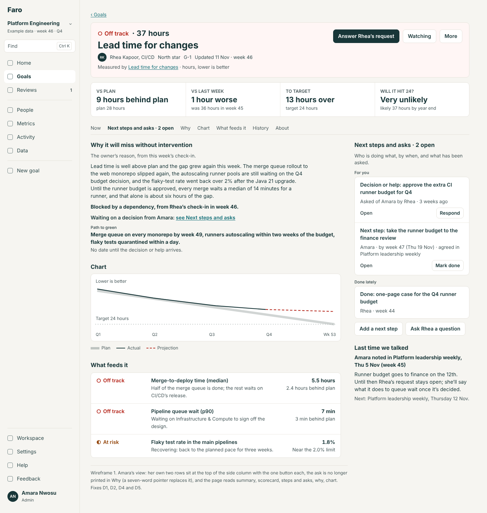
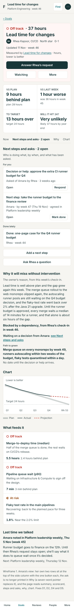
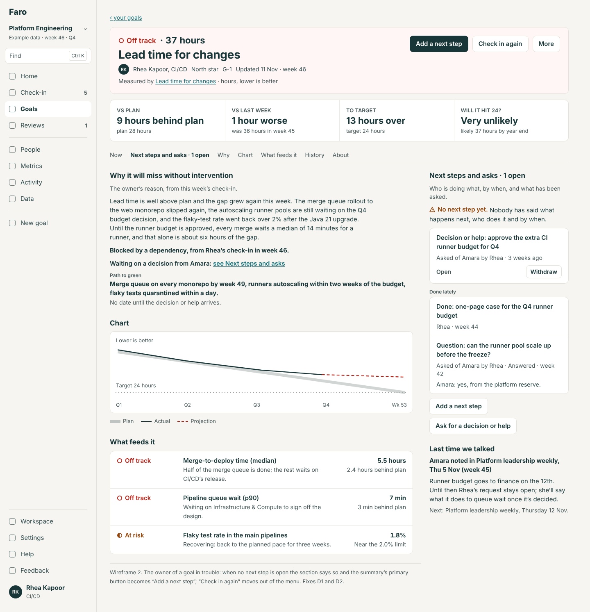
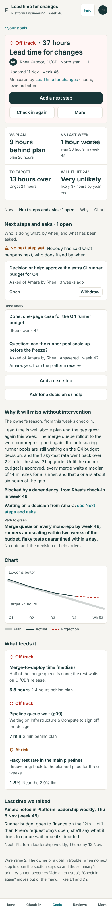
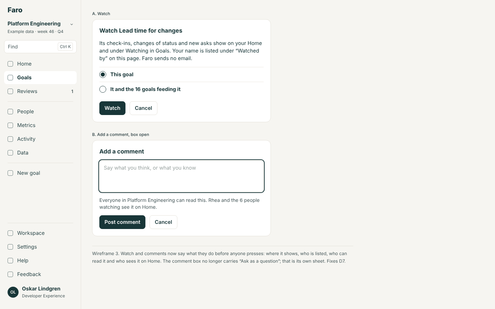
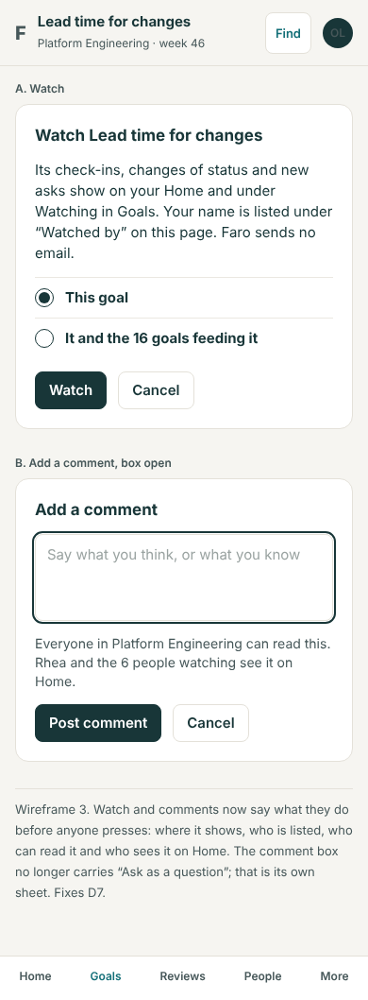
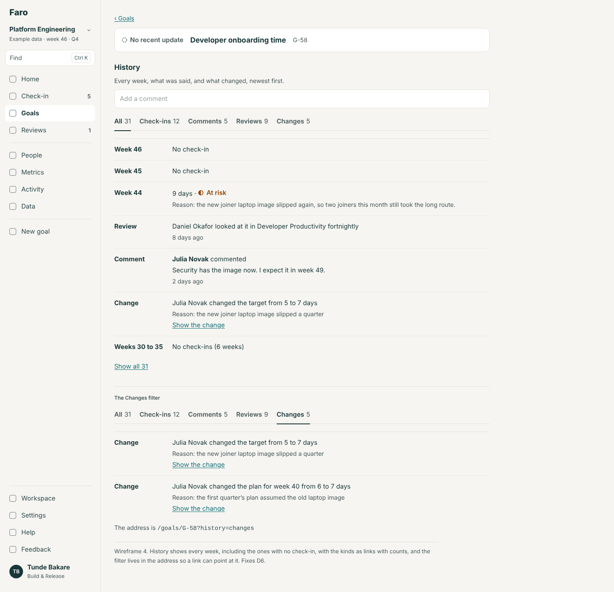
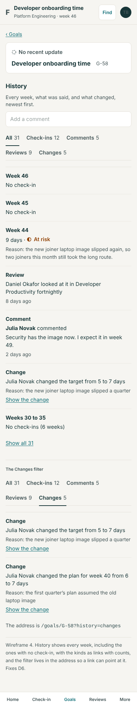
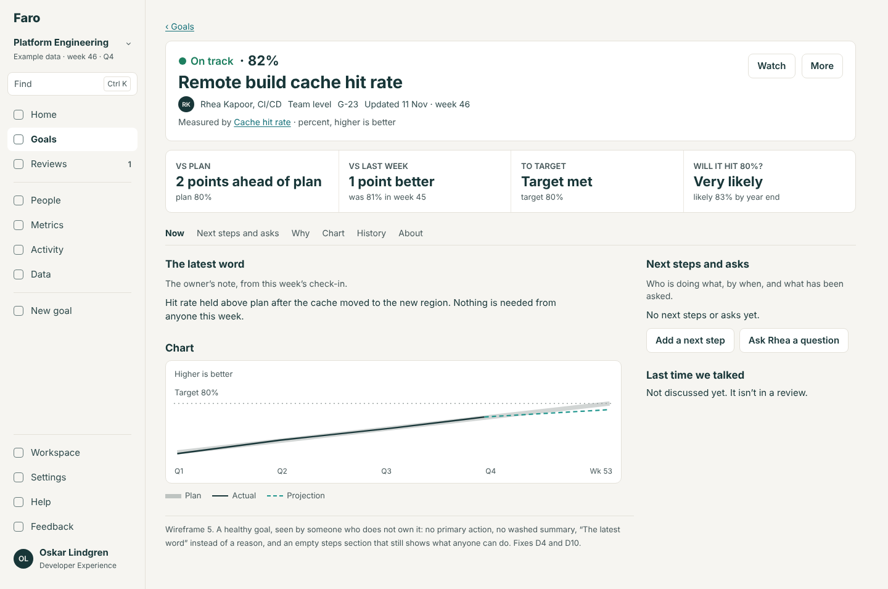
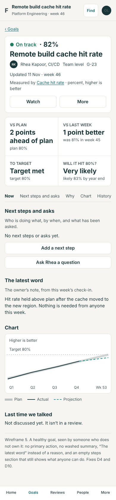

# The goal page: the evaluation and the design

10 November 2026. Area 4 of the app redesign (`docs/design/README.md`); ranked fourth in `docs/reviews/2026-11-10-app-redesign-priorities.md`. A design, not a build. The build spec is `spec.md` beside this file. The wireframes in `wireframes/` are rendered from `mockups/` (`node docs/design/goal/mockups/build.cjs`) at 1440 and 390 px.

This is the page for one goal (`/goals/<id>`). Its parts are good; the redesign reorders them, says each thing once, and gives the person looking something to do.

## The idea in four lines

1. **The first screen answers four questions in order:** how is it, what is being done and asked, why, and what can I do here.
2. **Next steps and asks are one list**, shown once, with the one button each person can press on each row.
3. **The owner always has a way to act**; someone else always knows what Watch and a comment will do.
4. **The history shows every week**, the ones with no check-in too, and the page's state is in its address.

## The jobs people come to do

| Who | Job | How often | Today |
|---|---|---|---|
| Owner (Rhea, Tunde) | Check in on it; correct this week's check-in | Weekly | A button only when one is due; otherwise the fourth item of the "…" menu |
| Owner | Say what happens next: add a next step, mark one done | Weekly when behind | "Add a next step" at the foot of a side column; on a phone inside "What's being done" |
| Owner | Ask for a decision or help; see whether it was answered | When blocked | In the check-in; the ask then shows in three places |
| Leader (Amara) | Answer what's asked of her | Weekly | The primary button, and a side card, and a line in "Why", and a row in Actions |
| Leader, manager | Read how it stands and why, in half a minute | Weekly, per troubled goal | Header and scorecard at once; the reason is under the chart, 702 px down |
| Anyone | See what was agreed last time it was discussed | Before a review | "Last time we talked": good |
| Anyone | Follow it | Once per goal | Watch: a button that doesn't say what it does |
| Anyone | Say something on it | Occasionally | A comment box with no Cancel and no word on who sees it |
| Anyone | Check its past: did it miss a week, when did the plan change | Occasionally | Activity: missed weeks leave no trace; "Changes" mixes review look-ins with edits |
| Anyone | Understand what it measures | Once | "What it measures" in the side column and again in About |
| Owner, admin | Change its definition, plan, owner | A few times a year | Three links inside a folded section, and a menu item that scrolls to them |
| Anyone with it open in a tab | Tell which tab it is | Daily | Every goal's tab says "Goals" |

## Findings

From the walk of 10 Nov over eight goals (off track with an open ask, healthy, stages, a limit, done, a north star with feeders, no check-in yet, no recent update) as Amara, Rhea, Tunde and Oskar at 1440 and 390, and `src/screens/GoalScreen.tsx`, `src/domain/goalPage.ts`. Severity: **High**, **Medium**, **Low**.

**D1. The owner of a goal in trouble has no button. High.**
- **Saw:** Rhea on "Lead time for changes" (her north star, off track, 9 hours behind plan): the summary bar's only control is "…". The primary action exists for an owner only when a check-in is due (`goalPage.ts:141`); "Check in again" is the fourth of six menu items (`GoalScreen.tsx:171`); "Add a next step" is at the foot of the Actions block. The same for Tunde on his stages goal.
- **Why it matters:** the page is where an owner comes to work on a goal, and it reads as a report about it. Lane's own rule (9 Nov) is that a goal behind needs a next step with an owner and a date; the page doesn't lead its owner to add one.
- **Backlog:** GD (1) built the rows (#78); GD (7) ("lead with what needs deciding") is this.

**D2. The open ask is shown up to four times. High.** (GD (2).)
- **Saw (Amara, the same goal):** the primary button "Answer Rhea's request"; a side card "Asked of you" with "Respond"; "Decision or help needed: Waiting on Amara Nwosu: approve the extra CI runner budget for Q4" inside "Why it will miss without intervention"; and an "OPEN" row in Actions. Rhea sees it twice.
- The same budget is also a second row, an action for Amara ("Take the runner budget to the finance review"), with its own "Respond".

**D3. Other things are said twice too. Medium.**
- This week's reason: in "Why…" (702 px) and word for word as the first row of Activity (2,146 px).
- A review note: in "Last time we talked" and in Activity.
- "What it measures": in the side column and as "How it's measured" in About.

**D4. One thing has three names, and on a phone no heading. Medium.**
- The block is "Actions"; its subtitle says "The asks on this goal"; its button says "Add a next step"; its rows are labelled "Action" and "Decision or help"; the vocabulary's word is "Next step" (`vocabulary.ts:332`).
- On a phone the Actions heading is gone: the list is folded into "What's being done" under "Path to green" (`GoalScreen.tsx:214–215`, `:228–230`).

**D5. The order changes with the width, and the reason comes late. Medium.**
- At 1440: header, scorecard, chart, then "Why" at 702 px; asks and actions in a side column.
- At 390: header, "Asked of you" (when there is one), chart, "Why" at 904 px, "What's being done" with the actions, "Last time we talked", then "What feeds it" (on a computer those two are the other way round).
- The page is 3,139 px with About closed and 4,455 px open (4,950 px on a phone).

**D6. The history hides the gaps and mixes its kinds. Medium.** (GD (3).)
- A goal with no update since week 44 shows week 44, then look-ins, and nothing for weeks 45 and 46. Only a paragraph elsewhere says it is stale.
- "Changes" lists "looked at it in Platform leadership weekly", notes and actions beside real edits; there is no filter for what was said in reviews; filters carry no counts.
- "Show all 79", "Show 3 changes", the filter, and whether About is open are not in the address, so none can be linked to or come back after a reload. About is open on a first visit and closed after, per person and goal (`GoalScreen.tsx:222`).

**D7. Watch and comments don't say what they do. Medium.** (GD (4), (5).)
- "Watch" turns to "Watching" with a toast. Only on a goal with feeders does a sheet say anything ("See its changes on Watching"). On a done goal Watch is the primary button. An owner has no Watch and no word why.
- The comment box is a field and "Post comment"; for a non-owner also "Ask as a question", explained only by a hover title. No Cancel; nothing says who can read it or who is told.

**D8. "Add a next step" assumes the owner. Low.**
- Opened by Oskar on Rhea's goal, "Who" is already Rhea. Someone can give the owner work without noticing they chose.

**D9. Changing a goal has three doors and plain selects. Medium.**
- "Change this goal" in the menu scrolls to About, which holds three links ("Improve the definition", "Change the plan or target", "Change the owner or level") to `/edit?part=`. The edit page has two exits. Owner is a select of 95, "Feeds into" a select of every goal (the find design, S3).

**D10. Small things. Low.**
- The browser's title is "Goals" (navigation, V5).
- On a phone the "…" button sits alone in a 60 px row, and the app's top bar is replaced by the goal's card (navigation, V8).
- The print page says "· Move a number" after the level, a term from the code.
- A new goal says "No value yet" four times and asks three times for a description (onboarding, O6).

### What works and is kept

- **The summary bar**: status as shape and word, the number, the gap, owner, level, key, "Updated 11 Nov · week 46"; it shrinks to one sticky line on scroll.
- **The scorecard**, in the kit's own words ("9 hours behind plan", "Very unlikely"), and its variants for stages and limits.
- **The chart**: plan, actual, projection with its range, readable by keyboard.
- **A page that fits the goal**: stages instead of a chart; "Why it has no recent update"; a done goal's result; a goal with no check-in yet.
- **Respond in place**, with "This closes it for all 3 goals".
- **One primary action chosen by rule**, which steps aside while its panel is open.
- **"Last time we talked"**, "What feeds it" worst first with "Most likely to make it miss", "This year by quarter".
- **The print page**, drafts that survive, and "Back to" that knows where you came from.

## The design

### The order, the same at every width (wireframes 1, 2)

| # | Section | What it holds | Section link |
|---|---|---|---|
| 1 | **Summary** | Back link; status and number; title; owner, team, level, key, "Updated …"; "Measured by {metric}" when linked; the primary action; Watch; "…" | — |
| 2 | **Scorecard** | The four cells, as today | "Now" |
| 3 | **Next steps and asks** | Everything open on this goal that someone must do: decisions and questions asked, next steps with who and by when; then what was done lately. One button per row for whoever can act. "Add a next step" and "Ask {owner}" | "Next steps and asks" |
| 4 | **Why** | The owner's reason this week and the path to green, as today's "Why it…" and "What's being done", in one section | "Why" |
| 5 | **Chart** | As today; stages or the limit for those kinds | "Chart" |
| 6 | **Last time we talked** | As today | — |
| 7 | **What feeds it** | As today; and "Feeds into" for a goal with a parent | "What feeds it" |
| 8 | **This year by quarter** | As today | — |
| 9 | **History** | Today's Activity, renamed: every week, comments, what reviews said, changes | "History" |
| 10 | **About this goal** | What it measures (once), its plan week by week, who watches, how the status is worked out, "Change this goal" | "About" |

On a computer 1,100 px and wider, sections 3 and 6 sit in the side column beside 4 and 5, so the first screen shows the summary, the scorecard, the reason and what is being done and asked, together. Under that width they come in number order. Nothing else moves.

The section links are a row under the summary that sticks while you scroll (navigation spec, 2.5).

### Next steps and asks: one list (wireframe 1)

One section, one name, on every width. A row says what, who, by when and how it stands, and carries at most one button, for the person who can press it:

| Row | Says | Button, for whom |
|---|---|---|
| A decision or help asked | "Decision or help: approve the extra CI runner budget for Q4" · "Asked of Amara by Rhea, 3 weeks ago" · "Open" | "Respond" for Amara (and admins); "Withdraw" for Rhea |
| A question | "Question: how soon does queue wait drop under five minutes?" · "Asked of Rhea by Daniel" | "Answer" for Rhea |
| A next step | "Take the runner budget to the finance review" · "Amara, by week 47 (Thu 19 Nov)" · "Open" or the warning mark and "Overdue by 1 week" | "Mark done" for Amara, whoever asked, an admin |
| An ask for an update | "Update asked by Daniel, 2 days ago" | "Check in" for the owner |
| Done lately (the last three) | "Done: one-page case for the Q4 runner budget" · "Rhea, week 44" | — |

- What needs **you** is first, under "For you". Then the rest, open before done, soonest due first.
- "Why" no longer repeats the ask. Where the owner's reason is a dependency it says so in its own words; the ask itself is in this list only.
- The primary button in the summary and this list are the same action: pressing "Answer Rhea's request" opens that row's panel in place.
- When a goal is off track or at risk and has no open next step, the section opens with the warning mark and "No next step yet. Nobody has said what happens next, who does it and by when." and, for the owner, that is the primary action (below).

### The primary action, for everyone (wireframe 2)

The existing rule, with two additions (marked new) so an owner is never left with only "…":

| Order | Who and when | Button |
|---|---|---|
| 1 | You are asked a question or a decision here | "Answer {name}'s question" / "Answer {name}'s request" |
| 2 | You own it and this week's check-in is due | "Check in for week 46" |
| 3 | You have a next step here that is open | "Mark your next step done" |
| 4 (new) | You own it, it is off track or at risk, and it has no open next step | "Add a next step" |
| 5 | You don't own it, it has no recent update, nobody has asked | "Ask {owner} for an update" |
| 6 | Otherwise | None |

Beside it, always, as plain buttons: for the owner **"Check in again"** (new: out of the menu) when rule 2 isn't the primary; for everyone else **"Watch"** / "Watching". Watch is never the primary action.

### Watch and comments say what they do (wireframe 3)

- **Watch** always opens a small sheet: "Watch Lead time for changes. Its check-ins, changes of status and new asks show on your Home and under Watching in Goals. Your name is listed under “Watched by” on this page. Faro sends no email." Then the choice it has today when the goal has feeders (this goal; or it and the 16 goals feeding it), and "Watch" / "Cancel". "Watching" opens the same sheet with "Stop watching".
- **An owner** sees, in About's "Watched by": "You own this goal, so it is always on your Home. Owners don't need to watch their own goals."
- **A comment** starts as one line, "Add a comment". Opened, it has the field, the line "Everyone in Platform Engineering can read this. Rhea and the 6 people watching see it on Home.", "Post comment" and "Cancel". "Ask as a question" moves to Next steps and asks as "Ask Rhea a question", which is where the answer will be.

### The history (wireframe 4)

- Renamed **History** (on a goal, "Activity" is the name of the whole workspace's feed).
- **Every week has a row** from the goal's first week to this one: a check-in's number, status and reason; or "Week 45 · No check-in". The current week is never folded.
- **Filters with counts:** "All 79 · Check-ins 44 · Comments 12 · Reviews 15 · Changes 8". Reviews is what was said and noted in reviews, and look-ins; Changes is edits to the goal, its plan, owner and links, each with its reason.
- **This week's check-in isn't printed twice:** its row shows the number and status and "The reason is above, under Why".
- **The address holds it:** `?history=changes`, `&all=1` for the whole list, `#history`; About is `?about=1`. A link to "the changes to this goal" works.
- A search field ("Find in this goal's history") and "Go to week…" appear once there are more than 30 entries.

### Changing a goal

One door: "Change this goal" in the "…" menu and at the foot of About both open `/goals/<id>/edit`, one page with its parts as sections (definition; plan and target; owner, team and level; what it feeds). Owner, team, "feeds into" and "also helps" are find-and-pick. One exit, "Close and keep the draft" (navigation spec, 2.5).

## Each screen's one primary action

| Screen | Primary action | Everything else |
|---|---|---|
| A goal | By the rule above; often none | "Check in again" (owner) or "Watch" (others); "…": Share image, Copy link, Print or save as PDF, Change this goal, Stop this goal |
| A goal in a review's walkthrough | As today ("Reviewed & next"); not changed here | — |
| Respond (in place) | "Record the answer" | "Ask the owner first"; "Leave it open" |
| Add a next step (sheet) | "Add the next step" | Cancel |
| Watch (sheet) | "Watch" / "Stop watching" | Cancel |
| Change a goal | "Save changes" | "Close and keep the draft" |
| Print | "Print or save as PDF" | "‹ {goal}" |

## Role differences

| | Rhea, on her own goal | Amara, asked a decision on it | Oskar, a watcher | Tunde, on someone else's goal |
|---|---|---|---|---|
| Primary | "Check in for week 46" when due; else "Add a next step" if behind with none; else none | "Answer Rhea's request" | None | None, or "Ask {owner} for an update" on a stale goal |
| Beside it | "Check in again" | "Watch" / "Watching" | "Watching" | "Watch" |
| Next steps and asks | "Withdraw" on her asks; "Mark done" on her steps; "Add a next step" | "For you" first, with "Respond" | Reads; "Add a next step"; "Ask Rhea a question" | The same as Oskar |
| "…" menu | All items | As an admin, all | Share image, Copy link, Print | The same as Oskar |
| Change this goal; Stop | Yes | Yes (admin) | Not shown | Not shown |
| Comment | Yes | Yes | Yes | Yes |

## The phone (wireframe 5)

- A slim top bar: "‹ your goals", Find, you (navigation). Under it the summary, which sticks as one line on scroll.
- The primary action is a full-width button under the summary; "Check in again" or "Watch" and "…" share the row under it. No control sits alone in an empty row.
- The sections come in number order: the scorecard (two by two), Next steps and asks, Why, the chart, and so on. The section links scroll sideways inside themselves.
- **Limits** (held by F14): the status, the number, the primary action and the heading "Next steps and asks" are all within the first 844 px at 390; nothing is under the tab bar; nothing scrolls sideways.

## Wireframes

| # | Screen | 1440 | 390 |
|---|---|---|---|
| 1 | A goal off track, as Amara, who is asked a decision |  |  |
| 2 | The same goal as its owner, Rhea, with no check-in due |  |  |
| 3 | The Watch sheet and the comment box |  |  |
| 4 | History, with a missed week and the Changes filter |  |  |
| 5 | A healthy goal as someone looking in (Oskar) |  |  |

## For the rebuild (spec only)

- **A delegate** (R6b) sees the owner's buttons, and every row they press says "for Rhea".
- **Being told** (R5): the Watch sheet's sentence gains the channels the internal app has ("and in your weekly digest"); a comment's line names who is notified.
- **Who may read a sent markup** (R1, rule 7) applies to 3a's markups in Next steps and asks.
- **The history is paged** by the server (R4): 30 entries at a time, the week rows worked out from the plan, not stored.

## Backlog

- **Replaces GD (2) to (7)** in full. GD (1) was built (#78) and is the list this design builds on.
- **Takes** NAV (4)'s section links on the goal page, LP's leftover U20 only in so far as the list shows who looked (its rule is unchanged), and SU's leftover wording for a goal with no check-in yet (with the onboarding spec).
- **Prepares** 3a: a sent markup is a row in Next steps and asks.

## Decisions for Lane

1. **Next steps and asks as one list, shown once.** (a) Yes: one section, on every width; "Why" stops repeating the ask. *Recommended.* (b) Keep "Actions" in the side column and the ask in "Why", and only remove the side card.
2. **The owner's buttons.** (a) "Add a next step" becomes the primary action when the goal is behind with none, and "Check in again" is always a button. *Recommended.* (b) Leave both in the menu and the list.
3. **"Activity" on a goal becomes "History".** (a) Rename it. *Recommended.* (b) Keep "Activity".
4. **The order on a computer.** (a) The reason and the list above the chart. *Recommended.* (b) Keep the chart first.
5. **Watch.** (a) Always a short sheet that says what it does, and never the primary button. *Recommended.* (b) Keep the one-press toggle and add a line of text under it.
