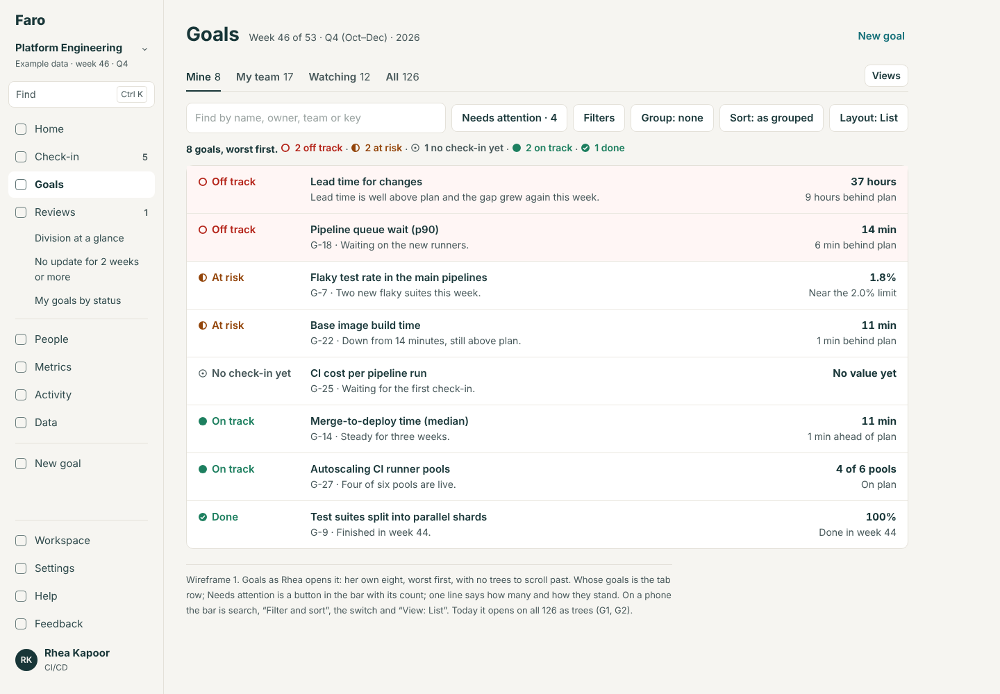
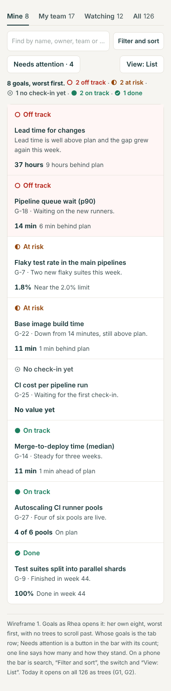
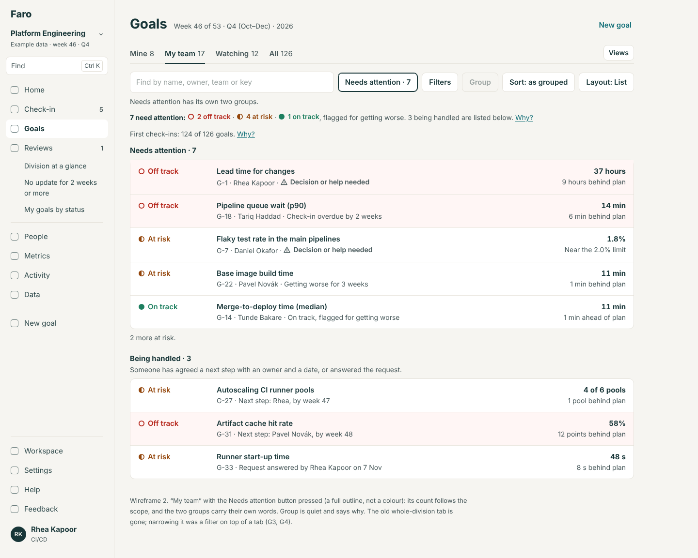
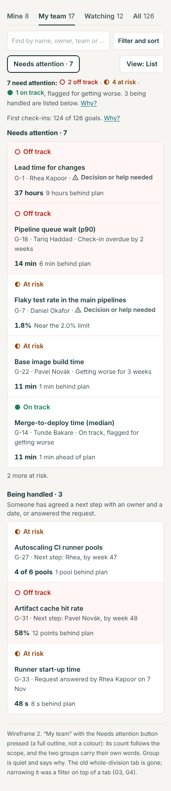
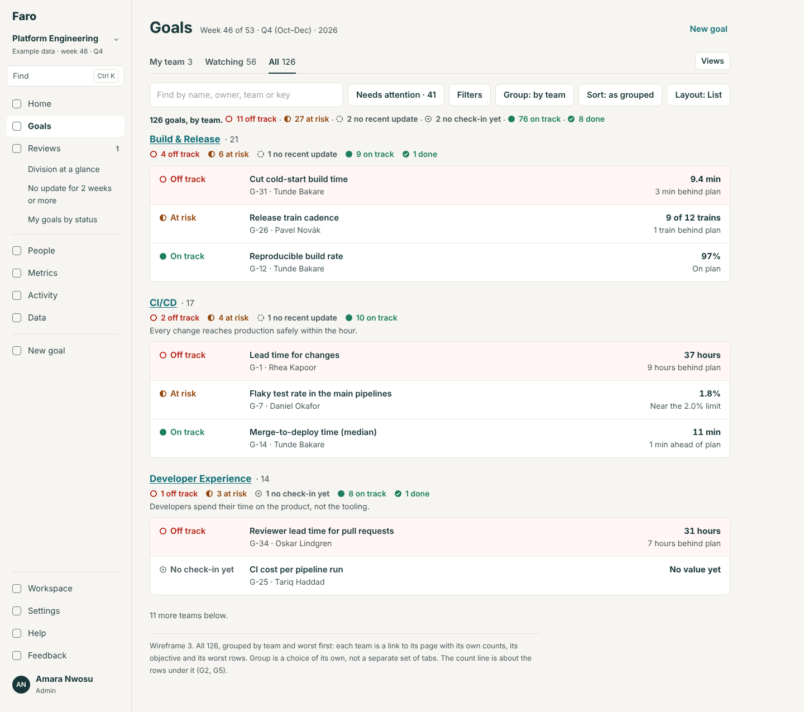
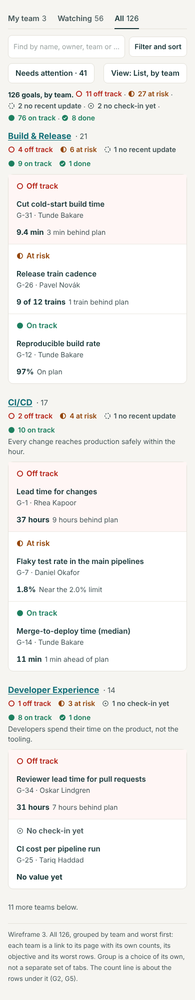
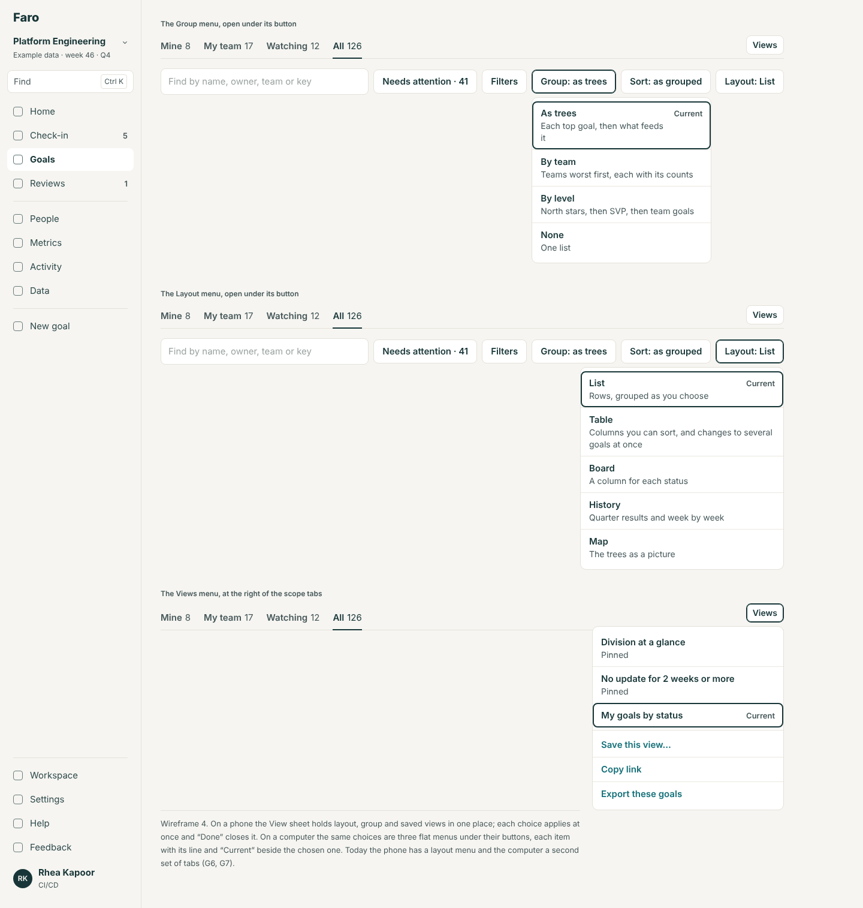
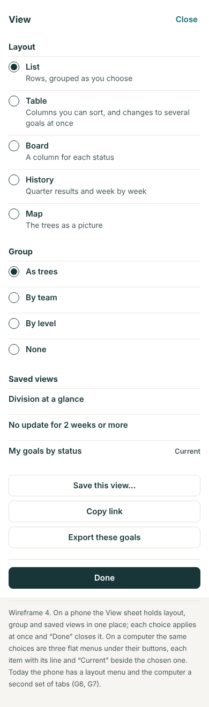
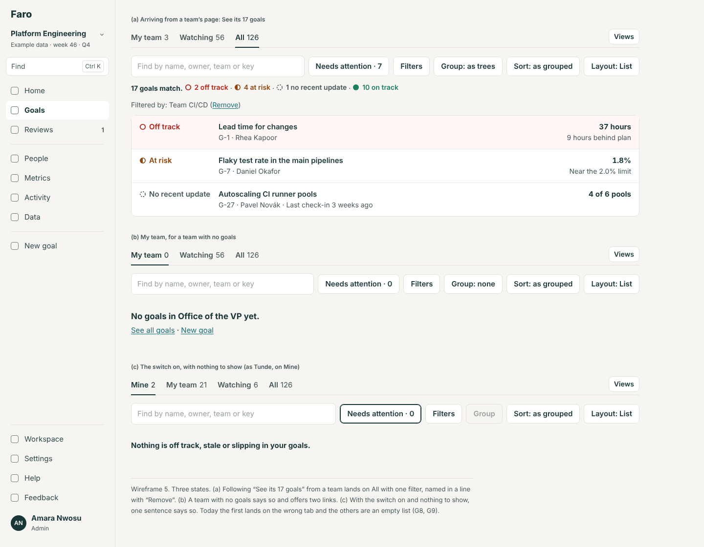
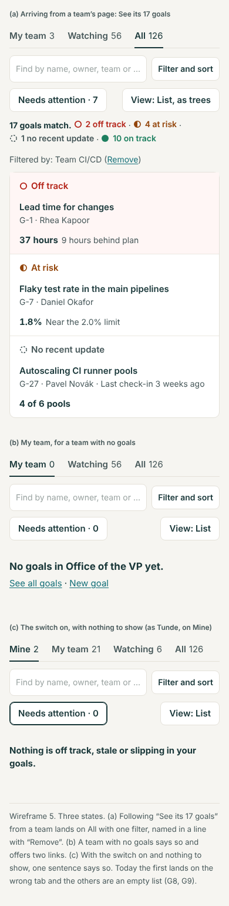

# The Goals page: the evaluation and the design

10 November 2026. Area 3 of the app redesign (`docs/design/README.md`); ranked third in `docs/reviews/2026-11-10-app-redesign-priorities.md`. A design, not a build. The build spec is `spec.md` beside this file. The wireframes in `wireframes/` are rendered from `mockups/` (`node docs/design/goals/mockups/build.cjs`) at 1440 and 390 px.

It stands on the list bar and find-and-pick (`docs/design/find`) and the navigation (`docs/design/navigation`), and it is where People's "See Rhea's 8 goals" and a team's "See its 17 goals" land (the Workspace redesign).

## The idea in four lines

1. **Whose goals** is one choice, the tabs: Mine, My team, Watching, All. The page opens on yours.
2. **How they are arranged** is a second choice, kept apart: as trees, by team, by level, or flat; and a third, the layout.
3. **Needs attention is a switch**, not a place: it works on whichever goals you are looking at, and counts them.
4. **One line says how many**, with the statuses beside it, and it is always about the rows under it.

## The jobs people come to do

| Who | Job | How often | Today |
|---|---|---|---|
| Owner (Tunde, 2 goals) | See my goals and how they stand | Weekly | Lands on all 126 as trees; Mine is the fifth tab |
| Manager (Rhea) | See my team's goals, worst first, before the review | Weekly | Filters → Team → CI/CD, or scroll By team (11,358 px) to her team |
| Manager | See what needs attention in my team | Weekly | The Needs attention tab is the whole division's 41; narrowing it is a filter on top of a tab |
| Leader (Amara) | See which teams are worst | Weekly | By team, worst first: works since #79, 14 groups down a long page |
| Leader | See what needs attention across the division; what waits on a decision | Weekly | The tab; a toggle; a saved view. Three routes |
| Anyone | Follow the goals I watch, and what changed this week | Weekly | The Watching tab: good, and kept |
| Anyone | Find one goal | Daily | The search box; soon Find (`docs/design/find`) |
| Anyone | See how a tree hangs together | Monthly | Trees, and the Map |
| Admin, owner | Change several goals at once | Monthly | Table's tick boxes: the page's only bulk actions |
| Anyone | Come back to a list they set up | Weekly | Saved views: good, and kept |
| Anyone | Get from a person or a team to their goals | Weekly | Not possible today; the Workspace redesign adds the links |

## Findings

From the walk of 10 Nov as Amara, Rhea and Tunde at 1440 and 390, and `src/screens/GoalsScreen.tsx`, `GoalFilters.tsx`, `GoalViews.tsx`. Severity: **High**, **Medium**, **Low**. Findings about search, filters and sort as such are S1 to S9 in `docs/design/find`.

**G1. One tab strip asks two questions, and answers neither fully. High.**
- **Saw:** the tabs are Trees, Needs attention 41, By level, By team, Mine 8, Watching 12 (`GoalsScreen.tsx:154–161`). Mine and Watching say whose goals; Trees, By level and By team say how all 126 are arranged; Needs attention is a filter (the same thing as `attention=1`, `query.ts:27`).
- **So:** you can't see your own goals as a tree, your team's by level, or what you watch by team. "My team's goals" is not a tab at all, though it is the manager's weekly question.
- **Why it matters:** this is the frame a rebuild will copy, and at 15,000 people "all of them, arranged three ways" is the least useful starting point. R6a's scope ("a team and everything under it") has nowhere to go in it.
- **Backlog:** the deep review's P3 and "should not copy" 4 ("six tabs times five layouts times saved views"). GP cut a layout; the tabs are untouched.

**G2. The page opens on everything, for everyone. High.**
- **Saw:** `/goals` is Trees: 126 goals, 11,942 px at 1440 and 21,635 px on a phone. Tunde owns 2 and sees "Needs attention 41". The default is fixed (`show` defaults to `outcomes`, `GoalsScreen.tsx:54`).
- On a phone the Goals tab is the same page, so an owner's goals are two taps away under More (navigation, V8).

**G3. Needs attention exists four times. Medium.**
- A tab; a filter in the address; a button "Decision or help needed" on the toolbar that sets `attention=1&needs=decision`; a tick box on the Map. Filtering any other tab to attention regroups it into "Needs attention" and "Being handled" (`GoalsScreen.tsx:116–124`), which is the tab again.

**G4. 17 controls and 373 px before the first goal on a computer. Medium.**
- **Saw (1440):** New goal; six tabs; Views; five layout buttons; Export; Search; Filters; "Decision or help needed"; Sort: 17 (18 for an owner), in four groups on two rows, then a layout hint, a status line and a note about first check-ins. First row at 373 px (430 on Needs attention, 456 on By team, 484 on Watching).
- The phone's version, built in G (#61), does the same with 5 controls and the first goal at 281 px. The computer never got the same care.

**G5. The numbers are right and look wrong. Medium.**
- The tab says "Needs attention 41"; the line beside it says "11 off track · 23 at risk · 5 no recent update · 2 on track". Two on-track goals need attention (they are getting worse, or have an ask waiting); only a tooltip says so (`attentionBadge`).
- Watching says 56 for Amara and shows 25 rows and "Show all 36".
- On Needs attention two explainers stack before the first row: "41 need attention. Why?" and the first-check-ins note, which appears on every tab, layout and empty search and never changes what you can do there.
- **Backlog:** U13 to U15 fixed the worst of this in #79; what's left is the shape, not the sums.

**G6. Back doesn't bring back what you saw. Medium.** (S6 in the find design, here in full.)
- Tabs and layouts add history entries; search, sort, filters and the toggle replace (`GoalFilters.tsx:45`). After attention → By team → sort by owner → Table → the toggle, Back gave: sorted by owner, then Needs attention, then Goals. By team was skipped.
- After Back the address had no `view=` but the page was still a table: the layout comes from the browser's memory when the address has none (`useLayout`, `GoalViews.tsx:42–54`).

**G7. "Views" means two things, and the layouts have no names. Low.**
- On a computer the Views menu is saved views only; on a phone it is the tabs, the saved views and Export. On a computer the five layouts are icons, four of them without a word; on a phone they are a menu that says what each shows. The phone's is the better of each pair.

**G8. The Map changes the page around it. Low.**
- Choosing Map moves "New goal" 128 px and widens the toolbar; the Map then has its own second search and its own Needs attention box.

**G9. Small things. Low.**
- An empty "Not linked" group shows at the foot of Trees for Tunde.
- Sort is offered twice (toolbar and dialog).
- An empty search offers four ways to clear.
- "Trees" is the tab's name; "outcomes" is its address (`show=outcomes`); "As trees" is what people say.

### What works and is kept

- **The row**: shape and word first, the title, one line of why, the number over its gap (`GoalRow`).
- **Trees** with their roll-up, and "worst first" across trees when sorted (GP).
- **By team with counts by status, worst first** (#79): the one-screen answer to "which teams are worst". It becomes a grouping anyone can put on any scope.
- **Needs attention then Being handled**, nothing hidden (Lane, 9 Nov), with "Why?".
- **Watching's own list** ("what changed this week" beside it).
- **Table** (column sort, sparklines, bulk edit), **Board**, **History**, **the Map** (MAP, #76).
- **Saved views**, pinned for everyone by an admin, and a view that says its name while open.
- **Everything in the address**, and a bad link that explains itself (`useBadLinks`).
- **The phone's two-menu bar**: its idea (say which goals and how, in two controls) is the model for the computer.

## The design

### Three choices, kept apart (wireframes 1, 2, 3)

| Choice | Control | Values | In the address |
|---|---|---|---|
| **Whose** (scope) | Tabs, as links, each with its count | Mine · My team · Watching · All | `?scope=mine\|team\|watching\|all` |
| **Arranged** (group) | A menu in the bar: "Group: as trees" | As trees · By team · By level · None | `?group=tree\|team\|level\|none` |
| **Drawn as** (layout) | A menu in the bar: "Layout: List" | List · Table · Board · History · Map | `?view=` as today |

- **The page opens on yours.** No scope in the address: the one you used last here; the first time, Mine if you own a goal, otherwise Watching if you watch any, otherwise All. It is then written into the address.
- **My team** is the team you are in and any you lead. With no team it isn't shown. From a team's page ("See its 17 goals") Goals opens on All with that team as a filter, which the filter line says: "Filtered by: Team CI/CD (Remove)".
- **Each scope has its natural arrangement**, used until you choose another: Mine is flat, worst first; My team is flat, worst first; Watching is its own list as today; All is as trees.
- **Layout is a menu on both widths**, each item with its one line ("Board: a column for each status"), so it has a name and takes one control's room.

### Needs attention is a switch (wireframe 2)

A button in the bar, on every scope: **"Needs attention · 4"**, counting the goals in this scope that need it. On, the list is two groups, as GP made it: "Needs attention · 4", then "Being handled · 3" with its one line. Off, it is the scope as arranged. It is `attention=1` in the address, as today.

"Decision or help needed" stops being a button: it is the filter "Needs attention because → Decision or help needed", and the saved view "Waiting on a decision" that leaders already have.

### One line of numbers (wireframes 1, 2)

Under the bar, the list bar's count line with the statuses after it, each a link that filters to it:

- "17 goals, worst first. 2 off track · 4 at risk · 1 no recent update · 10 on track"
- With the switch on: "4 need attention: 2 off track · 1 at risk · 1 on track, flagged for getting worse. 3 being handled are listed below. Why?"

The second form says in the line what today's tooltip says: an on-track goal can need attention, and why. The first-check-ins note shows only where it matters: with the switch on, as one line with "Why?", until every goal has had its first check-in.

### The bar (wireframe 1)

A computer, top to bottom:

1. "Goals", the week line, and the quiet "New goal".
2. The scope tabs; at the right, **Views** (saved views, "Save this view", "Copy link", and a module's "Export these goals").
3. The list bar: search · "Needs attention · n" · Filters · Group · Sort · Layout.
4. The count line; the filter line when filters are on.
5. The goals.

Twelve controls instead of seventeen, in three rows instead of five; the first goal about 250 px down instead of 373.

### The Map

On the Map the bar's search finds and pans (it is the Map's finder, moved up); the Map's own search and its Needs attention box go. "Troubled trees only" and "Fit all" stay on the Map. The page's frame doesn't move when the Map is chosen.

### What goes where

| Today | Becomes |
|---|---|
| Tabs Mine, Watching | Scopes Mine, Watching |
| Tab Trees | Scope All, grouped as trees |
| Tabs By level, By team | Groupings, on any scope |
| Tab Needs attention | The switch, on any scope |
| "Decision or help needed" button | A filter, and the saved view |
| The five layout icons | The Layout menu |
| Views (two meanings) | One Views menu: saved views, save, copy link, export |
| The layout hint line; the status line; "41 need attention. Why?" | The one count line |
| The first-check-ins note on every tab | One line, only with the switch on |
| The sidebar's Mine, Watching, All | The tabs (navigation, decision 1) |
| `/watching` | `/goals?scope=watching` |

## Each screen's one primary action

| Screen | Primary action | Everything else |
|---|---|---|
| Goals | **None**: it is a page for looking. In the last weeks of the year, "Wrap up" (as today) | New goal (quiet); the bar; Views |
| Goals, Table layout, rows ticked | **Change {n} goals** (the bulk edit, as today) | Clear the ticks |
| Goals, no goals in the workspace | **Set up the first goal** | — |
| Save this view (sheet) | **Save view** | Name; "Pin for everyone" (admins) |

## Role differences

| | Amara (leader, admin) | Rhea (manager) | Tunde (owner) | Oskar (owns none) |
|---|---|---|---|---|
| Opens on, the first time | Watching (she owns none) | Mine · 8 | Mine · 2 | Watching · 3 |
| Tabs | My team (Office of the VP) · Watching 56 · All 126 | Mine 8 · My team 17 · Watching 12 · All 126 | Mine 2 · My team · Watching · All 126 | My team · Watching 3 · All 126 |
| Needs attention counts | Her scope's; on All, 41 | Mine: hers; My team: CI/CD's | His 2 | What he watches |
| Bulk edit in Table | Any goal | Her own goals | His own | None: no tick boxes |
| Pin a view for everyone | Yes | No | No | No |
| New goal | Yes | Yes | Yes | Yes |

Mine is left out for someone who owns nothing, and My team for someone in no team: a tab is never shown empty by rule.

## The phone (wireframe 4)

- The top bar says "Goals"; there is no second title on the page.
- **Row 1:** the scope tabs, with counts; they fit 390 px (four short words) and scroll inside themselves if a team's name makes them longer.
- **Row 2:** the search field and **Filter and sort**.
- **Row 3:** "Needs attention · 4" at the left; **View** at the right, which says what is chosen ("List, flat") and opens one sheet: Layout, Group, saved views, "Save this view", "Copy link", Export.
- **Then** the count line, wrapping to two lines, and the goals.
- **Limits** (held by F13): first goal within 260 px of the top at 390 px on every scope (today 281 to 326); within 280 px at 1440 (today 373 to 484); nothing scrolls sideways; the tabs never push a goal below 260 px.

## Wireframes

| # | Screen | 1440 | 390 |
|---|---|---|---|
| 1 | Goals, Mine, as Rhea: the page as it opens |  |  |
| 2 | My team with Needs attention on |  |  |
| 3 | All, grouped by team, as Amara |  |  |
| 4 | The phone's View sheet, and the Group and Layout menus |  |  |
| 5 | Arriving from a team's page; and a scope with nothing in it |  |  |

## For the rebuild (spec only)

- **Scope is R6a's scope.** "My team" becomes "My organisation": the team you lead and everything under it, or your manager's chain. A fifth tab, "Another part of the company…", is the team picker over the tree. Counts come from summary rows (R4), never from loading a scope's goals.
- **All is paged** (R4): as trees it loads the top goals and opens a tree on demand; flat it is 50 at a time.
- **By team at 1,500 teams** groups by the level of the tree under the scope, not by every team.
- **Layouts:** start with List and Board (the deep review's advice); Table, History and the Map are worth copying once those are used.

## Backlog

- **Replaces** 0u's Goals leftovers and LV's ("anything Wednesday raises" aside); takes U13 to U15's remaining shape, and the deep review's P3.
- **Builds on** GP (#68), G (#61), talk-path polish (#79): their rules stay (Being handled, By team's counts, worst first across trees, the phone's limits).
- **Needs** FS2 (the list bar) and lands with NV1 (the sidebar loses Mine, Watching, All).
- **MAP** (#76) is kept; only its finder and tick box move into the bar.

## Decisions for Lane

1. **The tabs become whose goals: Mine, My team, Watching, All.** (a) Yes; Trees, By team and By level become "Group". *Recommended.* (b) Keep today's six tabs and fix only the toolbar's size.
2. **Where Goals opens.** (a) On yours: the scope you used last; first time Mine, else Watching, else All. *Recommended.* (b) Always on All as trees, as today.
3. **Needs attention.** (a) A switch on every scope, with its count. *Recommended.* (b) Keep it as a tab of its own (then it is a fifth "scope" that is really a filter).
4. **"My team".** (a) A tab for the team you're in and any you lead. *Recommended; it is the manager's weekly question and R6a's scope in small.* (b) Leave it out; a team is a filter under All.
5. **The five layouts.** (a) Keep all five, as one menu with a line each. *Recommended: Cards went on 9 Nov; the rest each do a job.* (b) Cut to List, Table and Board in Faro, and write History and the Map as spec only.
