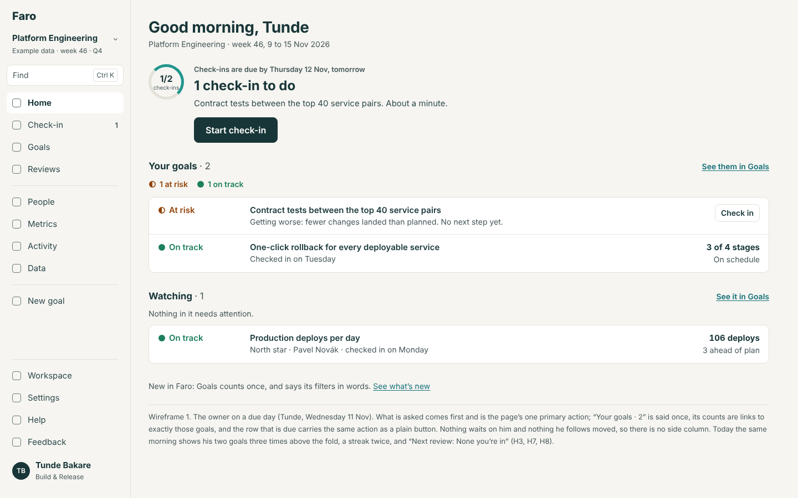
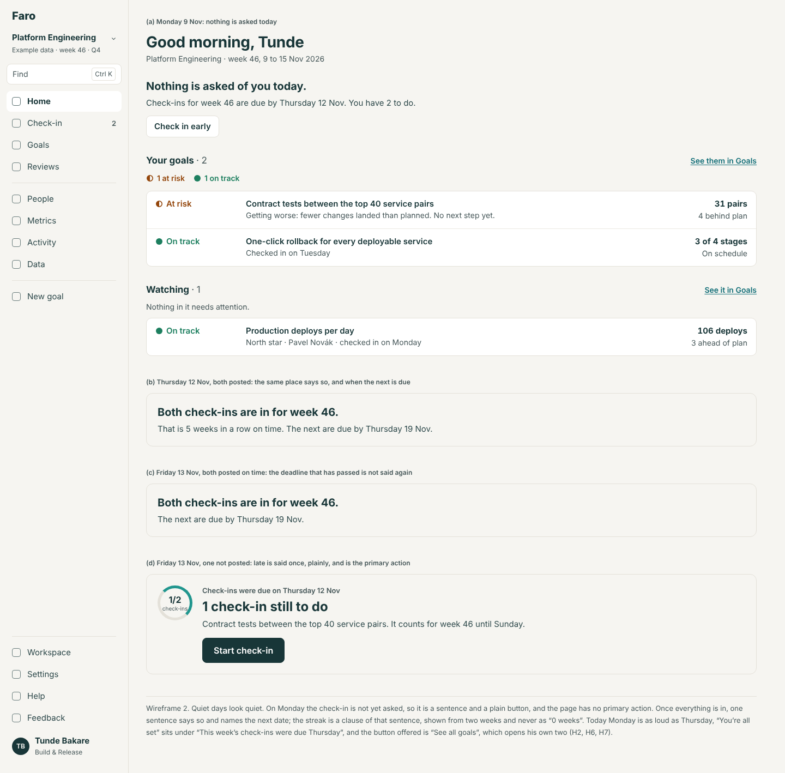
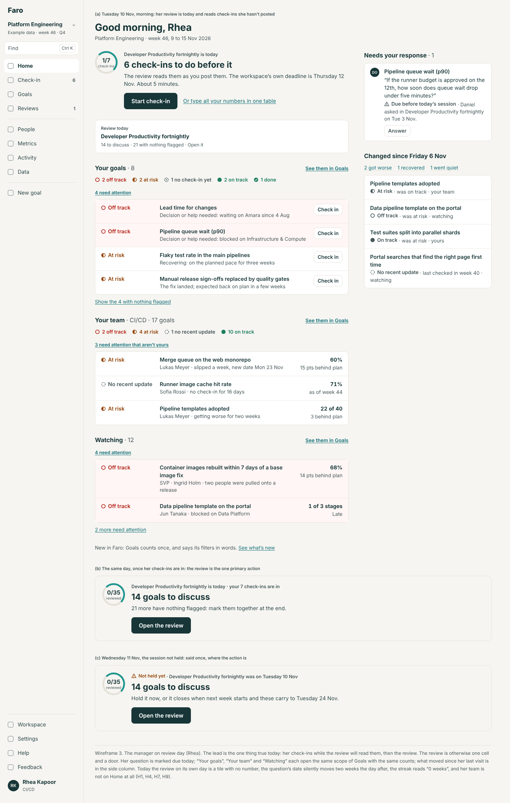
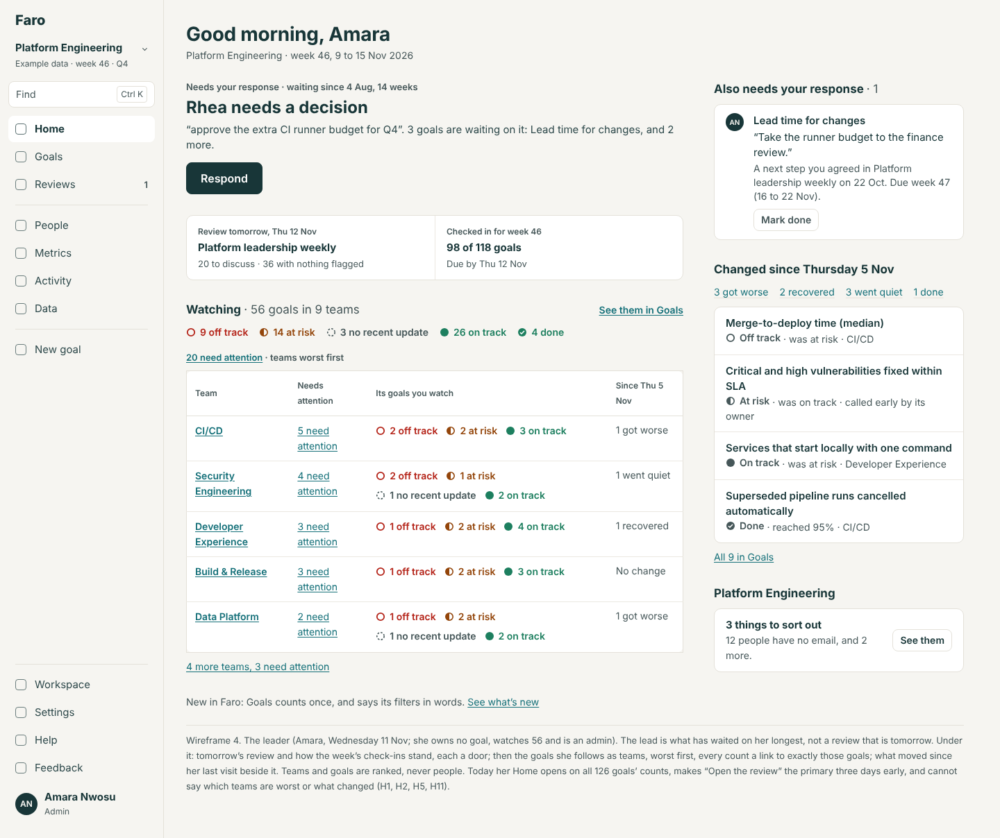
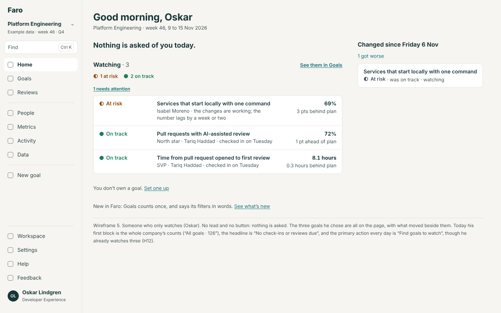
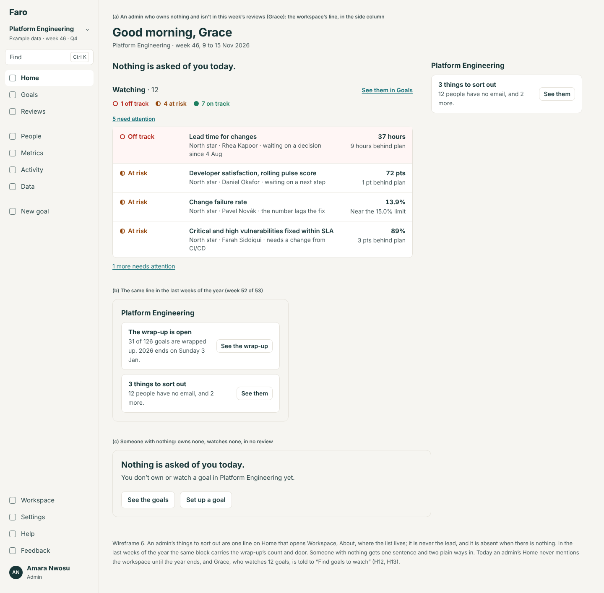
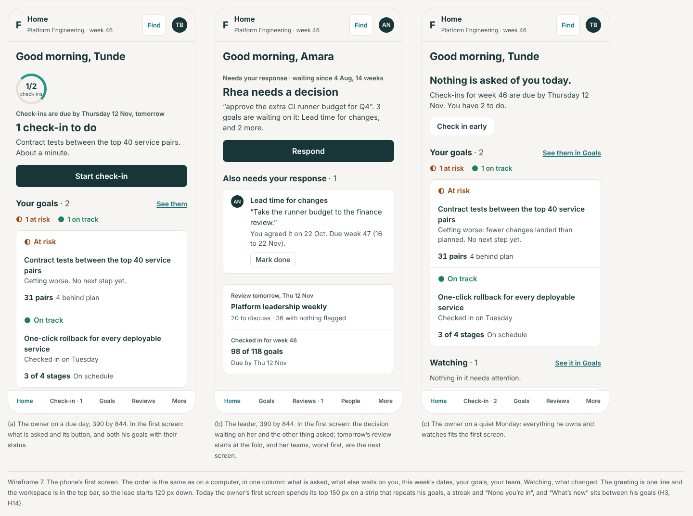
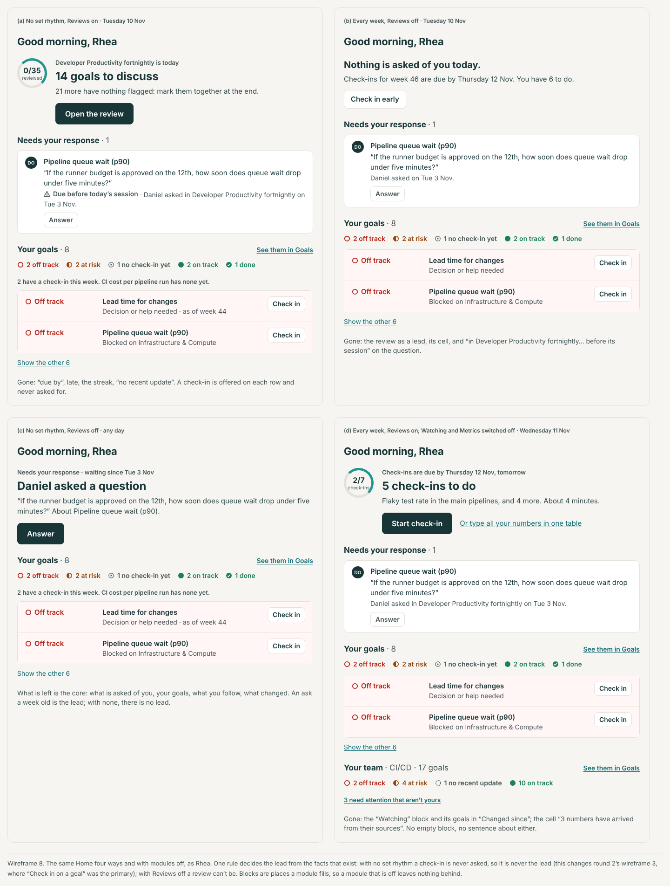
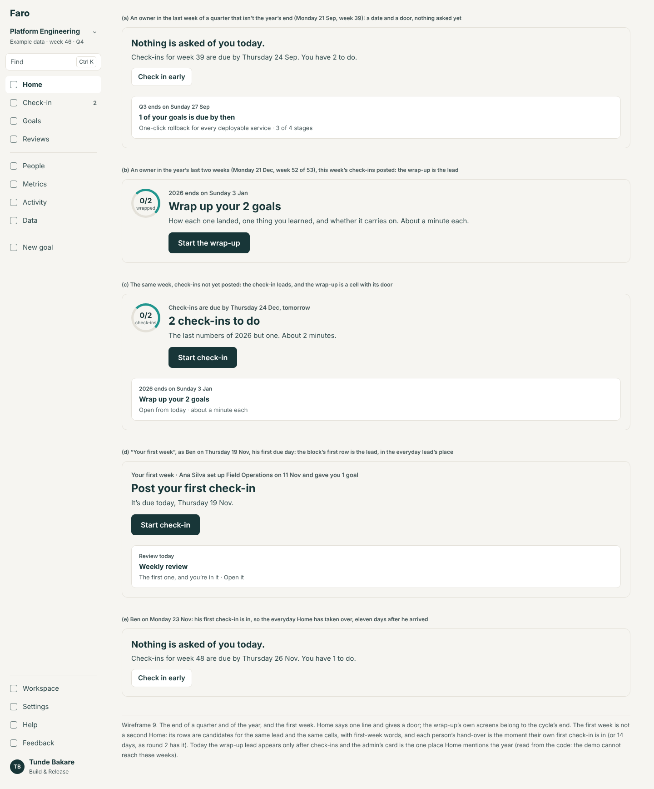

# Home, every week

11 November 2026. Design and spec only: no app code is changed, and nothing here is built. Round 3, area HM (`docs/design/round-3/README.md`). The build spec is [spec.md](spec.md); the wireframes are drawn by `mockups/build.cjs` with the shared kit.

## The idea in a few lines

Home answers three questions, in this order, for whoever is looking:

1. **What is asked of me?** One lead, the thing that is true today, with the page's one primary action; then anything else waiting on me. When nothing is asked the page says so in one sentence and has no primary action.
2. **How are my goals, or the goals I answer for?** "Your goals", "Your team" and "Watching": each is one scope of the Goals page, with the same counts, and every count is a link to exactly those goals. A leader's goals are drawn as teams, worst first.
3. **What changed since I last looked?** The goals that got worse, recovered, went quiet or finished since the last day you opened Home.

One function decides all of it from who is looking and a short list of facts (`homeFor`, spec rule 1). It is the same function with a weekly rhythm or none, with Reviews on or off, and with Watching or Metrics switched off: a fact that doesn't exist can't be the lead and leaves no block behind.

## How it was looked at

The live demo (`https://goals-app-puce-five.vercel.app/demo`), walked by script between 10:55 and 11:05 UTC on 11 November 2026: Home as Tunde (owner of two), Rhea (manager, owns eight, in a review), Amara (leader and admin, owns none, watches 56), Oskar (watches three) and Grace (admin, owns none, watches 12), at `today=` 9, 10, 11, 12 and 13 November, 24 November and 21 December, at 1440×900 and 390×844: 70 loads. Every block, count and link was written down; on 11 November each link was followed and the count on the page it opens compared. The code was read beside it (`src/screens/Home.tsx`, `src/domain/home.ts`, `attention.ts`, `progress.ts`, `dayOne.ts`, `review.ts`).

Two things could not be seen and were read from code. The demo has nobody who owns and watches nothing (every non-admin is given a watch, `src/data/platformOrg/generate.ts:399`). And the demo cannot reach the year's last weeks: with `today=2026-12-21` it re-bases its year and shows "week 43 · Q4" (`src/data/platformOrg/year.ts:17–22`), so the wrap-up on Home is from `Home.tsx:100–106` and `:304–314`.

## Jobs, by role and how often

| Who | Job on Home | How often | Today |
|---|---|---|---|
| Owner (Tunde) | See whether anything is asked of me today; do it; see my two goals as others see them | Two or three visits a week | The ask is the third thing on the page; his goals are shown three times |
| Manager (Rhea) | The same, and: is my team all right, what waits on me, is my review ready | Most days | Her team is not on Home; her review on its own day is a tile |
| Leader (Amara) | What is waiting on me; which teams are worst; what moved this week | Daily glance, weekly read | Counts for the whole company; a review three days off as the main action; no teams, no movement |
| Watcher (Oskar) | Has anything I follow changed | Weekly or less | Told daily to "Find goals to watch" |
| Admin (Grace) | Is there anything about the workspace to sort out | Monthly | Never said on Home |
| Someone with nothing | What is this, and where do I start | Once | A sentence and two buttons (read from code) |

## What Home shows today, by day

"Lead" is the block with the big button. Words are the screen's own.

| Day | Tunde | Rhea | Amara | Oskar, Grace |
|---|---|---|---|---|
| Mon 9 Nov | "Check-ins are due by Thursday, in 3 days · 2 check-ins to do · **Start check-in**" | "7 check-ins to do"; tile "Next review · Developer Productivity fortnightly · Tuesday · tomorrow" | "0/56 reviewed · Platform leadership weekly · 20 goals to discuss · **Open the review**" (the session is on Thursday) | "No check-ins or reviews due · **Find goals to watch**" |
| Tue 10 Nov (Rhea's review) | "1 check-in to do" | "6 check-ins to do … due by Thursday, in 2 days"; tile "Tuesday · today" | The same | The same |
| Wed 11 Nov | "You’re all set for week 46 · 5-week on-time streak · See all goals" | "5 check-ins to do"; tile "Not held yet · Tue 10 Nov · 1 day past" | The same; "Thursday · tomorrow" | The same |
| Thu 12 Nov (due day; Amara's review) | "Check-ins are due today, Thursday · You’re all set" | "1 check-in to do" | "19 goals to discuss · **Open the review**" | The same |
| Fri 13 Nov | "This week’s check-ins were due Thursday · You’re all set" | "Check-ins were due Thursday · 1 day late · 1 check-in to do" | "Not held yet · Thu 12 Nov · 1 day past · 18 goals to discuss" | The same |
| Tue 24 Nov | "2 check-ins to do" | "6 check-ins to do"; tile "Tuesday · today" | Tile "Next review · Security monthly · Tuesday · today"; lead "Platform leadership weekly · 20 goals to discuss" | The same |
| Mon 21 Dec | Shown as week 43; not the year's end (see above) | | | |

**Above the fold at 1440×900:** the greeting and "New:" line (to 120 px), the strip (144–232), the lead (256 to about 390–470), and the top of "Your goals" or "Goals you watch". Tunde's whole Home fits (922 px). Rhea's is 1,959 px; Amara's 1,035.

**In the first screen at 390×844** (the tab bar starts at 775): the top bar (71 px), the greeting, the strip (147–280), the lead (to 440–492). Rhea's "Needs your response" starts at 491 and her goals at 663; her Home is 2,916 px, three and a half screens. Oskar sees the company's six counts, "None you’re in", and "Find goals to watch" before the first goal he follows (508 px).

**Links and whether their numbers agree** (11 Nov, followed by script):

| On Home | Opens | Agrees? |
|---|---|---|
| "Your goals · 2" / "· 8" | `/goals?scope=mine`: "2 goals, worst first. 1 at risk · 1 on track" | Yes |
| "1 at risk", "2 off track" … (owner) | `/goals?scope=mine&status=…`: "1 goal matches." | Yes |
| "11 off track", "23 at risk" … (Amara, Oskar, Grace) | `/goals?scope=all&status=…`: "11 goals match." | Yes |
| **"All goals · 126"** (Amara, Oskar, Grace) | `/goals` → Watching: "56 goals" (Amara), "3 goals" (Oskar), "12 goals" (Grace) | **No** |
| **"See all goals"** (Tunde, all set) | `/goals` → Mine: "2 goals" | **No** |
| **"Find goals to watch"** (Oskar, Grace) | `/goals` → Watching: the goals they already watch | **No** |
| "14 more in Watching" (Amara) | `/goals?scope=watching`: all 56, not the 14 | **No** |
| "20 need attention (3 with no recent update) · 36 with nothing flagged" | Not links | — |
| "20 goals to discuss" | Not a link; the button opens the review | — |
| "All you’re watching" | `/goals?scope=watching`: "12 goals" (Rhea) | Yes |
| "Next review · None you’re in · See every review" | `/reviews` | Nothing to agree with |

## Findings

Evidence is the live demo at the times above unless a file is named.

| Id | Level | Finding | Evidence |
|---|---|---|---|
| **H1** | High | **The lead is not the thing that is true today.** A review three days away is the leader's primary action while a decision open for 14 weeks is a plain button; on a manager's review day the review is a tile with no number; and when two reviews are in play the lead opens a different one from the one that is today | Amara, 9 Nov: "0/56 reviewed · 20 goals to discuss · Open the review" with "Thursday · in 3 days"; beside it "Rhea asked 4 Aug. Open until you answer. · Respond". Rhea, 10 Nov: "6 check-ins to do … in 2 days", tile "Tuesday · today". Amara, 24 Nov: tile "Security monthly · Tuesday · today", lead "Platform leadership weekly". `Home.tsx:78` (the first review with something to do, in no date order), `:86–157`; `review.ts:149–154` |
| **H2** | High | **Four links open a list that isn't the one named, and the counts a leader would press aren't links.** | The table above. `Home.tsx:346` ("All goals" → `/goals`, which now opens on the viewer's own scope), `:146`, `:154`, `:297`, `:290` |
| **H3** | High | **The first block answers the second question, and says the owner's goals three times.** The strip of counts sits above what is asked; then the block's heading repeats the total and its groups repeat the counts | Tunde, 9 Nov, all above the fold: "Your goals · 2 · 1 at risk · 1 on track", then "Your goals 2", then "Need attention · 1" and "Nothing flagged · 1". The lead starts at 254 px on a computer and 282 px on a phone. `Home.tsx:391` (strip before the grid), `:165–181` |
| **H4** | High | **An ask's date slides without a word, and an old ask is never late.** A question due "before its next session" moves two weeks the day after that session; a decision with no date is "Open until you answer" for ever | Rhea: "Before its next session, Tue 10 Nov" on 9 and 10 Nov; on 11 Nov, unanswered, "Before its next session, Tue 24 Nov". Amara: "Rhea asked 4 Aug. Open until you answer." on every day walked. `Home.tsx:212–215`, `:221–223` (overdue only when a due week was set) |
| **H5** | High | **A leader cannot see which teams are worst or what moved.** Home gives her the company's totals and four goal rows; three counts of trouble sit on one screen for three different sets of goals | Amara, 9 Nov: "11 off track · 27 at risk" (of 126), "20 goals to discuss" (her review's 56), "18 need attention (1 with no recent update) · 2 being handled" (the 56 she watches). Deep review, "What a leader would expect in week one", 2 and 3. `home.ts:74–87` |
| **H6** | Medium | **Every day is equally loud, and the quiet state isn't quiet.** Monday's lead is Thursday's; once everything is in, four lines and a button remain, under a deadline that has passed | Tunde, 9 Nov: "2 check-ins to do · Start check-in". 13 Nov: "This week’s check-ins were due Thursday / You’re all set for week 46 / Every goal you own is checked in. Anyone reviewing it sees it as you wrote it. / 5-week on-time streak / See all goals". `Home.tsx:38–43`, `:141–147` |
| **H7** | Medium | **The streak is said twice, and as a nought.** | Tunde: "On-time streak · 5 weeks · All in on time" and "5-week on-time streak". Rhea, all seven days: "On-time streak · 0 weeks · Weeks with every check-in in by Thursday". `Home.tsx:59–62`, `:355–361` |
| **H8** | Medium | **Cells that say nothing the person can act on.** | Tunde and Oskar: "Next review · None you’re in · See every review". Grace: "Next review · Quarterly business review · Wednesday · in 42 days". `Home.tsx:370–374` |
| **H9** | Medium | **A manager's team is not on Home.** Home knows "mine" and "all"; Goals has had "My team" since round 1 | Rhea leads CI/CD (17 goals in `docs/design/goals/spec.md` rule 1); Home shows her 8 and the 12 she watches. `home.ts:60–61` |
| **H10** | Medium | **A 36-word paragraph about first check-ins, in week 46.** It shows for as long as any goal in the workspace has never been checked in | Rhea, every day: "Across the whole workspace, 124 of 126 goals have had their first check-in. Until they have, “nothing needs attention” only means nobody has reported. Waiting on Astrid and Rhea; this week’s are due Thu 12 Nov." `Home.tsx:188`; `progress.ts` `firstReports`. Deep review P3, 7 |
| **H11** | Medium | **Nothing says what changed since the last look.** "What changed this week" exists only on Goals, Watching, and only for watched goals; for your own goals and your team, nowhere | `Watching.tsx:44–58`; on Home a clause, "{n} got worse this week" (`Home.tsx:276`, `:290`) |
| **H12** | Medium | **Someone who owns nothing is told every day to find goals to watch, under the company's totals.** | Oskar (watches 3) and Grace (watches 12): "All goals · 126 …", "No check-ins or reviews due · You don’t own a goal. Watch the ones you care about, or set one up in about 3 minutes. · **Find goals to watch**". `Home.tsx:148–156`; `home.ts:76` |
| **H13** | Medium | **An admin's things to sort out are never on Home.** | `Home.tsx:304–318`: the card returns nothing except in the year's last two weeks; `workspaceNeeds` is read only by Workspace, About |
| **H14** | Medium | **On a phone the first screen is mostly the strip, and "What’s new" sits between the goals.** | 390×844: strip 147–280, lead to 475, tab bar at 775. Tunde: "New: Goals counts once…" between "Need attention" and "Nothing flagged". `Home.tsx:174–175` |
| **H15** | Medium | **An owner's own goal "needs attention" with the button "Open".** Minutes after checking in, Home lists his goal as a problem and offers nothing to do about it | Tunde, 11 Nov: "Need attention · 1 · Contract tests… · At risk · Getting worse · Open". `Home.tsx:321–331`; deep review T5 |
| **H16** | Low | **Two totals for one person's goals.** | Rhea: "Your goals · 8" beside a ring "1/7 check-ins" (the done goal isn't counted, unsaid); "CI cost per pipeline run · No check-in yet · No value yet" under "Nothing flagged", then "1 day late" on Friday |
| **H17** | Low | **Home names the workspace differently from the frame.** | "Example: Platform Engineering · week 46 · Q4" under the greeting; "Platform Engineering / Example" in the sidebar. `Home.tsx:387` doesn't use `workspaceName` |
| **H18** | Low | **The demo changes under a rehearsal.** The goal Tunde watches, the reasons on rows and Oskar's one flagged goal differ from day to day of the same week; 21 Dec is shown as week 43 | Tunde watches "Services deploying through the standard pipeline" on 9 Nov and "Production deploys per day" on 11 Nov; `src/data/platformOrg/year.ts:17–22` |

What works and is kept: one lead with one button; "Needs your response" grouped by kind with one action each, in a side column; status as shape and word on every row; the status counts' links (U23, fixed in #79); "Being handled" folded and never hidden; "Check-ins are due by Thursday" in place of "the review" (T4).

## The design

### The page, in order

1. **The greeting**, and one line: the workspace's name as the frame says it, the week and its dates. Nothing else.
2. **The lead** (place `home.lead`): what is asked of you today. An eyebrow that gives the date fact, a title, one line, one primary button, at most one quiet link. Or, when nothing is asked: one sentence, and under it the next date that matters, with at most a plain button.
3. **Needs your response**: every open ask waiting on you, as built, with two changes: an ask shown as the lead isn't repeated (the heading then reads "Also needs your response"), and every ask says how long it has waited and is marked once it is late (spec rule 3). In the side column on a computer.
4. **This week** (place `home.glance`): up to three cells of dated facts, each a door: a review you're in, the quarter or year ending, for a leader how the week's check-ins stand. A cell is left out when the lead is already saying it. No cell says "none".
5. **Your goals**: the total once, the counts by status as links, then rows, those needing attention first. A row that is due carries a plain "Check in"; one that is behind with no next step carries "Add a next step" (the goal page's own rule).
6. **Your team**: the same block for the team you belong to or lead. Rows are the goals that need attention and aren't yours.
7. **Watching**: the same block for what you follow.
8. **Changed since {day}**: what moved in those three sets since the last day you opened Home. In the side column on a computer.
9. **Modules' blocks** (`home.blocks`), then for an admin the workspace's line, then "New in Faro".

A set of goals that spans three or more teams (a leader's Watching, a division head's teams) is drawn as **teams, worst first**: one row per team with its count needing attention, its counts by status and what moved, every number a link. Goals and teams are ranked; people never are.

### The lead: one rule

The first of these that holds is the lead (spec rule 2 has the facts each reads).

| # | When | Lead | Primary |
|---|---|---|---|
| 1 | You have check-ins to do and they are late | "Check-ins were due on Thursday 12 Nov" · "1 check-in still to do" | Start check-in |
| 2 | You have check-ins to do, and they are due today or tomorrow, or a review you're in is today, or you left a draft | "Check-ins are due by Thursday 12 Nov, tomorrow" · "1 check-in to do" | Start check-in / Pick up where you left off |
| 3 | The wrap-up is open and you have goals to wrap up | "2026 ends on Sunday 3 Jan" · "Wrap up your 2 goals" | Start the wrap-up |
| 4 | A review you're in is today, or was this week and hasn't been held | "{Review} is today" · "14 goals to discuss" | Open the review / Continue: {goal} |
| 5 | An ask waits on you and is late, due this week, or a week old | "Needs your response · waiting since 4 Aug, 14 weeks" · "Rhea needs a decision" | Respond / Answer / Mark done / Check in |
| — | Otherwise | "Nothing is asked of you today." or what is in ("Both check-ins are in for week 46."), then the next date | None |

With no set rhythm rows 1 and 2 never hold; with Reviews off row 4 never does. Nothing else changes.

### Each person, each day (the weekly rhythm, Reviews on)

| Day | Tunde | Rhea | Amara | Oskar |
|---|---|---|---|---|
| Mon 9 Nov | Quiet: "Nothing is asked of you today. Check-ins for week 46 are due by Thursday 12 Nov. You have 2 to do." · plain "Check in early" | Lead 5: Daniel's question, "due before tomorrow’s session" · **Answer** | Lead 5: "Rhea needs a decision" · **Respond** | "Nothing is asked of you today." |
| Tue 10 Nov | Quiet, "1 to do" | Lead 2: "Developer Productivity fortnightly is today · 6 check-ins to do before it" · **Start check-in**; once in, lead 4: "14 goals to discuss" · **Open the review** | The same | The same |
| Wed 11 Nov | Lead 2: "due by Thursday 12 Nov, tomorrow · 1 check-in to do" · **Start check-in** (or, all in: "Both check-ins are in for week 46.") | Lead 2: "5 check-ins to do" | The same; a cell: "Review tomorrow, Thu 12 Nov" | The same |
| Thu 12 Nov | "Both check-ins are in for week 46. That is 5 weeks in a row on time. The next are due by Thursday 19 Nov." | Lead 2: "due today · 1 check-in to do" | Lead 4: "Platform leadership weekly is today · 19 goals to discuss" · **Open the review** (her decision is then the first row of "Needs your response · 2") | The same |
| Fri 13 Nov | The same, without the streak clause | Lead 1: "Check-ins were due on Thursday 12 Nov · 1 check-in still to do" | Lead 4, "Not held yet" | The same |
| Last week of a quarter | A cell: "Q3 ends on Sunday 27 Sep · 1 of your goals is due by then" | The same, for hers and her team's | The same, for what she watches | The same |
| Last two weeks of the year | Lead 2 while check-ins are due, then lead 3: "Wrap up your 2 goals" | The same | A cell with the wrap-up's count; the admin's line carries its door | A cell: "2026 ends on Sunday 3 Jan" |

### Decisions made beyond the brief

1. **The check-in becomes the primary action the day before it is due**, not on Monday. Earlier in the week it is a sentence and a plain button. This is what makes Monday quiet. (Decision 1 for Lane.)
2. **An ask is a lead.** A leader who owns nothing still has one true primary action on most days: the oldest thing waiting on her.
3. **With no set rhythm a check-in is never the lead.** Round 2 drew "Check in on a goal" as the primary; a button for something nobody asked breaks "none when nothing is asked". (Decision 2.)
4. **The strip of goal counts is gone.** The counts live in the heading of the block they count, so each total is said once (H3). The strip's place holds dated facts only.
5. **The streak is a clause, not a cell**: "That is 5 weeks in a row on time." It appears from two weeks, on the day the week is completed, and never as a nought. If the settings area drops the streak, the clause goes and nothing else moves.
6. **"Changed since" counts from the last earlier day you opened Home**, not from Monday, capped at four weeks. A new filter on Goals, "Changed since", makes its counts links (spec rule 5).
7. **"Your first week" is not a second Home.** Its rows become candidates for the same lead and cells, in first-week words; each person hands over when their own first check-in is in.
8. **The 36-word paragraph goes.** In the first week the first-week block says it; afterwards a goal with no check-in is a row with its status, like any other.
9. **The admin's line** is one row at the foot, never a lead.
10. **"What’s new" moves to the foot** on every width; the menu's Help dot already says there is something new.

## Each screen's one primary action

Home is one screen. Its primary action is the lead's, by the rule above; on a day when nothing is asked there is none. Every other button on Home is plain. "Needs your response" keeps one plain button per ask.

## What differs by role

Nothing is decided by a role's name: the blocks follow from facts. Someone who owns goals gets "Your goals"; someone in or leading a team with goals gets "Your team"; someone watching gets "Watching"; an admin with something to sort out gets the workspace's line. A leader is simply someone whose sets of goals span three or more teams, so they are drawn as teams. Who may do what is unchanged: Home shows nothing a person can't open, and its buttons are the ones the goal page, the check-in and the review already offer that person.

## The phone

The same order in one column: lead, needs your response, this week, your goals, your team, watching, changed since, the rest. The greeting is one line and the workspace is in the top bar, so the lead starts about 120 px down. In the first screen (390×844): for an owner on a due day, the ask, its button and both goals; for a leader, the decision waiting on her and the next thing asked, with tomorrow's review at the fold. Team rows stack: name, need attention, counts, what moved. Buttons are full width and 44 px or taller. Asks wrap; nothing is cut (U27).

## Wireframes

Drawn with the shared kit at 1440 and 390 px. Numbers are illustrative.

*1. The owner on a due day: the ask first, his goals once, no side column because nothing waits on him. [Phone](wireframes/01-owner-due-day-390.png).*

*2. Quiet days: Monday before anything is asked; everything in; the day after; and late. [Phone](wireframes/02-owner-quiet-day-390.png).*

*3. The manager on review day: her check-ins lead while the review will read them, then the review; her team is on the page. [Phone](wireframes/03-manager-review-day-390.png).*

*4. The leader: what waits on her, tomorrow's review, her teams worst first, what moved, the workspace's line. [Phone](wireframes/04-leader-390.png).*

*5. Someone who only watches: no lead, no button. [Phone](wireframes/05-watcher-390.png).*

*6. An admin's "to sort out" line, the same line at the year's end, and someone with nothing. [Phone](wireframes/06-admin-and-nothing-390.png).*

*7. The phone's first screen for the owner and the leader, cut at 844 px, and the owner's quiet Monday. [At 390](wireframes/07-phone-first-screens-390.png).*

*8. No set rhythm, Reviews off, both, and Watching and Metrics off. [Phone](wireframes/08-four-ways-390.png).*

*9. The last week of a quarter, the year's last two weeks, and the first week handing over. [Phone](wireframes/09-year-end-and-first-week-390.png).*

## What this changes in rounds 1 and 2

| Where | Was | Becomes |
|---|---|---|
| Round 2, toggles spec 4.4 and wireframe 3 | Home's strip: goals by status, streak, next review; `home.glance` "a cell in Home's strip" | The strip holds dated facts only and sits under the lead; goal counts move into "Your goals"; the streak is a clause. `home.glance` keeps its name and meaning |
| Round 2, toggles spec 4.4 | No set rhythm: "Your goals · {n} have a check-in this week" · primary **Check in on a goal** | The sentence stays, as a line in "Your goals"; the button is plain, on each row. No lead |
| Round 2, toggles spec 4.4 | Leader with Reviews off: lead "Goals you watch · 20 need attention · See them" | No such lead: it is not an ask. "20 need attention" is the link in the Watching block's heading |
| Round 2, toggles spec 5 | `home.lead`: "the first module with something to show wins, else the core's" | A module offers a candidate with a rank; the one rule picks (spec section 5), so Reviews can't outrank a late check-in by registering first |
| Round 2, set-up spec 2.9 and rule S4 (ST8) | "Your first week" is a block above Home that carries the primary and suppresses Home's lead, strip cells and paragraph for up to 14 days | The rows are unchanged; the first with a button is drawn in the lead's place, `first-review` is a cell, the rest are rows under the lead. A person's hand-over is when their own rows with buttons are done. "Hide this" and the 14 days stay |
| Round 1, goals spec rule 3 and the query | Filters as listed | One more, "Changed since" (`moved`, `since`), so Home's movement counts open exact lists |
| Round 1, navigation spec 2.1 | Counts on Check-in and Reviews as today | Unchanged; said here because Home's lead and the menu's counts must come from the same facts (spec rule 1) |
| Round 1, onboarding (OB3) | `FirstReports` paragraph under "Your goals" | Removed from Home after the first week |
| Built today, not a round | "You’re all set", "See all goals", "Find goals to watch", "Next review · None you’re in", "On-time streak · 0 weeks" | Gone; the sentences in spec 2.2 replace them |

Nothing here changes a status rule, the attention rule, an ask, or who may do what.

## Decisions for Lane

One batch; the recommended answer is first. The spec's "If Lane decides otherwise" says what each other answer changes.

1. **When does the check-in become Home's primary action?**
   - (a) From the day before it is due, when late, when a review you're in is today, or when a draft is kept; earlier in the week it is a sentence and a plain button. *Recommended.*
   - (b) From Monday, as today.
   - (c) Only on the due day and after.
2. **With no set rhythm, is a check-in ever Home's primary action?**
   - (a) No: plain buttons on the rows; the lead is for what is asked. *Recommended.*
   - (b) Yes, "Check in on a goal", as round 2 drew it.
3. **May an ask be the lead?**
   - (a) Yes, when it is late, due this week or has waited a week; decisions first. *Recommended.*
   - (b) Only when late or due this week.
   - (c) Never; asks stay in the side column.
4. **A leader's goals on Home.**
   - (a) As teams, worst first, when they span three or more teams; each scope (Your team, Watching) its own block that opens the same scope of Goals. *Recommended.*
   - (b) As trees (top goals), worst first.
   - (c) Goal rows only, as today.
5. **"Changed since".**
   - (a) Since the last earlier day you opened Home, capped at four weeks, with a "Changed since" filter on Goals so counts are links. *Recommended.*
   - (b) Always "this week", from Monday.
   - (c) Leave it on Goals, Watching only.
6. **The streak on Home** (the settings area decides whether it exists).
   - (a) A clause on the day the week is completed, from two weeks; never a nought. *Recommended.*
   - (b) A cell, as today, hidden at nought.
   - (c) Not on Home.
7. **How the week's check-ins stand, for a leader** (backlog L, the habit measure).
   - (a) One cell: "Checked in for week 46 · 98 of 118 goals", opening the goals not yet in; shown to anyone whose goals span three or more teams, and to admins. *Recommended.*
   - (b) The same, with last week's on-time share beside it.
   - (c) Not on Home.
8. **"Your first week".**
   - (a) Its rows feed the same lead and cells; hand-over per person when their first check-in is in. *Recommended.*
   - (b) Keep round 2's separate block for 14 days.
9. **An admin's things to sort out.**
   - (a) One line at the foot of Home that opens Workspace, About. *Recommended.*
   - (b) Not on Home; About only.

## What was not covered

No person was timed. The year's last weeks and someone with nothing were read from code, not seen. "Your team" for Rhea and the teams for Amara are drawn from the Goals design's numbers, not counted in the demo. Whether Amara's "20 need attention" equals the Goals page's switch count for Watching was not followed. Home in the real app with a shared database was not opened. The other round-3 areas were being written at the same time: Home's one line for the check-in, a review and the wrap-up uses today's addresses and words, and gives way to theirs.
