# Bulk import and export: the evaluation and the design

11 November 2026. Area 1 of round 2 (`docs/design/round-2/README.md`). A design, not a build: no app code was changed. The build spec is `spec.md` beside this file; it holds **the field table** and **the validation model**, which the goal-entry and set-up designs refer to. The wireframes in `wireframes/` are rendered from `mockups/` (`node docs/design/import/mockups/build.cjs`) at 1440 and 390 px. `samples/` holds the small bad files used as evidence.

## The idea in six lines

1. **One table says what every column needs**: required or not, its format, an example, its default, and the words when it is wrong. The template, the preview, Help and the form are made from it.
2. **Three levels**: Must fix, Check, fine. A problem is said once per kind, with the count, what was found and the fix; one answer covers every row with the same question.
3. **Nothing is guessed silently.** A default is said in the preview; a near miss is asked about; a column or sheet that was not read is named.
4. **See it, then save it, then take it back**: counts first, changes on request, one Undo for the whole import, listed on Data.
5. **Out and back in says "Nothing would change"**, and says so when someone has typed into a column Faro works out.
6. **Size is stated before the upload.** Faro checks a large file off the page's thread and draws 50 rows at a time; saving tens of thousands of rows is a job for the internal platform's server, written as a requirement.

## The jobs people come to do

| Who | Job | How often | Today |
|---|---|---|---|
| Whoever brings Faro to a team | Load the team's goals and people from the spreadsheet they already keep | Once per workspace | Works if the headers already match; otherwise "no sheet this app recognises" |
| Admin (Amara, Grace) | Add a quarter's goals for many teams | A few times a year | Works; one typo repeated on 14 rows is 14 problems |
| Admin | Back-fill history: check-ins for past weeks | Once, at the start | Works up to a few thousand rows; 30,000 took minutes with the page frozen |
| Admin | Re-organise: move goals between owners and teams, stop goals, mark leavers | Quarterly | Works (Action column); errors arrive in rounds |
| Owner (Rhea, Tunde) | Update their own goals' numbers for several weeks at once | Monthly | Works; a full workbook is fine if other rows are untouched |
| Owner | Take their goals out for a slide or a one-to-one | Weekly | "Export these goals": seven buttons |
| Leader | Take everything out for year-end reporting | Yearly | Works (Results sheet) |
| Anyone | Undo an import that was wrong | Rarely, and urgently | Only on the import's Activity entry |
| An AI assistant (MCP) | The same, through `bulk_change` | Varies | Same engine; problems as a flat list |
| Anyone on a phone | Read a preview someone sent them to check; export | Sometimes | Readable; nothing scrolls sideways |

## Findings

From the walk of 11 Nov: the demo at `/demo/data/import?today=2026-11-11` as Amara (admin), Rhea (owner, manager) and Tunde (owner), at 1440 × 900 and 390 × 844; set-up at `/?store=browser&today=2026-11-11` with every request to `supabase.co` blocked; 40 generated files (in `samples/` where small). Words in quotes are the app's, exactly. Severity: **High**, **Medium**, **Low**.

### What a file must have

**I1. Nowhere says which columns are required. High.**
- The Import page's three steps say "Download the workbook", "Change it in Excel", "Load it here" (`src/modules/spreadsheets/Import.tsx:66–71`). The README sheet has a row per column with "Kind", "What it means" and "When loaded back" (`src/domain/export.ts:60–73`); none says required, a format or an example. `docs/export-format.md` is made from the same list.
- A person finds out by being refused: "A new goal needs an owner: Owner email, or Owner." (`src/domain/changeset.ts:384`), "Name the goal in the Goal column." (`:371`), "Enter where it starts. Enter the target." (`src/domain/goal.ts:82`).
- The blank template is the full workbook with no rows: 45 Goals columns, 18 of them worked out, none marked (`export.ts:114`).

**I2. What a new goal gets when a column is missing is decided silently. High.**
- `samples/18-defaults.csv` has Goal, Owner, Start and Target only. The preview's headline is "3 new goals."; opened, each says "Type: Move a number", "Level: Team", "Role: Input", "Unit: %" (`changeset.ts:403`, and `blankGoal` in `goal.ts:44`, whose form default `unit: '%'` the import inherits when the file has no Unit column, `:404`).
- A goal 3 → 9 with no unit is saved as "Start: 3%", "Target: 9%".
- A row with Stages and no Type is told "Enter where it starts. Enter the target." (`samples/03-no-type-column.csv`): the default has made it a number goal.

**I3. One mistake repeated is one problem per row, with no suggestion. High.**
- `samples/05b-same-team-typo-14.csv`: "14 rows need fixing first", then fourteen boxes each saying "There’s no team called “Platfrom”." (`changeset.ts:388`; drawn by `src/ui/Preview.tsx:36–38`).
- No near match is offered anywhere: "“Rhea Kapor” isn’t in this workspace. Add them under Workspace first, or check the spelling." (`:176`); "There’s no team called “CI CD”."; "Level “vp” isn’t one of: north star, svp or team." (`src/domain/columns.ts:107`).
- In the 30,000-row check-ins file, one cause (a goal that keeps whole numbers) gave "27000 rows need fixing first" and 27,000 boxes; the first one shown was row 4,832.

**I4. Questions don't have to be answered, and sit with the footnotes. High.**
- `samples/04-numbers.csv`: "Below zero %. Fine for a change or a balance; otherwise check the sign.", "The target is over 100 times the start (3 to 3,000). Is that right?" and "Over 100%. Fine for growth; but if this is a share of something…" are listed under "How rows were read", between lines such as "“Rhea Kapoor” matched by name" (`changeset.ts:454` records them as notes; `Preview.tsx:63–68`). Save is enabled without a reply.
- The check-in's own questions ("Last week was 0.40. Is 4.10 right?", `src/domain/checkin.ts:43`) are never asked by the import: only blocking number problems are read (`changeset.ts:702`). A value ten times last week's is instead "Week 46 needs a Cause and a Why of 10 characters or more (it’s behind plan)…".
- Only two things are real questions today: a plan's direction flipping or a number far outside the old plan ("Check these plan changes", `Preview.tsx:52–58`).

**I5. A file from another workspace would rewrite this one's goals. High.**
- `samples/09h-other-workspace-keys-only.csv` has Key, Goal, Target for "Net revenue retention" (G-1) and "Logo churn" (G-2). The preview says "2 plans changed." and lists them under their **new** names. Opened, G-1 "Lead time for changes" is being renamed and re-targeted. One of the two is questioned ("This makes higher better…"); the other needs only a reason.
- Keys are per workspace and every workspace starts at G-1 (`changeset.ts:316–325` matches by key first). Nothing in a file says which workspace it came from except the README's first line, which is not read.

**I6. Large files freeze the page, and the preview draws every row. High.**

| File | To the preview | Page frozen | Memory | Preview drawn as | Save |
|---|---|---|---|---|---|
| The demo's own workbook, 5,569 rows (.xlsx, 513 KB) | 1.0 s | under 1 s | — | 1 line | — |
| 1,000 new goals (.csv) | 0.7 s | 0.6 s | 28 → 50 MB | 37,205 elements, 47,453 px tall | 0.9 s |
| 5,000 new goals | 8.7 s | 8.0 s in one stretch | — | 185,205 elements, 235,453 px | 11.2 s, frozen |
| 30,000 new goals (2.3 MB) | **5 min 36 s** | 163.5 s, then 167.0 s | 28 → 1,562 MB | 1,110,205 elements, 1,410,453 px; a screenshot timed out | not tried |
| 30,000 check-ins on 1,000 goals (0.8 MB) | 1 min 52 s | 110.8 s | 89 → 100 MB | 27,000 problem boxes, 2,423,573 px | — |

- No size is stated anywhere. Nothing shows progress; the page shows the empty drop area until it unfreezes.
- Time grows with the square of the rows: each new goal is compared with every goal so far (`changeset.ts:372`, `:450`), and each check-in scans all check-ins (`:636–638`, `:727`).
- Every change is one `
` in one list (`Preview.tsx:73–91`); every problem one box.

### What the preview says

**I7. An unedited export does not read as "nothing would change". High.**
- The demo's workbook, downloaded and loaded straight back as Rhea: "1 plan changed. 5569 rows are the same as now." It is "CI cost per pipeline run" (G-126), whose plan numbers have two decimal places: the Plan sheet writes week 46 as 0.4 for a plan value of 0.405, and the reader counts a difference of exactly half a unit as typed (`changeset.ts:536`, `:551`: `Math.abs(n - was) > tol`). Saving it would replace the plan with hand-set numbers and ask for a reason.
- This breaks shared decision 5 on the live demo. It is a bug to fix on its own, before any of this design (IM0).

**I8. What was not read is not said. Medium.**
- `samples/13-header-typo.csv` (headers "Targett", "Owner e-mail", "Notes"): "Nothing in this file changes anything. 1 row is the same as now." The three columns were dropped without a word (`src/domain/sheets.ts:76–84` keeps any header; the engine reads only the ones it knows).
- `samples/12-worked-out-edited.csv` (Status changed to "On track", Now to "24 hours"): the same sentence.
- Sheets left out are named, but not why: "Not loaded back: Results, Asks, Notes, Metrics and README." (`Import.tsx:57`).

**I9. Problems arrive in rounds, and out of order. Medium.**
- A row's Action (Stop, Delete, Left) is only checked once every other row is right (`changeset.ts:759`), so a file with one typo and one Stop with no reason is fixed, loaded, and refused again.
- With any error, the headline is "… so the file can’t be checked yet" when nothing else is valid (`Preview.tsx:31`), though it has been checked.
- Check-ins problems are listed by goal, not by row or kind: rows 13, 7, 8, 5, 6, 3, 2, 11, 14, 9, 10 (`changeset.ts:610`).
- For a duplicate, the second row is refused and the first quietly wins: "“Lead time for changes” has another row in this file. Give each goal one row." names one row (`:368`).

**I10. Set-up's upload hides a bad goals sheet until the last button. High.**
- Uploading `samples/05-typos.csv` (ten goals, eight faulty) at set-up's people step: "Read 05-typos.csv: no people sheet. It also has a goals sheet you can use in the next step." Check then says "Goals: None yet: the outcome and goals steps were skipped. Each owner adds theirs from New goal." (`src/screens/Onboarding.tsx:498`). Only after pressing "Create workspace" does one line appear: "“T1 owner typo”: “Rhea Kapor” isn’t in this workspace. Add them under Workspace first, or check the spelling." It is the first of eight; the rest appear one at a time (`Onboarding.tsx:230`, `result.issues[0]`).
- "Add them under Workspace first" is advice for a workspace that does not exist yet.
- A sheet that isn't Faro's is "no people sheet." A sheet with a Name column and nothing else of Faro's ("Name, Department, Salary band") is read as People: "Add Jo Bloggs’s email: everyone new needs one." (`columns.ts:410`).
- Fixed since the deep review, and kept: an upload adds to the people typed, with Undo (U5); stages before the joining week are counted from it, with "Keep the weeks as typed" (U4).

**I11. A new goal can be born late, or with a plan that ends before it starts. High.**
- Import (not set-up) accepts `samples/07-past-dates.csv` row 2 silently: stages due weeks 2, 6 and 10, loaded in week 46. The saved goal's page: "Expected week 46 · 44 weeks late, due week 2", Q1 "Not met". This is onboarding's O4 at bulk scale.
- Row 3, Due week 10 with no Plan from week: saved as "Plan from week: Week 46", "Target due: Week 10". The rule that would refuse it only runs when the file has a Plan from week column (`changeset.ts:424`).

**I12. A header row that isn't row 1, or headers nearly right, means "not recognised". Medium.**
- A title row above the headers (`samples/09d-extra-header-row.csv`), or "Goal name / Owner name / Target value": "That file has no Goals, Plan, Check-ins or People sheet this app recognises: each is known by its header row. Start from the workbook below, which has the right headers." (`Import.tsx:37`; `columns.ts:400–412` reads row 1 only, exact words only).
- A "TOTAL" row is a goal with no owner (`samples/09e-blank-and-merged.csv`).
- Read well today, and kept: semicolon CSVs with decimal commas; blank rows; formulas arrive as text and are refused as numbers ("“=20+2” isn’t a number.").

### After saving

**I13. Saving ends on a toast, and Undo is somewhere else. Medium.**
- "Saved: 1000 new goals", then the Goals page (`Import.tsx:50–52`). Undo is on the import's entry in Activity: "Undo this import", then "Put every row it wrote back as it was? Rows changed since are skipped and listed." (`src/ui/RemoveControls.tsx:126–131`). The rows that would be skipped are listed only after it has run.
- There is no list of past imports; Activity's "Imports and bulk edits" filter is the nearest thing.

**I14. One import is one entry plus one for every row. Medium.**
- After the 1,000-goal import, Activity is "Amara Nwosu loaded a spreadsheet: 1000 new goals" followed by 1,000 entries "created the goal “Load test goal 1000”…". The one with the Undo is the first of 1,001.
- The entry doesn't name the file.

### Export

**I15. Export has seven buttons of equal weight, and file names that stutter. Low.**
- "Export goals" (`src/modules/spreadsheets/Export.tsx`): Save .xlsx, Save .zip, a select with Save .csv, Save .json, Copy, Save .md. The select offers "README" as a table.
- The file from Import is `example-platform-engineering-goals-to-edit-2026-2026-11-11.xlsx`: the year name, then the date.
- On a phone the button is inside the Goals Views menu; fine.

**I16. Data's "Spreadsheets" menu mixes the ways out, the template and the way in. Low.**
- Six items: "CSV, as shown", "Excel (.xlsx), as shown", "Everything, as a workbook", "Everything, as zipped CSVs", "Blank template", "Import a spreadsheet…" (`src/modules/spreadsheets/DataMenu.tsx:27–32`).

### Roles

**I17. A non-admin's rights are enforced well and explained row by row. Low.**
- As Tunde: "Only Rhea Kapoor (its owner) or an admin can change “Lead time for changes”." (`changeset.ts:340`), "You can add goals you own. Ask an admin to add goals for other people." (`:385`), "Only an admin can add people." (`:254`). Correct, and repeated per row.
- The Import page tells a non-admin "Rows for other people’s goals are fine if you leave them as they are." and never who the admins are.

### Smaller things

**I18. Low, each.**
- A People row with a new email and the exact name of someone here is a new person, with a footnote: "Rhea Kapoor (CI/CD) is already here. That’s fine: their email tells you apart…". Usually it is the same person with a changed email.
- "12%" is read as 12 whatever the goal's unit (`checkin.ts:85` strips any trailing unit).
- The number example in a refusal ignores the goal: "“fast” isn’t a number. Type digits only, like 29.4." for a new whole-number goal.
- An empty cell in a column that is present clears some fields (Why, Next step, Unit, Source) and keeps others (Start, Target, Level); nothing says which.
- A date where a week goes: "Week should be a whole number from 1, counted from the start of the year." No date is accepted, though "Week starting" is written beside it in every export.
- "Takes over: “Rhea Kapor” isn’t an email." though the column's help says a name only one person has also works.

### What is right and stays

One format and one engine for the app, the import, set-up, Data and MCP; sheets known by their headers; rows matched by key then ID, people by email; all-or-nothing saving; plan changes that need a reason; the Action column; past weeks marked as loaded later; undo that skips what changed since; exports that carry the keys so a table "as shown" loads back.

## The design

### 1. The field table (spec section 3)

Each column of each sheet gains four facts in `src/domain/columns.ts`: `required` (`required`, `{ for: type }`, `optional` with its default in words, or none for worked-out columns), `format`, `example`, and `problems` (the Must-fix and Check wording for each way it can be wrong). From that one list come: the template's first sheet; the README sheet; `docs/export-format.md`; the Help article "Every column, and what it needs" (wireframe 8); the Import page's three lines (wireframe 1); the preview's wording; and the labels and errors of the goal form (the goal-entry design).

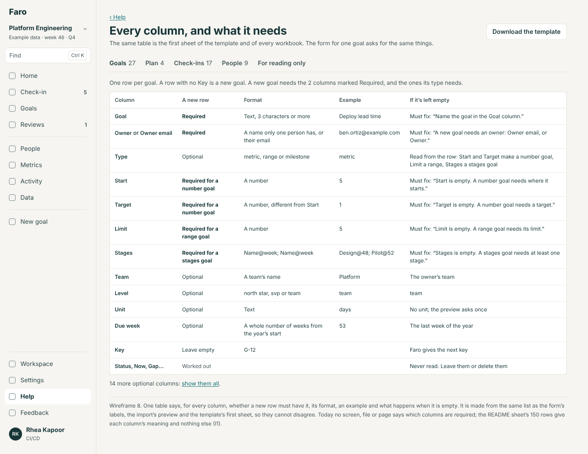
*Wireframe 8. One table per sheet: column, whether a new row needs it, format, example, what happens when it is empty.*

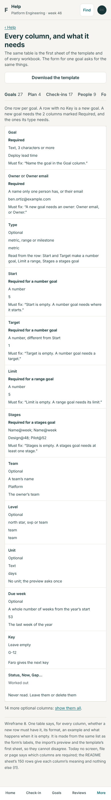

A new goal needs **Goal** and **Owner or Owner email**, plus what its type needs: **Start and Target** (number), **Limit** (range) or **Stages** (stages). Everything else has a default, and the preview says each default it used. A new check-in needs **Goal key (or Goal)**, **Week**, and **Value or Stages**. A new person needs **Name** and **Email** (and **Team** in a new workspace).

### 2. The validation model (spec section 4)

Thirty-eight checks, each with a kind, a level and one sentence. The rules for sorting them:

- **Must fix**: Faro cannot record it truthfully. A required column empty; text where a number goes; a word the column doesn't know, with nothing near it; a reference (person, team, goal) that matches nothing and nothing near; a key or a week used twice; a change the person may not make; a plan that ends before it starts.
- **Check**: possible, but unlikely or ambiguous. A name one or two letters from one that exists; a team or person the file would create; a goal with a name its team already has; a stage or due week already past on a new goal; a number far from the last or from the plan; a key that matches a goal with a different name, owner and team; an empty unit; a decimal comma; a near-miss header.
- **Fine**: counted, and where a default or a looser match was used, said on the change ("her team; the row gave none").

**One answer covers every row with the same question.** Problems and questions are grouped by `kind + column + what was found`. "14 rows name a team that isn't here: “Platfrom”" is one group. A group whose fix is a choice among things that exist (a team, a person, a word, a goal) can be answered in the preview, whichever level it is; a group whose fix is information only the author has (a missing owner, a number) is fixed in the file.

**Near-miss matching** uses one function for people, teams, goal names, headers and the words of a column: equal after folding case, accents, punctuation and "&"/"and" is a match and is fine ("ci/cd" is CI/CD today already; "Build and Release" becomes Build & Release); an edit distance of 1 for short words or up to 2 for words of eight letters or more, when exactly one candidate is that near, is a **Check** with the candidate as its first answer; anything else is not near.

**Never guessed**: an owner from a first name alone; a person from a name two people share; which of two goals with one name is meant; a number from text ("six"); a week from a date in another year; a type when the row fills in two types' columns; anything about a row whose key matches a goal that looks like a different goal.

### 3. The way in

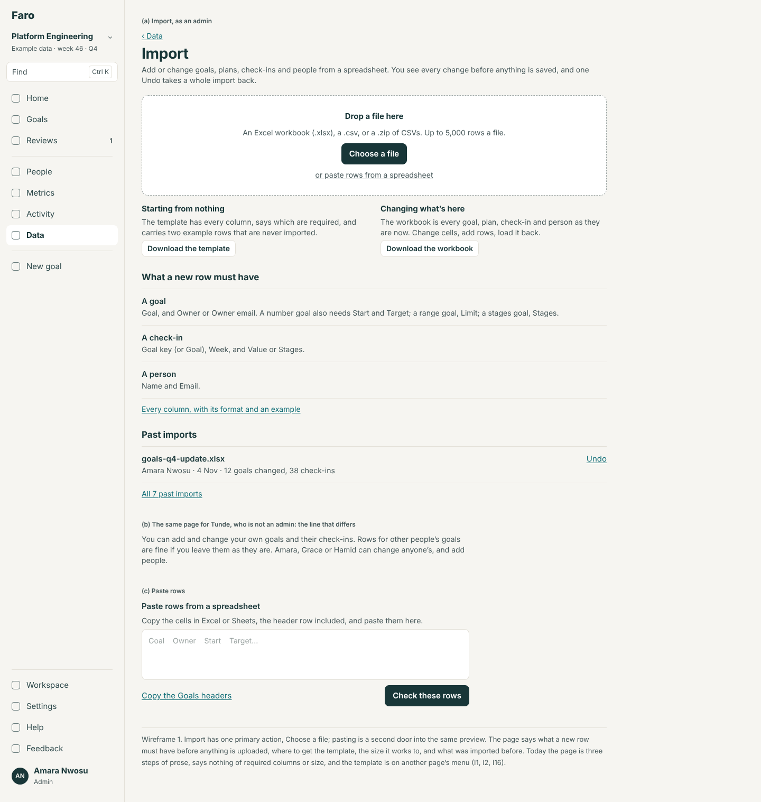
*Wireframe 1. One primary action. The page says what a new row needs, the size it works to, where the template is, and what was imported before.*

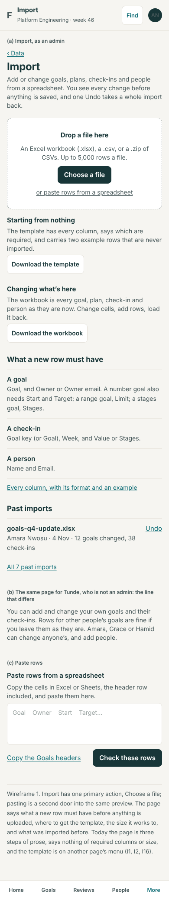

- **Primary action: Choose a file.** Dropping a file does the same. "or paste rows from a spreadsheet" opens a box that takes cells copied from Excel or Sheets, header row included, and leads to the same preview.
- **The template** (`faro-template.xlsx`): first sheet "Start here" (the field table); then Goals, Plan, Check-ins and People with only the columns a person fills in (no worked-out columns), the required headers in bold, and two example rows on Goals and People whose **Action says Example**. A row whose Action is Example is never imported; the preview counts it ("2 example rows left out").
- **Headers.** The header row is found within the first ten rows (a title row above it is skipped and said). A header is recognised if it is the column's name or one of a short list of other names kept beside it ("Goal name", "Owner name", "Baseline" for Start, "Units"), ignoring case and punctuation ("Owner e-mail"). A near miss ("Targett") is a Check: "Read “Targett” as Target?". There is no mapping wizard: a sheet that has fewer than two of Faro's headers isn't read, and the page says which headers it found and offers the template. The justification: mapping twenty-seven columns by hand is slower and more error-prone than pasting into the template, and near-miss questions cover the common case.
- **What was read**, said plainly at the top of every preview: "Read Goals, Plan, Check-ins and People. Not read: Results, Asks and README (for reading only); “Budget” (not a Faro sheet); the columns “Notes” and “RAG” on Goals."

### 4. The preview

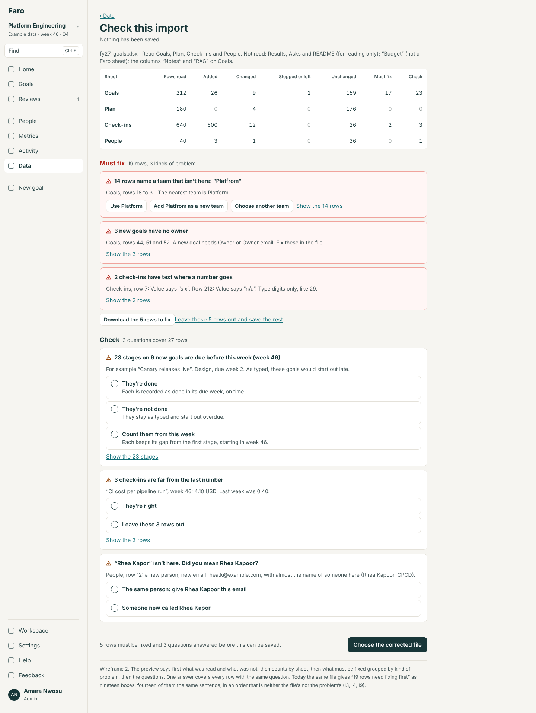
*Wireframe 2. What was read; counts by sheet; Must fix by kind; Check as questions.*

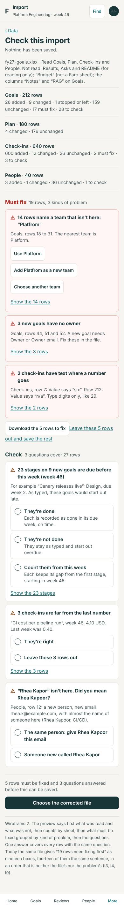

In order: the file line; counts per sheet (rows read, added, changed, stopped or left, unchanged, must fix, to check); **Must fix** by kind; **Check** as questions; then "What will be saved" in one sentence with "Show the n changes".

- **Fixing: both ways are kept, each for what it is good at.** Answer in the preview when the fix is a choice ("Use Platform"). Fix in the file when it is not; **"Download the n rows to fix"** gives back those rows exactly as they were, with two columns in front, Problem and Level, which are never read on the way back in. Recommended over a cell editor in the preview: Data's tables are already the grid editor, and a second one would be a second place for rules to drift.
- **Answers are remembered** when a corrected file is loaded: "Your 3 answers still apply."
- **All or nothing is the default.** While a Must-fix row remains, the primary action is "Choose the corrected file". "Leave these n rows out and save the rest" is a link under the Must-fix block; it says which other rows go with them ("and 4 check-ins for those goals") and the left-out rows are downloadable before and after saving. This is decision 1 for Lane.

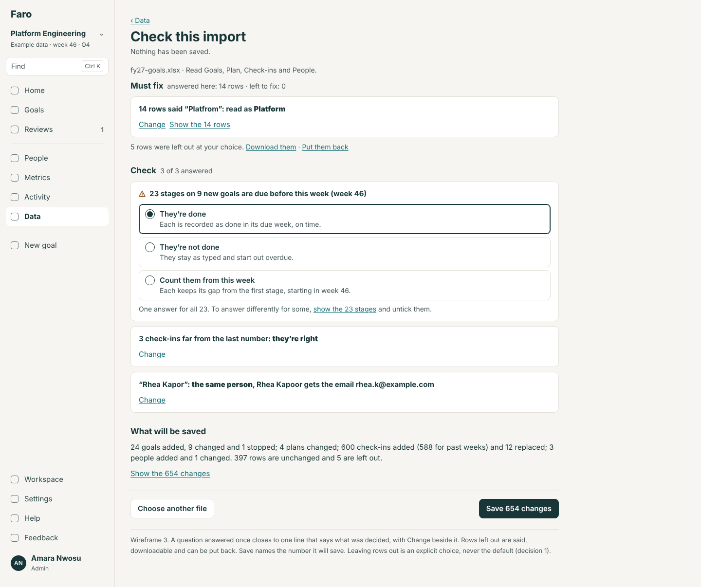
*Wireframe 3. An answer closes to one line with Change beside it; Save names its number.*

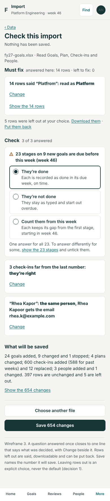

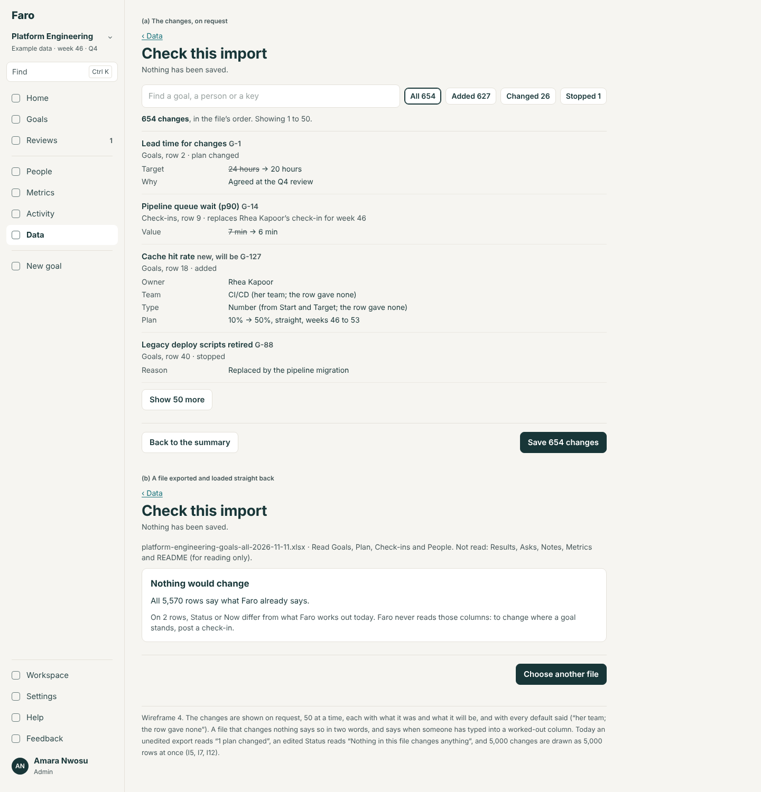
*Wireframe 4. Changes on request, 50 at a time, with before → after and every default said; and the round trip made visible.*

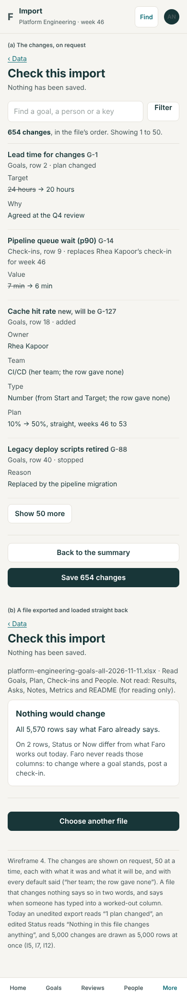

### 5. Undo and past imports

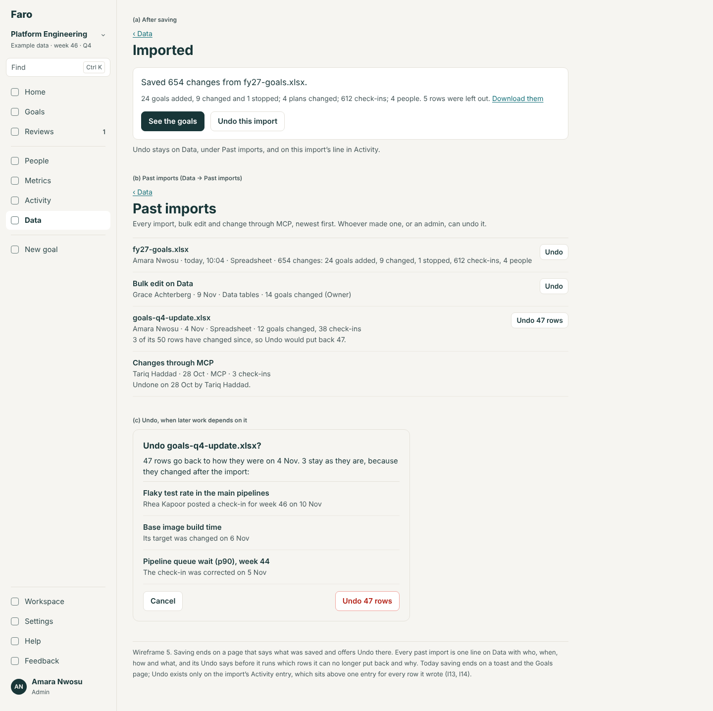
*Wireframe 5. Saving ends on what was saved, with Undo; Data lists every import; Undo says first what it can't put back.*

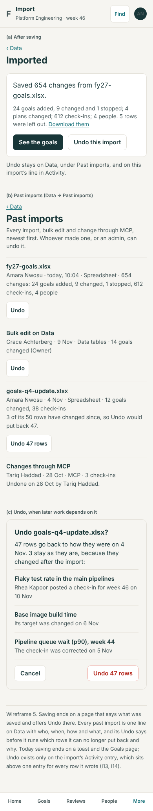

- **One Undo for a whole import**, in three places: the page after saving; **Data → Past imports** (`/data/imports`), one line per import, bulk edit or MCP change with who, when, how, the file's name and the counts; and the import's single line in Activity, which now folds its row entries under "Show the 654 changes".
- **How long**: no time limit in Faro. What limits it is later work, row by row. A row changed since the import stays as it is (today's rule, `undoImport`), and the Undo sheet lists those rows and why **before** it runs. An import with every row changed since says "Nothing left to undo".
- **A check-in posted on an imported goal**: the goal stays (it has history now), the other rows go back. The sheet says "Flaky test rate…: Rhea Kapoor posted a check-in for week 46 on 10 Nov".
- No new table: the change log already carries each import's summary entry, its `importId` and the before-images (`changeset.ts:827–844`). The entry gains the file's name as one more diff line.

### 6. Round trip

- An export loaded back unedited reads **"Nothing would change"**, with the row count. IM0 fixes the one case that breaks it today (I7), and N18 checks it for every goal in the demo at every decimal setting.
- **Worked-out columns**: when a matched row's worked-out cell differs from what Faro would write today, the preview says so, counted, and says what to do instead (post a check-in). It is a notice, not a question: nothing depends on the answer.
- **Unknown columns and sheets** are named (section 3).
- **Data's tables "as shown"** carry their key columns and load back (kept).
- **The formula guard** (an apostrophe before `= + - @`) is taken off on reading (kept). A cell that still starts with `=` in a number column is Must fix with its own words: "Target holds a formula (“=20+2”), not a number. In Excel, copy the column and paste it as values."
- **Another workspace's or last cycle's file**: every workbook's Start here sheet carries the workspace's id and the cycle. A file whose id is another workspace's opens with one Check before anything else: "This file was exported from “Sales”, not from Platform Engineering. Its keys and IDs belong there." with "Add its rows as new goals" (keys and IDs ignored) and "Cancel". A CSV has no such sheet, so the per-row Check on a key whose goal looks different (name, owner and team all differ) covers it. Last cycle's file from this workspace matches by key, as today, and says "Matched by key from 2025".

### 7. Large files

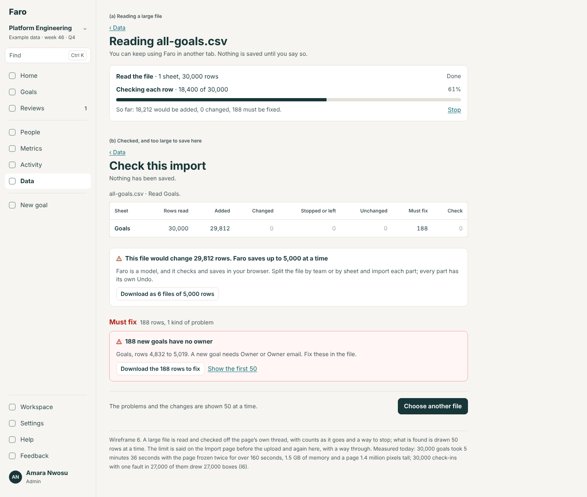
*Wireframe 6. Progress with counts while checking; the limit said with a way through.*

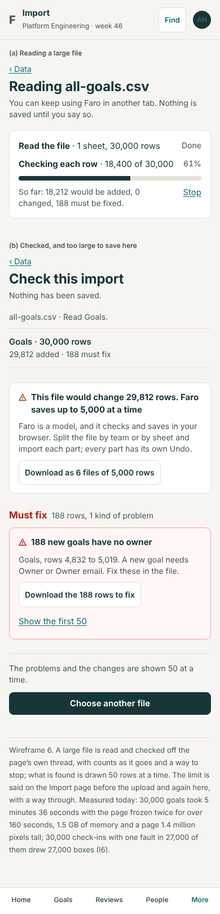

| | Faro builds | The internal platform provides (a requirement in the spec) |
|---|---|---|
| Reading and checking | In a Web Worker, with "Checking each row · 18,400 of 30,000", running totals and Stop. The engine's look-ups become maps, so time grows with the rows, not their square. Target: 30,000 rows checked in under 20 seconds, the page never frozen for more than 0.2 s | The same engine run on a server as an import job that survives a closed tab |
| The preview | Groups by kind; rows and changes 50 at a time; never more than about 3,000 elements | The same |
| Limits | Said before the upload: "Up to 5,000 rows a file." A file that would change more than 5,000 rows is checked in full and not saved; the page offers it back as files of 5,000 | No limit of this kind: one transaction or resumable batches on the server, with before-images kept per batch |
| Saving | One commit, all or nothing, up to 5,000 changed rows | Server-side, with progress, and the audit entry written by the server (deep review A2) |

Why 5,000: it is the largest size at which today's save was tolerable (11 s) and the undo record, held in one change-log entry, stays a few megabytes. Decision 3 for Lane offers the other answer (batches in the browser).

### 8. Export

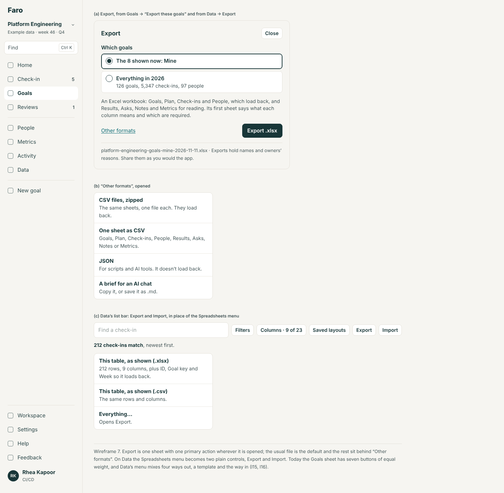
*Wireframe 7. One sheet, one primary action; Data's two plain controls.*

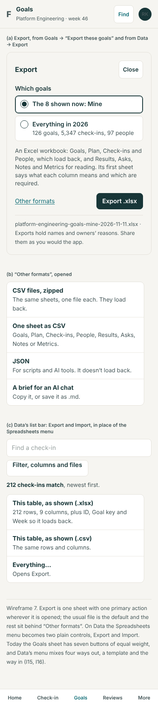

- **One Export sheet**, opened from Goals → "Export these goals" and from Data → Export. Which goals (what's shown, or everything), then one primary action, **Export .xlsx**. "Other formats" holds zipped CSVs, one sheet as CSV, JSON and the AI brief.
- **On Data**, "Spreadsheets" becomes **Export** (this table as shown, .xlsx or .csv; Everything…) and **Import** (a link). The template moves to the Import page.
- **File names**: `{workspace}-{what}-{scope}-{date}`, for example `platform-engineering-goals-all-2026-11-11.xlsx`, `platform-engineering-goals-mine-2026-11-11.xlsx`, `platform-engineering-check-ins-as-shown-2026-11-11.csv`, `faro-template.xlsx`, `fy27-goals-rows-to-fix.xlsx`. The cycle's name is on the Start here sheet, not in the file's name.
- **Owner and admin get the same export**: in Faro everyone can read every goal. What differs is the default scope (Mine from Goals → Mine). The spec states as a platform requirement that an export follows the platform's read rules and is written to the audit log.

### 9. Data's tables, as far as they are a bulk surface

Round 1's find design gives Data its list bar; nothing here changes it. Three things join it to this design: "Review changes" on Data and the bulk actions on Goals open **the same preview** with the same levels (they already share `Preview`); a bulk edit is a line in Past imports with its own Undo; and "as shown" exports say in the menu which key columns they add.

### 10. Set-up's upload

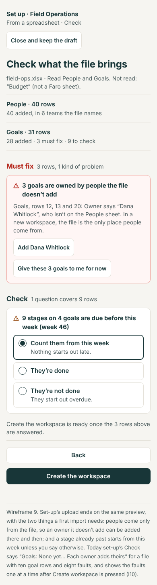
*Wireframe 9. The same preview inside set-up, with what only a first import needs.*

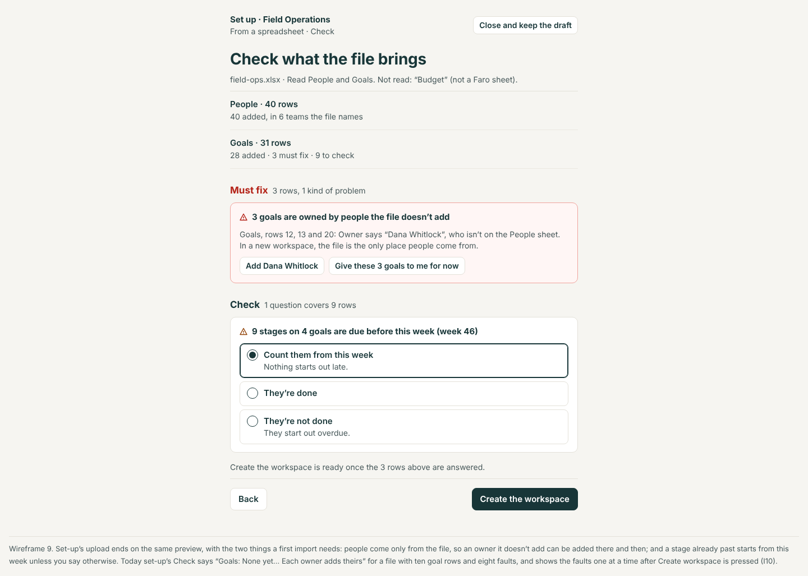

The set-up design decides where the upload sits. This design decides what it does: it reads any file Import reads, and ends on the same preview component in create mode, before "Create the workspace". What a first import needs that later ones don't:

- **People come only from the file.** An owner named on Goals who isn't on People is a Must fix that can be answered there: "Add Dana Whitlock" (asks for an email and a team) or "Give these 3 goals to me for now".
- **Teams are created by being named**; the count is said ("40 added, in 6 teams the file names"). A team name one letter from another in the same file is a Check.
- **Team is required for a person** (there is no team to default to).
- **A stage already past** defaults to "Count them from this week", set-up's present behaviour, as the first answer of the same Check.
- **Keys in the file are kept**, and another workspace's IDs are ignored (as today).
- There is nothing to undo: the read-back is the safeguard, and the workspace can be deleted.

## Each screen's one primary action

| Screen | Primary action |
|---|---|
| Import (`/data/import`) | Choose a file |
| Paste rows | Check these rows |
| Reading a large file | None (Stop is a link) |
| Preview, rows to fix remain | Choose the corrected file |
| Preview, questions remain | None until they are answered; then Save n changes |
| Preview, ready | Save n changes |
| Preview, nothing would change | Choose another file |
| Imported | See the goals |
| Past imports (`/data/imports`) | None (a page for reading; Undo is on each line) |
| Undo sheet | Undo n rows |
| Export sheet | Export .xlsx |
| Help: every column | Download the template |

## Role differences

| | Admin | Owner | Owns nothing |
|---|---|---|---|
| Import page | Full | Full, with the line that says what they may change and names the admins | Full; the line says they can add goals they will own |
| Goals and plans | Any | Their own; new goals they own (`planChanges`: `canChange`, `changeset.ts:339`, `:385`) | New goals they own |
| Check-ins | Any goal | Their own goals (`:679`) | None |
| People, teams, Left | Yes (`:246–293`) | No: the People sheet is read and must be unchanged | No |
| Rows they may not change | — | One Must-fix group, "41 rows change goals you don't own", with "Leave these rows out" | The same |
| Past imports | All; may undo any | All are listed; Undo on their own (`canUndoImport`, `src/domain/removal.ts:402`) | Listed; no Undo |
| Export | Everything | Everything; default scope is theirs | Everything |
| Data's tables | Edit cells | Read | Read |

A person who can't act sees the page without the action and is told once who can.

## The phone

Import and Export are desk work, and the phone's job is reading: a preview someone asks you to look at, a past import, an export on the way to a meeting. So at 390 px: the counts are one sentence per sheet, not a table; Must fix and Check stack, with answers as full-width rows at least 44 px high; the changes are one column with the label over each before → after; the field table is one block per column; the list bar's Export and Import go into "Filter, columns and files". Choosing a file works (the phone's own picker). Nothing scrolls sideways (F17).

## Decisions for Lane

**1. May an import with Must-fix rows save the good rows?**
- **a. All or nothing by default; "Leave these n rows out and save the rest" as an explicit choice (recommended).** The left-out rows, and the rows that depend on them, are named and downloadable. Evidence: with one typo in 30,000 rows, fixing and re-checking costs minutes today; and a non-admin's full workbook with a few stray edits has no other way through. The risk, a half-loaded tree, is met by leaving out dependants too.
- b. Always all or nothing, as today.
- c. Save the good rows by default.

**2. When a new goal's row has no Type:**
- **a. Read it from the columns filled in, say so in the preview, and refuse a row that fills in two types' columns (recommended).**
- b. Require Type on every new row.
- c. Keep today's silent "number goal".

**3. Above 5,000 changed rows:**
- **a. Check the whole file, don't save it, offer it back in parts; write the server-side import job as a platform requirement (recommended).** It keeps Faro honest about being a model.
- b. Save in batches of 2,000 in the browser, with progress and one Undo across them. More to build and something the rebuild should not copy.

**4. Near misses ("Platfrom", "Rhea Kapor"):**
- **a. Ask, with the near match as the first answer (recommended).**
- b. Refuse, but name the near match in the sentence.
- c. Accept the near match and say so.

**5. A team the file names that isn't here, on an existing workspace:**
- **a. An admin may answer "Add it as a new team"; anyone else must fix it (recommended).**
- b. Never from a file: teams are added under Workspace only (today).

**6. Past imports on Data:**
- **a. A page of its own, `/data/imports`, linked from Import and from Data's head (recommended).**
- b. Only the three newest on the Import page, the rest through Activity's filter.

**7. Should an export be written to Activity?**
- **a. No in Faro; yes as a requirement on the platform's audit log (recommended).**
- b. Yes in Faro too ("Rhea exported everything: 126 goals, 97 people").
