# The metric library, round 2: the evaluation and the design

11 November 2026. Round 2 of the redesign (`docs/design/round-2/README.md`), an area Lane added this morning. Design and spec only: no app code is changed and nothing here is built. The build spec is `spec.md` beside this file. The wireframes in `wireframes/` are rendered from `mockups/` (`node docs/design/metrics-2/mockups/build.cjs`) at 1440 and 390 px.

**Where this starts.** Round 1 (`docs/design/metrics/`, items ML1 to ML3) gave the library a place, a page per metric, a picker and a "to sort out" list; those are held, not built, and they stand. This round goes where round 1 stops: what a good definition is, how a goal is tied to a metric and a slice of it, what happens when a metric changes, numbers that arrive from a source, comparing goals on one metric, the Metrics sheet in and out, and the switch. It follows round 2's shared decisions: one field table, three levels (Must fix, Check, fine), see it before it is saved, everything can be taken back, out and back in changes nothing, off means absent.

## The idea in six lines

1. **A metric is usable with three things** (name, unit, which way is better) **and well defined with five more.** What is missing is said in one plain line, "Still to say: …", never a score, a percentage or a ranking.
2. **A goal takes its unit and direction from its metric and keeps its own start, target, plan and slice.** A slice is a team or the whole company, and optionally one named part of it.
3. **A metric that changes says so on every goal it measures**, after reading the goals back by name. Retiring keeps every link; only a metric nobody ever used can be deleted.
4. **A number from a source is offered, never posted.** The owner confirms it and still tells the story; every number afterwards says "from" or "typed".
5. **Goals on one metric are compared as goals**, each against its own plan on one scale. No team or person is named best or worst.
6. **The Metrics sheet goes in as well as out**, through the same preview as any import; and Metrics stays a feature that can be switched off, with a read-back first.

## The walk

- **The demo** at `https://goals-app-puce-five.vercel.app/demo?today=2026-11-11`, with Playwright, at 1440×900 and 390×844, as Amara Nwosu (admin), Rhea Kapoor (manager, 8 goals) and Tunde Bakare (owner, 2 goals): New goal's measure step, a goal's About, the check-in's number step, Data and its columns, the workbook, Help, Activity, Workspace → Features.
- **Metric screens were not live.** At 10:03 UTC on 11 November both `/demo/metrics` and `/demo/data/metrics` answered "Page not found · There’s nothing at this address". The live build had not merged. Its fallback (draft PR #57, `5c455c5`, read with `git show`, never checked out) is what "the fallback" means below.
- **The workbook** was exported twice as Amara ("Everything, as a workbook"), once with the Metric library on and once after switching it off in the demo (browser only; switched back on afterwards).
- **The code** on `design-round-2`: `src/domain/metrics.ts`, `types.ts`, `columns.ts`, `actions.ts`, `src/modules/metrics/`, `src/ports/`, `src/adapters/demo/numbers.ts`, migration 0033.

## The jobs people come to do

| Who | Job | How often | Today |
|---|---|---|---|
| A data owner (a metric's owner) | Define a number well enough that two teams read it the same way | When a number is first used; then when it changes | A form with ten fields and three required (the fallback); nothing says what a good definition is |
| A data owner | Change what a number means, and tell those who rely on it | A few times a year | Edit and save; no goal is told, no chart is marked |
| A data team | Bring the catalogue in: 200 metrics at once | Once, then quarterly | Not possible: the Metrics sheet is read-only |
| Owner (Tunde) | Say which number, and which part of it, measures my goal | Per goal | A select of every metric (the fallback); "For" a team or the company; no part |
| Owner (Rhea) | Check in without retyping a number a system already has | Weekly | "Where to get it: CI test analytics. Typed in by hand." |
| Leader (Amara) | See every goal on one number and where to look first | Monthly, and before a review | Not possible: in the demo no metric measures two goals |
| Admin (Amara) | Look after the library: retire, merge, switch it off | Quarterly | Remove unlinks every goal; no merge; the switch acts at once |
| The rebuild team | Plug a real source in | Once per source | The port exists; nothing reads it; it has no slice |

## Findings

M2-numbered, so they don't collide with round 1's M1 to M10. Severity: **High**, **Medium**, **Low**.

**M2-1. The same definition is written twice, and the two already differ. High.**
- Goal "Lead time for changes" (`/demo/goals/ns-lead`, About this goal → "What it measures"): "Median hours from a change’s first commit to it running in production, across every deployable service · Source: DORA dashboard (Four Keys)." (`src/screens/GoalScreen.tsx:1049`).
- Its metric, in the exported Metrics sheet: "Median hours from a change’s first commit to running in production, over the last 28 days. Counts every change to a deployable service; reverts count as changes." (`src/data/platformOrg/metrics.ts:18`).
- The goal doesn't say 28 days or that reverts count. A goal keeps `definition` and `source` of its own (`types.ts:100–102`) whether or not it is linked, and nothing says which one is true.

**M2-2. A number from a source has nowhere to land. High.**
- The check-in says, in fixed words, "Where to get it: CI test analytics. Typed in by hand." (`/demo/check-in`, `src/screens/CheckInFlow.tsx:410`).
- A check-in records no origin for its number (`CheckIn`, `types.ts:182–208`), so nothing could say "from the source" afterwards, on the goal or in an export.
- The port reads a metric, not a slice of one (`NumberSource.read(metric, at)`, `src/ports/index.ts:53–59`): two teams' goals on one metric would be offered the same number.

**M2-3. The demo's source would hand a check-in its own last number. High for the demo.**
- `demoNumbers` answers with "the value of the goal that metric measures, as last checked in" (`src/adapters/demo/numbers.ts:15–24`). The moment a check-in is filled from it, "this week's number" is last week's check-in.
- Its comment points to `src/ports/contracts/numbers.ts`, which doesn't exist (the contract is in `contracts/parts.ts:134`).

**M2-4. Removing a metric cuts every goal loose. High.**
- `removeMetric` unlinks every goal in the same save (`metrics.ts:185–198`); the fallback's button is one press, "Remove this metric" (`Metrics.tsx:112` on PR #57). Restored later, it comes back "without its old links" (`tools.ts:142`).
- There is no way to stop using a metric while its goals keep saying what they were measured by. A metric with three years of goals behind it can only be kept for ever or torn out.

**M2-5. A metric can change under its goals and nobody is told. High.**
- `saveMetric` saves any change by its owner or an admin, logged on the metric only (`metrics.ts:169–179`): a new meaning, a new unit, the opposite direction.
- A goal in hours whose metric becomes minutes is left as it is; `linkProblems` would refuse that link today (`metrics.ts:210`), but nothing looks again after the change.
- Round 1's ML3 added a confirm for unit and direction. It did not cover meaning, a mark on the goals, a reason, or what is refused.

**M2-6. The comparison has nothing to compare. Medium.**
- The exported Metrics sheet's "Measures" column has one goal or none on every row: 13 metrics, 12 links, 12 different metrics (`src/data/platformOrg/metrics.ts:21–105`).
- "Two teams' build time are the same thing" is the feature's sentence (`docs/live-build/metrics.md`), and the example has no two goals on one number. Round 1's wireframe 2 had to invent a second goal.

**M2-7. The Metrics sheet goes out and not in; a goal's metric goes neither way. Medium.**
- `METRICS` is `loaded: false`, every column "For reading" but ID (`columns.ts:355–373`); the README sheet says "Not loaded back" on each of its 14 rows.
- The Goals sheet has `Source` and `Definition` (`columns.ts:209–210`) and no "Measured by": a goals file can't say which metric measures a goal, and the round trip is silent about it.
- A data team's catalogue has to be typed in one metric at a time, or sent through an AI tool.

**M2-8. Switching the library off acts at once and leaves a sheet behind. Medium.**
- Workspace → Features, as Amara: the row "Metric library … On" is a tick box. Unticking it showed only a toast: "Metric library is off in Example: Platform Engineering. Nothing it saved is lost. · Undo" (`Workspace.tsx:496`). No count of metrics or goals, before or after.
- The workbook exported with it off still had the Metrics sheet, 13 rows, and the README's 15 lines about it. "Off means absent" (shared decision 6) does not hold for the sheet, because the sheet lives in the core (`columns.ts:377`).

**M2-9. What "well defined" means is nowhere. Medium.**
- Three fields are required (`REQUIRED_FIELDS`, `metrics.ts:30`). A metric with only those reads exactly like one with a meaning, a source and an owner who still works here. Round 1's M6 found this and gave owners a "to sort out" list; it did not say what the bar is, or keep it from becoming a score.
- Nothing questions a percentage whose words don't say out of what, a unit spelled two ways ("min", "mins"), or a name one letter from another's (round 1's close-name rule compares whole words, so "Deploy sucess rate" passes).

**M2-10. A slice is a team or nothing. Medium.**
- A link holds `teamId` or null (`types.ts:415–424`). "Queue wait for tier-1 services" and "queue wait for release builds" by one team can't both be said; a second goal on the same team's number isn't noticed either.
- 0b left "dimensions an admin defines" out on purpose (`module.json` → `growth`). That stays out; what is missing is the smallest thing short of it.

**M2-11. The form asks for the unit before the metric that knows it. Medium.** (Round 1's M4, seen live.)
- New goal, step 2 of 4, "Measure": "Unit", "Decimals", "By when?", the numbers, "How will progress come?", and last "How it’s measured · optional", 606 px down at 1440 and 642 px at 390 (`GoalWizard.tsx:239–244`). The `goal.measure` place renders after it.
- Round 1's ML2 moves it first. This round adds what is locked once a metric is chosen, which ML2 left as "Use different ones".

**M2-12. Help knows nothing of metrics. Low.**
- Find in Help, "metric": "3 articles match": MCP access, Setting up a goal, Importing from a spreadsheet. None is about the library, though Features lists it as on and the workbook carries its sheet.

**M2-13. Two names. Low.**
- Features calls it "Metric library"; round 1's menu, page and sheet say "Metrics". One name: Metrics.

### What works and is kept

- **The record and the rules** (round 1's list), unchanged: three required fields, anyone adds, the owner or an admin changes, the goal's owner or an admin links, one metric per goal, a unit mismatch refuses.
- **A goal's own "What it measures" and "Source".** They looked like duplication (M2-1); they are what a goal falls back on when it has no metric, or when Metrics is off. They stay, with one rule about which is shown.
- **"No new number this week"** on the check-in. It is exactly what a monthly number needs on a weekly rhythm.
- **The switch.** Metrics is already a module with `needs: []` and nothing needing it; Features, `setModule` and `set_feature` exist.
- **The port's shape**: `reads`, `read`, a `Reading` with the time measured. It gains one argument.

## The design

### 1. Defining a metric well (wireframe 1)

**The fields.** The record does not change. Each field is one row of the shared field table (the full table, with formats, examples and exact wording, is `spec.md` section 3).

| Field | Is it needed? | Asked |
|---|---|---|
| Name | **Required** | First |
| Unit | **Required** | First |
| Which way is better | **Required** | First |
| What it means and how it's calculated | Optional (empty: "Not said yet") | First, under the three |
| Decimal places | Optional (0) | Beside Unit |
| Source; who owns that source; how often it refreshes | Optional ("Not said") | Later: one group, "Where the number comes from · can be said later" |
| Owner | Required, and filled in: you | Later; shown as text with Change |
| Caveats | Optional | Later |
| Still to say; retired on; goals | Worked out | Never asked |

**Meaning and calculation stay one field**, with a hint in three parts: "What is counted, out of what or over what period, and what is left out." Two fields would need a migration and would be filled with the same sentence twice.

**The three levels in the form.**

- **Must fix**: no name, a name under 3 characters, a name another metric has; no unit; no direction; decimals not 0 to 4; an owner who isn't in the workspace. The rule's words exist (`metricProblems`); each now shows under its own field, outlined and washed.
- **Check** (a question, answered once, never a refusal):
  - a name one letter or one word from another's: "This is one letter from “Deploy success rate” (%, higher is better, owned by Marisol Duarte, 2 goals)." → "Use that one" / "Mine is different: keep it";
  - a unit spelled like one in use: "Other metrics here use “min”. Use “min”, or keep “mins”?";
  - a percentage or rate whose words don't say out of what: "This is a percentage, and the words don’t say out of what. For example: …" → "It’s right as written";
  - a change to a metric that goals use (section 3).
- **Fine, and said**: anything optional left empty. It is not a Check, because a thin metric on its first day is likely, not unlikely.

**"Well defined" is a line, never a score.** A metric is **usable** with its three required fields. It is **fully defined** when it also has a meaning, a source, who owns the source, how often it refreshes, and an owner who is in the workspace. Between the two, one line names what is left, in this order: "Still to say: what it means, where the number comes from, who owns that source, how often it refreshes." or "Its owner has left." It shows:

- by the form's button, before saving;
- under the metric's title, to everyone ("Fully defined", or the line);
- on a goal measured by it, only as the thing itself ("Its meaning hasn’t been written yet.");
- in the library as round 1's filter "Something to sort out".

It is never a number, a bar, a percentage or a sort order. The library can filter by it and cannot sort by it.

**No draft or "proposed" state.** A metric can be used the moment it is added. A state would be a gate, and 0b dropped Draft and Ready on 8 November for that reason; the line above does the honest part of the job. A company that wants a steward to approve definitions adds that as a role and a state (the growth list); the spec writes it as a requirement, not a screen.

**Primary action:** "Add the metric" / "Save changes".

### 2. How a goal is measured by one, with slices and targets (wireframe 2)

**One metric per goal**, as today (the link's id is the goal's id). A goal that needs two numbers is two goals.

**The slice is two things.**

- **"For"**: the goal's team, or "The whole company". Exists (`teamId`).
- **"Which part"** (new, optional): one short label for a cut of that number: "tier-1 services", "EU", "release builds". It is free text that converges: the field offers the parts other goals on this metric already use, and a new label close to one of them is a Check ("This metric already has a part called “tier-1 services”. Use that / Keep “Tier 1”"). No admin defines dimensions; that stays on the growth list. It is one text column on the link.

**What the metric gives the goal, and what stays the goal's own.**

| From the metric (said as text, not fields) | The goal's own |
|---|---|
| Unit | Start and target, or the limit and which side of it |
| Decimal places | The plan's shape and its due week |
| Which way is better | For, and which part |
| Meaning, source and who owns it, refresh, caveats | A note "For this goal" (its own "What it measures", when it adds something) |

**Locked, and how it is said.** On a new goal, choosing a metric replaces the Unit and Decimals fields with one block: "From the metric: min, whole numbers, lower is better. From CI runner metrics, refreshed hourly." and under it "A goal measured by a metric uses its unit and its direction. To use others, choose another metric or “No metric”." Round 1's "Use different ones" goes: a different unit could never be saved (`linkProblems` refuses it), so the link offered a dead end.

**When they disagree** (an existing goal being linked, or a file):

| Case | Level | Words |
|---|---|---|
| The goal's unit isn't the metric's | Must fix | "The goal is in hours and the metric is in min. Use the same unit for both." (exists) |
| The goal aims the other way | Check | "The target is above the start, but for Pipeline queue wait (p90) lower is better. Is that meant?" → "Yes, it’s meant" / "Change the target" |
| The goal shows more decimal places | Check | "The goal keeps 1 decimal place and the metric whole numbers. Show whole numbers on the goal?" → "Yes" / "Keep 1 decimal place" |
| Another goal has the same metric, team and part | Check | "Another goal already measures this for Build & Release, release builds: … Two goals on one number is unusual." |
| The metric is retired | Must fix | "“Flaky test rate (old)” was retired on 11 Nov. Use “Flaky test rate”, which replaced it." |

**The kinds of goal.**

- **A number goal**: its target is the target in the metric.
- **A keep-in-range goal** (a guardrail): allowed, as today. "At most 5 min" on a lower-is-better metric agrees with it; "at least" on one is the Check above. The comparison shows its limit, and "1 min of room", not "behind plan".
- **A dated-stages goal**: no "Measured by" at all. The field is absent, not disabled.

**Changing a goal's metric after check-ins have started** needs a reason, as a plan change does, and is marked in the goal's History ("Measured by Flaky test rate since week 46: …"). Before the first check-in it changes freely. (The live build's brief keeps "freely" for today; this is the backlog answer to its question 3, made cheap because the rule now lives in the module.)

**Which words a goal shows.** Linked: the metric's meaning and source, then the goal's own text under "For this goal" only when it has some. Not linked, or Metrics off: the goal's own. Linking never deletes the goal's own text. This settles M2-1 without a migration.

**Primary action:** the form's own (Continue, or Save changes).

### 3. When a metric changes or is retired (wireframe 3)

Every change is one of five kinds, decided by a rule from what changed and whether goals use the metric.

| Change | With no goals | With goals |
|---|---|---|
| **Words**: owner, who owns the source, refresh, caveats | Saves | Saves. Logged on the metric |
| **Name** | Saves | Saves. Every goal says the new name at once (it is a link). The old name still finds it in Find and in a file, as a Check: "“Deploy frequency” is now called “Production deploys per day”. Use it?" |
| **Meaning or source** | Saves | One question first: "Is it still the same number?" **Same number, better words**: saves, nothing marked. **The number itself changes, from week 46**: needs a reason, and reads back the goals by name. Each goal's chart and History then say "Definition changed in week 46" with the reason. History stays as recorded; it is marked, not rewritten |
| **Unit** | Saves | **A new label for the same numbers** ("mins" → "min"): a guided change, read back: "5 goals will show “min” instead of “mins”. No number changes." **A different scale** (hours → min): Must fix. "3 goals are in hours. A metric in minutes is a different number: add it as a new metric and move goals to it, or retire this one." |
| **Which way is better; decimals** | Saves | A guided change with a reason: "For 2 of its 4 goals the target now lies the wrong way: … Each will show a Check until its owner has looked." Marked like a change of meaning |

**Who is told.** Nobody is sent anything new. The mark is an entry in each linked goal's History, so it reaches the owner on Home's "what changed", watchers in Watching, and a review's agenda, by the ways changes already travel.

**Retiring** (new) replaces removing for any metric that has ever measured a goal.

- "Retire this metric…" asks why, and may name what replaces it. Read-back: "3 goals stay measured by it and keep their numbers. They will say “Measured by Flaky test rate (old), retired 11 Nov”. It leaves the pickers and the library’s list."
- A retired metric: is not offered for new links; shows in the library only under the filter "Retired"; keeps its page, which opens with the retirement and "Bring it back"; takes no more numbers from a source.
- On a goal: "Measured by Flaky test rate (old), retired 11 Nov", the reason, and for the goal's owner and admins "Measure it by Flaky test rate" (when a replacement was named) and "Choose another".
- "Bring it back" undoes it at any time.

**Merging** two metrics that turn out to be one: "Merge into another metric…" on the one that goes. Read-back: "“CI cost per pipeline run” (2 goals) becomes “CI compute cost per pipeline run” (1 goal). Both are in USD. The 2 goals will be measured by it from today, and their History will say so. “CI cost per pipeline run” is retired, pointing here." Different units: Must fix. A merge is a retirement with its goals moved.

**Deleting** is only for a metric no goal has ever been measured by: "Delete this metric…", today's removal (kept 30 days in Recently removed). The page offers Retire or Delete, never both.

**One Undo each**, from the toast and from Activity: a change with its marks, a retirement, a merge with every moved goal, a deletion.

**A metric's History** (a section at the foot of its page, newest first, in the shape of a goal's): added; each change field by field; "Definition changed from week 46", with the reason and both texts; renamed; goals measured by it and no longer; retired, brought back, merged. Readings from a source are not History; they are on the goals.

### 4. Numbers that fill themselves in (wireframe 4)

**What exists.** The port: `NumberSource { name; reads(metric); read(metric, at) }` returning `{ value, at }` or nothing, with a contract of two tests. One adapter, the demo's "CI analytics", which reads one metric by echoing its goal's check-ins (M2-3). No screen calls it.

**The principle: a source offers, the owner confirms.** A check-in is "the owner’s weekly word on a goal". A number that arrives is the first half of the word; the owner still chooses the status and says what changed. So nothing is posted without a person.

**The check-in's number step**, when the goal's metric has a source Faro can read:

- the number, large; under it "**From CI analytics**, measured Thu 12 Nov at 09:00."; then "Week 45: 43 min. You still say what changed: that is the next step.";
- the primary button "**Use 41 min**"; two links: "Type a different number", "No new number this week".

**The three levels.** A source never blocks a check-in, so there is no Must fix: the owner can always type.

| What the source gives | Level | The step says |
|---|---|---|
| A number measured since the last check-in, in time | Fine | As above |
| The same reading as last time | Fine | "No new number since your last check-in: still 43 min, measured Wed 4 Nov." with "No new number this week" as the primary button |
| Nothing yet | Fine | "CI analytics has no number for this yet." and the field to type in |
| It can't be reached | Fine | "CI analytics couldn’t be reached just now." "Try again", and the field to type in |
| A number older than its refresh allows | Check | "The latest number from CI analytics is 43 min, measured Wed 28 Oct, 15 days ago. It usually refreshes hourly." → "Type this week’s number" / "No new number this week" / "Use 43 min anyway" |
| Ten times the last number, or a tenth | Check | "CI analytics says 410 min. That is ten times week 45’s 43 min. Is it right?" → "Yes, use 410 min" / "Type a different number" |
| The source now gives a different number for the week last checked in | Check | "CI analytics now says week 45 was 45 min, not the 43 checked in. Correct week 45?" → "Correct it to 45 min" / "Leave it" |

**From the source, or typed.** Each check-in records what the source said, when it was measured, and the number the owner used. Then:

- the goal's Now and History: "From CI analytics, measured Thu 12 Nov 09:00. Rhea Kapoor checked in." / "Typed by Rhea Kapoor." / "Typed by Rhea Kapoor. CI analytics said 45 min.";
- the Check-ins sheet: three worked-out columns, "Number from", "Source’s number", "Measured at". Worked out, so a file can never claim a source said something.

**A correction after the fact** is a change to that week's check-in, logged with what the source said then and now. It is offered, never made silently.

**Refresh against rhythm.**

- A weekly rhythm and a monthly number: most weeks the step opens on "No new number since…", and that check-in counts as a check-in. Nothing is late for want of a number the source doesn't have.
- **No set rhythm**: numbers still arrive and nothing is due. The goal's page says "Latest from CI analytics: 41 min, measured Thu 12 Nov 09:00. Not checked in yet." with "Check in with this number". The status shown stays the last check-in's, with its week (the toggles design's rule).

**What Faro builds, and what is the platform's.**

| Faro builds (the model to copy) | A requirement for the internal platform (written into the spec, not built) |
|---|---|
| The port with a slice; its contract | Real connectors, one per source, passing the contract |
| A demo source with its own series for two metrics, one of them in two parts | Credentials held by the platform, never in the browser or in Faro's tables |
| The rule that sorts a reading into the cases above | A schedule per metric's refresh; readings kept with the time measured and the time fetched |
| The check-in step, the goal page's line, History's words, the sheet's columns | A reference per metric and part (the query or series a connector reads) |
| The words | A source that is down alerts the source's owner, through the platform's observability, not each goal's owner |
| | Whether a number may be recorded with nobody confirming it (see Decisions, 5) |

**Primary action:** "Use 41 min" (or "No new number this week" when there is none).

### 5. Comparing goals that share a metric (wireframe 5)

On the metric's page, round 1's "Goals measured by it" grows into the comparison. With one goal there is nothing to compare, and the section is the one row.

- **The count line** leads: "1 off track, 1 at risk, 1 on track. Now between 4 and 11 min; targets between 4 and 5 min." It replaces round 1's "Lowest now: Build & Release, 4 min. Highest: CI/CD, 7 min.", which named a best and a worst team.
- **The table**: Status (shape and word) · Goal (with its key; "said why this week" when its owner has; "yours" on the viewer's own) · For (team · part) · Now · Target ("5 min by week 53" / "At most 5 min") · Against plan ("5 min behind plan" / "1 min of room") · Last 4 weeks, in words ("Worse 3 weeks running", "Level") · Owner.
- **Order**: "Worst first" (status, then furthest behind its own plan) or "By team and part". There is no sort by owner, by "best", or by number. Owner is the last column and the first to give way when the page is narrow.
- **Small charts, one per goal** ("Each against its own plan, on one scale"): the plan dashed, the actual line, the target or limit as a hairline; the status as shape and word above each. All share one vertical scale when their numbers sit within five times of each other; otherwise "Each against its plan" is chosen for them, each chart on its own scale and the line under them says so. Up to six, then "Show the other 3". A link gives the same numbers as a table of weeks.
- **Why small charts and not one chart with several lines**: one chart needs a colour per goal and a legend to match; Faro's colours mean status and nothing else. Small charts need neither, and each keeps its own plan beside its own line, which is the comparison that matters: is each where it said it would be.
- **Never a league table.** No ranks, no "top" or "bottom", no team named in a summary, no totals per owner. An off-track goal whose owner said why this week says so on its row: early warnings read as care, not as failure (backlog R5).

**What each person takes from it.**

- **Amara** (a leader): where to look first, and whether the trouble is one team's or the number's (every chart bending the same way in the same week is the number). "See its 3 goals" opens Goals filtered to them, where a review can be built.
- **Tunde** (an owner): his own row marked "yours", and how the others on the same number are doing and what they said; their goals are a link away.
- **Rhea** (the metric's owner): who relies on the definition, before she changes it.

**Primary action:** "See its {n} goals" (round 1's, unchanged).

### 6. Importing and exporting metrics (wireframe 6)

**Today** (`src/domain/columns.ts`): the Metrics sheet has 14 columns, ID as its match and 13 "for reading", `loaded: false`. The Goals sheet has Source and Definition and nothing about a metric. A header row with "Metric" and one of Unit, Direction or Measures is recognised as the Metrics sheet whatever the file is called.

**What changes**: the Metrics sheet is loaded back; it gains Action and Reason, and two worked-out columns; the Goals sheet gains three columns; the Check-ins sheet gains three worked-out columns (section 4). The rows for the shared field table are in `spec.md` section 3, in the import spec's shape.

- **How a row finds its metric**: by ID when the cell has one; otherwise by name (any case, spaces trimmed); otherwise it is new. An ID that isn't a metric here is a Must fix. A name with a different ID's row is a rename, shown as one.
- **200 metrics in one file**: a workbook or CSV with only a Metrics sheet goes through the same preview: counts first ("188 new metrics · 7 change a metric that exists · 2 retired · 3 unchanged"), then Must fix rows, then Checks, each answered once for all the rows it covers. Metrics with no source are counted, not questioned: "61 new metrics name no source yet: they will say “Still to say: where the number comes from”."
- **No Owner email** is a Check when the file adds metrics: "14 rows give no Owner email. You will own those 14 metrics." → "I’ll own them" / "Leave these 14 rows out".
- **A file can't do the guided changes.** A row that changes the unit of a metric goals use is a Must fix that sends the person to the metric's page; a row that changes its meaning is a Check with the same question as the form.
- **Retiring** is the Action column, as Stop is on Goals: "Retire" or "Bring back". Retire with goals is a Check that counts them.
- **The Goals sheet**: "Measured by" (a metric's name or ID), "Measured for" (a team's name, or The whole company; empty: the goal's team), "Part".
  - A name that isn't in the library is a Check, answered once for every row that names it: "3 rows name the metric “Deploy frequency”, which isn’t in the library." → "Use “Production deploys per day”" (the closest, when there is one) / "Add “Deploy frequency” as a new metric (deploys, higher is better, owned by you)" / "Leave these goals without a metric". The unit and direction come from the goals that name it.
  - An emptied "Measured by" on a goal that has a metric is a Check: "12 rows clear “Measured by” on goals that have a metric." → "Stop measuring them by a metric" / "Leave them as they are".
- **Round trip**: an export loaded back unedited reads "Nothing would change", the Metrics sheet and the new columns included; retired metrics are exported with their date, so loading the file back doesn't bring them back.
- **Undo**: one, for the whole load, metrics and links with it.
- **With Metrics off**: the sheet and the columns are absent from exports and the template. A file that still has them is read without them, with one line: "The Metrics sheet was left alone: Metrics is switched off here."

**Primary action:** the preview's own ("Add 188 metrics, change 7"), live once nothing is left to fix or answer.

### 7. Should Metrics be a feature that can be switched off? (wireframe 7)

**It already is, and it should stay one.** It is a module with nothing in `needs` and nothing that needs it; Workspace → Features lists it; `setModule` (admins only) switches it; nothing it saved is deleted. Numbers from a source belong to it (a source reads a metric), so they go off and on with it.

**What a workspace looks like with it off.**

- No Metrics in the menu or in Find; a metric's address says the toggles design's line: "Metrics is switched off in Platform Engineering. An admin can switch it on in Workspace, Features."
- "Measured by" isn't asked, on a new goal or a changed one. The form asks for the unit and decimals as it does today, and for "How it’s measured" and "Where the number comes from" as the goal's own words.
- A goal's page shows its own "What it measures" and "Source". No block, no line, no sentence about metrics.
- Goals has no "Measured by" filter. The check-in asks for the number by hand. Past check-ins keep saying where their number came from: that is a fact about the check-in.
- The Metrics sheet and the three Goals columns leave exports, the template and the README sheet. The AI tools say it is off (exists).

**What switching off says first** (the toggles design gives a read-back to a module that owns records; this is that read-back for Metrics):

> **Switch Metrics off for Platform Engineering?**
> **13 metrics, and what 12 goals are measured by, are kept.** They come back as they were when you switch it on.
> Leaves the menu: Metrics, and each metric's page · On goals: 12 goals stop saying what they are measured by, and show their own "What it measures" words instead · New goals: "Measured by" isn't asked · From sources: 1 goal's number stops arriving from CI analytics; its owner types it · Spreadsheets: the Metrics sheet and the "Measured by" columns leave exports and the template.
> **Check.** 7 of the 12 goals have no "What it measures" words of their own. They would say "Not described yet". ☑ Copy each metric's meaning and source into those 7 goals first.
> **Switch Metrics off** · Keep it on

Afterwards: "Metrics is off. 13 metrics and 12 goals’ links are kept. Undo" (Undo also takes back the copied words). Switching it on again says nothing first: nothing is lost by it.

**The default** for a new workspace is on. An empty library costs a new goal one optional field. **Set-up says nothing about it** unless the set-up design's "how you work" step lists the features; then its line is "Metrics: define each number once, so two teams’ “build time” mean the same thing. On."

## Each screen's one primary action

| Screen | Primary action | Everything else |
|---|---|---|
| Add or change a metric | **Add the metric** / **Save changes** | Answers to Checks; Close and keep the draft |
| The change read-back (meaning, unit, direction) | **Change the meaning** (or the unit, the direction) | Keep it as it was |
| Retire; Merge (sheets) | **Retire the metric** / **Merge them** | Cancel |
| "Measured by" on a goal form | The form's own | Change; For; Which part; answers to Checks |
| The check-in's number step, from a source | **Use 41 min** | Type a different number; No new number this week |
| A metric's page, with its comparison | **See its {n} goals** | The two orders; the two scales; the table of weeks |
| The import preview | **Add 188 metrics, change 7** | Leave rows out; answers; the template |
| Switch Metrics off (sheet) | **Switch Metrics off** | Keep it on; the tick box |

## Role differences

Rights are the ones in the code; the last two rows are gaps, and are decisions for Lane.

| | Amara (admin) | Rhea (owns metrics and goals) | Tunde (owns 2 goals) | Enforced by |
|---|---|---|---|---|
| Add a metric | Yes | Yes | Yes | `saveMetric` (anyone adds) |
| Change a metric: words, name, meaning | Any | Hers | No button: "Rhea Kapoor or an admin can change this." | `saveMetric`, `canEditMetric` |
| Retire, bring back, delete an unused one | Any | Hers | No | New `retireMetric`, with the same check; `removeMetric` |
| Choose a goal's metric, For and part | Any goal | Her goals | His goals | `linkGoalMetric`, `canLinkGoal` |
| Confirm or type over a source's number | — (owns none) | Her goals | His goals | The check-in's own rule, unchanged |
| See the comparison, History, where a number came from | Yes | Yes | Yes | R1: reading is open |
| Import the Metrics sheet | Yes | As the import design decides; each row is still checked by `saveMetric` | The same | The change engine, row by row |
| Switch Metrics off | Yes | No (Features isn't shown) | No | `setModule` |
| **Merge two metrics; change a unit's label on its goals** | Yes | **Gap**: both write to goals she may not own | No | Decision 3 |
| **Copy a metric's words into goals when switching off** | Yes | — | — | Admin already; said for completeness |

## The phone

- **The form**: one column; a Must fix and a Check sit under their field at full width, their answers as full-width buttons 44 px high; "Add the metric" sticks above the keyboard with the count line over it.
- **"Measured by"**: "From the metric" is one block; "For" is two rows; "Which part" is a field with its suggestions as links under it.
- **The read-backs** are full sheets; the goals are named in a paragraph, not a table.
- **The check-in**: the number, where it came from, the two links, then "Use 41 min" at the foot.
- **The comparison**: the count line, "Worst first / By team and part", then each goal as a short stack (status and title first; For, Now, Target, Against plan, Last 4 weeks, Owner as labelled lines); the small charts one per row. The scale choice moves into "Filter and sort".
- **The import preview**: counts two by two; each Must fix row a stack with what was read in the status colour.
- **Features**: the switch under its sentence; the read-back a full sheet.

## Wireframes

| # | Screen | 1440 | 390 |
|---|---|---|---|
| 1 | Adding a metric, with a Must fix, two Checks and the "Still to say" line | 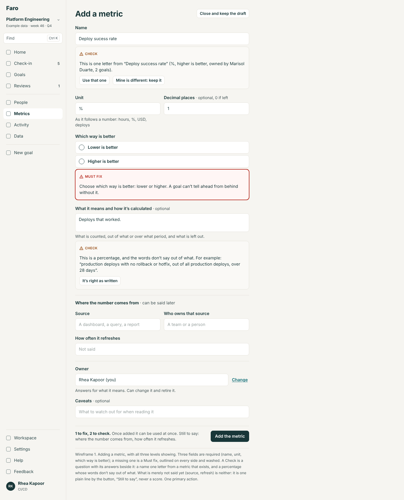 | 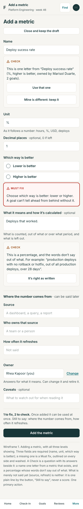 |
| 2 | A goal measured by a metric for a team and a part: the measure step, and the goal's About | 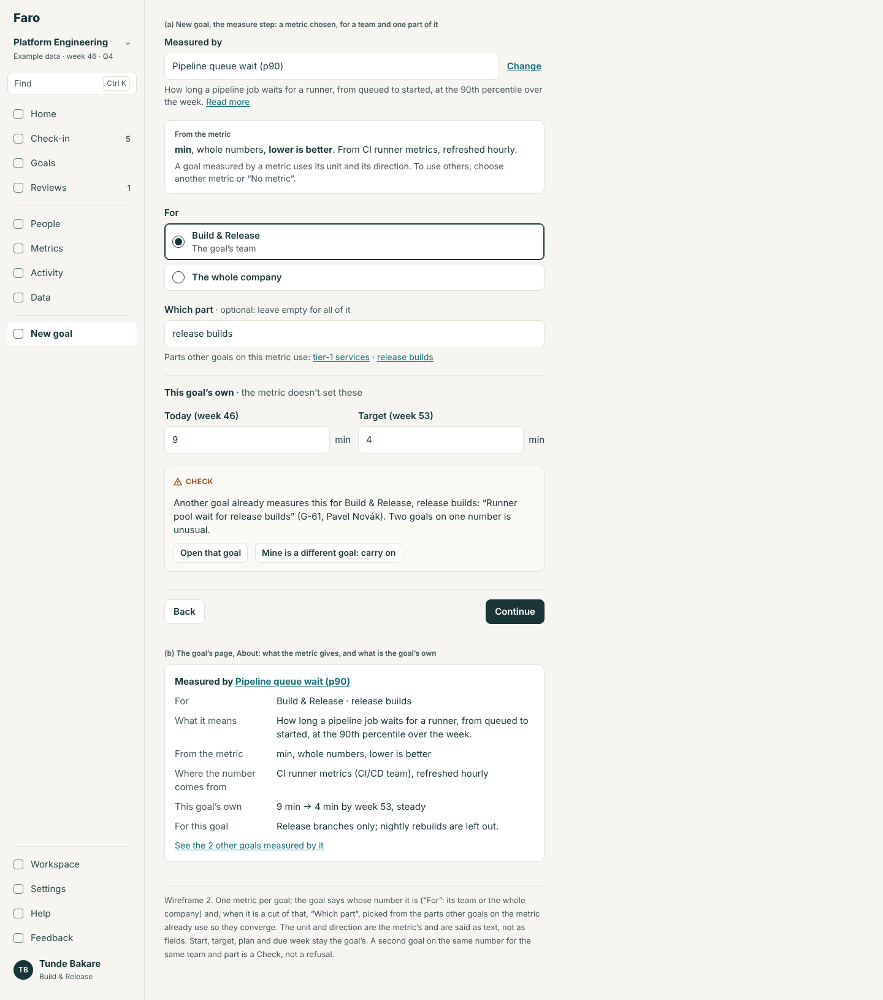 | 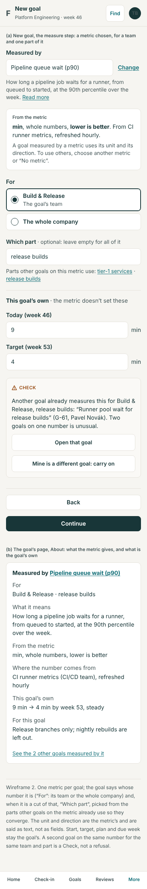 |
| 3 | Changing what a metric means, with its read-back; the mark on a goal; a retired metric on a goal | 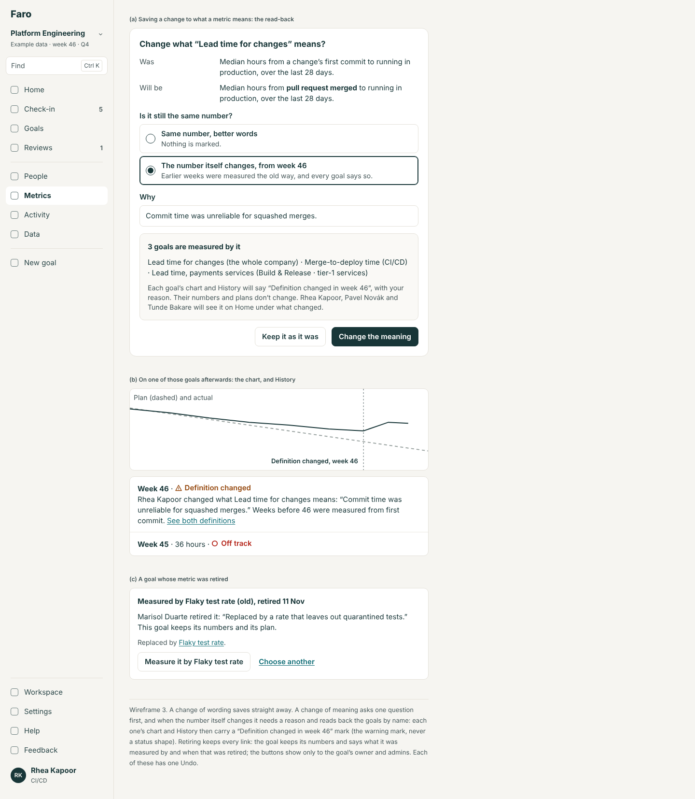 | 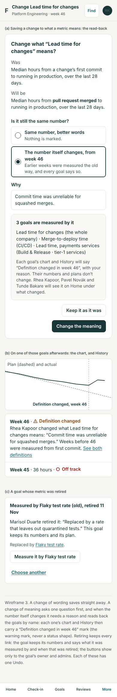 |
| 4 | A check-in whose number came from the source; late; ten times the last; and where each number came from | 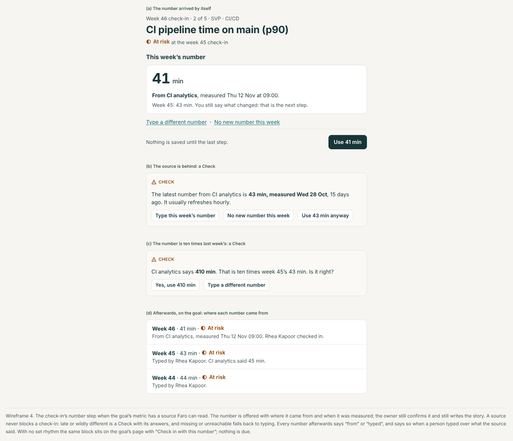 | 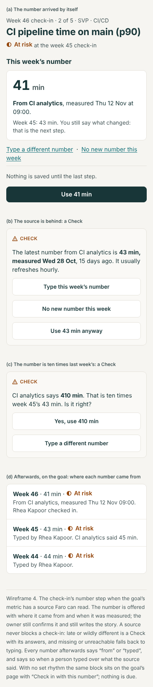 |
| 5 | Comparing the goals on one metric | 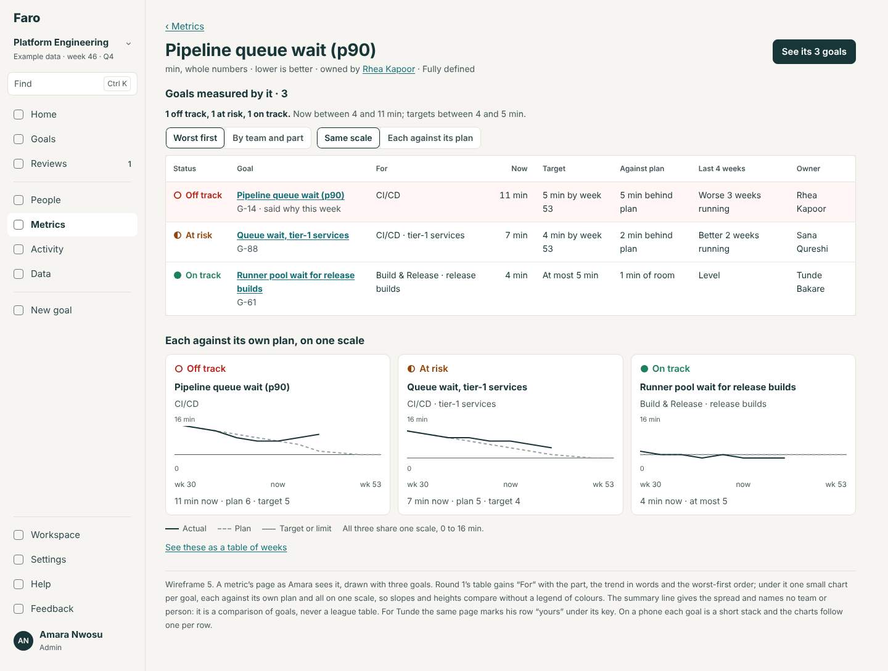 | 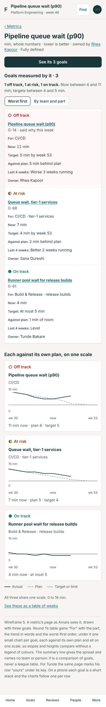 |
| 6 | The Metrics sheet: the preview of a 200-metric file, and what each column takes | 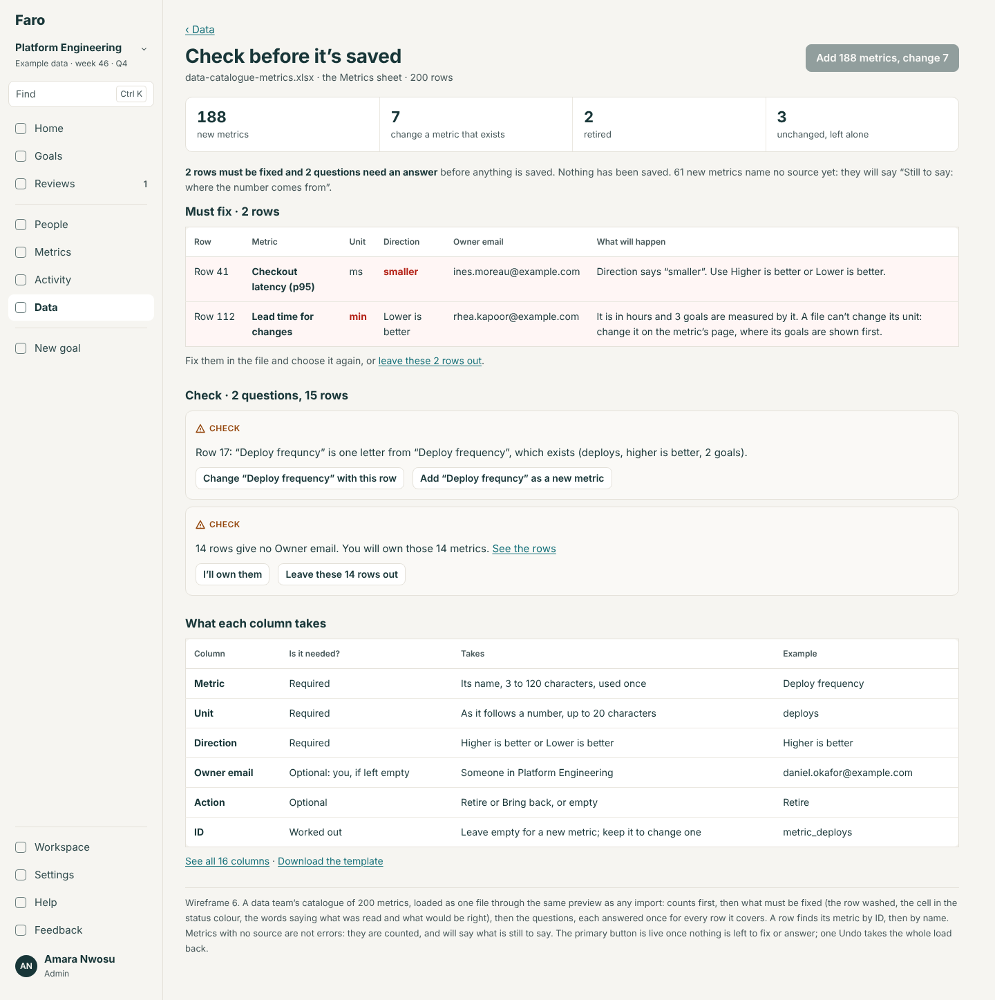 | 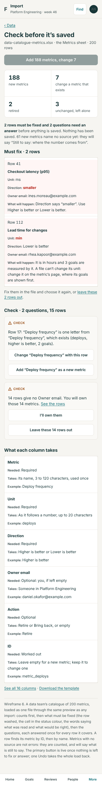 |
| 7 | Features: switching Metrics off, and a goal while it is off | 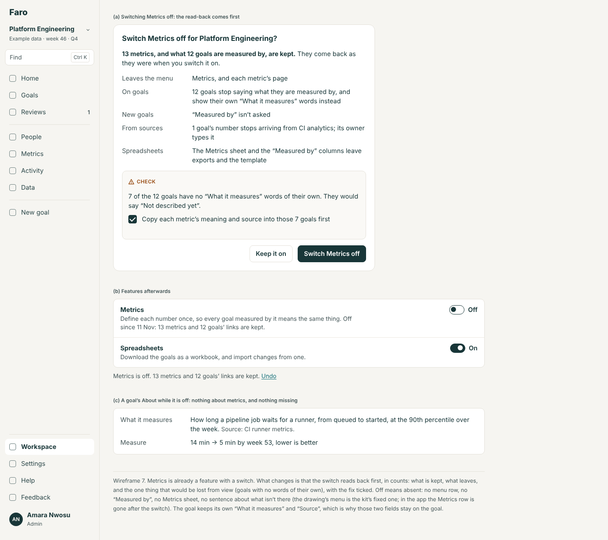 | 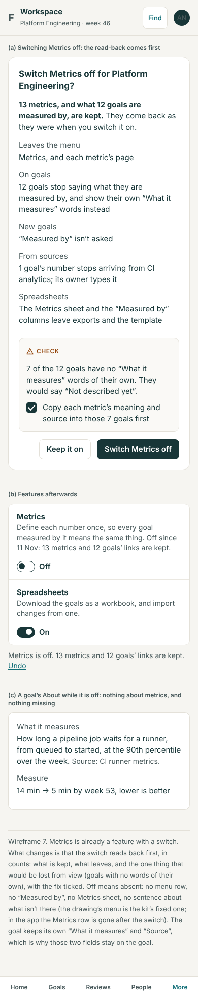 |

The drawings use the kit's fixed menu, so wireframe 7 still shows a Metrics row beside the "afterwards" states; in the app it is gone. Names, keys and numbers in wireframes 2, 3, 5 and 6 are examples: the demo has no metric with two goals today (M2-6).

## What this changes in round 1

Round 1's ML1 to ML3 stand except here.

| Round 1 | Round 2 |
|---|---|
| **ML1**, a metric's page, the line under the goals table: "Lowest now: Build & Release, 4 min. Highest: CI/CD, 7 min." (`summaryLine`, rule 2) | Replaced by the spread, naming no team: "Now between 4 and 11 min; targets between 4 and 5 min." |
| **ML1**, the goals table's columns | Gains the part in "For", "Last 4 weeks", and "said why this week" / "yours" under the key; the small charts are new |
| **ML1**, a metric's page: Facts, then "To sort out" | Gains the "Fully defined / Still to say" line under the title, and a History section at the foot |
| **ML2**, "Use different ones" beside "from the metric" (spec 2.4, rule 5) | Removed. The unit and direction are the metric's; the way out is another metric or "No metric" |
| **ML2**, "For": a team or the whole company | Gains "Which part · optional" |
| **ML2**, linking is free at any time | Needs a reason once the goal has check-ins |
| **ML3**, the confirm on changing a unit or direction ("{k} of them will show a warning … Change it?") | Replaced by the guided change: a label change is read back and made on the goals; a change of scale is refused; a change of meaning asks its one question |
| **ML3**, "Remove this metric…" and its sheet: "{n} goals stop being measured by it" (spec 2.5) | Becomes **Retire** (links kept) for any metric that has measured a goal, and **Delete** only for one that never has. `removeMetric` is no longer offered on a metric with goals |
| **ML3**, the close-name question (rule 4: whole words) | Also catches one or two letters' difference, and is a Check in the three-level form |
| **ML3**, `metricNeeds` ("To sort out") | Kept for its buttons; its list of what is missing is now `stillToSay`, which also covers who owns the source and refresh. "No goal uses it" stays in "To sort out" only: an unused metric can be fully defined |
| Round 1's spec: "The Metrics sheet stays read-only" | It is loaded back |
| Round 1's spec: "No table and no migration" | Seven columns on three tables (spec, section 6) |
| Round 1's evals U81 to U83 | Unchanged; U83's Remove step becomes Retire |

Nothing changes in round 1's routes, redirects, the library's list bar, the picker, the people and team blocks, or Workspace → About's line.

## Where the live build's page ends up

The page built on stage today lives at `/data/metrics`, behind a link on Data. Round 1 already moves it to `/metrics` with redirects, and nothing here changes that. Whatever today's room decides about who may create a metric and what one must have is the rule this design reads; the field table's "Required" follows the merged `REQUIRED_FIELDS`.

## Decisions for Lane

1. **A slice finer than a team.** (a) "Which part", an optional label on the goal's link that converges by suggestion. *Recommended.* (b) Named slices defined on the metric by its owner (a table, and a screen to keep it). (c) Team or whole company only, as today.
2. **Stopping use of a metric.** (a) Retire keeps every goal's link; Delete only for a metric never used. *Recommended.* (b) Keep Remove as it is (it unlinks), with round 1's confirm.
3. **Who may make a change that writes to goals they don't own** (merging two metrics; relabelling a unit on its goals). (a) Admins only: no new permission. *Recommended.* (b) The metric's owner too: a new right, written into R1's table.
4. **A change of meaning.** (a) One question, "Is it still the same number?"; a real change needs a reason and marks every goal. *Recommended.* (b) Every change of meaning marks every goal. (c) No marks: the change log is enough (today).
5. **A number from a source.** (a) Offered in the check-in; the owner confirms and tells the story; nothing posts by itself, with or without a rhythm. *Recommended.* (b) With no set rhythm, a reading is recorded by itself as a number with no status call, shown as "from the source, nobody has said anything yet": a requirement for the internal platform, not built in Faro. (c) Always recorded by itself.
6. **Changing a goal's metric after check-ins.** (a) Needs a reason, as a plan change does. *Recommended.* (b) Free, as the live build's brief has it.
7. **Meaning and calculation.** (a) One field with a three-part hint and the "out of what" Check. *Recommended.* (b) Two fields (one more column).
8. **A draft or "proposed" state.** (a) None: usable at once, with "Still to say". *Recommended.* (b) Proposed until its owner or an admin accepts it.
9. **Metrics as a switch.** (a) Stays switchable, on by default, with the read-back and the offer to copy words into goals. *Recommended.* (b) Always on (part of the core). (c) Off by default until an admin switches it on.
10. **The demo's example.** (a) Link three more demo goals so two metrics have three goals each, one of them with parts, and give the demo source its own series. *Recommended; without it the comparison and the source have nothing to show.* (b) Leave the example; show them only in tests.
11. **The name on Features.** (a) "Metrics", as everywhere else. *Recommended.* (b) "Metric library".
