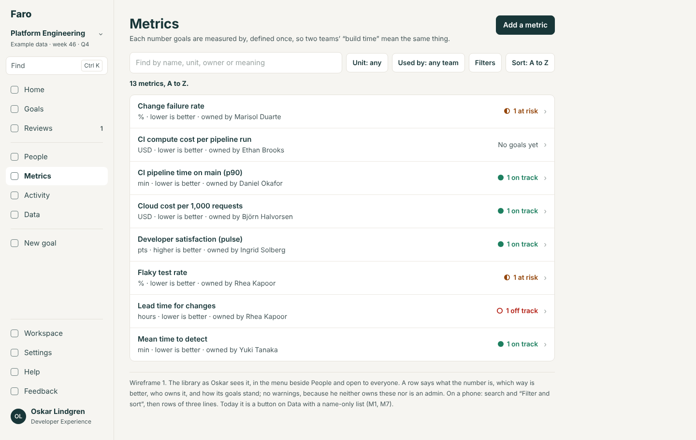
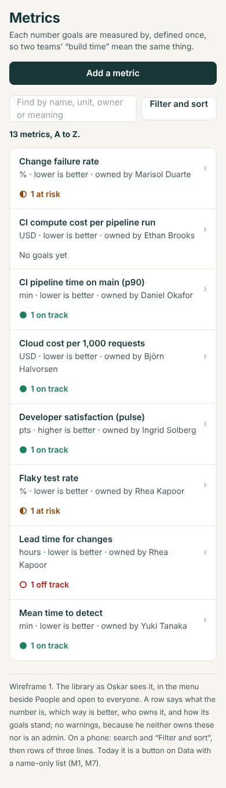
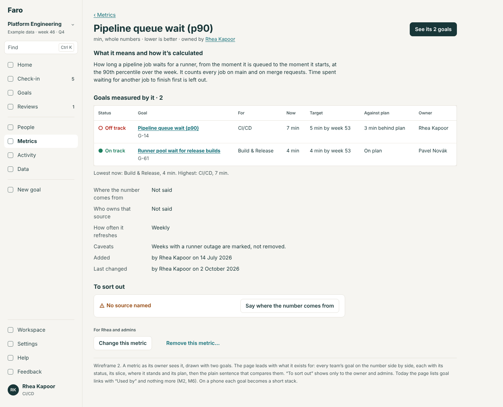
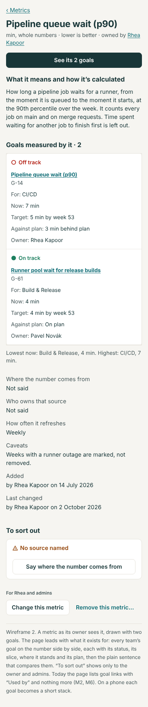
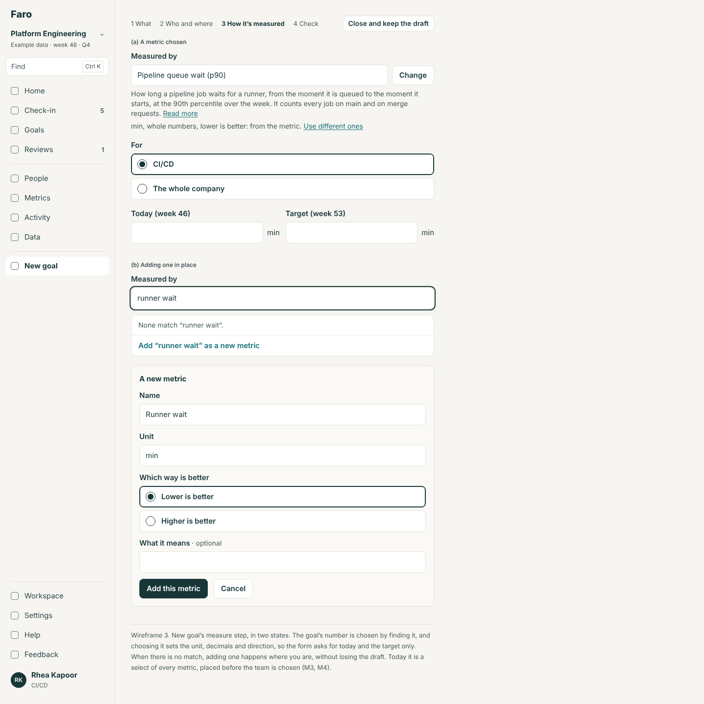
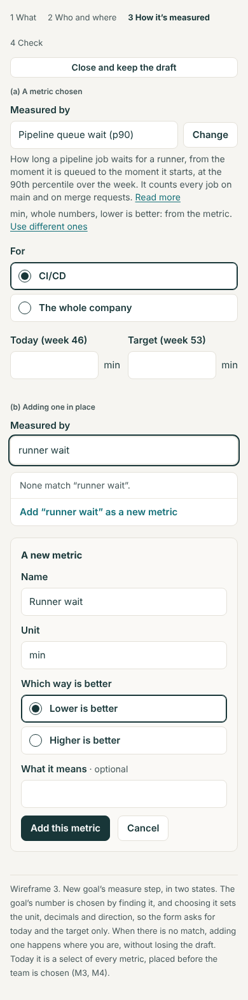
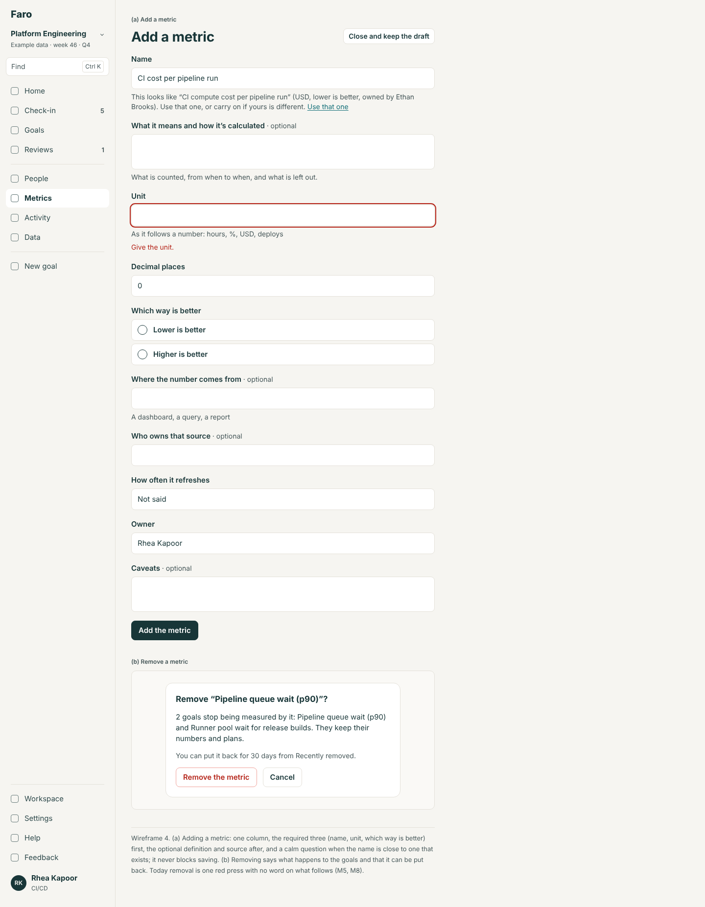
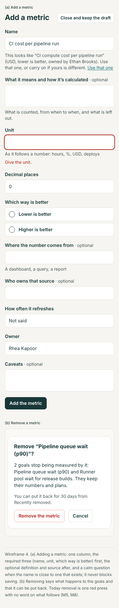
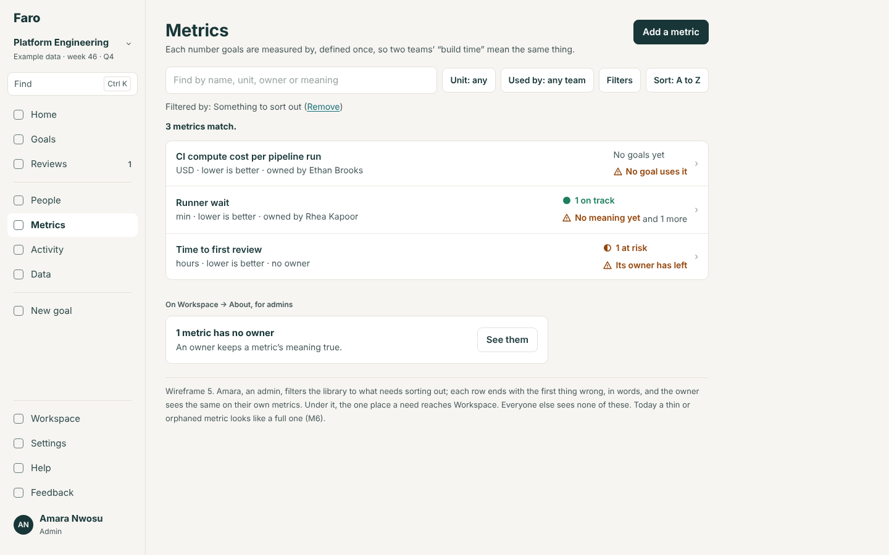
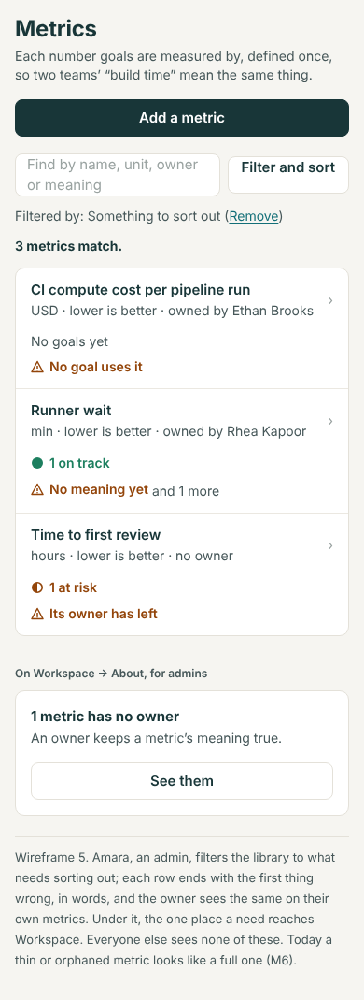

# The metric library: the evaluation and the design

10 November 2026. Area 5 of the app redesign (`docs/design/README.md`); ranked fifth in `docs/reviews/2026-11-10-app-redesign-priorities.md`. A design, not a build. The build spec is `spec.md` beside this file. The wireframes in `wireframes/` are rendered from `mockups/` (`node docs/design/metrics/mockups/build.cjs`) at 1440 and 390 px.

**Where this starts.** The library's back end is on main (backlog 0b, PR #52). Its first screens are built live on stage on Wednesday 11 November from `docs/live-build/metrics.md`, which this design does not change. This is what the library should become **after** that: it takes Wednesday's screens (as rehearsed on the branch `demo/metrics-live-run2`, read but never merged) as its starting point. Nothing here is for the live build.

## The idea in four lines

1. **Metrics is a place everyone reads**, in the menu beside People: what each number means, defined once.
2. **A metric has a page**, and the page's point is its goals: every team's goal on that number, side by side, each with its status.
3. **A goal is linked where it is made**: "Measured by" is the first thing New goal asks about the number, by typing to find one, or adding it there.
4. **A thin or orphaned metric says so** to the person who can fix it, and nobody else is nagged.

## The jobs people come to do

| Who | Job | How often | After Wednesday |
|---|---|---|---|
| Anyone | Find out what a number means ("is lead time commit to deploy, or merge to deploy?") | Whenever a goal's number is in doubt | Data → Metrics → find by name → a page of facts |
| Owner | Say which metric measures my goal, when I make it | Per goal | A select of every metric in the goal form |
| Owner | Add a metric that isn't there yet, without losing my place | Occasionally | "Create a new metric…" in the select: name, unit, direction |
| Leader (Amara) | See every team's goal on one metric, and how each stands | Monthly, and in reviews | The metric's page lists its goals as bare links |
| A metric's owner | Keep its definition true; see who relies on it | Quarterly | Edit; a list of goal links |
| A metric's owner, an admin | Tidy up: metrics with no meaning, no owner, no goals, or two for one thing | Quarterly | Not possible: no filter, no signal |
| Manager (Rhea) | See which of my team's goals have no metric | At the year's start | Not possible |
| Anyone | Get from a person to the metrics they own | Occasionally | Not possible |
| The rebuild team | Plug a number source into a metric | Once per source | The port exists (`NumberSource`); nothing on screen reads it |

## Findings

M-numbered. "Back end" findings are from the code on main; "Wednesday" findings are from reading the rehearsal's screens (`Metrics.tsx`, `MeasuredBy.tsx`, `GoalMetric.tsx` on `demo/metrics-live-run2`); they were not seen running, and Wednesday's room may change details. Severity: **High**, **Medium**, **Low**.

**M1. The library lives under Data, behind a button. High.** (Wednesday.)
- One address, `/data/metrics`, with the list, a metric (`?m=<id>`) and the form (`?new`, `?m=<id>&edit`) all on it. It is reached by a "Metrics" button on Data, the page of spreadsheet tables that the deep review calls "Faro's own workshop, not the product" (P3).
- **Why it matters:** 0b calls this "the idea most worth copying". A thing everyone should read has no place in the menu, and a metric has no address of its own to link to from a goal, a review or a message.

**M2. A metric's page can't show the thing it exists for. High.** (Wednesday.)
- "Goals it measures" is a list of goal links with "Used by {teams}". No status, no number, no target, no slice (which team's number, or the whole company's), though the link record holds the slice (`teamId`, `src/domain/types.ts:415`) and every goal has a status.
- **Why it matters:** "two teams' build time are the same thing" is the pitch. The page that could show two teams' build time side by side shows two links.

**M3. Choosing a metric is a select of every metric. High at scale.** (Wednesday.)
- "Measured by · optional": a select of "No metric", every metric as "Name (unit)" (the goal's unit first), and "Create a new metric…". Thirteen today; hundreds at a company. No search, and no way to read a metric before choosing it except the meaning shown after.
- 0a already says metrics "always use find-and-pick".

**M4. "Measured by" comes at the wrong moment in New goal. Medium.** (Back end and Wednesday.)
- The `goal.measure` place sits on step 2, after the free-text "How it's measured" (`GoalWizard.tsx:244`), before the team is chosen on step 3, though a link's slice is "this team, or the whole company". The Check step never mentions it.
- A metric knows its unit, decimals and direction; the form asks for all three by hand first, then refuses the link if the unit differs (`linkProblems`, `metrics.ts:206`: "hours" against "min" is an error).

**M5. Nothing catches two metrics for one thing, or a goal that should use one. Medium.** (Back end.)
- Only an exact name (any case) is refused (`metricProblems`, `metrics.ts:111`). The demo has the metric "CI compute cost per pipeline run" (USD, no goal uses it) and the goal "CI cost per pipeline run" on Rhea's Home, unconnected.
- Metric names and goal titles drift ("Flaky test rate" measures "Flaky test rate in the main pipelines"), which is right; but nothing helps someone find the metric from the goal.
- 0b dropped "suggestions and look-alike grouping for existing goals" on 8 Nov; this design keeps that dropped and proposes only the one check a form needs: a warning when a new metric's name is close to one that exists.

**M6. A thin metric looks like a full one. Medium.** (Back end and Wednesday.)
- A metric needs only a name, a unit and a direction (`metrics.ts:30`). One with no meaning, no source and no caveats is listed exactly like one that is carefully defined. A metric whose owner has left shows "No owner" in the list and nowhere else. Nothing tells its owner or an admin.
- 0b dropped Draft and Ready states and "Metric not defined" enforcement; this design keeps them dropped and only shows what is missing, in words.

**M7. The list is a name-sorted list. Low now.** (Wednesday.)
- Search by name only; no sort, no filter (by unit, owner, "no goals"), no count of goals by status. Fine for 13; not for the 300 a company will have.

**M8. Removing a metric is one press. Medium.** (Wednesday.)
- A red "Remove this metric" button with no confirmation and no word on what it does to the goals that use it. The rule unlinks every goal in the same save and keeps the row for Undo (`removeMetric`, `metrics.ts:185`), which is good; the screen doesn't say so.

**M9. The model module reaches into the core. Medium for the rebuild.** (Back end; the deep review's A3.)
- Its rules are in `src/domain/metrics.ts`, its records in the core's `Snapshot` and store. AS part 2 (the records extension point) fixes this; the screens designed here should arrive as a clean module, so this design names every place and list it needs (the spec's section 5).

**M10. Small things. Low.**
- The form shows all its errors together under the form, after a try; Faro's other forms show each under its field.
- The goal page's block sits after the page's own sections, before Activity: far from "what it measures".
- The phone layout is whatever the grid does (not checked).
- The Metrics sheet in the workbook is read-only, and Data's Spreadsheets menu doesn't name it.

### What works and is kept

- **The record**: name, meaning and calculation, unit, decimals, direction, source and its owner, refresh, owner, caveats (`types.ts:384`).
- **The rules**: anyone adds; the owner or an admin edits and removes (`canEditMetric`); the goal's owner or an admin links (`canLinkGoal`); a unit mismatch refuses and a direction or decimals mismatch warns (`linkProblems`); one metric and one slice per goal; removal unlinks and can be undone.
- **The MCP tools** and the read-only sheet, in parity.
- **Wednesday's sentence** for the list: "Each number goals are measured by, defined once, so two teams' “build time” mean the same thing."
- **Create in place**: adding a metric from the goal form without leaving it.
- **The growth list** (`spec/modules/metrics/growth.md`): what the internal app could add. It stays a list.

## The design

### Its own place (wireframe 1)

**Metrics** is an item in the menu's Look up group, after People (navigation). Addresses:

| Address | Page |
|---|---|
| `/metrics` | The library |
| `/metrics/<id>` | A metric |
| `/metrics/new`, `/metrics/<id>/edit` | The form (focus mode) |

Wednesday's `/data/metrics` addresses redirect. Data keeps no Metrics button; its Spreadsheets menu names the Metrics sheet.

### The library (wireframe 1)

The shared list bar (`docs/design/find`): search "Find by name, unit, owner or meaning"; in the bar "Unit: any" and "Used by: any team"; in Filters also Owner (find-and-pick), Direction, "No goals use it" and "Something to sort out"; Sort: A to Z, most goals first, changed lately. The count line: "13 metrics, A to Z."

A row is three lines at most, and opens the metric:

- **Lead time for changes**
- "hours · lower is better · owned by Rhea Kapoor"
- at the right: its goals by status, shape and word ("1 off track"), or "No goals yet"; and, only for its owner and admins, the warning mark with what is missing ("No meaning yet").

Primary action: **"Add a metric"**, for everyone (anyone adds).

### A metric (wireframe 2)

In order:

1. "‹ Metrics". The name as the title. Under it "hours, to 1 decimal place · lower is better · owned by Rhea Kapoor".
2. Primary action: **"See its 4 goals"**, which opens Goals filtered to this metric.
3. **"What it means and how it's calculated"**: the meaning. Empty: "Not said yet." and, for those who may, "Say what it means".
4. **Goals measured by it**: a table, the point of the page. One row per goal: status as shape and word; the goal; "For" (CI/CD, or "The whole company"); now; target; against plan; owner. Worst first. So "pipeline queue wait" for CI/CD and for Build & Release sit one above the other.
5. **Facts**: source and who owns the source; how often it refreshes; caveats; "Added by … on …; last changed by … on …".
6. **To sort out** (its owner and admins only, when anything is): "No meaning yet", "No source named", "Its owner has left", "No goal uses it", each with its one button.
7. For its owner and admins: "Change this metric", and apart and quieter "Remove this metric…".

### "Measured by" in the goal forms (wireframe 3)

In New goal's reordered steps (`docs/design/onboarding`), "Measured by" is the **first field of the measure step**, after the owner and team are known:

- It is find-and-pick for a metric: suggestions first (metrics your team's goals use; metrics you picked lately), type to find by name, unit or owner, and a last row "Add “queue wait” as a new metric".
- **Choosing one fills the form**: the unit, decimal places and which way is better come from the metric and are shown as text ("min, whole numbers, lower is better: from the metric"), with "Use different ones" for the rare goal that differs (then the existing rules warn or refuse).
- Under it: the metric's meaning in two lines, a link to its page (in a new tab), and **"For"**: the goal's team, or "The whole company".
- "Add as a new metric" opens a small form in place: the name as typed, unit, which way is better, and one optional line of meaning; "Add this metric". The rest can be said later on its page.
- "No metric" is a named choice. Then, and only then, the free-text "How it's measured" shows, as today.
- The Check step has a row: "Measured by Pipeline queue wait (p90), for CI/CD."
- A dated-stages goal has no "Measured by" (as the rule says).

### On a goal's page

- In the summary: "Measured by Lead time for changes · hours, lower is better", a link to the metric (the `goal.facts` place, `docs/design/goal`).
- In About, in place of the free text when linked: the metric's meaning, its source and caveats, and "See the 3 other goals measured by it".

### Adding and changing (wireframe 4)

One page, the fields in the order people know them: name; what it means and how it's calculated; unit and decimal places; which way is better; where the number comes from and who owns that source; how often it refreshes; owner (find-and-pick, starting as you); caveats. Each error under its field.

- **A close name is questioned as you type**: "This looks like “CI compute cost per pipeline run” (USD, lower is better, owned by Ethan Brooks). Use that one, or carry on if yours is different." It never blocks.
- **Removing asks first**: "Remove “Pipeline queue wait (p90)”? 2 goals stop being measured by it: Pipeline queue wait (p90) and Runner pool wait. They keep their numbers and plans. You can undo this for 30 days from Recently removed."

### What to sort out, and who is told (wireframe 5)

Nobody is nagged about someone else's metric. What is missing is shown:

- on the metric's own page and its row, to its owner and admins;
- as the filter "Something to sort out" on the library, to anyone who looks;
- on Workspace → About's "To sort out" for admins, as one line when a metric's owner has left: "2 metrics have no owner" (the Workspace design's `needs`);
- on a person's page: "Metrics Rhea owns · 4" (the Workspace design's `people.person` place), and on a team's: "Metrics its goals use".

## Each screen's one primary action

| Screen | Primary action | Everything else |
|---|---|---|
| Metrics | **Add a metric** | Find, filter, sort; a row opens the metric |
| A metric | **See its {n} goals**. None: none | Change; Remove; the "to sort out" buttons |
| Add or change a metric | **Add the metric** / **Save changes** | Close and keep the draft |
| "Measured by" in a goal form | Choosing a row | "Add … as a new metric"; "No metric"; "For" |
| Remove (sheet) | **Remove the metric** | Cancel |

## Role differences

| | Amara (admin) | Rhea (owns 4 metrics) | Tunde (owns none) | Oskar (owns no goals) |
|---|---|---|---|---|
| Read the library and any metric | Yes | Yes | Yes | Yes |
| Add a metric | Yes | Yes | Yes | Yes |
| Change or remove a metric | Any | Her own | None: the page says "Rhea or an admin can change it" | The same as Tunde |
| "To sort out" on a metric | On any | On hers | Not shown | Not shown |
| Link a goal to a metric | Any goal | Her goals | His goals | No goal to link |
| Workspace → About's line | Sees it | No | No | No |

## The phone

- The library: the title, "Add a metric" full width, the search and "Filter and sort", the count line, then rows of three lines. First metric within 300 px.
- A metric: one column; "See its 4 goals" full width under the name; the goals table becomes rows of three lines (status and goal; "For CI/CD · 7 min of 5"; against plan and owner).
- "Measured by" opens as a full sheet with the keyboard up; "Add as a new metric" is a second step of the same sheet.
- The form is one column; "Add the metric" sticks above the keyboard.

## Wireframes

| # | Screen | 1440 | 390 |
|---|---|---|---|
| 1 | Metrics: the library |  |  |
| 2 | A metric, as its owner |  |  |
| 3 | "Measured by" in New goal: chosen, and adding one in place |  |  |
| 4 | Adding a metric, with a close name questioned; and Remove |  |  |
| 5 | The library filtered to "Something to sort out", as an admin |  |  |

## For the rebuild (spec only)

Unchanged from `spec/modules/metrics/growth.md`, with where each would show in this design:

- **Numbers from the source** (the `NumberSource` port): a metric's page gains "Latest from the source: 37 hours, 2 hours ago", and a goal measured by it fills its check-in's number in.
- **Slices side by side and dimensions an admin defines:** the goals table on a metric's page is the first version; dimensions add columns to it.
- **Versions with a reason:** a History section on the metric's page, in the shape of a goal's.
- **Draft and Ready; a steward role; "Metric not defined" enforcement:** the "to sort out" words become states and rules.
- **Suggestions for existing goals:** a block on a metric's page, "Goals in hours that no metric measures".
- **The directory** (R6a): "Used by" filters by a part of the company, not a flat team.

## Backlog

- **Starts from 0b's "built live" part** as merged after Wednesday (or its fallback). If the room's answers on Wednesday change a rule (who may create, what a metric must have), the spec's section 3 follows the room.
- **Keeps 0b's dropped list dropped.** Only the close-name question is new, and it is a form's manners, not a look-alike feature.
- **Needs** FS1 (find-and-pick) and FS2 (the list bar), NV1 (the menu), OB1 (New goal's steps), GT1 (`goal.facts`), and is cleanest after AS part 2 (the records extension point).
- **Takes** 0a's "metrics always use find-and-pick".

## Decisions for Lane

1. **Where the library lives.** (a) Its own place, Metrics, in the menu beside People, with a page per metric. *Recommended.* (b) Stay under Data, as built on Wednesday, with a page per metric at `/data/metrics/<id>`.
2. **The goals table on a metric's page** (every goal on that number, side by side). (a) Build it: it is the reason to define a number once. *Recommended.* (b) Keep the list of links.
3. **Choosing a metric fills in the unit, decimals and direction.** (a) Yes, with "Use different ones". *Recommended.* (b) Keep them as separate fields the rules then check.
4. **A close name is questioned when adding a metric.** (a) Yes, never blocking. *Recommended.* (b) No: leave anything like it to the growth list, as decided on 8 Nov.
5. **Telling admins about ownerless metrics on Workspace → About.** (a) One line there, for admins only. *Recommended.* (b) Only the filter on the library.
