# App navigation: the evaluation and the design

10 November 2026. Area 2 of the app redesign (`docs/design/README.md`); ranked second in `docs/reviews/2026-11-10-app-redesign-priorities.md`. A design, not a build. The build spec is `spec.md` beside this file. The wireframes in `wireframes/` are rendered from `mockups/` (`node docs/design/navigation/mockups/build.cjs`) at 1440 and 390 px.

It fits the Workspace redesign (PR #81): People in the main navigation, Workspace beside Settings, one Feedback item, one name for the workspace, one Demo panel.

## The idea in four lines

1. **The sidebar lists places, in three short groups**: your work, things to look up, and this workspace and you. It is the same on every page and fits a laptop screen.
2. **Find is its first row**, so anything is one key away.
3. **A page says where you are**: its own name in the browser's title, one item lit in the sidebar, one "back to" that follows the structure.
4. **A phone has the same places** in the same groups: four tabs and a short More.

## The jobs people come to do

| Who | Job | How often | Today |
|---|---|---|---|
| Owner (Rhea, Tunde) | Get to this week's check-ins | Weekly | One click or tap: good |
| Everyone | Get to one goal they know | Daily | Goals, then search: three steps, from one page only |
| Everyone | Get back to the list they came from | Every visit to a goal | "Back to …" works and is the best wayfinding in the app |
| Manager | Get to her goals, her team's, a saved view | Weekly | One click on a computer (six rows under Goals); two taps on a phone, under More |
| Leader (Amara) | Get to the review she runs | Weekly | Two clicks |
| Everyone | Find a person, a team, a metric | Weekly | Workspace → People; metrics nowhere yet |
| Everyone | Know which page a browser tab is | Many times a day | Every goal's tab says "Goals" |
| Someone on a small laptop | Use the collapsed sidebar | Always, once chosen | Loses Mine, All and saved views; names only as browser tooltips |
| Anyone new | Understand why their menu differs from a colleague's | Once | Not said anywhere |
| Admin | Workspace, Settings | Rarely | One click; fine |

## Findings

From the walk of 10 Nov as Amara, Rhea, Tunde and Oskar at 1440 and 390, and `src/ui/Shell.tsx`. Severity: **High**, **Medium**, **Low**.

**V1. The sidebar is one list of five kinds of thing, and it doesn't fit. High.**
- **Saw:** Rhea's sidebar, top to bottom: the workspace; Home; Check-in 5; Goals with Mine, Watching, All and three saved views; Reviews 1; Activity; Data; New goal; Workspace; a "Demo" block; Settings; Help; Feedback; Send feedback; herself; Collapse sidebar. That is 19 rows: places, an action (New goal), views of one place (six rows under Goals), tools (Demo, Send feedback) and a person, with no grouping (`Shell.tsx:46`, `sideFor`, and `:262–293`).
- It is 925 to 965 px tall in a 900 px window for three of the four roles; "Collapse sidebar" is cut off and the person button sits on the edge.
- **Why it matters:** the eye has no landmarks; the row that controls the sidebar is the one that falls off it.
- **Backlog:** NAV (7) is one symptom ("No update for 2 weeks or more" doesn't fit). The Workspace redesign's WR5 removes one row.

**V2. Three rows open one page. Medium.**
- "Goals" and "All" both go to `/goals`; "Watching" goes to a tab of it; "All" stays lit on every tab (`GoalsSection`, `Shell.tsx:128–150`). Mine, Watching and All are the Goals page's own tabs, said again in the sidebar.

**V3. Collapsed, the sidebar keeps its promise to nobody. High (a promise the app breaks; NAV (1)).**
- **Saw:** the 68 px rail shows icons only. Their names are native `title` tooltips: nothing on keyboard focus, nothing on touch. Mine, All and every saved view have no size at all; the workspace's and the person's names are gone. Settings says the icons name themselves on hover and focus.

**V4. Nothing can be reached by typing. Medium.**
- A goal by name is Goals → the search box → the result. A person is Workspace → People → search. There is no key for anything except marking up the screen (`Ctrl Shift M`); `/`, `?` and `Ctrl K` do nothing. (The control itself is designed in `docs/design/find`; its door is here.)

**V5. The browser's title and the lit item say less than the page knows. Medium.**
- **Saw:** the title is the nav item's label, not the page's name: "Goals · Example: Platform Engineering · Faro" on every goal, its edit and its print page, and on `/ready`; "Workspace" on every section; "Check-in" on the table check-in (`Shell.tsx:204`, `:218`). With six goals open in tabs, all six say "Goals".
- Nothing is lit on `/quick-check-in`, `/retro`, `/research` and `/ready`. On a goal's page "Goals" is lit, which is right.

**V6. Leaving a form is said five ways. Low.**
- "Close and keep the draft" (New goal, goal edit), "Close and save the draft" (check-in), "Close without saving" (review edit, wrap-up), "Close and keep what you've typed" (set-up), "Close the review" (the walkthrough). Goal edit has two exits side by side ("Back to Lead time for changes" and the close button). Three of the five mean the same thing.

**V7. "Back to" is good where it exists, and missing or wrong in four places. Medium.**
- **Works:** from Mine "Back to your goals"; from a saved view "Back to Division at a glance"; from Home "Back to Home"; from a parent goal "Back to Lead time for changes"; a direct link goes up the goal tree (GD (6) asked for this; it is so for feeders).
- **Missing or wrong:** Settings says "Back to Home" wherever you came from (NAV (6)), though Settings is itself a place in the sidebar. A review's page has a small "Reviews" link, not a "Back to". Workspace's sections have none (the Workspace redesign adds "‹ Workspace" on a phone). When "Back to" steps over a form it goes back several entries at once (`BackLink.tsx:60–79`), so it and the browser's Back can disagree by one press.

**V8. On a phone, Goals opens everything, and More is long. Medium.**
- **Saw:** the tabs are Home, Check-in, Goals, Reviews, More for an owner and Home, Goals, Watching, Reviews, More for anyone else (`tabsFor`, `Shell.tsx:50`). The Goals tab opens all 126 goals as trees for Rhea, who owns 8. Mine and saved views are in More, whose sheet has 12 to 16 rows: a Goals group, then Activity, Data, New goal, Workspace, Settings, Help, Feedback, Demo controls, Send feedback, and you.
- The top bar's second line is cut off: "Example data, week 4…" (the Workspace review's F15).
- On a goal's page the top bar is replaced by the goal's own card, so the workspace and any way to find something else are gone, and the tab bar sits over the chart on the first screen.

**V9. Why the menu differs by person is not said. Low. (NAV (2).)**
- Tunde has Check-in with no count; Amara and Oskar have no Check-in at all, and Watching in its place on a phone. Only the word "Admin" under a name explains anything.

**V10. Places with no way in, and tools mixed with places. Low.**
- `/quick-check-in` (type every number in one table) is reached only from a line on Home; the check-in queue can't be seen as a list to pick from (NAV (3)). `/research` and `/ready` are reached only from the demo panel and set-up, which is right, but nothing is lit while you are there.
- The demo's block sits in the middle of the sidebar, between Workspace and Settings, and the person button opens the same panel under another name (the Workspace review's F17).

### What works and is kept

- **The workspace switcher** in the sidebar's header and the phone's top bar.
- **A count on Check-in and Reviews**, and nowhere else.
- **"Back to" that knows where you came from**, and steps over forms.
- **Focus mode** for forms (check-in, New goal, edit, set-up, a review's set-up): no sidebar, one way out.
- **The skip link, the 2 px focus ring, focus moved to the page's heading** after each move.
- **Modules add their own items** (`navigation` in a module's `app.tsx`).

## The design

### The sidebar (wireframes 1, 2)

Top to bottom, the same on every page:

| Group | Rows | Notes |
|---|---|---|
| Header | Faro; the workspace switcher | One name for the workspace, "example data" as a quiet second line (Workspace spec, rule 1) |
| Find | **Find** | Opens Find from anywhere (`docs/design/find`); shows its key |
| Your work | Home · **Check-in** (count) · **Goals** · Reviews (count) | Check-in only when you own a goal. Under Goals: up to four saved views, nothing else |
| Look up | People · Metrics · Activity · Data | Metrics is the metric library's item; a module's item goes in this group |
| Make | New goal | An action, set apart (Lane, 9 Nov: the sidebar entry stays) |
| This workspace and you | Workspace · Settings · Help · Feedback | As the Workspace design; Help carries the "something new" dot |
| You | Your name and role | Opens the Demo panel in the demo; "Not you?" in the real app |

That is 16 rows for Rhea with no saved views and 20 with four: 640 to 790 px, inside a 900 px window with room for the header.

**What leaves the sidebar**

| Today | Goes to | Why |
|---|---|---|
| Mine, Watching, All under Goals | The Goals page's own tabs; Goals opens on the one you used last | V2 |
| Saved views past the fourth, "n more views" | The Goals page's Views menu, which lists them all | V1 |
| "Send feedback" | The Feedback page's button (Workspace decision 5) | V1 |
| The "Demo" block | The person button, which opens the one Demo panel | V10 |
| "Collapse sidebar" | Settings → Navigation, and a small control in the sidebar's header beside the workspace, where it can't fall off | V1 |

**Which saved views show under Goals:** the ones pinned for everyone first, then yours, most recently opened first, four at most. A view's row is lit when the address is that view.

### Collapsed (wireframe 3)

A 64 px rail of icons. Each names itself in the app's own label on hover **and on keyboard focus**, and a long press on touch. Counts stay as small figures. Hovering or focusing **Goals** opens a small panel with its saved views; the workspace and you open the same sheets as when it is wide. Nothing reachable when wide is unreachable when collapsed.

### Where you are

- **The browser's title** is the page's own name: the goal's title, the person's name, the section, the step. "Lead time for changes · Platform Engineering · Faro".
- **One item is lit** on every page that belongs to a place: the table check-in lights Check-in; the wrap-up lights Goals; What's new lights Help; a person's or team's page lights People; a metric's lights Metrics. Pages that belong to none (Ready, research) light nothing and say where to go next.
- **One "back to"** above the title on every page below a place's first page. It follows where you came from when the app knows, and the structure when it doesn't: a goal goes to the goal it feeds, or Goals; a person to People; a metric to Metrics; a review's walkthrough to the review; a review to Reviews. Settings, Workspace → About and the other first pages have none.
- **Sticky section links** on the two long pages, the goal's page and Settings (NAV (4)): a row of the page's sections that stays at the top while you scroll and lights the one you are in.

### Leaving a form (wireframe 5)

Two wordings, by what happens:

- **"Close and keep the draft"** wherever what you typed is kept (check-in, New goal, goal edit, set-up).
- **"Close without saving"** where it isn't (a review's set-up, the wrap-up of a goal).

One exit each, top right; the "Back to" beside it on goal edit goes. A form's steps are in the address, so the browser's Back steps back a step (NAV (5); the wizard itself is in `docs/design/onboarding`).

### The check-in queue (wireframe 4)

Check-in opens on the list of what is due this week, each row a goal with what it last said and a "Check in" button; the primary action is "Start with {the first}"; under the list, "Or type all your numbers in one table". So the queue can be seen and picked from, and the table has a way in (NAV (3)).

### The phone (wireframe 6)

- **Top bar:** Faro's mark, the page's name, under it "{workspace} · week 46" in full, **Find**, and you. A goal's page keeps a slim bar ("‹ Goals", Find, you) above its own summary.
- **Tabs:** Home, Check-in, Goals, Reviews, More for someone who owns a goal; Home, Goals, Reviews, People, More for someone who doesn't. Goals opens on your scope (Mine, or Watching if you own none), so Watching no longer needs a tab.
- **More** is the sidebar's remaining rows in its groups: Look up (People if not a tab, Metrics, Activity, Data); Make (New goal); This workspace and you (Workspace, Settings, Help, Feedback); then, in the demo, Demo; then you. Nine to eleven rows. Saved views are in Goals' own Views menu, not here.

## Each screen's one primary action

| Screen | Primary action | Everything else |
|---|---|---|
| The sidebar, the rail, the tab bar | None: they are the way to every primary action | Find; the switcher |
| More (phone) | None | Its rows |
| Check-in (the queue) | **Start with {goal}** | "Check in" on any row; "Or type all your numbers in one table" |
| Check-in, nothing due | None: "You're all set for week 46" | "Check in again" per goal; links to Goals |
| Page not found | **Go to Home** | Find; Help |

## Role differences

| | Amara (leader, admin) | Rhea (manager) | Tunde (owner) | Oskar (owns none) |
|---|---|---|---|---|
| Check-in | Not shown (she owns no goal) | Shown, with a count | Shown; a count only when something is due | Not shown |
| Goals opens on | The scope she used last; first time Watching | Mine | Mine | Watching |
| Saved views under Goals | Pinned ones, then hers, four at most | The same rule | The same | The same |
| Phone tabs | Home, Goals, Reviews, People, More | Home, Check-in, Goals, Reviews, More | The same as Rhea | The same as Amara |
| Workspace | Every section | The sections a member reads | The same | The same |
| Under the name | "Admin" | Her team | His team | His team |

The one difference that isn't about rights (Check-in) is said in three places: Settings → Navigation ("Check-in shows when you own a goal"), Help's "Getting around", and on Home the week your first goal arrives ("You own a goal now, so Check-in has joined your menu").

## Wireframes

| # | Screen | 1440 | 390 |
|---|---|---|---|
| 1 | The sidebar, as an owner (Rhea), on Home | 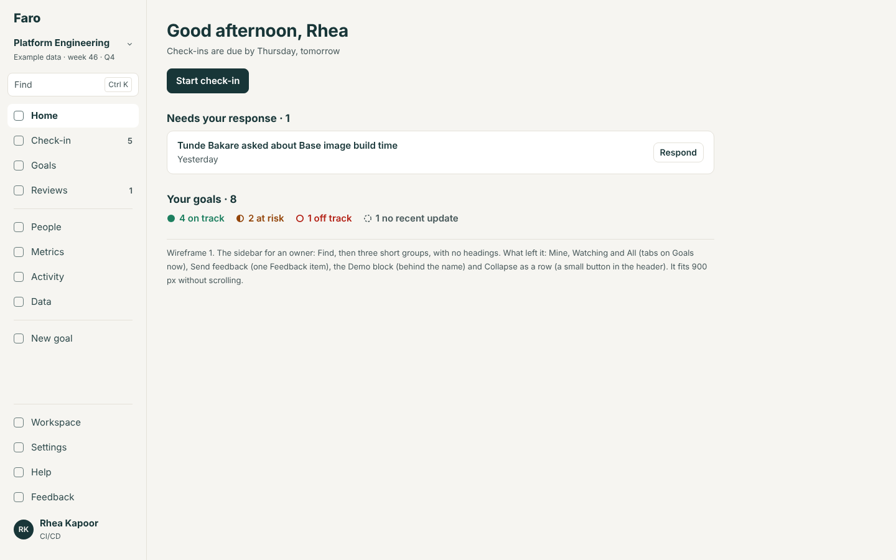 | 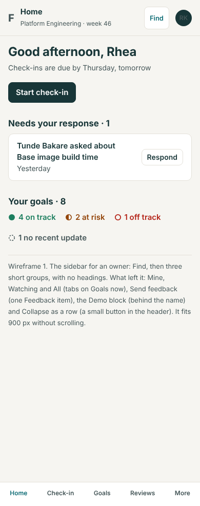 |
| 2 | The sidebar, as someone who owns none (Oskar), on Goals with saved views | 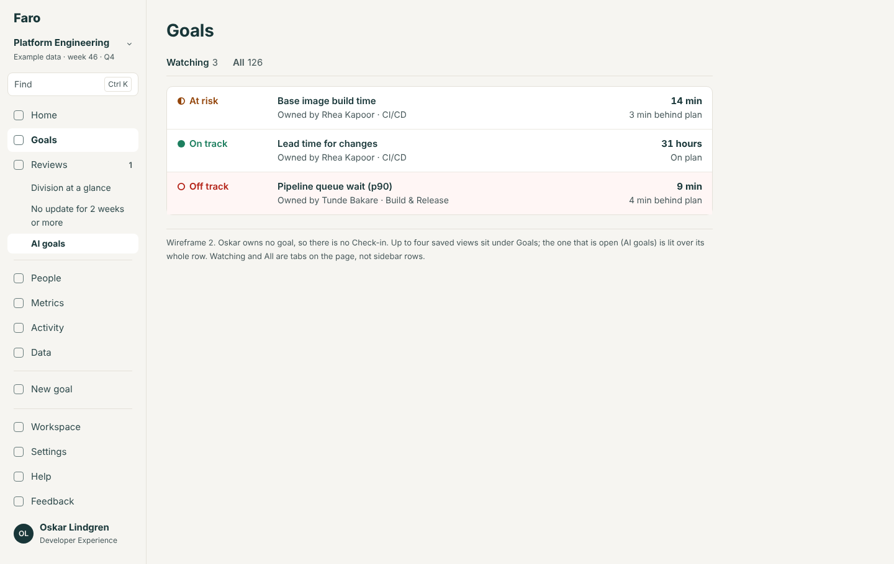 | 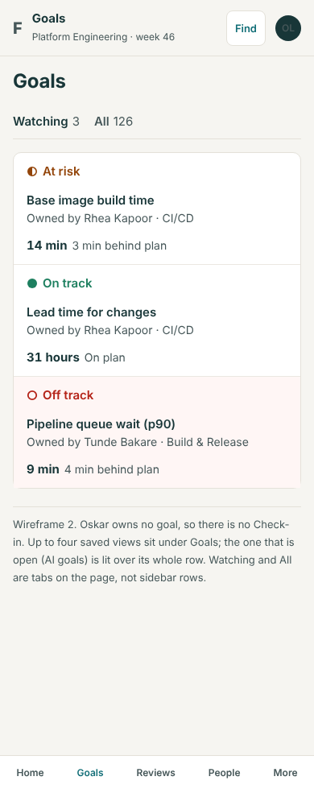 |
| 3 | Collapsed, with a name shown and Goals' views open | 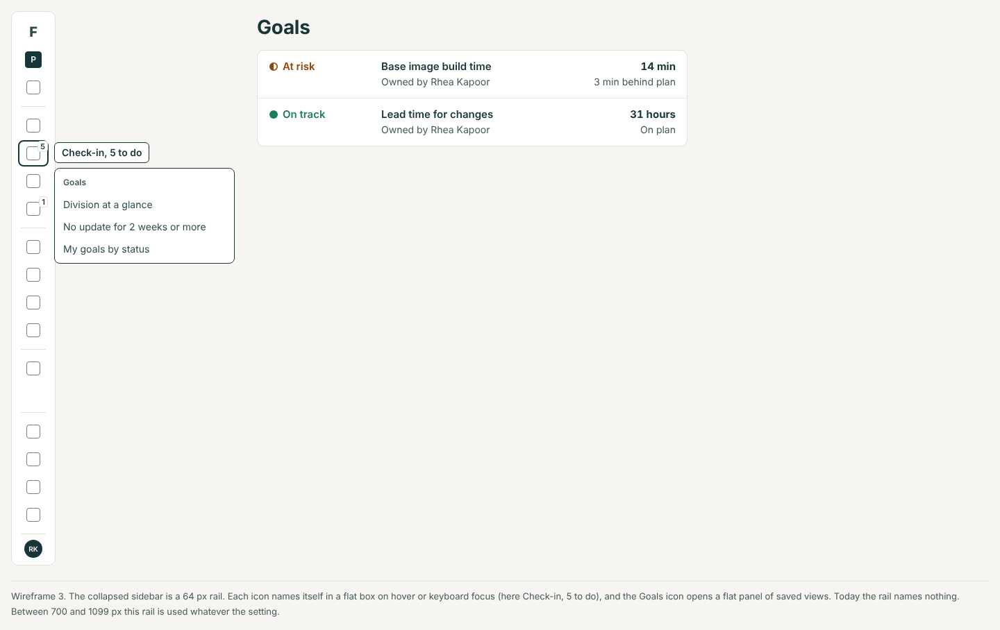 | 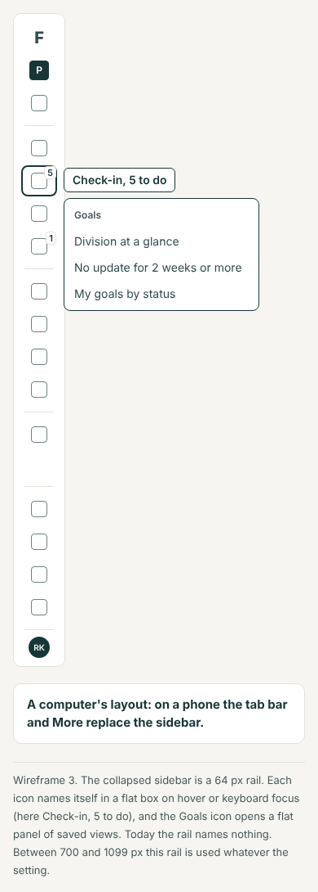 |
| 4 | Check-in: the queue | 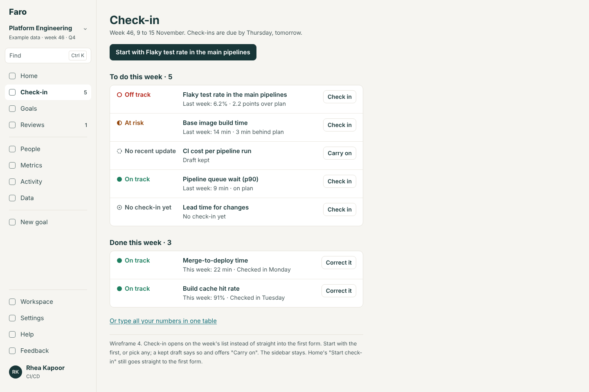 | 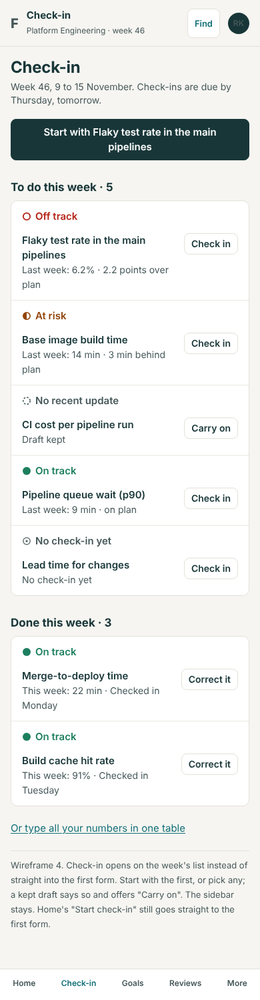 |
| 5 | Where you are: a back link, section links, and leaving a form | 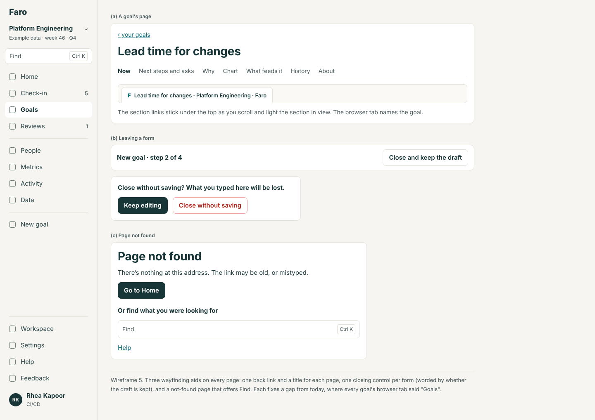 | 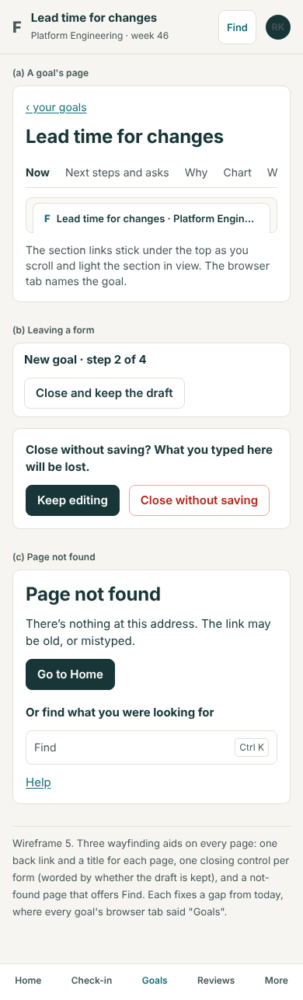 |
| 6 | The phone: the top bar, the tabs and More | 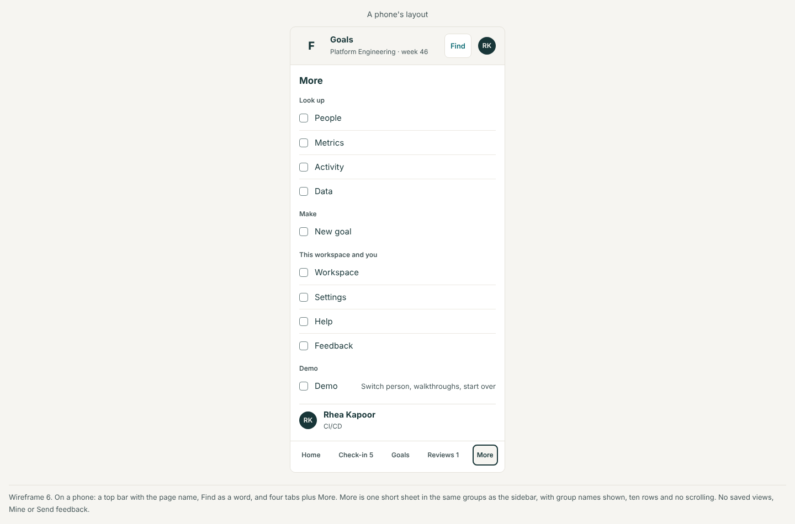 | 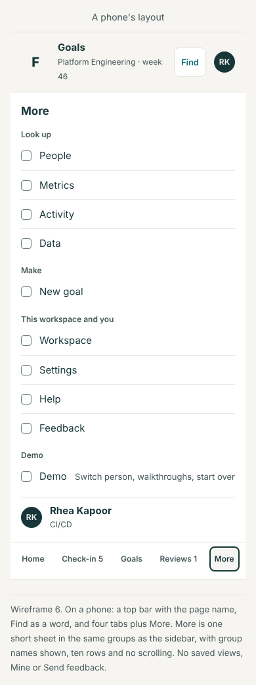 |

Wireframe 3 is a computer's layout only and wireframe 6 a phone's; each is drawn at both widths so the set is complete, with a line saying which one applies.

## For the rebuild (spec only)

- **Scope in the header** (R6a, rule 5): beside the workspace's name the internal app shows the part of the company you are looking at ("Platform Engineering › CI/CD"), and Home, Goals and Reviews start there.
- **Notifications** (R5) have no place in Faro's navigation; the internal app puts a count on Home, not a new item.
- **"Not you?" goes** (R1, rule 1): the person button opens your own page and Settings.
- **Deep links** from Slack, Teams and email (R5) land on the page with its "back to" following the structure, as a direct link does here.

## Backlog

- **Replaces NAV in full** ((1) to (7)), and **builds the Workspace redesign's WR5** (one Feedback, one name, one Demo panel) as part of the same item.
- **Takes** GD (6) ("Back to" follows the goal tree), R5's Cmd-K door if Find is built (find's decision 1), and the deep review's "check-in queue" note.
- **Leaves** New goal's steps in the address to `docs/design/onboarding` (it is the wizard's change), which NAV (5) asked for.

## Decisions for Lane

1. **Mine, Watching and All leave the sidebar** and live only as the Goals page's tabs. (a) Yes: Goals opens on the one you used last. *Recommended.* (b) Keep them in the sidebar.
2. **Saved views in the sidebar.** (a) Up to four: pinned first, then yours by latest use. *Recommended.* (b) None: only in Goals' Views menu. (c) As today, up to six.
3. **Check-in for people who own no goal.** (a) Hidden, as today, and explained in Settings, Help and on Home. *Recommended.* (b) Always shown, with a page that says there's nothing to check in.
4. **The demo's block.** (a) It leaves the sidebar; the person button opens the one Demo panel. *Recommended, and the Workspace design already asks for one panel.* (b) Keep the block.
