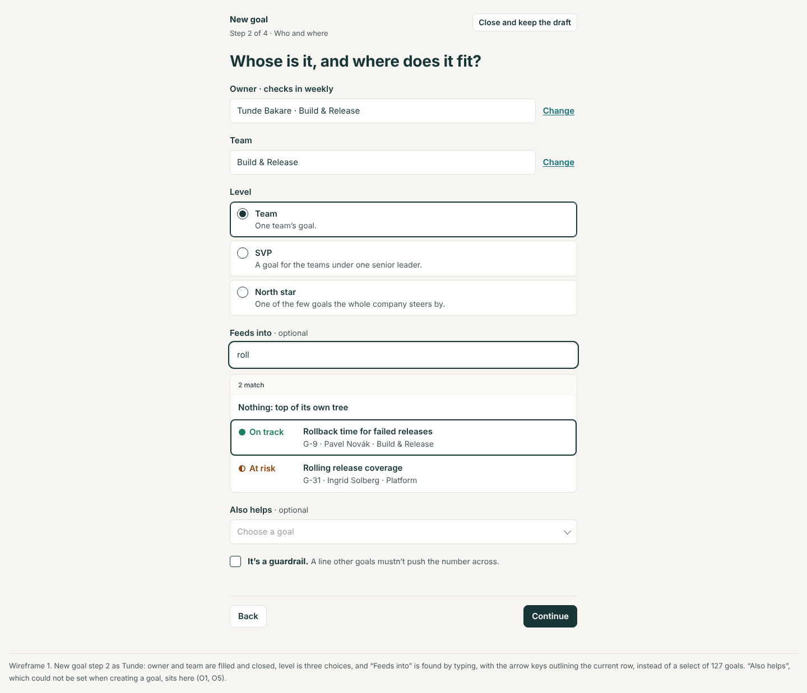
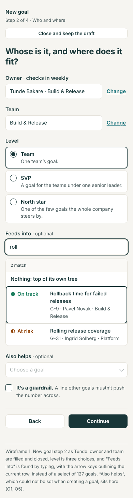
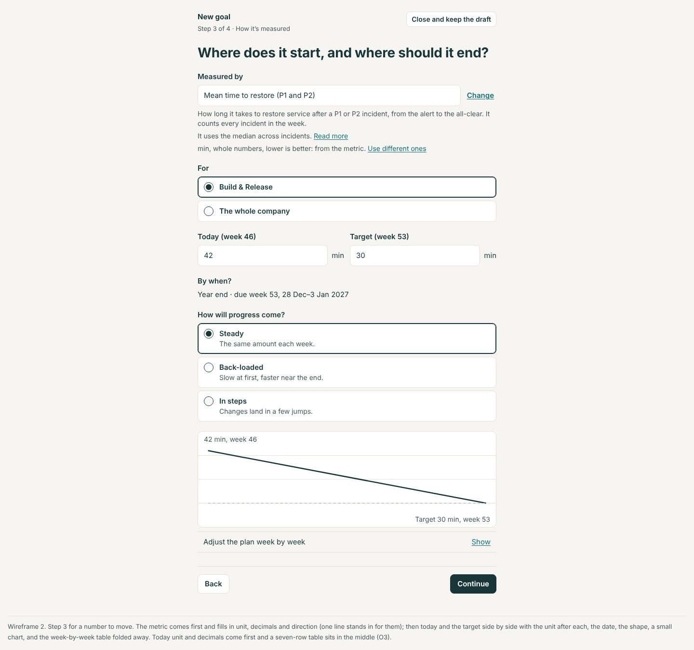
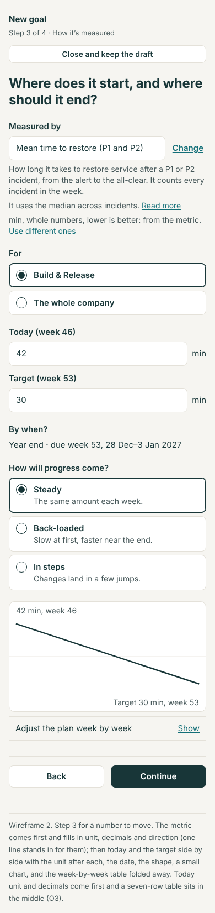
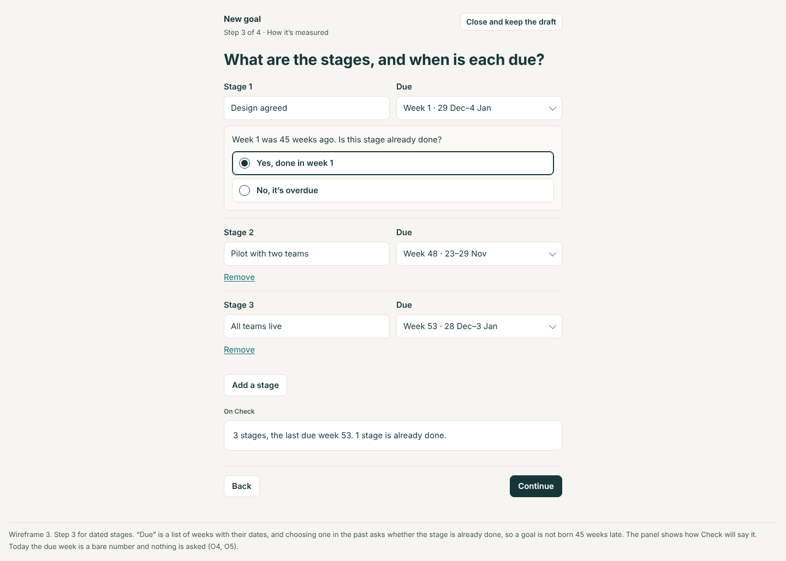
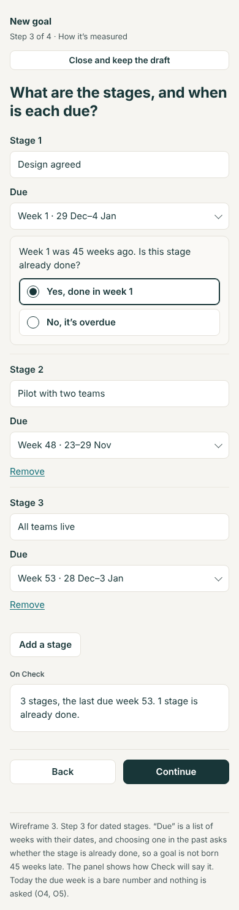
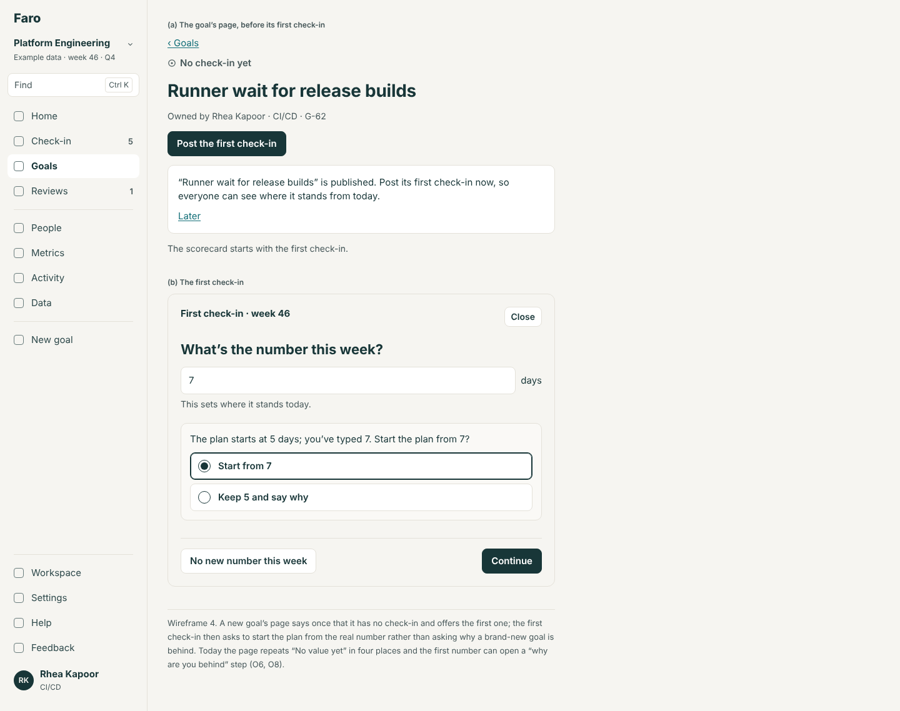
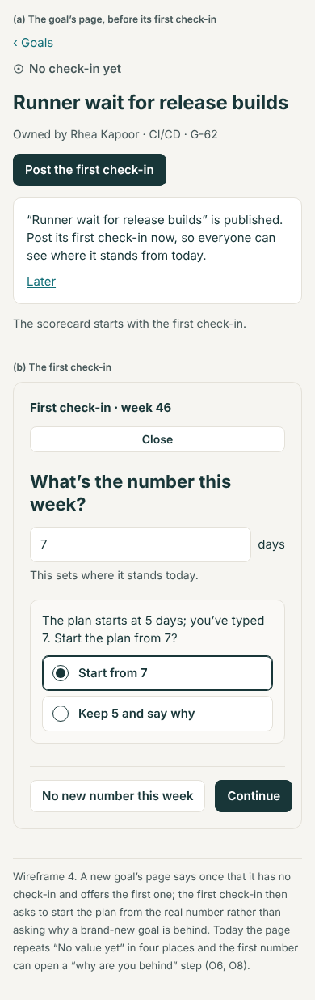
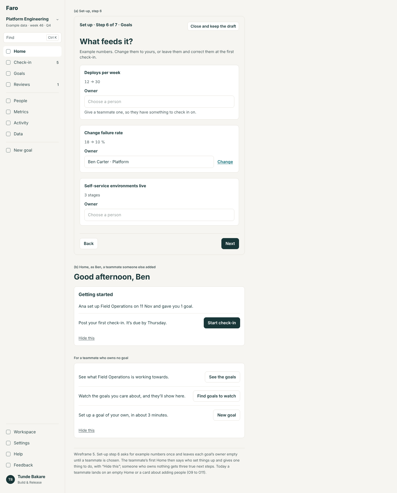
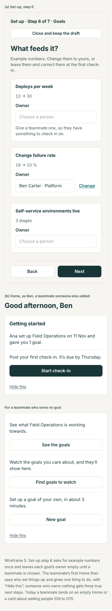

# Goal onboarding: the evaluation and the design

10 November 2026. Area 6 of the app redesign (`docs/design/README.md`); ranked last in `docs/reviews/2026-11-10-app-redesign-priorities.md` because it is the healthiest area and most of what is wrong with it is fixed by the areas before it. A design, not a build. The build spec is `spec.md` beside this file. The wireframes in `wireframes/` are rendered from `mockups/` (`node docs/design/onboarding/mockups/build.cjs`) at 1440 and 390 px.

Three flows: **New goal** (`/goals/new`), **the first set-up of a workspace** (`/workspace/new`, then day one), and **the first check-in** on a goal.

## The idea in four lines

1. **New goal asks in the order people think**: what, whose and where, how it's measured, check. Each step has an address, so Back steps back.
2. **Nothing is chosen from a list of everything**, and a metric fills in what it already knows.
3. **A goal can't be born late**: a date in the past is questioned, and a first number that differs from the plan's start re-bases the plan instead of asking "why are you behind?".
4. **Day one gives everyone something true to do**, the second person included.

## The jobs people come to do

| Who | Job | How often | Today |
|---|---|---|---|
| Owner (Rhea, Tunde) | Add a goal for the quarter | A few times a year | Four steps, three typed fields for the simplest: good |
| Owner | Say what it feeds, who owns it, which team | Per goal | Selects of 127 goals, 97 people, 14 teams |
| Owner | Say what measures it | Per goal | A free-text box; after Wednesday, a select of metrics on the wrong step |
| Owner | Put in a goal that started months ago, or stages already done | Often, at first | Accepted silently; the goal is "45 weeks late" at once |
| Owner | Post the first number | Once per goal | One field; works; says "On plan" and "No change planned yet." |
| Whoever brings Faro to a team | Set up a workspace, with or without goals | Once | Seven honest steps: good |
| The same person | Know what to do in the first week | Once | Home: "Start check-in" on template numbers, and "Add your people" after adding them |
| A teammate who was added | Know why they're here and what to do | Once | "You don't own a goal." |
| Leader (Amara) | Add a north star | Yearly | The same wizard; level defaults to Team |
| Anyone on a phone | All of the above | Sometimes | Works; New goal is third in More |

## Findings

From the walk of 10 Nov (New goal as Rhea, Tunde, Amara and Oskar; set-up at `/?store=browser` with every off-site request blocked, on the template path and the "set goals up later" path; the first check-in in both), and `src/screens/GoalWizard.tsx`, `Onboarding.tsx`, `CheckInFlow.tsx`, `src/ui/GoalFields.tsx`, `PlanTable.tsx`. Severity: **High**, **Medium**, **Low**.

### New goal

**O1. Step 3 is three lists of everything. High.** (0a (2); the find design's S3.)
- "Feeds into": a select of 127 goals, north stars first. "Team": 14. "Owner · checks in weekly": 97 people in directory order (Amara, Grace, Hamid, Wen, Lucía…).
- "Also helps" can't be set at all when creating a goal; it exists only in edit (`GoalEdit.tsx:213`).

**O2. The steps aren't in the address. Medium.** (NAV (5).)
- The address is `/goals/new` throughout; the step lives in the draft (`GoalWizard.tsx:85`). The browser's Back leaves the wizard from any step. A reload shows an in-between page ("You have a goal you didn't publish… stopped at step 3 of 4") before any step.

**O3. The measure step is the longest and asks in the wrong order. Medium.**
- Unit and decimals come before the numbers; between "Target" and "How it's measured" sit a chart and a seven-row "Plan by week" table of editable fields, with an explanation whose example is a first-quarter one ("week 13, checked in 23–29 Mar, closes Q1") shown in week 46 (`PlanTable.tsx:62`).
- "How it's measured" is free text; the metric's place (`goal.measure`, `GoalWizard.tsx:244`) comes after it, on a step before the team is known (the metric design's M4).
- "By when?" is plain text unless there are two choices (`GoalFields.tsx:47`): right, and kept.

**O4. A goal can be born late. High.**
- A stage "due week 1", entered in week 46, is accepted without a word: the new goal's page says "0 of 1 stages · 45 weeks late", and its first quarter "Not met". Due weeks are bare numbers with no dates beside the field.
- SU (#74) fixed the same fault for set-up's uploads ("uploaded stages not late on day one"); the wizard still has it.
- **Why it matters:** the commonest first use is putting in what already exists. The app's first verdict on it is a red one the owner didn't earn.

**O5. Small faults in the wizard. Low.**
- A duplicate title is allowed, rightly, and warned ("Another goal is called …"), with no link to the other goal.
- The "why do we expect it to help?" placeholder is a fixed sentence that ends "…which should cut “{parent}” time", nonsense for most parents (`GoalWizard.tsx:277`).
- Check says "1 stages" (`GoalWizard.tsx:298`).
- Level starts at Team for everyone, a leader adding a north star included.

**O6. A new goal's page repeats what it doesn't know. Medium.** (SU's leftover.)
- "No value yet" in the summary and in three scorecard cells, "Too early to say", and three separate prompts to describe how it's measured (a side note, About, and a link), for a field the wizard called optional.

### The first check-in

**O7. It talks about a plan that hasn't started. Low.**
- The first check-in on a goal says "On plan" and "No change planned yet.", then the goal's page says "2 pts ahead of plan". "No change planned yet." means nothing to someone posting a first number.

**O8. A first number against a made-up start asks "Why is it behind?". Medium.**
- In a workspace just set up from a template, the outcome's plan runs 5 → 2 days from numbers the template supplied. A true first number of 7 gives "Going backwards", "At risk" and the step "Why is it behind?", before the team has done anything.

### Set-up and day one

**O9. Templates give the first person every goal, and present made-up numbers as theirs. Medium.**
- All four template goals are owned by the person setting up, though a teammate was just added on the step before. Today 5, target 2, 12 deploys, 18%: filled in as if measured.

**O10. Day one has nothing for the second person. High.**
- Opened as the teammate: "You don't own a goal. Watch the ones you care about, or set one up in about 3 minutes." No word on who set this up, what it is for, or what happens on Thursday. No Check-in in their menu (rightly), and nothing in its place.
- The first person's Home still shows "Add your people: goal owners need to be here to check in" after adding people.

**O11. Small faults in set-up. Low.**
- On "Set goals up later" the counter jumps from "Step 4 of 7" to "Step 7 of 7".
- `/ready` and Home agree since SU; the Workspace overview's day-one nags are the Workspace review's F9.
- Touch targets under 44 px on "Change" and "Start over" (0u).

### What works and is kept

- **Four steps, one question each**, a card per kind of goal ("Move a number", "Keep a number in range", "Hit dated stages"), autofocus, and "Continue".
- **A draft that survives** closing and reloading, with "Start over".
- **Errors that say what to type**: "5.5 has 1 decimal place, but this goal keeps whole numbers, so it would show as 6. Type 6, or set the goal's Decimals to 1."; the first check-in's "Keep 1 decimal place for this goal".
- **Check**, as a sentence ("Rhea Kapoor owns it and checks in weekly. It moves from 10% to 5% by week 53…") with "Change" beside each part.
- **Landing on the new goal's page** with "Post the first check-in" and "Later".
- **Set-up**: recording asked and off unless chosen; "Set goals up later"; paste or upload people; per-field errors; an honest Check; `/ready` with one button.
- **The first check-in**: one field, the unit inside it, "No new number this week", and one press when on plan.
- **The table path** for many goals at once.

## The design

### New goal: the same four steps, reordered (wireframes 1, 2, 3)

| Step | Address | Asks |
|---|---|---|
| 1. What | `/goals/new/what` | Its name; which kind |
| 2. Who and where | `/goals/new/who` | Owner; team; level; what it feeds; what else it helps |
| 3. How it's measured | `/goals/new/measure` | Measured by (a metric); today and the target; by when; how progress comes |
| 4. Check | `/goals/new/check` | Reads back; Publish |

- **Who and where comes before the numbers**, so the metric's "For" knows the team, and the suggestions for "feeds into" know the level.
- **Every chooser is find-and-pick** (`docs/design/find`): the owner starts as you; the team as yours; "feeds into" suggests the goals one level up in your team and has "Nothing: top of its own tree" as its first row; "also helps" is there, optional, several allowed.
- **Level starts where you are likely to be adding**: Team, unless the goal feeds nothing and you lead a team that owns north stars, in which case it asks rather than assumes (no default).
- **The measure step leads with "Measured by"** (`docs/design/metrics`). Choosing a metric sets the unit, decimals and direction. Then "Today (week 46)" and "Target (week 53)", each with the unit beside it. Then how progress comes. The chart shows once both numbers are in.
- **The week-by-week plan is folded**: "Adjust the plan week by week" opens the table for those who want it. Its explanation uses this goal's own next quarter end, not a fixed example.
- **Dated stages show their dates**: each "Due" is a week with its dates ("Week 48 · 23–29 Nov"), chosen from a short list of the weeks left, with "Earlier…" for a stage already past.
- **A stage in the past is asked about, once**: "Week 1 was 45 weeks ago. Is this stage already done?" → "Yes, done in week 1" (it is recorded as done on time, not late) or "No, it's overdue" (it stays, and the Check step says "1 stage is already overdue").
- **A duplicate title** names the other goal as a link ("G-1, CI/CD, owned by Rhea Kapoor").
- **Back and reload**: each step is an address. The browser's Back steps back with everything kept. Opening `/goals/new` with a draft goes straight to the step it stopped at, with one line: "Picked up the goal you hadn't published. Start a new one".

### After publishing (wireframe 4)

The goal's page, as today, with what it doesn't know said once:

- Summary: "No check-in yet"; primary **"Post the first check-in"**.
- In place of the scorecard: "The scorecard starts with the first check-in."
- "What it measures: Not described yet. Describe it" appears once, in About (`docs/design/goal`).
- The banner "“{goal}” is published. Post its first check-in now, so everyone can see where it stands from today." stays, with "Later".

### The first check-in (wireframe 4)

- Its heading says what it is: "First check-in · week 46", and under the field: "This sets where it stands today."
- **If the first number isn't where the plan starts**, and the goal was set up in the last four weeks with no check-in since, it is not "behind". It asks one thing: "The plan starts at 5 days; you've typed 7. Start the plan from 7?" → **"Start from 7"** (the plan is re-drawn from 7 to the same target; nothing is behind) or "Keep 5 and say why" (the usual second step).
- On plan: no "No change planned yet."; the confirmation says "Check-in saved. It's on the record from week 46."

### Set-up (wireframe 5)

Seven steps as today, with four changes:

- **The template's goals ask who owns each**, by find-and-pick over the people just entered, starting empty for the three feeder goals with the hint "Give a teammate one, so they have something to check in on." The outcome starts as yours.
- **The template's numbers are marked as examples**: "Example numbers. Change them to yours, or leave them and correct them at the first check-in." (and the first check-in's re-base, above, makes "leave them" safe).
- **The counter counts the path**: on "Set goals up later" it is "Step 5 of 5".
- **Steps are addresses** (`/workspace/new/<step>`), as New goal's.

### Day one, for both people (wireframe 5)

One block at the top of Home, "Getting started", until its rows are done or it is dismissed. It lists only what is true for the person looking:

| For | Rows |
|---|---|
| Whoever set it up | "Post your first check-in" (when they own goals) · "Give {n} goals an owner" (when template goals have none) · "Send the invite link" · "Add the rest of your team" (only while they are alone) |
| A teammate who owns a goal | "{Admin} set up {workspace} on {date} and gave you {n} goals." · "Post your first check-in. They're due by Thursday." |
| A teammate who owns none | "{Admin} set up {workspace} on {date}." · "See the goals" · "Watch the ones you care about" · "Set up a goal of your own" |

"Add your people" goes once there is a second person. Nothing here is a nag about a choice set-up made for you (the Workspace review's F9).

## Each screen's one primary action

| Screen | Primary action | Everything else |
|---|---|---|
| New goal, steps 1 to 3 | **Continue** | "Back"; "Close and keep the draft" |
| New goal, Check | **Publish goal** | "Change" beside each part; "Back" |
| A new goal's page | **Post the first check-in** | "Later"; "Describe it" |
| The first check-in | **Continue**, then **Post check-in** | "No new number this week"; the re-base question's two answers |
| Set-up, each step | **Next**; on Check **Create workspace** | "Back"; "Close and keep the draft" |
| `/ready` | **Check in on your {n} goals** / **Set up the first goal** | The invite link |
| Home on day one | The first row of "Getting started" | Its other rows; "Hide this" |

## Role differences

| | Amara (leader, admin) | Rhea (manager) | Tunde (owner) | Oskar (owns none) |
|---|---|---|---|---|
| Owner in New goal starts as | Herself; she may choose anyone | Herself; she may choose herself only (an admin adds for others) | Himself | Himself |
| Team starts as | Office of the VP | CI/CD | Build & Release | Developer Experience |
| Level | Asked (she leads the team that owns north stars) | Team | Team | Team |
| "Feeds into" suggests | The north stars | SVP-level goals of CI/CD, then hers | SVP-level goals of Build & Release | SVP-level goals of Developer Experience |
| Measured by: add a metric in place | Yes | Yes | Yes | Yes |
| Getting started on day one | Set-up's rows | A teammate's rows | The same | The same |

Choosing an owner other than yourself when you aren't an admin is refused by the rule that exists (`planChanges`: "Anyone, for a goal they own; an admin, for anyone"); the chooser shows other people as not selectable with those words, instead of failing at Publish.

## The phone

- Each step is one screen with the keyboard in mind: one or two fields above the fold, "Continue" fixed above the keyboard, the step line ("Step 2 of 4 · Who and where") at the top beside "Close".
- Find-and-pick opens as a full sheet.
- The measure step no longer holds a seven-row table; the folded plan opens as its own sheet.
- "New goal" is in More under "Make" (navigation), and a quiet link at the foot of Goals.
- **Limits** (held by F16): on every step at 390 × 844 the step's first field and "Continue" are on the first screen with the keyboard closed; no step is taller than two screens; touch targets are 44 px ("Change", "Start over" included).

## Wireframes

| # | Screen | 1440 | 390 |
|---|---|---|---|
| 1 | New goal, step 2: who and where |  |  |
| 2 | New goal, step 3: how it's measured |  |  |
| 3 | Dated stages, with a stage in the past asked about |  |  |
| 4 | A new goal's page, and its first check-in with the re-base question |  |  |
| 5 | Set-up's goals step, and day one's "Getting started" for a teammate |  |  |

## For the rebuild (spec only)

- **The planning round** (R6c): New goal makes a draft that is proposed and agreed before it counts; the Check step's button is "Propose", and the page says who agrees it.
- **People come from the directory** (R6a, R1): set-up has no "Your team" step; owners are found in the directory; "Getting started" for a teammate is triggered by their first sign-in.
- **A delegate** (R6b) can post a first check-in for an owner.
- **Numbers from a source**: when the chosen metric has one, the first check-in is filled in and the owner confirms it.

## Backlog

- **Replaces** NAV (5) (steps in the address), 0a (2)'s wizard rows, SU's leftover ("No value yet" for a set-up Today value), 0u's set-up touch targets, and what is left of the deep review's U3, U6 and U7 on day one.
- **Builds on** S (#49), SU (#74), check-in honesty (#77): their rules stay.
- **Needs** FS1 (find-and-pick); ML2 for "Measured by" (without it the step keeps the free text); NV2 for one way out of a form.

## Decisions for Lane

1. **New goal's order.** (a) What; who and where; how it's measured; check. *Recommended.* (b) Keep today's order (measure before where it fits).
2. **A stage or start date in the past.** (a) Ask once whether it's already done, and record a done stage as on time. *Recommended.* (b) Accept it silently, as today. (c) Refuse dates in the past.
3. **A first number that differs from the plan's start.** (a) Offer to start the plan from it, for a goal set up in the last four weeks. *Recommended.* (b) Treat it as any check-in: behind asks why.
4. **Who owns a template's goals at set-up.** (a) Ask per goal, starting empty for the feeders. *Recommended.* (b) All to the person setting up, as today.
5. **"Getting started" on Home.** (a) One block for the first week, with rows that fit the person, the teammate included. *Recommended.* (b) Keep today's cards.
