# Running a review

11 November 2026. Round 3 of the redesign (`docs/design/round-3/README.md`), area "Running a review". Evaluation and design only: nothing here is built, and no app code was changed. The build spec is [spec.md](spec.md). Items RV1 to RV10, journeys U118–U121, checks F24 and N25, requirements `REVIEW-PREPARE`, `REVIEW-WALK`, `REVIEW-FINISH`.

## The idea in a few lines

1. **A review is its own place, from the list to the last press.** The walkthrough stops being the goal's page with a bar over it and becomes the review's page for one goal (`/reviews/<id>/walk/<goal>`): why the goal is here, what the room needs to see, and the decision beside it. That is also the module boundary round 2 asked for: with Reviews off, nothing of this exists and nothing else changes.
2. **The agenda says why each goal is on it**, worst first, in groups: needs a decision, being handled, and the ones with nothing flagged, folded and counted.
3. **A troubled goal leaves with one decision in one press and a sentence.** "A next step" is open already, with the goal's owner and the next session's week filled in. The other ways out are one press away: accept the risk, ask a question, agree a new goal, or come back to it.
4. **Finish is a page that reads everything back**, and the session can be reopened by anyone in the review until the next one. A goal nobody got to is carried over, said plainly, so a review can always end.
5. **The next session opens with what was promised**: every next step still open from any earlier session, the answers that came in, and the risks accepted last time with how those goals stand now.

**What a review gives the weekly loop that Home and Goals don't** (the two lines for defending it as optional):

> Home and Goals show each person what needs attention. A review makes a group decide about it together on a set day: every troubled goal leaves with an owner and a week, an accepted risk or a question, and the next meeting opens with what was promised.
>
> Without it Faro still records next steps and asks on each goal, so a team that already decides elsewhere loses nothing true; what goes is the shared agenda, the read-back and the carry-forward.

## How this was checked

- **The live demo**, `https://goals-app-puce-five.vercel.app/demo?today=2026-11-11`, between 10:54 and 11:00 UTC on Wed 11 Nov, by script (Playwright) at 1440×900, 390×844 and 1920×1080. As **Rhea** (Developer Productivity fortnightly, 35 goals): the list, the review's page, the print page, the whole walkthrough of 10 goals to Finish, Undo, Finish again, then Home, a goal's page and Activity; then the same browser data on `today=2026-11-10` (the day), `2026-11-24` (the next session), `2026-11-25` (a day late) and `2026-12-08` (two sessions on). Setting up a new review. As **Amara** (Platform leadership weekly, 56 goals): Home, the list, the review's page, the first goal. As **Tunde** (in no review): the list, a review's page, the walkthrough's address, "Join this review". The demo keeps its data in the browser; nothing was written to the shared database.
- **The code**: `src/screens/Review.tsx`, `Inspect.tsx`, `Print.tsx`, `src/domain/review.ts`, `decide.ts`, `onePager.ts`, `attention.ts`, `asks.ts`, `home.ts`, `actions.ts`, `removal.ts`, `src/mcp/workTools.ts`.
- **Not run**: unit tests and evals (`node_modules` is not installed, and nothing they test was changed).

Scripts and screenshots are in the session's scratchpad, not the repo.

## Jobs, by role and how often

| Who | Job | How often |
|---|---|---|
| Someone running a review (Rhea, Amara) | See what will be discussed and why; chase who hasn't checked in | The day before each session |
| | Walk the troubled goals and leave each with a decision | Each session: weekly or fortnightly, 30 minutes |
| | Finish: read back what was decided; put right what was mistyped | Each session |
| | Open with what was promised last time | Each session |
| Someone in a review who isn't running it | Follow on their own screen; mark their own next step done; answer a question | Each session |
| An owner whose goal is in a review they are not in | Know it will be discussed and when; see what was decided about it | Each session, from Home and the goal's page |
| Anyone | Set a review up; change who is in it, its goals or its day | A few times a year |
| Anyone | Read what a review decided, this time or an earlier one | Now and then |
| An admin | Switch Reviews on or off (round 2, FT2) | Once |

## Counting the walk (Rhea, 35 goals: 10 to discuss, 25 with nothing flagged)

| | Today | Designed |
|---|---|---|
| A next step for a troubled goal | 5 presses and a sentence: "Add the next step", open "By", choose a week, "Save the next step", "Reviewed & next" | 1 press and a sentence: "Save and go to the next goal" (owner and week filled in) |
| Accept the risk | 3 presses and a reason | 2 presses and a reason |
| Ask the owner a question | 3 presses and the question, and the goal still can't be left | 2 presses and the question |
| Nothing to add (a goal being handled, or with nothing flagged) | 1 | 1 |
| The 25 with nothing flagged | Leave the walk, then 2 presses on the review's page | 1 press, on the walk's last screen |
| The whole session, every troubled goal given a next step | 1 + 10 × 5 + 2 = **53 presses** | 1 + 10 × 1 + 1 + 1 = **13 presses** |
| The walk as run on 11 Nov (9 risks accepted, 1 reviewed) | 29 presses to the last goal, 31 to Finished | 21 |

**What a calm 30-minute review needs the screen to do.** Two minutes on what was promised, ten goals at about two and a half minutes each, one minute for the 25, two minutes to read back. For that the screen must:

1. Show one goal on one screen with no scrolling, on a laptop and on the room's screen (today the page is 1,401 px tall at 1440×900 with a 192 px bar over its foot).
2. Say in one line why the goal is here, so nobody asks.
3. Put the owner's own words and what is already agreed above the chart.
4. Take a decision as a sentence and one press, with the likely owner and date already there.
5. Never lose the place: a fixed order, "Goal 3 of 10", Previous and Next, and "come back to it later".
6. Deal with the healthy goals in one press, after the troubled ones, without leaving the walk.
7. End: read back what was decided, and let a goal that wasn't reached be carried over.

## Findings

Severity: **High** (the review can't do its job, or says something untrue), **Medium** (it costs the room time or trust), **Low** (wording and polish). Evidence is the demo on 11 Nov and the code at the lines given.

| # | Finding | Evidence | |
|---|---|---|---|
| V1 | **The next session can open with nothing from the last one.** "Last time" shows only next steps, and only those of the single latest session | After finishing 11 Nov's session with nine accepted risks, `/reviews/devprod` on `today=2026-11-24` has no "Last time" block at all. Tariq's step from 3 Nov ("by Thu 19 Nov", by then overdue) is not shown, while the list still says "Open actions 1". Accepted risks and questions are never carried. `decide.ts:54–61` (`lastTime` reads one week, `kind === 'action'`) | High |
| V2 | **Finish can be undone only from a message that disappears, and only by whoever pressed it** | The sheet says "You can undo it from the message that follows." The held page's only controls are "Edit review setup" and "Print or save as PDF". `removal.ts:94–99`: "Only whoever marked them, or an admin, can undo it." Undo then writes 25 Activity rows, "Rhea Kapoor undid marking it reviewed on …" | High |
| V3 | **A next step costs five presses in a sheet, and nothing is filled in but the owner** | "Add the next step" → sheet "The next step: Merge-to-deploy time (median)" → "By: Choose a week" (a select of 8 weeks) → "Save the next step" → back on the goal → "Reviewed & next". `Inspect.tsx:152`, `:205–224`. Saving never moves on. The demo script's "each takes three clicks" is true only of accepting the risk | High |
| V4 | **The walkthrough is the whole goal's page under two bars** | `/demo/goals/lead-merge?review=devprod` at 1440×900: page 1,401 px tall; the review's bar 77 px at the top; "What happens next, who, by when?" fixed over the bottom 192 px. First screen: scorecard, the top of the chart, and "Last time we talked". The owner's reason is below the fold. The 25 with nothing flagged are marked from a different page (`Review.tsx:271–287`) | High |
| V5 | **The agenda doesn't say why a goal is on it** (backlog R, F15, still open) | "Still to review · 10" rows are status, title, number. `Review.tsx:101–104`: "No reasons". As Amara, "On track · Changes shipped with automated integration tests" is last of 20 to discuss with no word why. Goals being handled are not grouped, though `agendaOf` returns them (`review.ts:81–85`) | High |
| V6 | **Who may speak in a review is three different answers.** The screen offers "Join this review" to everyone and the rule always refuses it; the screen keeps decisions to people in the review and the rule lets anyone make them | As Tunde, "Join this review" (the page's primary button) → "Only someone in the review, whoever set it up, or an admin can change it." `Review.tsx:218–220`, `:244` against `actions.ts:225`. `reviewCall`, `markReviewed` and `acceptRisk` check nothing (`actions.ts:154–190`; `:172` "Anyone may; only the screen keeps it to those in the review"), so the AI tool `review_call` lets anyone accept a risk for a review they are not in | High |
| V7 | **A review can't end while one goal is undecided.** "Finish review" appears only when no goal is left in the walk, and a troubled goal can't be reviewed without a decision | `Review.tsx:242–243`; `Inspect.tsx:116`, `:147–161`. With one owner away the session stays "In progress · 34 of 35 reviewed" until its week ends, and then is forgotten (V11). There is no "carry it to next time" | High |
| V8 | **Setting one up: no team, a list of every top goal, three cadences, nothing read back, no first date** | `/reviews/new`: "A goal and everything feeding it" lists all 12 top goals as rows (`Review.tsx:391–397`); levels are capsule buttons (`:389`, `className="pill"`); "How often" offers 1, 2, 4 weeks (`:331`) while the rule allows 1 to 13 (`actions.ts:219`) and the demo has a quarterly review; saving goes straight to the review with no date said. Which of the two weeks a fortnightly review falls in can't be chosen (`review.ts:55–60`, `w % n`) | Medium |
| V9 | **Several reviews on one goal are never mentioned, and they talk over each other** | "CI/CD weekly", set up from "Lead time for changes" (17 goals), overlaps Developer Productivity fortnightly entirely; nothing says so. In that fortnightly's walkthrough the goal shows "Last time we talked · Platform leadership weekly, Thu 5 Nov (week 45): reviewed, nothing added. Next: Platform leadership weekly, Thursday 12 Nov." | Medium |
| V10 | **An accepted risk is a decision at Finish and a note everywhere else** | Finish sheet: "Decided · We accept the risk: …". The review's page: "Notes · 9". The goal's page: "Rhea noted · We accept the risk: Known; waiting on the budget decision." `Review.tsx:111`, `:142–149` | Medium |
| V11 | **A missed session vanishes.** It is "Outstanding" until Sunday, then nothing says it wasn't held | `today=2026-11-25`: "Outstanding from Tue 24 Nov (1 day past)". `today=2026-12-08`: "Session Tue 8 Dec · Last held Wed 11 Nov", no word of 24 Nov. `review.ts:55–60`. By the same rule a quarterly review missed by a day is gone the next Monday for 13 weeks | Medium |
| V12 | **An earlier session's record can't be opened** | The review's page shows the current session only (`Review.tsx:264`, `:288`). Once the next one starts, "What was said" on 11 Nov is reachable only goal by goal | Medium |
| V13 | **Nothing helps anyone prepare.** No screen says who hasn't checked in before the session, and a goal with no recent update can only be "Reviewed & next" | The review's page has no such line. In the walk, "Security gate in every deploy pipeline" (No recent update, as of week 44) offers "Reviewed & next · Add a note · Ask Ben a question · Add an action"; `askForUpdate` exists (`actions.ts:60`) and isn't offered | Medium |
| V14 | **On a phone a third of the screen is bars, and one choice is missing** | 390×844: the review's bar 127 px, the decision bar 145 px. "Skip for now" is not shown (`Inspect.tsx:166–167`). In the sheet, "Who" reads "Pavel Novák · Engineering …" | Medium |
| V15 | **Nothing is made for the room's screen** | At 1920×1080 the title is 28 px and the text 15 px, with the sidebar beside it; there is no way to put the menu away | Medium |
| V16 | **One thing has three names, and one date two forms** | "Open actions 1", "Actions · 1", "Add an action", "Tariq agreed" against round 1's "next step". On one page: "by Thu 19 Nov" (Last time) and "by week 47, 16–22 Nov" (Said so far) | Low |
| V17 | **Home and the list disagree mid-session, and Home gives a weekday with no date** | After two goals: list "In progress · 2 of 35 reviewed"; Home "Not held yet · Tue 10 Nov · 1 day past". After Finish: "Next review · Tuesday · in 13 days" (`Home.tsx:341`, `:371`) | Low |
| V18 | **Two counters and a private shape** | "Goal 1 of 10 to discuss · 0 of 35 reviewed". A session's state is a square shape plus a word (`Review.tsx:36–47`) where round 1 says a state that isn't a status is a word | Low |
| V19 | **A question doesn't let the review move on, and two known leftovers stand** | After "Ask Johanna a question" on an off-track goal the block still says "What happens next, who, by when?". Backlog LP's U20 (reviewing an on-track goal flagged "Getting worse" changes nothing) and U22 (Activity's count) are open | Low |
| V20 | **The one-pager says "a page or two"** | `/reviews/devprod/print`: 4,587 px tall at 1440 px for 35 goals, each troubled goal with every fact and warning: about four pages | Low |

What #73, #78 and #79 fixed and the walk confirmed: the order is fixed when a session starts and survives leaving and coming back; "Mark N reviewed" asks first; a troubled goal asks for a decision; Finish says what was decided; other screens stop naming a closed session.

## The design

Exact wording, states, rules and worked examples are in [spec.md](spec.md). In outline:

### The list of reviews (`/reviews`). Wireframe 1

Round 1's list bar: a search ("Find a review by name, person or goal"), "Yours" or "All", and the count line. One row per review, two lines: its name and cadence; when its session is, with weekday and date ("Thu 12 Nov, tomorrow"), and when it was last held; what is on the agenda in counts; what is still open from earlier. A session past its day says "Was due Tue 10 Nov, yesterday" with the warning mark, and how long it can still be held. No primary action: the page is for reading, and "Set up a review" is an ordinary button (primary only when there are no reviews).

### Setting one up (`/reviews/new`, `/reviews/<id>/edit`). Wireframe 2

One screen, 620 px. Name. **Which goals**, added in one of four ways, as often as wanted, each found by typing with round 1's find-and-pick: a goal and everything under it; a team's goals (new); every goal at a level (named as the workspace names its levels); goals picked one by one. **Who takes part**, find-and-pick for people, with "Add the 5 other owners of these goals" offered. **When**: how often (every week, 2 weeks, 4 weeks, quarter) and the weekday, then the first three dates in words. Last, **"What you're setting up"** reads it back before anything is saved: how many goals, how they stand today, the first date, and a Check when they overlap another review ("17 of the 20 are also in Developer Productivity fortnightly. That is allowed…"). Changing a review shows "What will change" in the same place.

### Preparing: the review's page before a session (`/reviews/<id>`). Wireframe 3

In order: the name, its cadence, and when the session is; one primary action, **"Start the review"** (for people in it); "Print the one-pager". Then:

- **Before you meet**: who hasn't checked in for this week, by name, with one button, "Ask them for an update" (the action that exists, once per goal). With no set rhythm it says instead which goals have not been updated since the last session.
- **From last time**: every next step agreed in this review that is still open, from any earlier session; questions still waiting; what was done since.
- **To discuss**, worst first, each row with one line of why: "No next step. Its back-on-plan date has moved from week 31 to week 51." / "Waiting on Amara Nwosu: approve the extra CI runner budget for Q4, asked 4 Aug." Groups: "Carried over" (when any), "Needs a decision", "Being handled · confirm and move on".
- **Nothing flagged · 25**, folded: "22 on track, 3 done. Reviewed together at the end."
- People; earlier sessions, each a link to its record.

Someone not in the review sees the same page without "Start the review", and one line: "You're not in this review. Daniel, Tariq, Rhea, Pavel, Diego, Nadia or an admin can add you."

### The walkthrough (`/reviews/<id>/walk/…`). Wireframes 4, 5, 7, 8, 9

**Its steps, in a fixed order set when the session starts:** "Since last time" (only when there is something to say); each goal to discuss; the goals with nothing flagged, together; Finish.

**A goal** (wireframe 4), two columns from 1,100 px:

- Left, in this order: "On the agenda because: …"; the title, owner and when it last checked in; status and number; the four comparisons; "{Owner} said in week 45" and how it gets back; the goal's next steps and asks (round 1's list, with its one button per row, so an answer or "Mark done" can be given in the room); a small chart; "Also in {other review}…"; "Open the goal's page".
- Right, **"What happens next?"**: five choices, the first open.
  - **A next step**: what needs doing; who (the goal's owner, with Change); by (the next session's week, with Change).
  - **We accept the risk**: the reason.
  - **Ask {owner} a question**: the question. The goal may then leave the walk; it still needs attention, and it is first on the next agenda.
  - **Agree a new goal** (round 2's GE6, kept as specified there).
  - For a goal with no recent update: **Ask {owner} for an update**.
  - One primary button, **"Save and go to the next goal"**. Under it: "Come back to it later" and "Add a note".
- A goal that isn't behind, or already has a next step in date (wherever it was agreed), has **"Reviewed, nothing to add"** as its primary button, with the same choices folded under "Say something about it".
- The bar: "‹ {review}", "Goal 3 of 10 to discuss" (one counter), Previous, Next, Agenda (the list, to jump), Present.

**The healthy run** (wireframe 5): after the last goal to discuss. "Nothing flagged · 25", grouped "Changed since last time" (reached its target, recovered, a new goal) and "As they were", the second folded past three rows. One primary action, **"Review all 25 and finish"**. Opening a row walks that goal like the others.

**The opening** (wireframe 7): "Since last time". Next steps, overdue first, each with "Mark done" for whoever may; questions and their answers; risks accepted last time and how those goals stand. One primary action, "Go to the first goal".

**With no set rhythm** the walk is the same, over whatever was last updated: every row and every goal says "as of week 44" when its status isn't this week's; there is no "No recent update"; "Before you meet" names goals not updated since the last session; and the healthy run's first group is "Updated since last time".

### Finish (`/reviews/<id>/finish`) and afterwards. Wireframe 6

A page, not a sheet. One line of counts, then everything read back: next steps by who does them; risks accepted, each with its reason and "It still needs attention."; questions asked; a new goal agreed; how last time's promises stand; "Reviewed with nothing to add · 27", folded. Each line has "Change", which returns to that goal. Any troubled goal without a decision is listed under **"Not decided · 2"** with one choice, "Carry them to Tue 24 Nov", and an optional reason. One primary action, **"Finish the review"**.

Afterwards the review's page leads with the same record: "**Held Wed 11 Nov**, finished by Rhea Kapoor. The next is Tue 24 Nov, in 13 days." with "Copy the summary" (plain text, for the team's channel: Faro sends nothing itself), "Print" and **"Reopen this session"**, for anyone in the review until the next session's day. Reopening is one entry in Activity, as finishing is.

**What everyone sees afterwards.** The person a next step is for: it is on Home under "Needs your response" and on the goal, as today. A goal's page: "Last time we talked" names each review that discussed it (up to three), says an accepted risk as "The review accepted the risk: …", and gives the next date for each. Activity: one entry, "Rhea Kapoor finished Developer Productivity fortnightly: 5 next steps, 2 risks accepted, 1 question, 27 reviewed". Home's cell (for the Home area to place): "Next review · Developer Productivity fortnightly · Tue 24 Nov, in 13 days".

### A missed or late session

A session can be held from the Monday of its week until the day before the next one; held late, it says "Held Wed 11 Nov" and which session it was. Until then the list and the review's page say "Was due Tue 10 Nov, yesterday. It can still be held until Mon 23 Nov." Once the next session's day arrives it is recorded as **"Not held"** in "Earlier sessions" and said once in the next opening. A session started and never finished keeps what it decided and reads "Started Wed 11 Nov, not finished".

### Several reviews on one goal

Allowed, and said: at set-up (the Check above), in the walk ("Also in Platform leadership weekly (Thu 12 Nov): reviewed there on Thu 5 Nov, nothing added."), and on the goal's page. A next step agreed in one review counts in the other: the goal arrives "Being handled", with "Agreed in Platform leadership weekly" on the row.

### Who may run and mark

There is no chair. Anyone in a review can start it, decide in it, finish it and reopen it; each thing said records who said it. Everyone else can read all of it. The handover's parked question is put to Lane below (decision 1) with the analysis in spec section 3; the recommendation is that only people in a review, or an admin, speak for it, enforced in the rule and not only on the screen, and that the dead "Join this review" becomes a line naming who can add you.

## Each screen's one primary action

| Screen | Primary action |
|---|---|
| The list | None ("Set up the first review" when there are none) |
| Set up, change | "Set up the review" / "Save changes" |
| A review, before a session | "Start the review" (people in it); none for others |
| A review, in progress | "Carry on · goal 4 of 10" |
| A review, held | None |
| Since last time | "Go to the first goal" |
| A goal behind | "Save and go to the next goal" |
| A goal not behind, or being handled | "Reviewed, nothing to add" |
| Nothing flagged | "Review all 25 and finish" |
| Finish | "Finish the review" |
| An earlier session's record | None |

## Role differences

| | In the review | Not in it | Admin, not in it |
|---|---|---|---|
| Read the agenda, the walk, the record, earlier sessions | Yes | Yes | Yes |
| Start, decide, come back later, finish, reopen | Yes | No: the walk shows the goal with "You're reading Developer Productivity fortnightly. People in it decide." and Previous / Next | Yes (decision 1) |
| Mark a next step done; answer a question | Whoever the core's rules allow (`canMarkDone`, `canAnswer`), in the review or not | The same | The same |
| Change the review's goals, people, day | Yes | No | Yes |
| End or delete the review | Whoever set it up | No | Yes |
| Set one up | Anyone | Anyone | Anyone |

## The phone. Wireframe 8

- **The list and the review's page**: one column; a row's three parts stack; the buttons wrap under the title.
- **A goal**: one screen. Why, title, status and number, the four comparisons two by two, the owner's words cut to three lines with "More"; the chart behind "Show the chart". A fixed foot of three buttons at 48 px: Previous, **Decide**, Next. No bar is fixed at the top; the review's name is in the page's bar.
- **Decide** opens the decision block as a full sheet, "A next step" open with its owner and week filled in; "Save and next" in the sheet's foot. "Come back to it later" is in the sheet (today's phone has no skip, V14).
- **A goal not behind**: the foot's middle button is "Reviewed, nothing to add"; "Say something" is a link above it.
- **The healthy run and Finish**: one column; the primary button in the fixed foot.
- **Presenting** is not offered under 1,100 px.

## Presenting on a big screen. Wireframe 9

"Present" on the walk's bar puts the menu away and sets the type a third larger (title 40 px, text 19 px); the page is otherwise the same, so whoever presents types the decision where the room can read it. One goal fits 1920×1080 without scrolling. Escape or "Stop presenting" returns. It is a choice kept for the tab, in the address (`?present=1`), so a reload keeps it.

## Wireframes

Drawn with `docs/design/_shared/kit.cjs` (`node docs/design/reviews/mockups/build.cjs`); the HTML is in `mockups/`. Names and counts are the demo's on 11 Nov where it shows them (35 goals, 10 to discuss, 25 with nothing flagged, six people, the other five reviews and their dates); what was decided in the room, and the reasons on agenda rows, are examples. The 390 px pictures of wireframes 4 and 9 show those pages narrowed by the kit; the phone's own design is wireframe 8.

**1. The list of reviews**

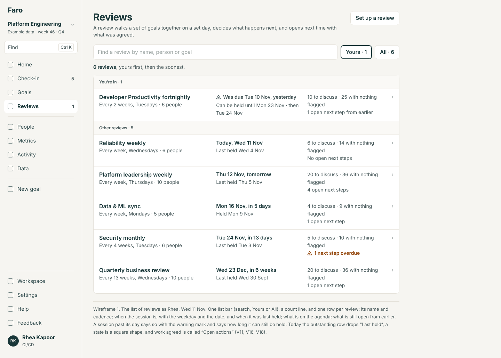
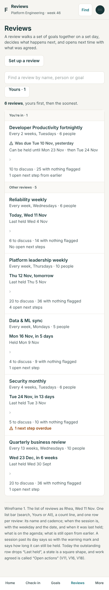

One list bar, one count line, and a row that says when, with weekday and date, what is on the agenda and what is still open.

**2. Setting one up**

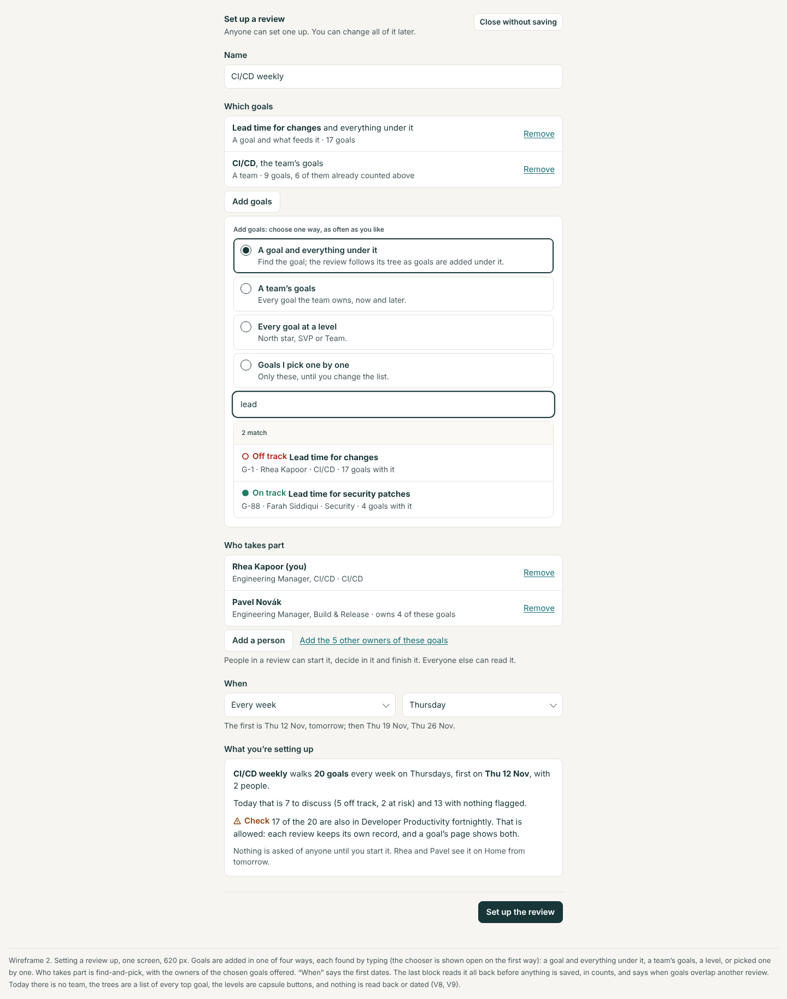
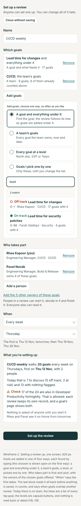

Goals added four ways, each found by typing; the first dates said; all of it read back before it is saved.

**3. Preparing**

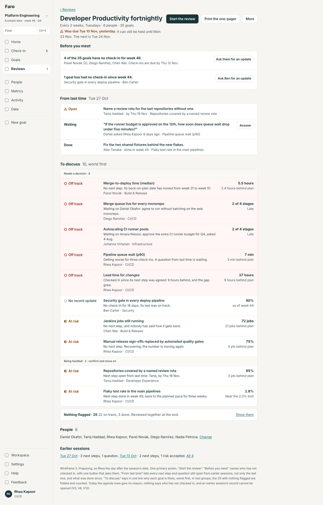
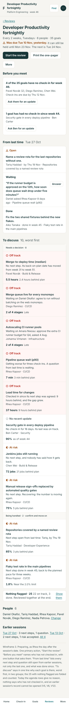

Who hasn't checked in, what is open from last time, and why each goal is on the agenda.

**4. A troubled goal in the walkthrough, with its decision**

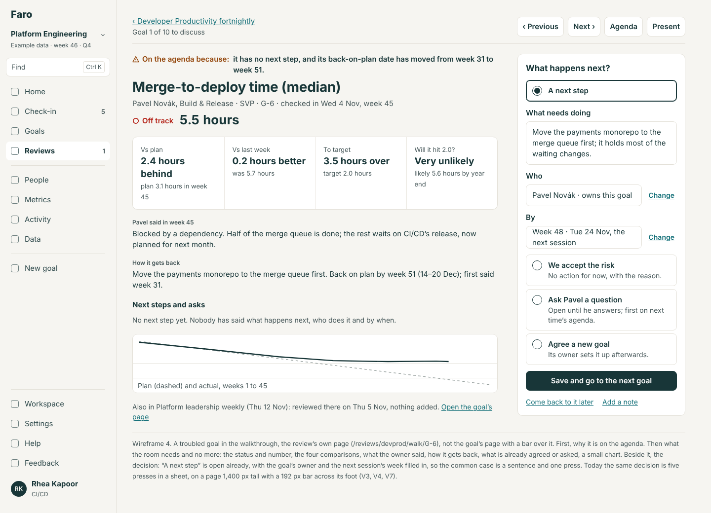
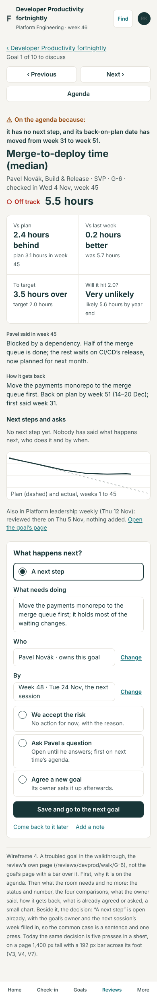

The review's own page for one goal: why it is here, what the room needs, and the decision beside it, already half filled in.

**5. A healthy run**

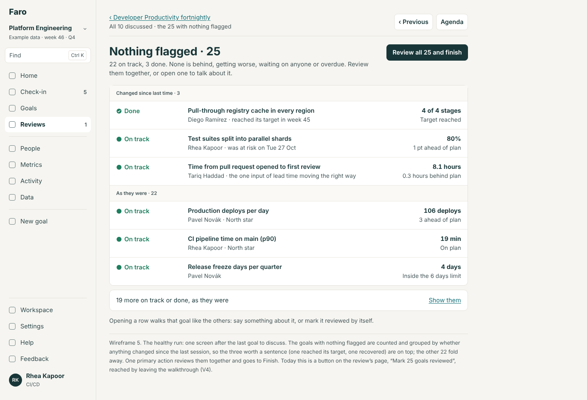
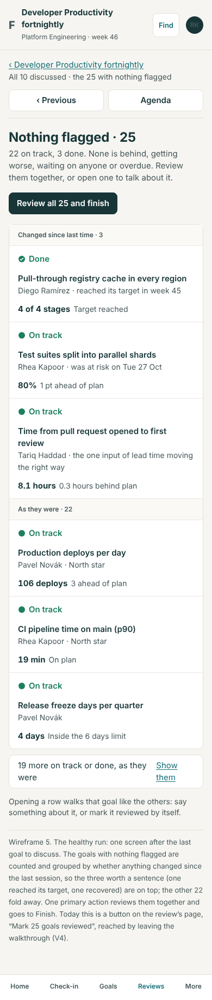

The 25 with nothing flagged, the three that changed on top, and one button.

**6. Finish, with the summary; and the page afterwards**

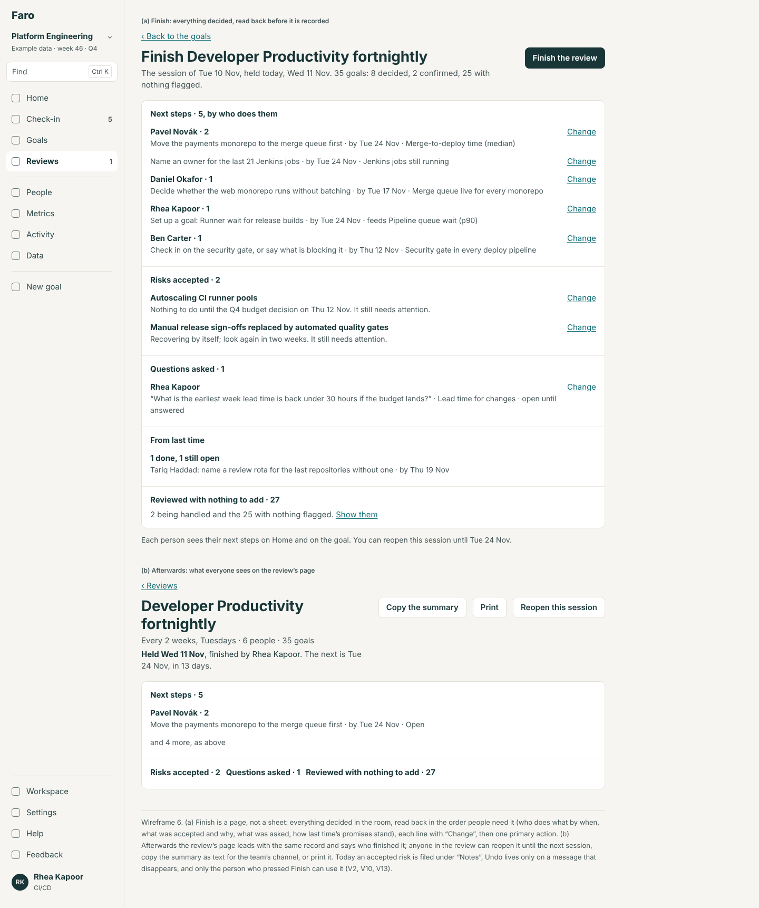
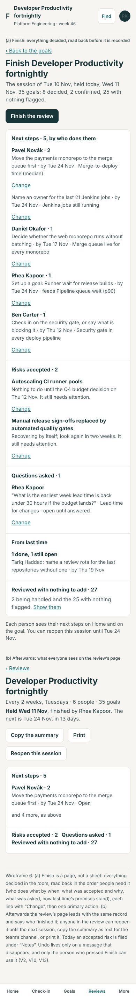

Everything decided, read back with "Change" on each line; afterwards the same record, who finished it, and "Reopen this session".

**7. The next session's opening**

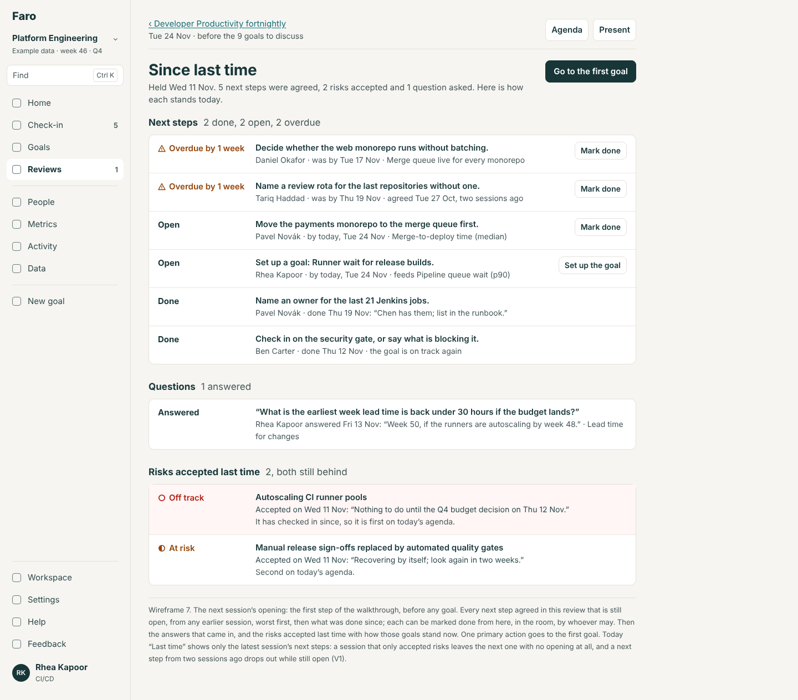
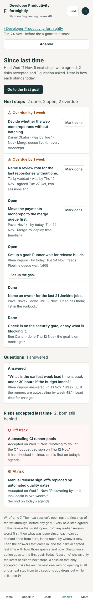

What was promised, from any earlier session, and how each stands today.

**8. The walkthrough on a phone**

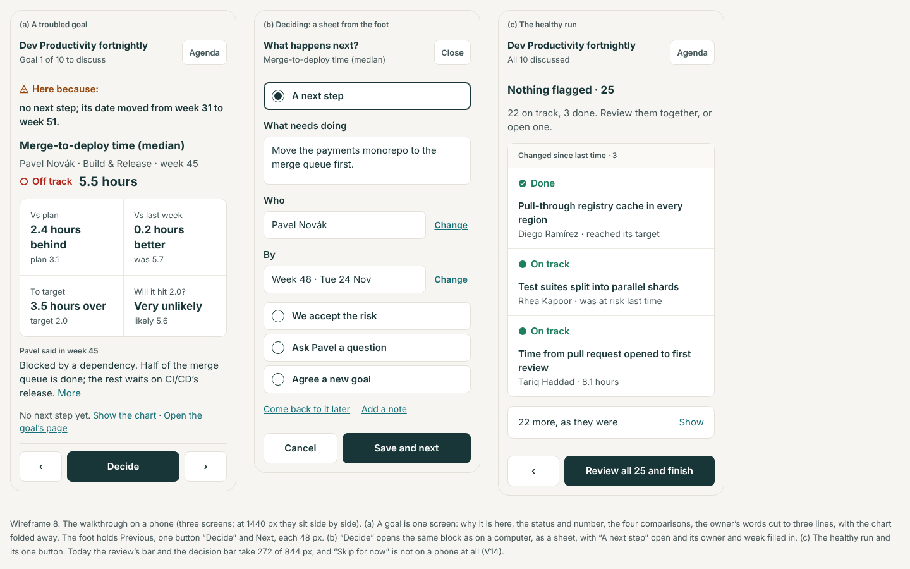
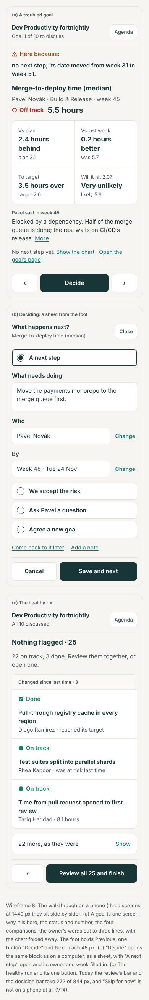

Three screens: a troubled goal, deciding, the healthy run.

**9. Presenting on a big screen**

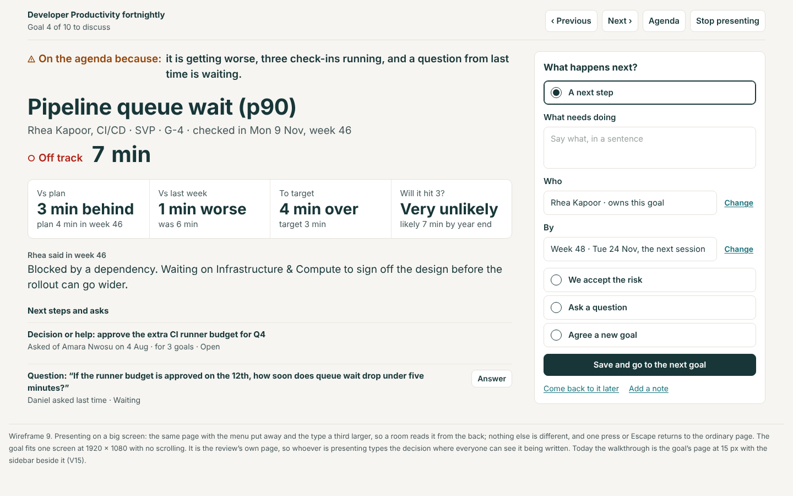
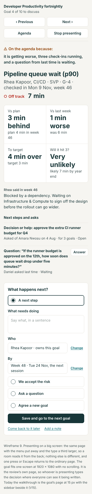

The same page with the menu away and larger type.

## How it fits the module boundary

Round 2 made Reviews a module (FT2 the switch, FT3 the move). This design is drawn to sit inside it:

- **Every screen here is under `/reviews`.** The walk leaves the goal's page: `/goals/<id>?review=<id>` redirects to the walk while Reviews is on and drops the parameter when it is off (as FT2 already says). The goal's page then carries nothing of a review but two places the contract already has: the section "Last time we talked" (`goal.sections`) and the fact "In {review}, next Tue 24 Nov" (`goal.facts`).
- **The walk imports the core's goal parts** (status, scorecard, the next-steps-and-asks list, the chart) and adds nothing to them. This is what FT3 planned ("the walk becomes the module's own route"), now designed.
- **What it writes are core records through core actions**: a next step and a question are asks (`addAction`, `askQuestion`), kept and shown with Reviews off. "Reviewed", a note, an accepted risk and "carried over" are the module's marks in `okr_decisions`, which the core already keeps as history.
- **No core rule reads anything new.** "Being handled" is still a next step with an owner and a week; "Looked at by…" is unchanged. Nothing in the status, attention, Home or Goals rules takes a review.
- **Extension points**: FT3's three (`ModuleNav.count`, `home.lead`, `home.glance`) and nothing more. With Reviews off these screens are absent and nothing else changes.

Designed four ways at once (round 3's decision 4): with a rhythm or none, the walk differs only as said above; with Reviews off there is nothing to draw.

## What this changes in rounds 1 and 2

| Round | Where | Change |
|---|---|---|
| 1 | Goal spec 2.3, "The goal in a review's walkthrough" | Replaced. The walk is the review's page; the goal's page has no review mode. The "same component, review mode" becomes: the walk imports round 1's next-steps-and-asks list as it is |
| 1 | Navigation spec, rule 4 (the back link) | "A goal in a review's walkthrough → ‹ {review}" now applies to `/reviews/<id>/walk/…`; "A review's summary" becomes "An earlier session → ‹ {review}"; Finish → "‹ Back to the goals" |
| 1 | Navigation spec 2.5, leaving a form | "The review walkthrough keeps 'Close the review'" becomes: it has the back link only. Nothing is lost by leaving: every decision is saved when made |
| 1 | Navigation spec 2.1, the menu's count | "Reviews you're in, held this week, with goals still to cover" becomes: reviews you're in whose session's day has come and which isn't finished |
| 1 | Find spec, section 4 (the moves) | Adds two: Reviews gets the list bar; set-up's goals, teams and people are find-and-pick (people already are) |
| 1 | Words | In a review, "action" becomes "next step" everywhere on screen (the stored kind is unchanged). A session's state is a word, with the warning mark when it is late; the square shapes go |
| 2 | Goal entry 2.8 (GE6) | Kept as specified. Its place moves: "Agree a new goal" is the fourth choice of "What happens next?" on the walk's page, not a block on the goal's page. Its "Set up by" starts as the next session's week, as it said |
| 2 | Toggles spec 3, routes | Three addresses added to the switched-off list: `/reviews/:id/walk/*`, `/reviews/:id/finish`, `/reviews/:id/sessions/:week`. `/reviews/:id/summary` now goes to the latest finished session |
| 2 | Toggles spec 1.2, FT2's refusals | The new actions (`decideAndReview`, `carryOver`, `finishSession`, `reopenSession`) refuse with the same line when Reviews is off |
| 2 | Toggles spec 4.2, the read-back before switching off | Unchanged, and its counts gain nothing: carried-over marks are among "things said or marked" |
| 2 | Toggles README 2.4, "a session whose date passed while off is not 'Not held yet'" | Kept: the "Not held" record starts from the day Reviews came back on |
| 2 | Set-up spec 2.4, "Hold a review" | Its select gains "Every quarter"; its line "It walks whatever was last updated" stands and is what the walk does with no set rhythm |
| 2 | Round 2's shared decision 3 (see it before it is saved) | Applied to a review's set-up, to changing one, and to Finish |

Nothing in rounds 1 and 2 is contradicted on the rhythm, the field table, the three levels or the switches.

## Decisions for Lane

One batch; the recommended answer is first. The spec's section 12 says what changes for each other answer.

1. **Who may mark and decide in a review** (the handover's parked question; V6).
   - (a) Only people in the review, or an admin, enforced in the rule; everyone else reads. Joining stays as the rule has it (someone in it, or an admin, adds you), and the screen says who can. *Recommended.*
   - (b) The same, and anyone may add themselves, logged.
   - (c) Anyone in the workspace may, as the rule allows today; the screen stops hiding it.
2. **A question as a way out of a troubled goal** (V19).
   - (a) It lets the review move on; the goal still needs attention and is first on the next agenda. *Recommended.*
   - (b) As today: only a next step or an accepted risk.
3. **A goal the room didn't get to** (V7).
   - (a) Finish offers "Carry them to {next date}", with an optional reason, kept as a mark on each goal. No migration. *Recommended.*
   - (b) Finish is refused until every goal has a decision.
   - (c) Finish marks them reviewed with nothing said.
4. **Undo for a finished session** (V2).
   - (a) "Reopen this session" on the review's page, for anyone in it, until the next session's day. *Recommended.*
   - (b) The same, for whoever finished it and admins only.
   - (c) As today: the message's Undo only.
5. **Where the walk lives** (V4).
   - (a) The review's own page per goal, with the goal's page one link away. *Recommended.*
   - (b) Keep the goal's page under a bar; take only the in-place decision and the agenda's reasons.
6. **A session past its day** (V11).
   - (a) It can be held until the day before the next one, then is recorded "Not held". *Recommended.*
   - (b) As today: until the end of its week, then forgotten.
   - (c) Add "We're not holding this one", which needs a session record (a table; SQL in spec 8).
7. **Which week a fortnightly or monthly review starts in** (V8).
   - (a) As today, fixed by the calendar's week numbers; set-up says the first three dates. No migration. *Recommended for now.*
   - (b) Let the person choose the first date (one column, `first_on`; SQL in spec 8).
8. **A review's scope by team** (V8).
   - (a) Add it, kept inside the scope already stored. No migration. *Recommended.*
   - (b) Leave it out; a team's goals are picked one by one or by tree.
9. **Presenting.**
   - (a) A "Present" view of the walk: menu away, larger type. *Recommended.*
   - (b) Leave it; the browser's zoom and a collapsed sidebar do.
10. **How much to build.**
    - (a) RV1, RV2, RV3 after FT2: the agenda's reasons, the walk with its decision, Finish with reopen. Decide the rest when they land. *Recommended.*
    - (b) All ten items.
    - (c) Only RV1 and the fixes in RV7 now.

## What was not verified, or not done

- No person was timed; "30 minutes" is presses and screens counted, not a room observed.
- The walk as Amara went one goal deep; Finish was run only as Rhea. A second person on a second device during one session was read from code, not tried.
- The quarterly review's set-up screen (V8's "no cadence chosen") is from code; it was not opened to edit.
- The reasons on agenda rows in the wireframes are written by hand from the demo's goals; the rule that makes them (spec rule 1) is specified with examples but not run.
- With no set rhythm, and with Reviews off, nothing could be walked (neither is built); those states are designed from round 2's specs.
- The demo's sessions sit a week apart for a fortnightly review ("Last time · Tue 3 Nov" before Tue 10 Nov): seed data, noted, not investigated.
- Home's blocks are named here and left to the Home area to place.
