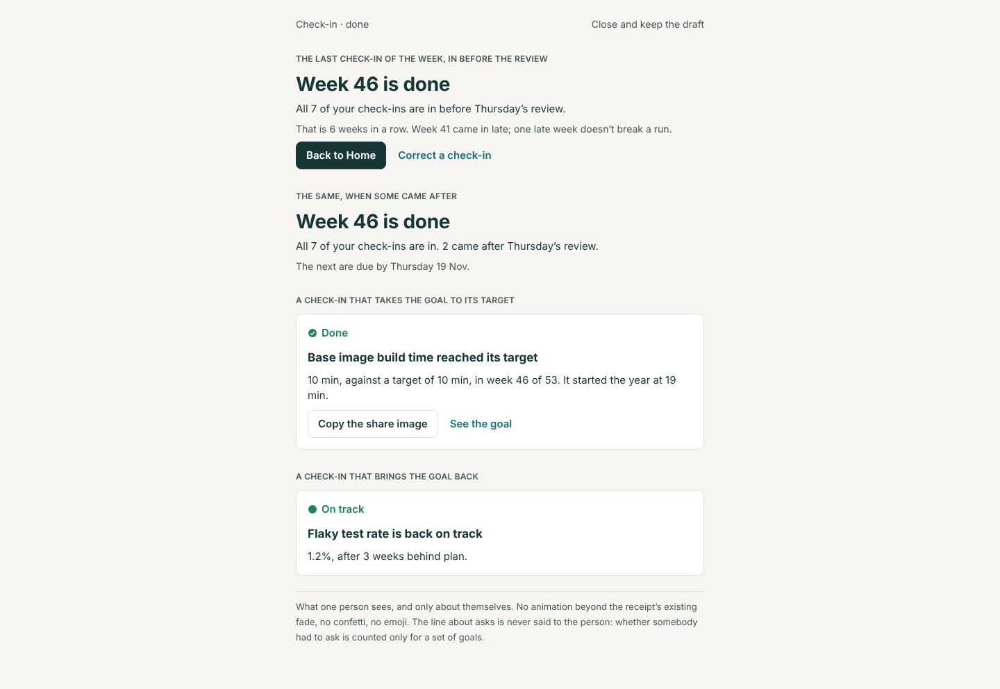
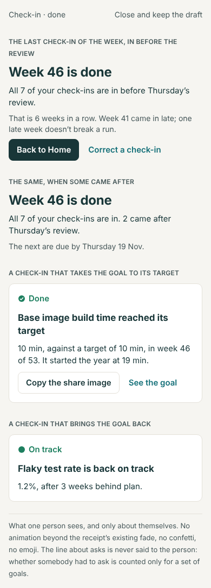
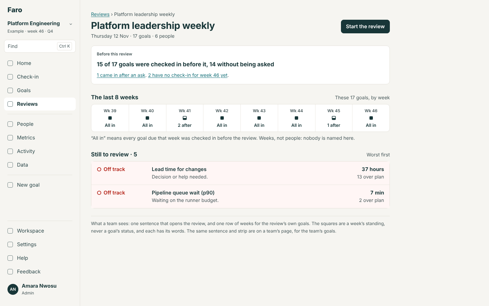
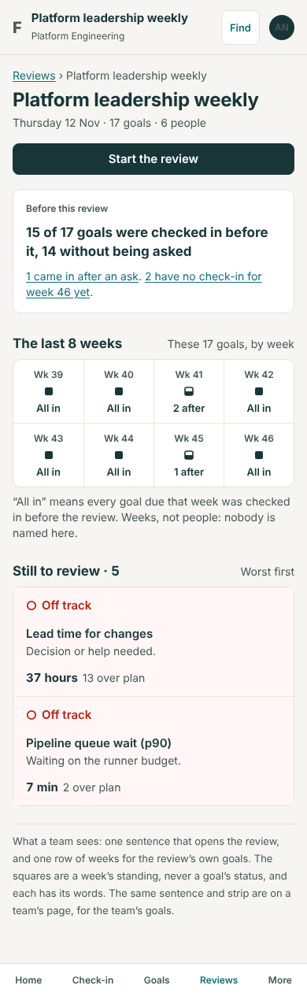
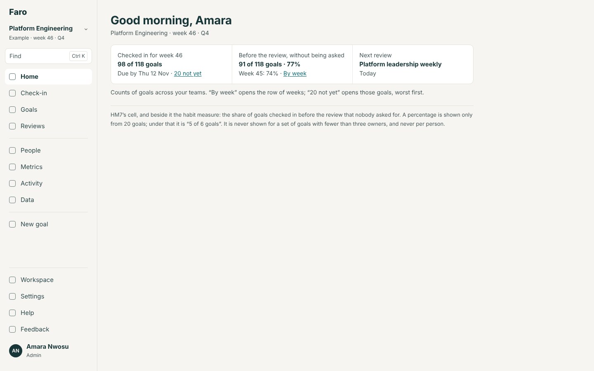
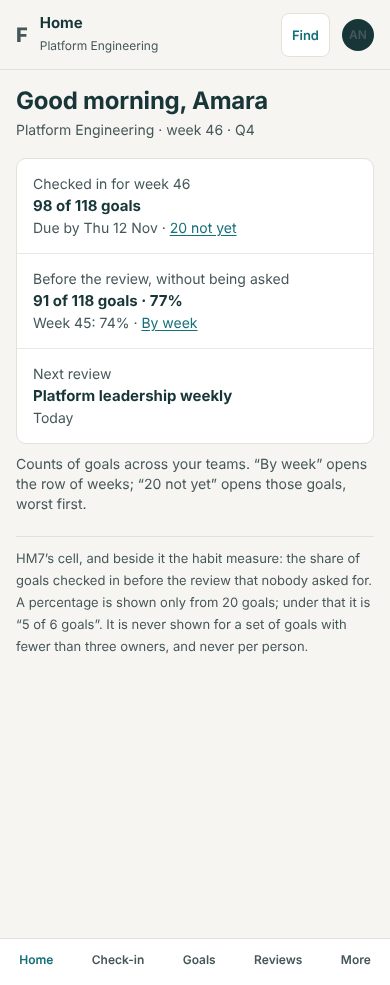

# The habit moment: the build spec

13 November 2026. Round 4, item 3 (`../README.md`). A design, not a build. It takes up the evaluation's item 12 and decision 4 (`docs/reviews/2026-11-12-muse-product-evaluation.md`), backlog L parts (1), (3) and (4), and round 3's CF4 (`docs/design/workspace-settings/spec.md`, 2.5), whose rule it uses and does not restate. It assumes Lane takes the recommended answer to questions 10 to 13. Track 1 holds its build for this file.

**The measure Lane chose:** the share of goals checked in before the review without a nudge. Faro's only nudge is an ask for an update.

**Standing rules** (`CLAUDE.md`): each part adds its section of `spec/` (and R5's worked examples), conformance rows, `npm run spec`, What's new and the guide, its evals, the quality gate. No table. `cycle.streak` comes with CF2's migration; if that is not on main, HB1 builds the rule with the forgiving behaviour and says so in its PR. After `progress.ts` changes, `npm run build:mcp` (`get_my_work` returns the streak).

## The problem

The habit Faro most wants is checking in before the review without being asked. Today it is noticed three ways, all weak: a streak that one late week sets to nought, no number a leader or a team can read, and nothing at all when a goal reaches its target.

## Options

| | What | For | Against |
|---|---|---|---|
| A | **A habits page**: charts of on-time check-ins by team and week | Everything in one place | A place nobody is sent to; charts by team become charts by person in a small team; a new screen and a new menu row |
| B | **Sentences where people already are**: the check-in's receipt for a person, the top of a review for a team, one cell on a leader's Home, and one row of weeks for a set of goals | Read at the moment it is true; nothing to open; easy to keep calm | The measure has three homes, so its rule must be one function |
| C | **Spec only**: write the measure into R5 and build nothing | Free | The model doesn't show the thing most worth copying |

**Recommended: B.**

## 1. Routes

None. One query value on Goals: `checkedin=asked` (live goals whose check-in this week answered an ask for an update), beside HM7's `checkedin=no`.

## 2. Screens

### 2.1 What a person sees: the check-in's receipt

Wireframe 1. The receipt after the week's last check-in (`CheckInFlow.tsx`, today "Week {n} is done"). The heading is unchanged.

| When | First line | Second line (quiet ink) |
|---|---|---|
| Every check-in was in by the due day | "{All {n} of | Both of | } your check-in{s} {are | is} in before {Thursday}’s review." | The run, from two weeks: "That is {k} weeks in a row." With a forgiven week inside the run, the first time it is shown after that week: "Week {w} came in late; one late week doesn’t break a run." |
| Some came after | "All {n} of your check-ins are in. {m} came after {Thursday}’s review." | "The next are due by {Thursday 19 Nov}." No run is mentioned, and none is said to be lost |
| The workspace has no review | "…are in for week {w}." in place of "before {Thursday}’s review" | As above |
| The streak is off, or there is no set rhythm | The first line only | — |

- Home's quiet line (HM1) uses the same two sentences on the day the week is completed.
- A person is never told that an ask preceded their check-in, here or anywhere. The ask itself said so.
- **Never said:** "streak lost", "broken", a nought, a count of late weeks, an exclamation mark.

### 2.2 When a goal reaches its target, or comes back

Wireframe 1, lower half. On the receipt of the check-in that does it, one panel above the week's lines:

| When (rule 3) | Shape and word | Heading | Line | Buttons |
|---|---|---|---|---|
| `reached` | The ticked circle, "Done" | "{Goal} reached its target" | "{value}, against a target of {target}, in week {w} of {weeks}. It started the year at {start}." | "Copy the share image" (plain; the existing `shareCard`) · "See the goal" |
| `back` | The filled circle, "On track" | "{Goal} is back on track" | "{value}, after {k} weeks behind plan." | "See the goal" |

- In the goal's History the check-in's row gains a result in small capitals, in the status colour, with no capsule: "REACHED ITS TARGET" / "BACK ON TRACK".
- No animation beyond the receipt's existing fade, which already respects reduced motion. No confetti, no emoji, no sound, no banner on anyone else's screen.
- One panel per check-in; `reached` wins over `back`.

### 2.3 What a team sees: a review, and a team's page

Wireframe 2. At the top of a review's page, above "Still to review", a panel labelled "Before this review":

- Heading: "{a} of {n} goals were checked in before it, {u} without being asked". When `a` equals `u`: "…before it, all without being asked". When `a` is `n` and `u` is `n`: "All {n} goals were checked in before it, without anyone asking".
- Under it, links, each only when not nought: "{k} came in after an ask" (`checkedin=asked`) · "{m} have no check-in for week {w} yet" (`checkedin=no`). Both open goals, worst first.
- Before the due day the heading is in the present: "{a} of {n} goals are checked in so far."

Under the panel, **"The last 8 weeks"**: one row of eight weeks for the review's own goals (backlog L (4)). Each cell is the week's number, a square mark and its words:

| Mark | Words | When (rule 2) |
|---|---|---|
| Filled square | "All in" | Every goal due that week was checked in by the due day |
| Half-filled square | "{k} after" | Some came after, or not at all |
| Open square | "None in" | None was in by the due day |
| No mark | "Nothing due" | No goal in the set was due |

Under the row: "“All in” means every goal due that week was checked in before the review. Weeks, not people: nobody is named here." On a phone the row is two rows of four. The marks are squares because a circle is a goal's status and nothing else.

The same panel and row are on a team's page (People → a team), for the team's goals, headed "Before this week’s review".

### 2.4 What a leader sees: Home's cell

Wireframe 3. Beside HM7's cell ("Checked in for week 46 · 98 of 118 goals"), one more, for the same viewer and the same set:

- Label "Before the review, without being asked"; value "{u} of {n} goals · {p}%"; under it "Week {w−1}: {p}%" and "By week", which opens the first review that covers the set, or the Goals view of it with the row of weeks above the list.
- A percentage is shown only from 20 goals; under that the value is "{u} of {n} goals".
- During the week, before the due day, the cell says "So far: {u} of {n} goals".

### 2.5 The streak's setting

CF4's sheet (workspace-settings spec, 2.5) with one change: the default for a new workspace is "One late week forgiven" (`'grace'`); "Every week must be on time" and "Not shown" are the other two. Existing workspaces keep what they have.

## 3. Who sees what

| Viewer | Sees |
|---|---|
| A person | Their own receipt and Home line. Nobody else's run, anywhere |
| Anyone in a review | The review's panel and row of weeks |
| Anyone | A team's panel and row, for a team of three or more owners (rule 4) |
| A leader whose goals span three or more teams, and an admin | Home's cell (HM7's audience) |

## 4. Rules for `src/domain` (`habit.ts`, new, and `progress.ts`)

### Rule 1. A check-in's standing: `checkInStanding(goal, week, s, cycle): 'unasked' | 'asked' | 'after' | 'none'`

For a live goal due that week (FT1's rhythm):

- `none`: no check-in by its owner, or by someone checking in for them, counts for the week;
- `after`: the first such check-in was posted after the end of the due day, `reviewDate(cycle, week)`;
- `asked`: it was posted by the due day and it answered an ask for an update (`kind: 'update'`, open when it was posted; `requestsAfterCheckIn` set `answeredAt`);
- `unasked`: otherwise.

A question, a comment or a review's carried action is not a nudge. A correction does not change a week's standing. "Before the review" is the end of the due day because Faro's reviews have a day and no hour; R5 tells the rebuild to use the review's start.

| Given (due Thu 12 Nov) | Standing |
|---|---|
| Checked in Tue 10 Nov; no ask | `unasked` |
| Daniel asked for an update on Wed; checked in Wed evening | `asked` |
| A question was asked on Tue; checked in Wed | `unasked` |
| Asked for an update the week before, answered then; checked in Tue | `unasked` |
| Checked in Fri 13 Nov | `after` |
| No check-in | `none` |
| Checked in Tue, corrected Fri | `unasked` |

### Rule 2. The measure: `habit(goals, week, s, cycle): { due, inTime, unasked, asked, after, none }` and `habitWeeks(goals, to, n = 8)`

Counts rule 1 over a set of goals. `inTime = unasked + asked`. The measure is `unasked / due`. `habitWeeks` gives the row of weeks: `'all' | 'some' | 'none' | 'nothing-due'` and the count for "{k} after" (`after + none`).

| Given (17 goals due) | Reads |
|---|---|
| 14 unasked, 1 asked, 2 none | "15 of 17 goals were checked in before it, 14 without being asked" · measure 82% (not shown under 20 goals) |
| 17 unasked | "All 17 goals were checked in before it, without anyone asking" |
| 118 due; 91 unasked, 7 asked, 12 after, 8 none | Home: "91 of 118 goals · 77%" |

### Rule 3. A moment: `moment(before, after, goal): 'reached' | 'back' | null`

`reached`: the check-in's value meets the target in the goal's direction and the one before it did not. `back`: the status is On track, the one before was At risk or Off track, and the goal had been behind for two weeks or more. Neither fires on a correction, a backfilled week or an import.

### Rule 4. Never a person: `habitShown(goals): boolean`

False when the set's goals have fewer than three owners, unless the viewer owns all of them. A set that fails is not shown a panel, a row or a cell. No function in `habit.ts` takes or returns a person.

### Rule 5. The run

CF4's `onTimeStreak`, unchanged. One addition for the receipt: `forgivenIn(personId, …): number | null`, the forgiven week inside the current run, so it can be said once.

## 5. What it must never become

For the rebuild to copy with the rest (R5, rules 5 and 6):

- a list, a count or a chart per person, or a sort by person;
- a comparison of teams by their share (no order by percentage, no "best" or "most improved");
- a target for the measure, or a status drawn from it;
- a message to anyone about someone else's late week;
- a loss ("you lost your streak"), a nought, or a red number;
- a celebration anyone other than the person checking in has to watch.

## 6. What the rebuild should copy

- The measure and its three counts as one rule with worked examples, and the definition of a nudge. Once the platform sends reminders (R5), a reminder is a nudge too.
- The sentences, word for word, as R5's worked examples.
- A forgiving run by default.
- The row of weeks for a set of goals, never for a person.

## 7. Evals

Journeys: `HABIT-RECEIPT` (the last check-in before the due day says "before Thursday’s review"; one posted after says "came after" and no run); `HABIT-REVIEW` (the panel's sentence and its two links open exactly those goals; the row has eight cells with words); `HABIT-MOMENT` (a check-in to target shows the panel and History's result). N-checks: no person's name inside the panel, the row or the cell; a two-owner team's page has none of them. P3 and P4 on the marks (every shape has its words); P6 on each. Unit tests: every table above, and CF4's. Requirements: `HABIT-MEASURE`, `HABIT-NEVER-A-PERSON`, `HABIT-MOMENT`.

## 8. Help and What's new

Guide: "Check in" (what the receipt says); "Reviews" and "A team" (before this review; the last 8 weeks); "Home" (the cell). What's new: "A late week no longer resets your run" (HB1); "A review says how many goals were ready for it" (HB2); "Reaching a target is said, quietly" (HB1).

## 9. The first-download budget

Nothing is added to it. The receipt is in the check-in's chunk, the panel and row in Reviews' and People's. Home is in the first download, so its cell must not import `habit.ts`: Home paints HM7's cell, then loads the rule and fills the second cell. `forgivenIn` is called only from the receipt.

## 10. If Lane decides otherwise

| Question | Answer | Changes |
|---|---|---|
| 10 | (b) the first review that includes the goal | Rule 1's due moment becomes per goal; a person's line and the set's number can then disagree, and the receipt names the review |
| 10 | (c) reviews get a time | A field on a review, its form and its migration; rule 1 reads it |
| 11 | (b) strict by default | 2.5 is CF4 as written; the "came in late" sentence is shown only where an admin chose "forgiven" |
| 12 | (b) the review only | Drop the team's page and 2.4 |
| 12 | (c) Home only | Drop 2.3's panel; the row of weeks opens from the cell |
| 13 | (b) also for watchers | One line in Home's "Goals you watch" that week: "{Goal} reached its target." |
| 13 | (c) History only | Drop the receipt's panel |

## 11. Build plan

| # | Part | Size | Needs |
|---|---|---|---|
| HB1 | CF4's forgiving run and its default; the receipt's lines; the moment (rule 3) on the receipt and in History | S | Nothing (CF2's migration if it has landed) |
| HB2 | Rules 1, 2 and 4; the review's panel and row of weeks; the team's page; `checkedin=asked`; R5's examples in `spec/` | S–M | HB1 |
| HB3 | Home's cell | S | HM7 |

## Mock-ups

| # | Screen | 1440 | 390 |
|---|---|---|---|
| 1 | The receipt: on time, some after, a target reached, back on track |  |  |
| 2 | A review: "Before this review" and the last 8 weeks |  |  |
| 3 | A leader's Home: the cell |  |  |
