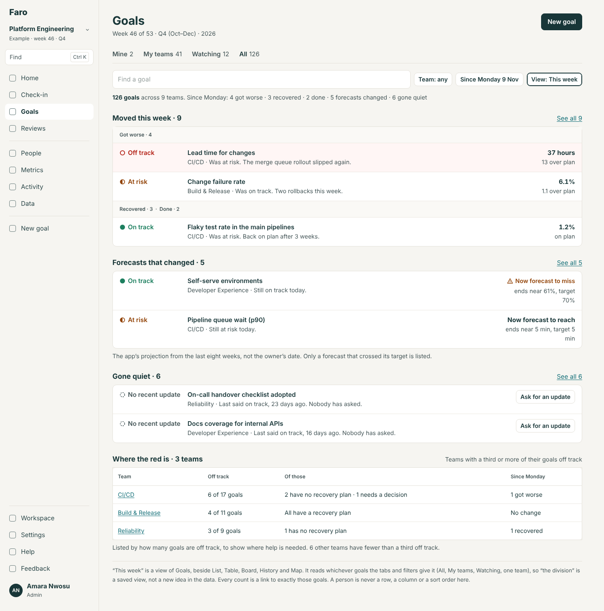
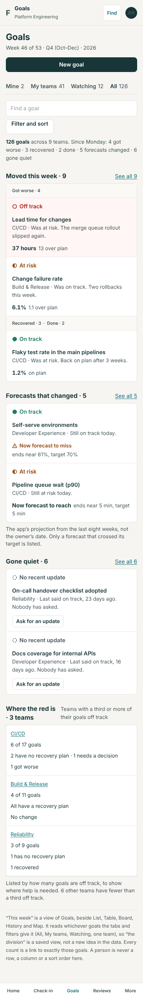
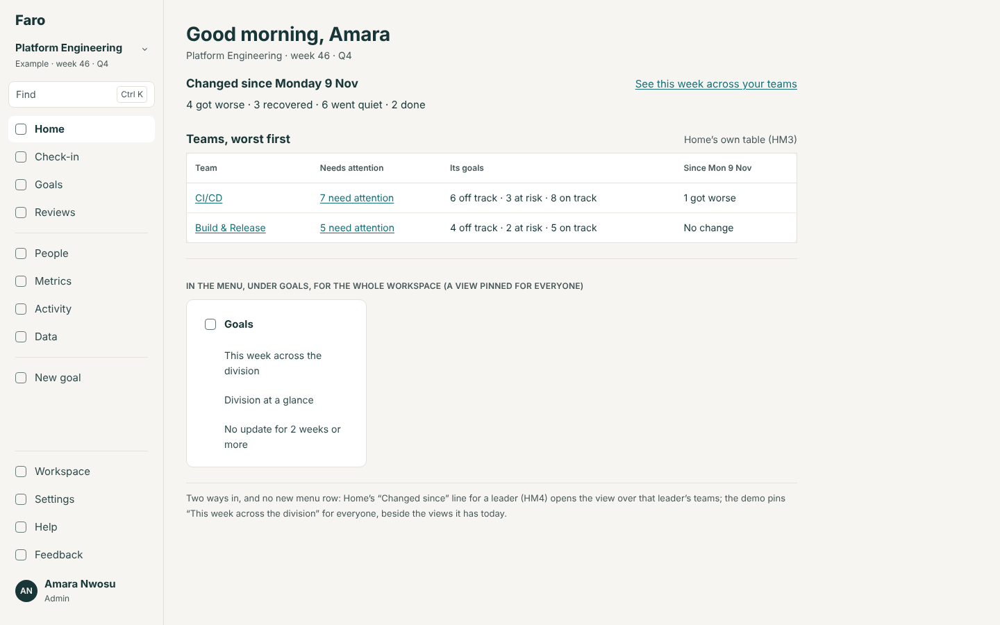
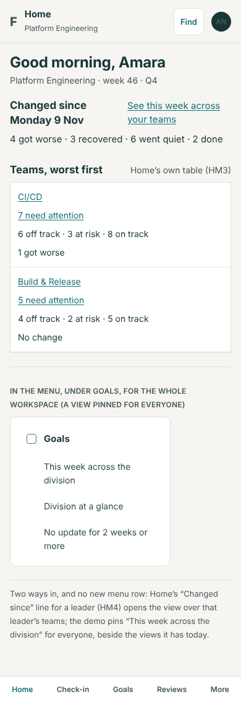

# A leader's week (the VP portfolio view): the build spec

13 November 2026. Round 4, item 4 (`../README.md`). A design, not a build. From the backlog's "Ideas, not yet placed" and the product review of 8 November: "what moved across the division this week, forecast movers, quietly stale goals, teams overloaded with red". It assumes Lane takes the recommended answer to questions 14 to 16. It reads the Goals spec (scopes, groups, views, the list bar), the Home spec (HM3's "Teams, worst first", HM4's `changedSince`) and R5's rule 5, and restates none of them.

**Standing rules** (`CLAUDE.md`): its section of `spec/`, conformance rows, `npm run spec`, What's new and the guide, its evals, the quality gate. It changes Goals' shared view switch, so it runs the full `npm run evals`. No table, no migration.

## The problem

A VP can see how every goal stands today, but not what changed across the division since Monday. The answer is spread over the Goals table, Watching's "What changed this week", each review's agenda and each goal's chart, and has to be put together team by team.

## Options

| | What | For | Against |
|---|---|---|---|
| A | **Its own screen**, a menu row "Portfolio" | Easy to find; room for anything | A fourteenth row for a handful of people; a third place for "teams, worst first"; needs "a division", which the data doesn't have; a screen for leaders alone is where a ranking of people grows |
| B | **More sections on a leader's Home** | Where a leader starts | Home is the one screen in the first download and is meant to say what is asked of you today; HM3, HM4 and HM7 already fill it |
| C | **A view of Goals, "This week"**, beside List, Table, Board, History and Map | Works over any tab and filter, so "the division" is a saved view and a team lead gets the same view of one team; every count is already a Goals address; nothing new in the menu; lazy by nature | One more view in a switch that has five |

**Recommended: C.** Home answers "what is asked of me today"; this answers "what changed out there this week"; Table answers "how does everything stand".

## 1. Routes

| Address | Screen |
|---|---|
| `/goals?scope=<any>&view=week` | Goals, as "This week" (2.1). Takes `team`, `since` (`monday`, the default, or `seen`) and the list bar's search and filters. `group`, `sort` and `status` are not used by this view and are kept in the address for when the view changes |
| `/goals?…&moved=worse|better|done|quiet&since=…` | HM4's filter, as that spec has it: the lists behind "See all" |
| `/goals?…&forecast=miss|reach&since=…` | New: goals whose forecast crossed their target since then |
| `/goals?…&quiet=unasked` | New: gone quiet and nobody has asked (rule 3) |

No redirect. The demo's pinned view "Division at a glance" stays; a second, "This week across the division" (`scope=all&view=week`), is pinned for everyone beside it.

## 2. Screens

### 2.1 Goals, as "This week"

Wireframe 1. The page's head, tabs and list bar are Goals' own. The bar's extras are "Team: {any}", "Since {Monday 9 Nov}" (the other choice: "Since you last looked · {Fri 6 Nov}") and "View: This week". The count line: "**{n} goals** across {t} teams. Since {Monday}: {a} got worse · {b} recovered · {c} done · {d} forecasts changed · {e} gone quiet". A part that is nought is left out; when all are: "Nothing has moved since {Monday}."

Four sections, in this order. Each shows up to five rows, then "See all {n}", which opens the plain list with the filter that gives exactly those goals. A section with nothing in it is not drawn. A row is a Goals row: status (shape and word) first, the title, then one line beginning with the **team's** name; the owner's name is not on the row (it is on the goal's page).

| Section | Rows | The row's line | At the right |
|---|---|---|---|
| **"Moved this week · {n}"** | `changedSince` (HM4): grouped "Got worse · {k}", then "Recovered · {k}" and "Done · {k}"; worst first within each | "{Team} · Was {at risk}. {The check-in's first sentence.}" | The number over its gap, as a list row |
| **"Forecasts that changed · {n}"** | Rule 2: forecasts that crossed their target, misses first | "{Team} · Still {on track} today." | "Now forecast to miss" with the warning mark, or "Now forecast to reach" in bold; under it "ends near {x}, target {t}" |
| **"Gone quiet · {n}"** | Rule 3: longest quiet first | "{Team} · Last said {on track}, {23} days ago. Nobody has asked." | A plain button, "Ask for an update" (the existing `askForUpdate`, for a viewer who may) |
| **"Where the red is · {t} teams"** | Rule 4: a table, most off-track goals first | Columns "Team" (a link to this view for that team), "Off track" ("{6} of {17} goals", a link), "Of those" ("{2} have no recovery plan · {1} needs a decision" / "All have a recovery plan"), "Since {Monday}" ("1 got worse" / "No change") | — |

- Under "Forecasts that changed": "The app’s projection from the last eight weeks, not the owner’s date. Only a forecast that crossed its target is listed."
- Under "Where the red is": "Listed by how many goals are off track, to show where help is needed. {k} other teams have fewer than a third off track."
- **On a phone**: the same four sections in the same order; rows stack as Goals' rows do; the table is stacked rows.
- **Width**: a portfolio view, the wide frame.
- **Quiet**: with nothing in any section, the count line and one sentence, "Nothing has moved, no forecast has changed and nothing has gone quiet since {Monday}."
- **A small workspace** (round 4's SM): with one team, "Where the red is" is not drawn (rule 4), and the view reads as "what changed in the team this week".

**Primary action:** Goals' own ("New goal"). The view is for reading.

### 2.2 The ways in

Wireframe 2. No menu row.

- **The view switch on Goals**, for everyone: List · Table · Board · History · Map · This week.
- **A leader's Home**: HM4's "Changed since {Monday 9 Nov}" heading gains the link "See this week across your teams", which opens `scope=team&view=week` (for an admin with no teams, `scope=all`). HM3's "Teams, worst first" stays Home's; "Where the red is" does not repeat it (a different question: where is the load, not how does each team stand).
- **A pinned view** in the demo, under Goals in the menu.
- **A review**: "This week, for these goals" on a review's page, when Reviews are on, opens the view filtered to the review's goals. (A small addition; it can be left for a later cut.)

## 3. Who sees what

Everyone who can open Goals can open the view, over what they can already see. Nothing in it is for leaders only, on purpose: a view only leaders see is where a ranking grows. "Ask for an update" follows today's rule for who may ask.

## 4. Rules for `src/domain` (`week.ts`, new)

### Rule 1. Since when: `weekSince(choice, seen, today)`

`monday`: 00:00 on the Monday of the current week, the same for every viewer. `seen`: HM4's `sinceFor(seen, today)`.

### Rule 2. A forecast that crossed: `forecastCross(goal, since, now): 'miss' | 'reach' | null`

Uses `projection` (`plan.ts`) as it stood at `since` and as it stands now. `miss`: it reached the target then and misses it now. `reach`: the reverse. Null when either is unknown (fewer than the weeks `projection` needs), when the goal has no number, or when it is done or stopped. A move that does not cross the target is not listed, however large.

| Given | Then |
|---|---|
| Ended near 72% on Monday, near 61% now; target 70% | `miss` |
| Ended near 6 min on Monday, near 5 min now; target 5 min, lower is better | `reach` |
| Ended near 61% on Monday, near 52% now; target 70% | null (it was already missing) |
| Three check-ins so far | null |

### Rule 3. Gone quiet: `goneQuiet(goal, s, now): { days: number; lastStatus } | null`

A live goal with no update for `RULES.staleDays` (14) or more (`daysWithoutUpdate`), whose last status was On track or At risk, with no open ask for an update and no open review action on it. A goal that was Off track when it went quiet is not here: it is already in "Needs attention". These are the goals nobody is looking at.

### Rule 4. Where the red is: `redLoad(goals, teams, since): Row[]`

A team is listed when it has three or more goals Off track and they are a third or more of its live goals (`RED_FROM = 3`, `RED_SHARE = 1/3`, in `thresholds.ts`). Order: most off-track goals first, then the larger share, then name. A row carries the counts in 2.1 and nothing else. A team whose goals have fewer than three owners is never listed. The view draws the section only when the set has two or more teams.

| Given | Then |
|---|---|
| CI/CD: 6 of 17 off track | Listed |
| Developer Experience: 2 of 12 | Not listed (fewer than three) |
| Security: 3 of 20 | Not listed (under a third) |
| A team of one owner with 4 of 5 off track | Not listed |

### Rule 5. One function per section, and no person

`weekView(goals, s, since, now)` returns the four sections' rows and counts. No function in `week.ts` takes a person, returns a person, or orders by one. `checkLayers` gains: `week.ts` and the view's component may not import `directory.ts`'s person functions.

## 5. What it must never become

- **A ranking of people.** No row, column, group, filter or sort is a person. The view ignores `owner=` and `sort=owner`; it says so in the bar if either is in the address ("This view doesn't sort or filter by person.").
- **A league table of teams.** No position numbers, no "best" or "worst", no percentage column to sort by, no arrows for a team's direction over months. Teams are listed only where the load is, with what the goals lack.
- **A count of late people.** "Gone quiet" lists goals. It has no "by owner" total, and its button asks one goal's owner, privately, as an ask always does.
- **An export per person.** The view's export is Goals' own sheet.
- **A status of its own.** It draws no new colour or shape for a team; a team has counts.
- **A leaders-only place.** Everyone can open it.

## 6. What the rebuild should copy

- "What changed" as a view of the goals list over any scope, not a separate report.
- The four questions and their rules: moved, forecast crossed, gone quiet (and unasked), where the load is.
- The "must never become" list as conformance rows, and the rule that the functions cannot be handed a person.
- "Since Monday" as the shared default, so a meeting reads one page.
- With an organisation tree (which Faro lacks), "my division" becomes one more scope; nothing else changes.

## 7. Evals

Journeys: `WEEK-VIEW` (as Amara: the four sections; every "See all" count equals the list it opens; "Ask for an update" posts one ask); `WEEK-TEAM` (as Rhea on `scope=team`: one team, no "Where the red is"). N-checks: no person's name in any row of the view at 390 and 1440; `owner=` and `sort=owner` change nothing but the bar's sentence. P6 and P7 (the wide frame; the table never clips). Unit tests: rules 2, 3 and 4's tables. Requirements: `WEEK-VIEW`, `WEEK-NEVER-A-RANKING`.

## 8. Help and What's new

Guide: "Goals" gains "This week: what changed"; "Home" (the link). What's new: "See what changed across your teams this week".

## 9. The first-download budget

Nothing is added to it. The view and `week.ts` are a layout chunk of Goals, loaded when `view=week` is chosen, as Map and History are. Home's link is a link; Home does not import the rule. The forecast "as it stood at Monday" is worked out from check-ins already in the snapshot, in the chunk.

## 10. If Lane decides otherwise

| Question | Answer | Changes |
|---|---|---|
| 14 | (b) its own menu row | A route `/portfolio` drawing the same component over `scope=all`; a row in "Your work" for leaders and admins; section 5's last line goes, and the N-checks matter more |
| 14 | (c) on Home | The four sections join a leader's Home at five rows each; Home's rule must then load after paint; not recommended against the budget |
| 15 | (b) since you last looked | `since=seen` is the default; the bar's other choice is "Since Monday" |
| 16 | (b) every team | Rule 4 loses its two thresholds; the section duplicates HM3's table |
| 16 | (c) leave it out | Drop rule 4 and the fourth section |

## 11. Build plan

| # | Part | Size | Needs |
|---|---|---|---|
| PF1 | Rules 1 to 5; the view with "Moved this week" and "Gone quiet"; the pinned view; Home's link | M | HM4 (`changedSince`, the `moved=` filter); HM3 for Home's link |
| PF2 | "Forecasts that changed" and "Where the red is"; `forecast=` and `quiet=` | S–M | PF1 |

## Mock-ups

| # | Screen | 1440 | 390 |
|---|---|---|---|
| 1 | Goals, as "This week", over All |  |  |
| 2 | The ways in: a leader's Home, and the pinned view |  |  |
