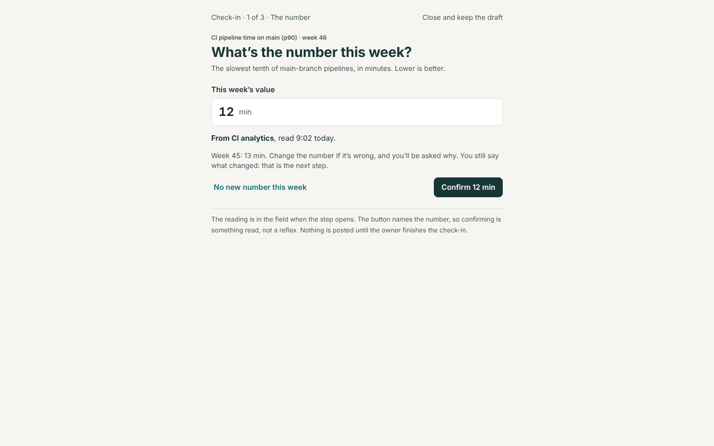
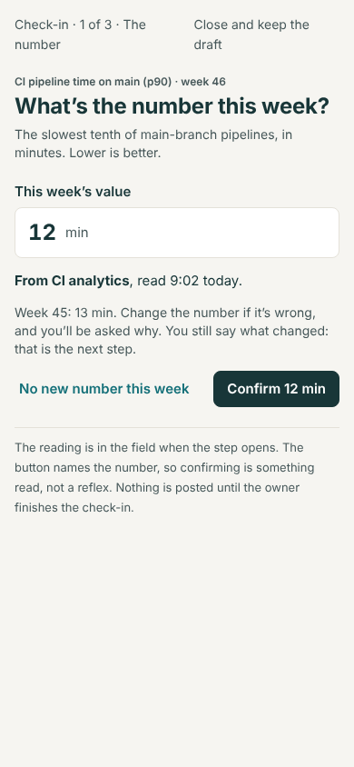
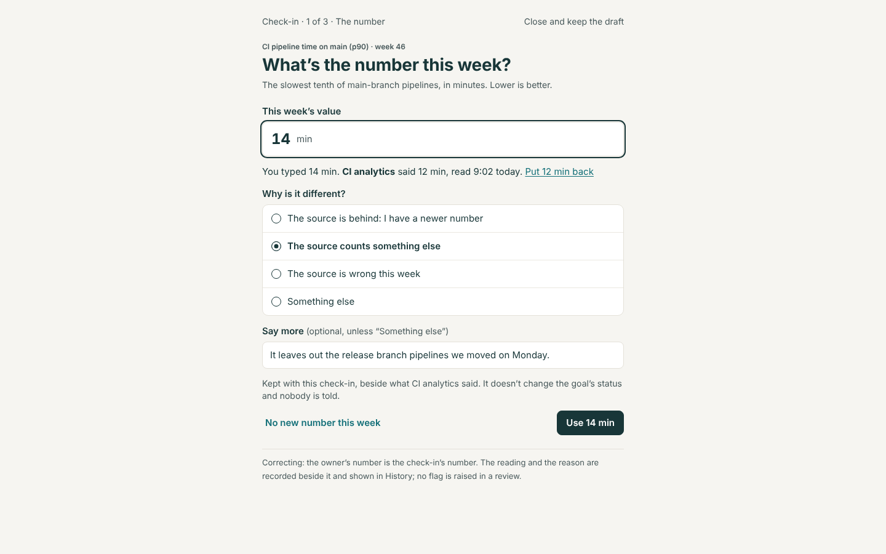
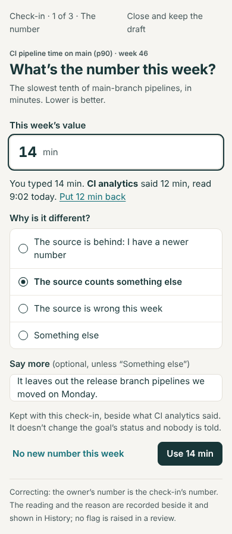
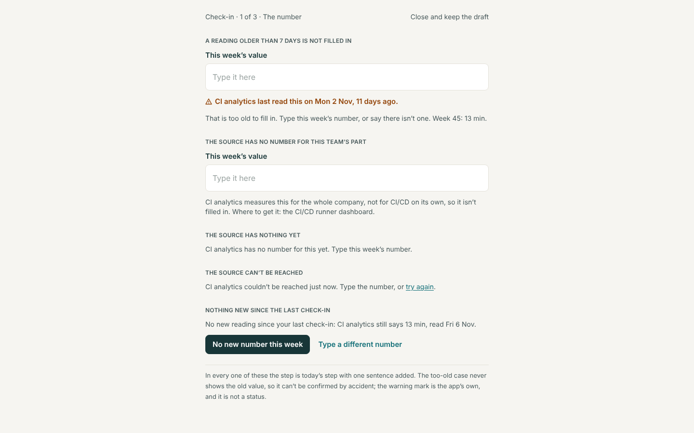
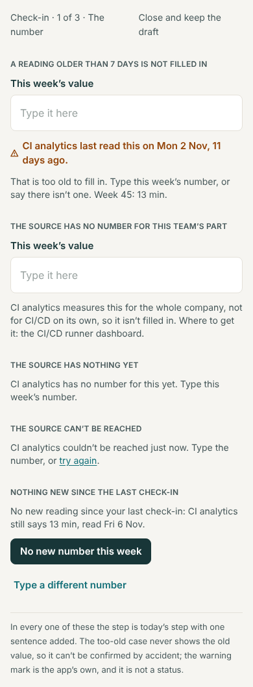
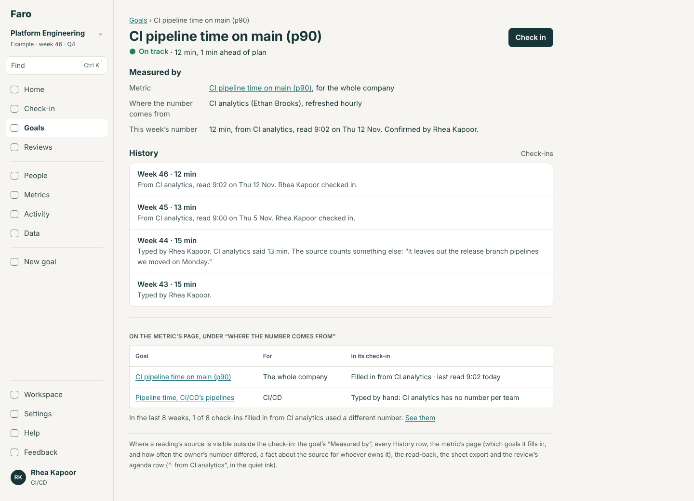
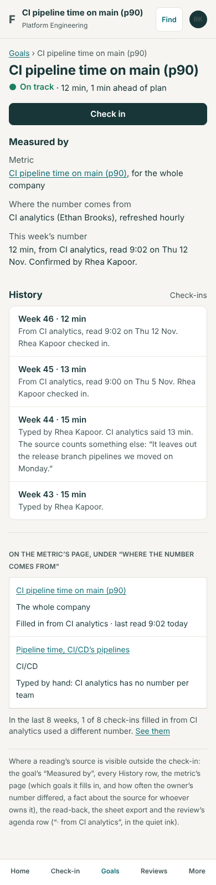

# Readings fill in the check-in (NR): the build spec

13 November 2026. Round 4, item 2 (`../README.md`). A design, not a build. Round 2 already designed most of this as **MT4** (`docs/design/metrics-2/spec.md`, sections 2.8, 5 and 6.2, and rule 7). This file is MT4 as changed by Lane's four answers of 12 and 13 November, and says only what changes and what is added; where the two disagree, this is the later decision. NR replaces MT4 in the build plan.

**Lane decided:** (a) pre-fill only, never post a week nobody updated; (b) readings per team's part where the source has them, otherwise no pre-fill; (c) a reading older than 7 days is ignored; (d) a different number is recorded only, never flagged.

**Standing rules** (`CLAUDE.md`): its section of `spec/` (number sources), conformance rows, `npm run spec`, What's new and the guide, its evals, the quality gate. One migration (MT4's 6.2, with one more key), shipped one merge ahead of the code (AX10). After the check-in rule changes, `npm run build:mcp`.

## The problem

A metric can say where its number comes from, and the demo has a source that can be read, but the check-in still asks the owner to look the number up and type it. Nothing on screen reads the source, and nothing records whether a number was read or typed.

## Options

| | What | For | Against |
|---|---|---|---|
| A | **MT4 as drawn**: the reading shown large above an empty field, "Use 12 min" puts it in; a different number is kept beside it with no reason; a stale reading can be used anyway | Designed and reviewed | Not what Lane described ("opens with the latest reading filled in"); "use it anyway" contradicts answer (c); a silent difference tells the source's owner nothing |
| B | **Filled in, and confirmed by name**: the field holds the reading; the step's button says the number; a different number asks why from four choices; too old means not filled in | Matches all four answers; confirming is a read, not a reflex | One more required tap when the owner disagrees |
| C | **Filled in, plain "Continue"** | Fewest taps | Invites passing a wrong number without looking |

**Recommended: B.**

## 1. Routes

None. The block is the Metrics module's component in the place `checkin.number` (MT4, section 7).

## 2. Screens

### 2.1 The number step, with a reading (changes MT4's 2.8)

The block is drawn when the goal has a live link to a live metric and a registered source says `reads(metric, slice)` for the link's own slice (its team and part). The source is asked once when the step opens.

| State (rule 1) | The field | Says | Primary | Also |
|---|---|---|---|---|
| `fresh` (wireframe 1) | Filled with the reading | "**From {source}**, read {when}." · "Week {w}: {last}. Change the number if it’s wrong, and you’ll be asked why. You still say what changed: that is the next step." | **"Confirm {value} {unit}"** | "No new number this week" |
| `changed` (wireframe 2): the owner has typed a number that differs from the reading at the metric's decimals | Theirs, focused | "You typed {typed} {unit}. **{source}** said {value} {unit}, read {when}." · "Put {value} {unit} back" · "Why is it different?" (2.2) · "Kept with this check-in, beside what {source} said. It doesn’t change the goal’s status and nobody is told." | **"Use {typed} {unit}"**, once a reason is chosen | "No new number this week" |
| `same` | Empty | "No new reading since your last check-in: {source} still says {value} {unit}, read {when}." | **"No new number this week"** | "Type a different number" |
| `old` (wireframe 3): the reading is more than 7 days old | Empty | The warning mark and "{source} last read this on {date}, {n} days ago." · "That is too old to fill in. Type this week’s number, or say there isn’t one. Week {w}: {last}." The old value is not shown | The step's "Continue" | "No new number this week" |
| `no-slice`: the source reads the metric but not this link's team or part | Empty | "{source} measures this for {the whole company | what it does read}, not for {team} on its own, so it isn’t filled in." and today's "Where to get it: {goal.source}." | "Continue" | — |
| `missing` | Empty | "{source} has no number for this yet. Type this week’s number." | "Continue" | — |
| `unreachable` | Empty | "{source} couldn’t be reached just now. Type the number, or try again." | "Continue" | "Try again" |
| `jump` (a Check, as MT4) | Filled | "{source} says **{value} {unit}**. That is {ten times | a tenth of} week {w}’s {last}. Is it right?" | None until answered | "Yes, confirm {value} {unit}" · "Type a different number" |
| `revised` (a Check, above any other, as MT4) | — | As MT4 | — | "Correct it to {new}" · "Leave it" |

- **"Read {when}"** is the time the source measured the number (`Reading.at`), in the viewer's zone: "9:02 today", "16:40 yesterday", otherwise "9:00 on Thu 5 Nov".
- The words "Typed in by hand." leave the "Where to get it" hint everywhere, as MT4 says.
- MT4's "Use {value} {unit} anyway" on a stale reading is removed (answer c).

### 2.2 Why is it different?

One choice is needed before "Use {typed} {unit}":

1. "The source is behind: I have a newer number"
2. "The source counts something else"
3. "The source is wrong this week"
4. "Something else"

Under them, "Say more" (one line; needed only with "Something else", at least 10 characters, as `MIN_CORRECT_REASON`). Choices are a single-choice list, drawn as the check-in's cause choices are. Nothing is asked when the typed number equals the reading at the metric's decimals: that is a confirmation.

### 2.3 The read-back, the receipt and the table

- The check-in's read-back gains one line: "{value} {unit}, from {source}, read {when}. Confirmed by you." / "{typed} {unit}, typed. {source} said {value} {unit}: {reason in lower case}."
- **"Type all your numbers in one table"**: a cell whose goal is `fresh` is filled in the faint ink until the owner touches the row; under the table, "{n} numbers are from their sources; change any that are wrong." Posting the table confirms them. A changed cell opens 2.2 in the row before the table can be posted. No row is posted that the owner did not post.
- **Nothing is ever posted for the owner** (answer a). A week with a reading and no check-in is a week with no check-in: the goal says "No check-in yet", and R7.8 stays out of Faro.

### 2.4 Where a reading's source shows elsewhere

Wireframe 4.

| Place | Shows |
|---|---|
| A goal's "Measured by" | A third line, "This week’s number": "{value} {unit}, from {source}, read {when}. Confirmed by {name}." or "{typed} {unit}, typed by {name}. {source} said {value} {unit}." Only what the latest check-in recorded; Faro keeps no series of readings |
| A goal's History | Each check-in row's second line, as MT4's 5.3, with the reason: "Typed by {name}. {source} said {value} {unit}. {Reason}: “{words}”" |
| The metric's page, under "Where the number comes from" | A table of the goals it measures: "Goal", "For", "In its check-in" ("Filled in from {source} · last read {when}" / "Typed by hand: {source} has no number per team" / "Typed by hand: no source can be read"). Under it, when any: "In the last 8 weeks, {k} of {n} check-ins filled in from {source} used a different number." with "See them" (History rows across those goals) |
| A review's agenda row | After the number, in the quiet ink: "· from {source}". No mark, no flag, and a typed number says nothing (answer d) |
| The sheet export | MT4's three columns on Check-ins, plus "Reason for a different number" |

## 3. Who sees what

The block is the owner's, or whoever may check in for them. Everyone who can read the goal reads where its numbers came from. The count on the metric's page is about the source, for whoever owns it; it lists goals and weeks, never people.

## 4. Rules

### Rule 1. A reading's state: `readingState(reading, lastReading, lastValue, now, typed)` (replaces MT4's rule 7)

Returns the first that applies:

| State | When |
|---|---|
| `no-slice` | The source `reads(metric)` but not `reads(metric, slice)` |
| `unreachable` | The source threw |
| `missing` | `reading` is null |
| `old` | `now − reading.at` is more than `RULES.readingMaxDays` (7) days |
| `same` | `lastReading` exists and `reading.at` ≤ `lastReading.at` |
| `jump` | As MT4 |
| `changed` | `typed` is a number that differs from `reading.value` at the metric's decimals |
| `fresh` | Otherwise |

MT4's table of ages by refresh is gone: one limit for every metric. `old` comes before `same`, so a reading recorded last week and now ten days old reads as too old, not as "no new reading".

| Given (now Thu 12 Nov, 10:00) | State |
|---|---|
| 12 min at Thu 09:02; last check-in 13, typed | `fresh` |
| The same, and the owner types 14 | `changed` |
| The same, and the owner types 12.0 | `fresh` (a confirmation) |
| 13 min at Mon 2 Nov | `old` (10 days) |
| 13 min at Fri 6 Nov 09:00, which week 45's check-in recorded | `same` (6 days) |
| 13 min at Thu 5 Nov 09:00, which week 45's check-in recorded | `old` (7 days and an hour) |
| A monthly metric read on 1 Nov, opened on 12 Nov | `old` |
| The link is for CI/CD; the source reads the whole company only | `no-slice` |
| 120 at Thu 09:02; last 13 | `jump` |

### Rule 2. What is recorded (extends MT4's 5.3)

`CheckIn.reading?: { source, value, at, why?: { kind: 'behind' | 'other-count' | 'wrong' | 'else'; text?: string } } | null`. `why` is set only when `value` differs from `CheckIn.value`. `CheckIn.value` is always the owner's number. Nothing reads `why` to decide a status, a flag, an attention count or an order: `evaluate`, the review's flags and "Needs attention" do not take it.

### Rule 3. The same rule everywhere

`postCheckIn` takes the reading and the reason; the form, the table, the import and the MCP server's `post_check_in` go through it. The MCP tool gains optional `reading_confirmed` and `different_because`; a tool call without them on a goal with a fresh reading is a typed number with no reading recorded, as the import's is.

## 5. The port, the demo and the data

As MT4's section 5 and 6.2, with these changes: the demo's source stays where it is (`src/modules/metrics/numbers.ts`) and gains MT4's seeded series, two slices for "Pipeline queue wait (p90)", one slice with no reading this week and one series two weeks behind; the migration's `reading jsonb` carries `why`; `RULES.readingMaxDays = 7` joins `thresholds.ts`.

## 6. What the rebuild should copy

- **A person confirms every number.** A reading is a suggestion in a field, never a check-in.
- **One sentence says where a number came from and when,** in the check-in and wherever the number is shown again.
- **One limit for staleness,** and an old value is not offered.
- **A difference is information for the source's owner,** kept with its reason, and is never a mark against the goal's owner.
- **Readings are per slice or not at all**: a company-wide number is never put in a team's goal.
- Connectors, credentials, schedules and failures are the platform's (R7.1 to R7.7, unchanged). R7.4's "time fetched" is kept by the platform; Faro's "read" is the time measured.

## 7. Evals

Journeys: `READING-CONFIRM` (the step opens filled; "Confirm 12 min"; History says "From CI analytics"); `READING-DIFFERENT` (type 14, choose a reason, History carries both, no review flag appears); `READING-OLD` (the fixture two weeks behind: empty field, no old value on the page); `READING-SLICE` (a team's link on a company-wide source is not filled in). N-check: no check-in exists for a goal whose owner did nothing. P6 on the step in each state. Unit tests: rule 1's table; rule 2's "nothing reads `why`". The port's contract tests are MT4's. Requirements: `READING-PREFILL`, `READING-RECORDED-ONLY`, `READING-SEVEN-DAYS`.

## 8. Help and What's new

Guide: "Check in" (a number that is filled in; changing it); "A metric" (which goals it fills in). What's new: "Check-ins start with the number, where a source can be read".

## 9. The first-download budget

Nothing is added to it. The block and its rule live in the Metrics module's chunk and are drawn inside the check-in, which is lazy. The source is asked when the step opens, never on Home.

## 10. If Lane decides otherwise

| Question | Answer | Changes |
|---|---|---|
| 6 | (b) plain "Continue" | The button's label only |
| 6 | (c) MT4's "Use {value}" | The field opens empty; `fresh` is MT4's row; 2.3's table still fills cells |
| 7 | (b) optional | "Use {typed}" is live at once; `why` may be absent |
| 7 | (c) own words | Drop the four choices; `why.kind` is always `'else'` |
| 8 | (b) or one refresh period | `old` takes the metric's refresh: 7 days, Monthly 35, Quarterly 100; two more rows in rule 1's table |
| 9 | (b) History only | Drop the count line on the metric's page; the table of goals stays |

## 11. Build plan

| # | Part | Size | Needs |
|---|---|---|---|
| NR1 | The port's slice, the demo's series, the migration, rule 1 and rule 2 | S | MT2 (merged) |
| NR2 | The number step's block, the read-back, the table | M | NR1; CK1 and CK2 (merged) |
| NR3 | "Measured by", History, the metric's page, the agenda row, the export; R7's page in `spec/` | S | NR2 |

## Mock-ups

| # | Screen | 1440 | 390 |
|---|---|---|---|
| 1 | The number, filled in |  |  |
| 2 | A different number, and why |  |  |
| 3 | Too old, no part for this team, nothing yet, can't be reached, nothing new |  |  |
| 4 | Where the source shows elsewhere |  |  |
