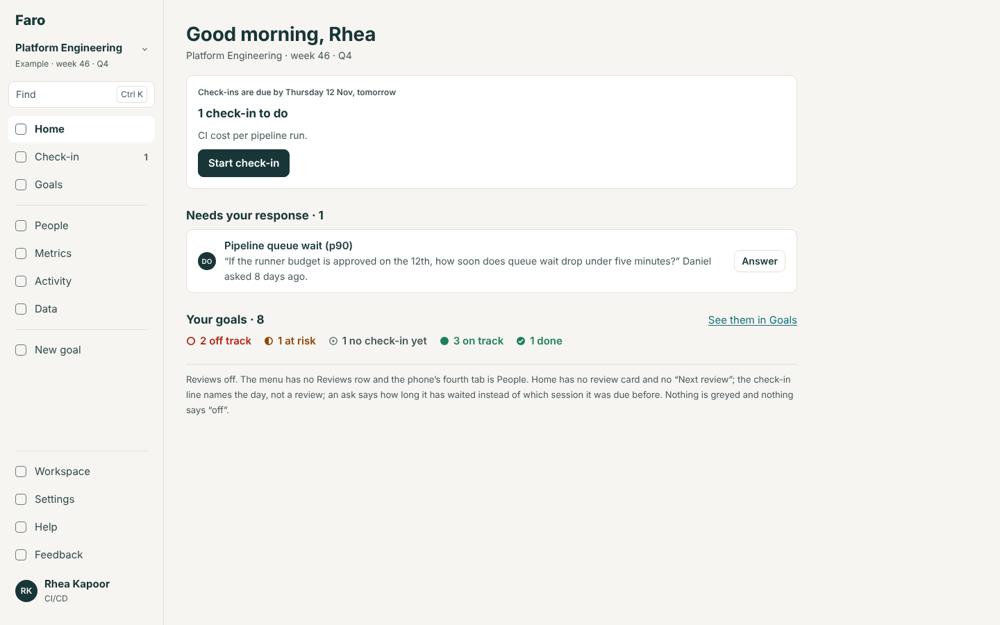
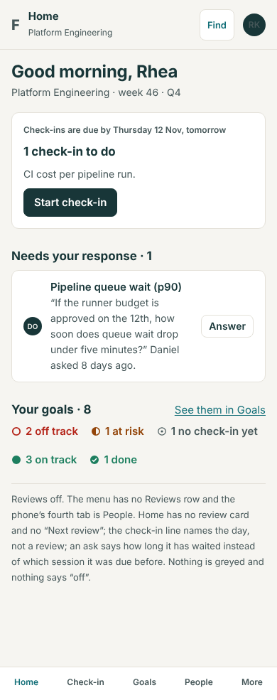
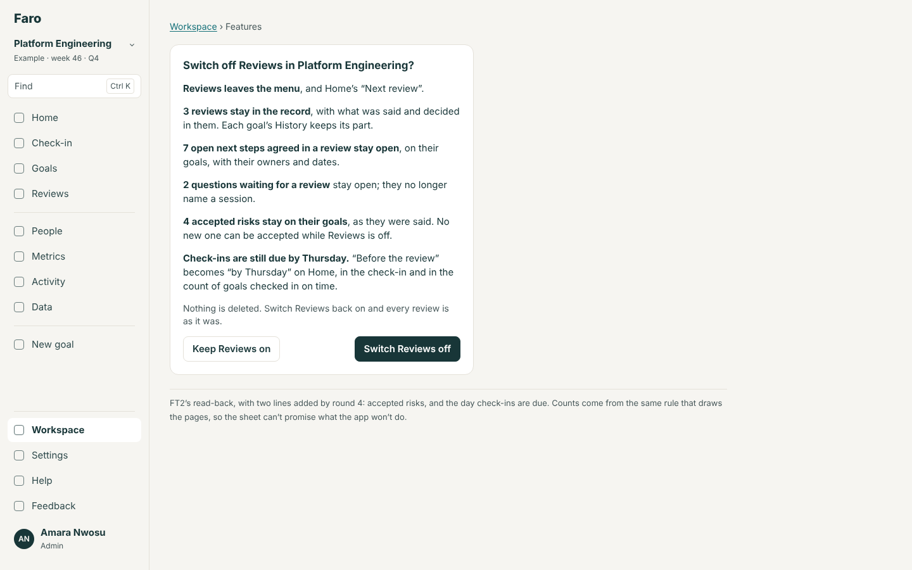
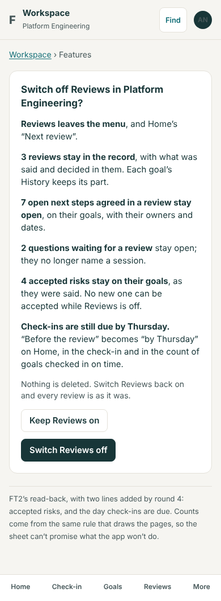
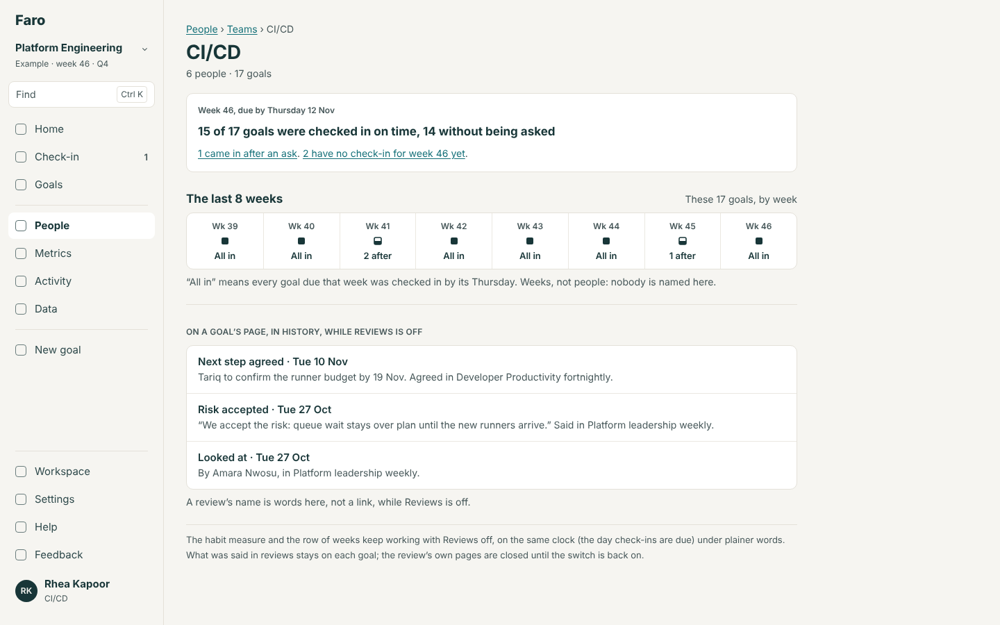
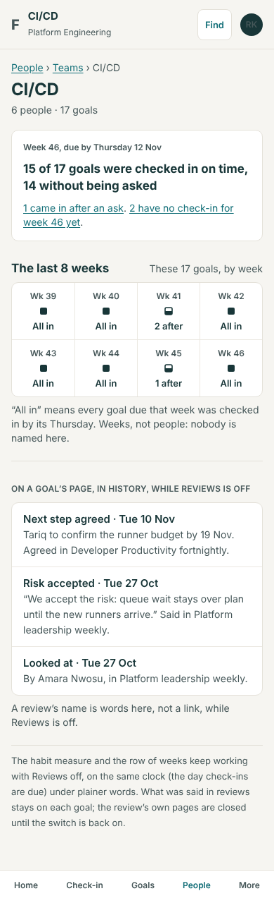

# Reviews as a feature switch (RS): the build spec

13 November 2026. Round 4, item 5 (`../README.md`), added the same day at Lane's request: a design pass first. A design, not a build. It assumes Lane takes the recommended answer to questions 18 to 22.

**Most of this is already designed and approved.** Round 2's **FT2** (`docs/design/feature-toggles/README.md`, 2.2 to 2.4, and `spec.md`, sections 1.2, 3, 4 and 6) designs Reviews as a switch, screen by screen, and Lane took its recommended answers on 11 November. It is not built: Reviews is core code on main, and `Workspace.tsx` still says "Goals, check-ins, reviews and people are always on." This file does not restate FT2. It says what has changed since (HM1, HM2 and RV7 have merged; round 4 added four things that read reviews), settles what FT2 left open, and answers the question of small workspaces. Where the two disagree, this is the later decision.

**Standing rules** (`CLAUDE.md`): its section of `spec/`, conformance rows, a rebuild stage (FT2's `stage-6-module-reviews`), `npm run spec`, What's new and the guide, its evals, the quality gate; the shell changes, so the full `npm run evals`. No table, no migration. After the tools change, `npm run build:mcp`.

## The problem

Reviews can't be switched off yet, and the design that lets them be was written before Home's lead, the habit measure, the short review and the week view existed. Each of those names "the review", and three of them count against it as a clock. A team that doesn't hold reviews would see a habit measure called "before the review", a Home that leads with a session nobody holds, and asks that are "due before" a meeting that doesn't exist.

## Options

| | What | For | Against |
|---|---|---|---|
| A | **FT2 as written**, nothing more | Approved; ready to build | Leaves the habit measure, the team's page, the week view and "Accept the risk" undefined with Reviews off; the build would decide them one by one |
| B | **FT2, plus a short addendum** (this file): one clock that never needed a review, plainer words for it, and a line for each thing round 4 added | Small; nothing approved is reopened; the measure keeps working | Two files to read (FT2, then this) |
| C | **Start again**: design "no reviews" as its own way of working, with its own Home and rhythm | Could be more thorough | Reopens eleven answers Lane has given; a second product |

**Recommended: B.** Built as FT2 (already next on track 4), then one small part, RS1, for round 4's words.

## 1. Routes

FT2's, unchanged: the seven `/reviews…` routes and `/help/reviews` show "Page not found" with "**Reviews is switched off in {ws}.** An admin can switch it on in Workspace, Features."; `/goals/:id?review=` drops the parameter. One more, from round 4: `/goals?…&view=week&review=<id>` (the week view for a review's goals) drops `review`.

## 2. What goes, what stays, what changes its words

"Off means absent": no empty block, no greyed control, nothing that says "off" outside Workspace → Features and the closed pages.

| Thing | With Reviews off | Decided in |
|---|---|---|
| The menu row, its count, the phone's tab | Gone; the phone's tabs are Home, Check-in, Goals, People, More | FT2 |
| Review pages, the walk, the agenda, "Mark reviewed", Finish review, carry-forward ("Last time we talked") | Gone | FT2 |
| The short review (round 4, SM) | Gone with the rest; nothing replaces it | Here |
| Home's review lead (HM1, rank 50) and "{review} is today" in the check-in lead | Not in the chain: the lead falls to the next that applies (asks, check-ins, watched goals needing attention), as `feature-switches/spec.md` 2.2 orders it | FT2; here for HM1's merged shape |
| Home's "Next review" cell | Not drawn | FT2 |
| An ask's "Due before {review}'s session" (HM2) | "{Daniel} asked 8 days ago." An ask is late by its own age, as HM2's rule already has for an ask with no session | FT2, HM2 |
| Asks, questions, next steps | Unchanged. They are the goal's, not the review's. New ones are made on the goal's page. An old one's "agreed in {review}" stays as words, not a link; a new one says "agreed on {date}" | FT2 |
| "Being handled" | Unchanged: it reads next steps and answered asks, not reviews | FT2 |
| **Accepted risks** | The ones made stay on their goals, in History, as they were said. "Accept the risk" is the review's own action and goes with it; nothing on the goal's page replaces it. An accepted risk never changed a status or a count, so nothing shifts | Here (question 20) |
| "Looked at by…" | No new ones; old ones stay, unlinked | FT2 |
| **The day check-ins are due** | Unchanged. It is one field (`Cycle.reviewDay`) that has always been the due day; with Reviews off it is called "the day check-ins are due" everywhere, and the `due` flag reads "Due by {Thu 12 Nov}." in place of "Due before the review in week {w}." | FT2's decision; here for the flag |
| **The habit measure** (round 4) | Kept, on the same clock. Rule 1 of the habit spec already counts "by the end of the due day", so no rule changes; only the words do (2.1) | Here (question 19) |
| The habit panel at the top of a review | Gone with the page. The team's page keeps its panel and row of weeks | Here |
| The receipt's "before {Thursday}'s review" | "…are in by {Thursday}." | Here |
| The week view (round 4) | Unchanged but for its "This week, for these goals" way in from a review. "Gone quiet" reads open asks and open next steps, which stay | Here |
| The streak | Unchanged: it reads the due day | Here |
| Cycle end's reviews line | Left out | Cycle-end spec |

### 2.1 The habit's words with Reviews off

Wireframe 3.

| Place | Reviews on | Reviews off |
|---|---|---|
| The receipt | "All 7 of your check-ins are in before Thursday’s review." / "…2 came after Thursday’s review." | "All 7 of your check-ins are in by Thursday." / "…2 came after Thursday." |
| A team's page, the panel's label | "Before this week’s review" | "Week {w}, due by {Thursday 12 Nov}" |
| The panel's heading | "{a} of {n} goals were checked in before it, {u} without being asked" | "{a} of {n} goals were checked in on time, {u} without being asked" |
| Under the row of weeks | "…was checked in before the review." | "…was checked in by its {Thursday}." |
| Home's cell, the label | "Before the review, without being asked" | "On time, without being asked" |

The habit spec's receipt row for a workspace with no review ("…are in for week {w}.") is replaced by the row above. One function gives the phrase: `dueWords(reviewsOn, cycle, week)`. No screen writes "review" itself.

### 2.2 Switching off, and back on

Wireframe 2. FT2's read-back sheet (`switchOffReadBack`), with two lines added after the questions line:

- "**{n} accepted risks stay on their goals**, as they were said. No new one can be accepted while Reviews is off." (left out at nought)
- "**Check-ins are still due by {Thursday}.** “Before the review” becomes “by {Thursday}” on Home, in the check-in and in the count of goals checked in on time."

The toast, Undo and "Reviews is back on." are FT2's.

**Back on** (FT2, restated because it is the question most asked): every review, its people, its cadence and its record are as they were. A session whose date passed while the switch was off is not "Not held yet": the next session is the next date on its cadence. Carry-forward opens the next session with what was open when the switch went off. The habit's row of weeks has no gap, because it never read reviews.

### 2.3 Past reviews while the switch is off

The record is on each goal (History's Reviews tab, shown while it has entries; a review's name is words, not a link) and in Activity. The review's own pages are closed. There is no read-only "Past reviews" list: a list of pages that can't be opened is the greyed control "off means absent" rules out, and an admin who needs to read one switches Reviews on, reads and switches it off; nothing is lost either way.

### 2.4 A small workspace

Round 4's answer 4a stands: a new workspace starts with Reviews on, weekly, and a review of twelve goals or fewer is one page. Set-up's "No reviews" stays where ST2 put it, under "Change how you’ll work" ("**No reviews** · Reviews stays out of the menu. Switch it on later in Workspace, Features."). A team that chooses it gets exactly the workspace this file describes, and SM's rule 1 has nothing to add: the row is not drawn because the switch is off, not because it is empty. A workspace with Reviews on and no review yet keeps its Reviews row (SM's rule 1 applies only to rows of modules that name a collection to wait for; Reviews names none, since setting up the first review is what the page is for).

## 3. Who sees what

FT2's: an admin switches it; everyone else sees the app without it. On a closed page a member is told once who can switch it on.

## 4. Rules

- **FT2's rules stand**: `menuFor` and `tabsFor` take `reviews`; the six review actions refuse with "Reviews is off in {ws}."; `switchOffReadBack` counts.
- **Rule RS1. One phrase for the clock:** `dueWords(reviewsOn, cycle, week)` returns the phrases in 2.1 and the `due` flag's sentence. `attention.ts`, `home.ts`, the receipt and `habit.ts` call it.

| Given (due Thu 12 Nov) | `dueWords` |
|---|---|
| Reviews on; a review on the due day | "before Thursday’s review" |
| Reviews on; the workspace has no review set up | "by Thursday" |
| Reviews off | "by Thursday" |

- **Rule RS2. The read-back's two new counts**: accepted risks on live goals; and the due day's name.
- **Nothing in `habit.ts`, `week.ts` or `progress.ts` reads a review** (a `checkLayers` line), which is what lets the switch be a switch: the test in `feature-switches/README.md` ("a feature can be switched off if no core rule reads its records") must still pass after round 4 is built.

## 5. The import, the MCP server and the rebuild kit

- **Export**: as the import spec has it, `workbook()` leaves out the Notes sheet and the Review column on Asks. **Import**: a workbook that has them is not refused; the preview says once, "Reviews is off in {ws}, so the Notes sheet and the Review column were not read.", and the rest is checked as usual.
- **MCP**: `list_reviews`, `get_review`, `review_call`, `edit_call`, `save_review`, `end_review` and `delete_review` answer with the sentence the built tools already use for a module that is off ("Reviews is switched off in {ws}, so {tool} can’t be used there. An admin can switch it on in Workspace, under Features."), in place of FT2's section 6 wording, so there is one pattern. `get_my_work` leaves `reviews` out. Nothing else changes: `post_check_in` and the asks tools never needed a review.
- **The rebuild kit**: FT2's `module.json` for Reviews (`rebuild: { status: "outline" }`, `stage-6-module-reviews.md`) gains conformance rows for this file: the clock's words with the module off; the habit measure's examples with no reviews; a closed page's sentence; switching back on. R5 gains one line: the measure is "on time, unasked" where a workspace holds no reviews.

## 6. What the rebuild should copy

- **Reviews are a module the weekly loop does not depend on.** Check-ins, their due day, the habit measure and what is asked of people stand without them.
- **One function names the deadline,** so no screen can say "the review" when there isn't one.
- **Off means absent, and off never deletes**: what a review produced lives on the goal, so it stays readable with the module off.
- **The read-back before switching off says what will change in words the app then keeps.**

## 7. Evals

FT2's journeys, plus `REVIEWS-OFF-WORDS`: with Reviews off, no page at 390 or 1440 contains "review" outside Workspace → Features, History's unlinked names and the closed-page sentence; the receipt says "by Thursday"; a team's panel says "on time". `REVIEWS-BACK-ON`: a session whose date passed while off is not "Not held yet"; the habit row has eight cells before, during and after. N-check: every review tool's refusal is the one sentence. Unit tests: RS1's table. Requirement: `REVIEWS-SWITCH-CLOCK`.

## 8. Help and What's new

Guide: "Features" (what switching Reviews off keeps and changes); "Check in" and "A team" (the words without reviews). What's new, with FT2's entry: "Reviews can be switched off, and nothing they saved is lost".

## 9. The first-download budget

FT2's shell change (`menuFor` taking `reviews`) and Home's shorter lead chain are in the first download and must net nought: with Reviews off the review lead's branch is skipped, not replaced. `dueWords` is a few lines in a file Home already loads; if it does not fit, Home takes the phrase from `reads.ts` and the function stays in the lazy chunks. Everything else here is in lazy screens.

## 10. If Lane decides otherwise

| Question | Answer | Changes |
|---|---|---|
| 18 | (b) start again | A new pass; FT2 waits |
| 18 | (c) FT2 only | Drop RS1; the build settles round 4's words as it meets them |
| 19 | (b) hide the measure | With Reviews off the team's panel, the row of weeks and Home's cell are not drawn; `habitShown` takes `reviewsOn` |
| 19 | (c) a separate "team check-in day" | A new setting and a migration; `Cycle.reviewDay` splits in two |
| 20 | (b) on the goal's page | "Accept the risk" becomes a core action on a goal for an admin or the goal's reviewer; it leaves the Reviews module, with its rule and its History entry |
| 21 | (b) a read-only list | Activity gains "Past reviews", each a read-only page; the seven routes stay closed for writing only |
| 22 | (b) off at eight people or fewer | Set-up writes `reviews: false` for them; Home offers "Set up a review" in week 3 (as round 4's 4c) |
| 22 | (c) set-up asks everyone | "Do you look at the goals together?" becomes a question on step 1, in place of the sentence |

## 11. Build plan

| # | Part | Size | Needs |
|---|---|---|---|
| FT2 | The switch, as designed in round 2 | M | Next on track 4 already |
| RS1 | `dueWords`; the read-back's two lines; the habit's words; the tools' one sentence; the import's line; the conformance rows | S | FT2; HB1 for the receipt, HB2 for the team's page (whichever lands later carries the words) |

## Mock-ups

| # | Screen | 1440 | 390 |
|---|---|---|---|
| 1 | Home with Reviews off |  |  |
| 2 | Switching Reviews off: the read-back |  |  |
| 3 | A team's page and a goal's History with Reviews off |  |  |
