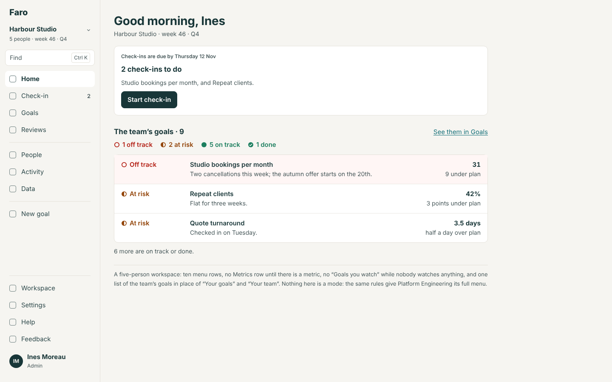
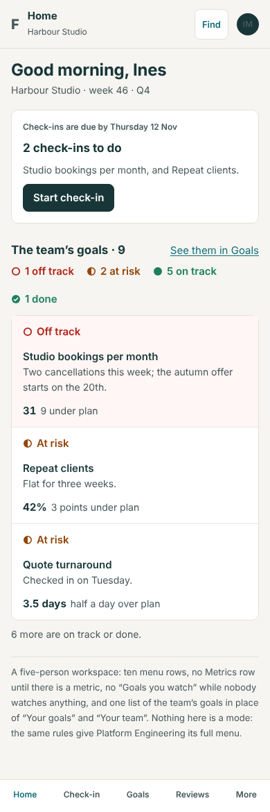
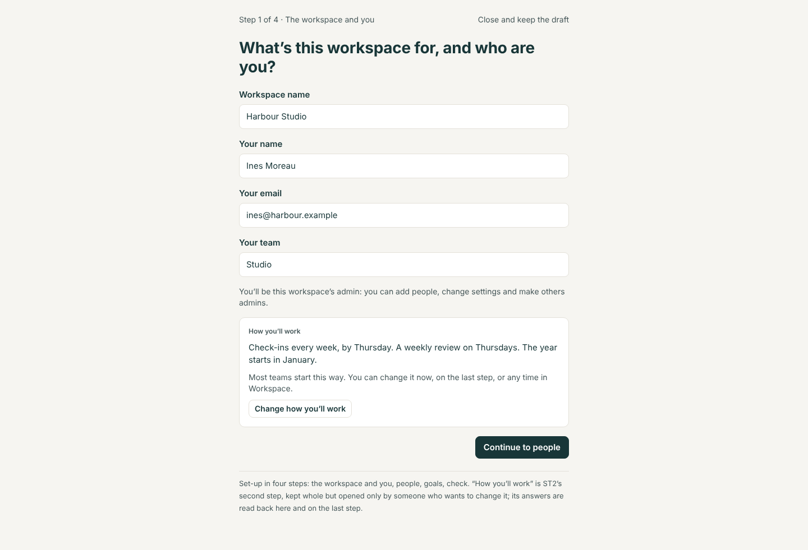
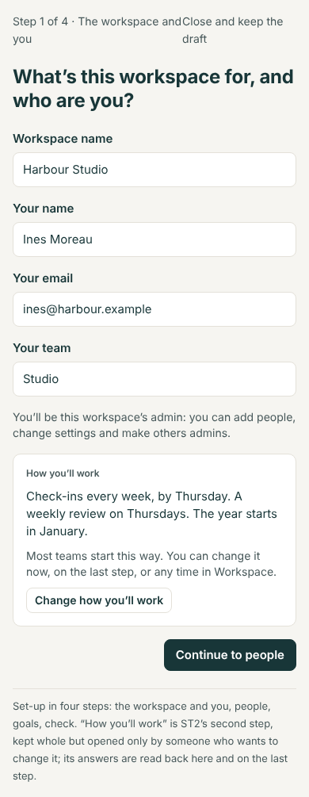
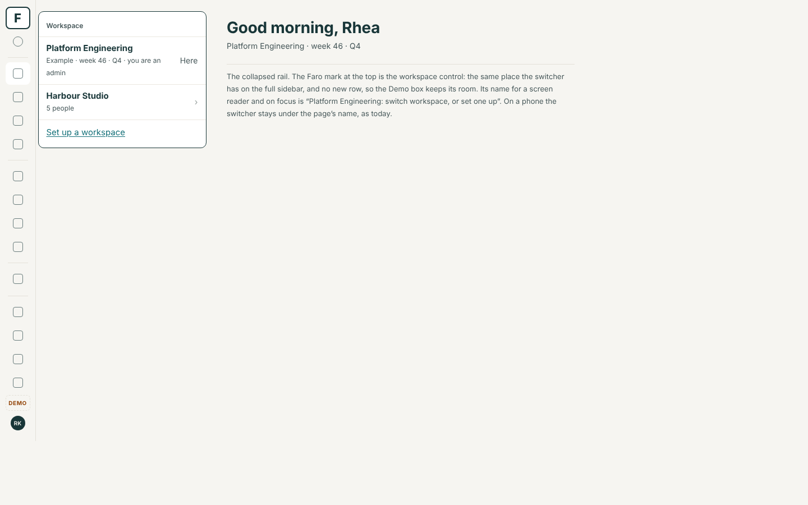
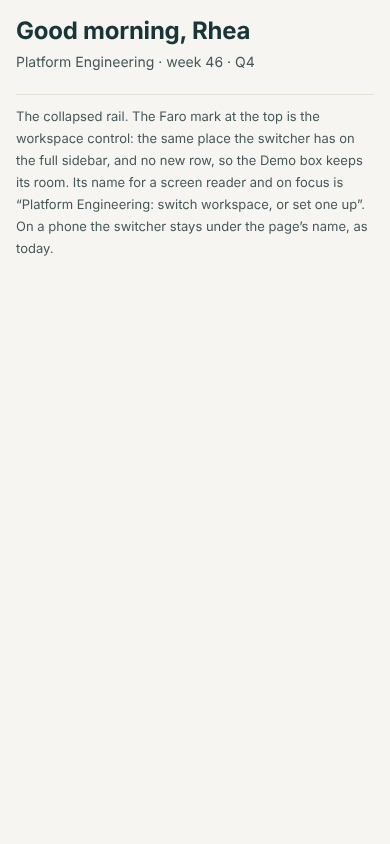
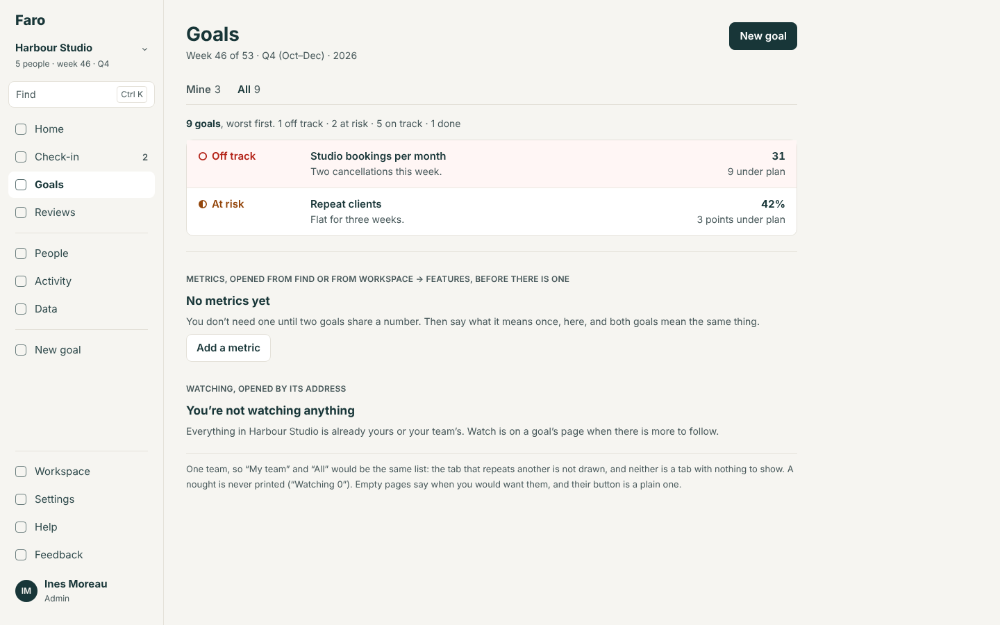
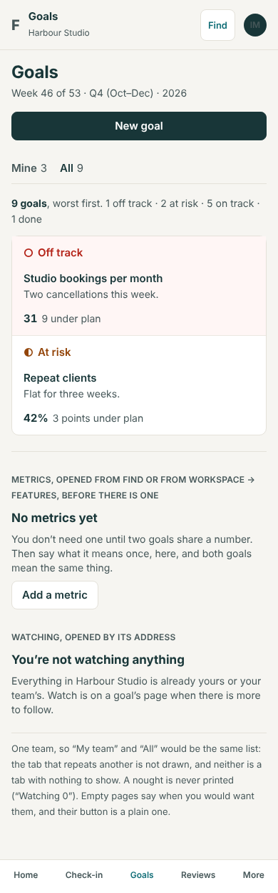

# Small workspaces (SM): the build spec

13 November 2026. Round 4, item 1 (`../README.md`). A design, not a build. It assumes Lane takes the recommended answer to questions 1 to 5; "If Lane decides otherwise" says what changes. It builds on the set-up spec (`docs/design/setup/spec.md`, ST2), the navigation spec, the feature-switches design (its decision 4) and the reviews spec.

**Standing rules** (`CLAUDE.md`): each part adds its section of `spec/` and conformance rows, runs `npm run spec`, adds a What's new entry and updates the guide, comes with its evals, and passes the quality gate. SM1 and SM4 change the shell, so they run the full `npm run evals`. No table, no migration.

## The problem

A team of five gets the frame built for ninety-seven people. Set-up has seven steps. The menu has thirteen rows, one of them an empty Metrics page. Goals has four tabs, of which "My team" and "All" are the same list and "Watching" says 0. The weekly review walks nine goals with an agenda made for a hundred. Nothing is wrong, but the app reads as a big tool half filled in, not a small one that is finished.

## Options

| | What | For | Against |
|---|---|---|---|
| A | **A size setting** on the workspace ("Small team" / "Division") that picks a menu, a set-up and a rhythm | Says what it does | Two products to build, test and explain; a team that grows must be told to change it; the rebuild copies a switch, not a rule |
| B | **A "start simple" preset** at set-up that switches Metrics, Reviews and Watching off (feature-switches 4b) | Uses switches that exist | Hides the weekly loop, which is the idea most worth copying; off is harder to find than empty; only an admin can undo it |
| C | **By rule, no mode.** Rows, tabs and sections are drawn when they have something in them; a nought is never printed; set-up is shorter for everyone; a short review is one page | One product; a workspace grows into its menu by using it; the big demo is unchanged | A row that appears later needs saying once; the rules must be exact (below) |

**Recommended: C.** It keeps feature-switches' recommended answer (4a, no preset) and makes the question moot: an unused module costs a small workspace nothing on screen.

## 1. Routes

| Address | Change |
|---|---|
| `/workspace/new/how` | No longer a step. It opens as a sheet over step 1 or the last step ("Change how you'll work"); opened directly, it goes to step 1 with the sheet open |
| `/workspace/new/workspace`, `/people`, `/goals`, `/check` | "Step {n} of 4" |
| `/goals?scope=team` | When "My team" is not drawn (rule 1), goes to `scope=all` |
| `/goals?scope=watching` | Still opens when the tab is not drawn, on its quiet empty page (2.4) |
| `/metrics` | Still opens when its row is not drawn |

## 2. Screens

### 2.1 The menu, and Home, in a small workspace

Wireframe 1. For Harbour Studio (five people, one team, nine goals, no metric): "Your work" is Home, Check-in, Goals, Reviews; "Look up" is People, Activity, Data; then New goal; then Workspace, Settings, Help, Feedback. Ten rows where the demo has thirteen plus three saved views.

- **Metrics** is not a row until there is a metric (rule 1). When the first is saved, the row appears and the save's toast says "Metrics is now in the menu."
- **Check-in** shows only to someone who owns a goal, as today.
- **Home**: "Goals you watch" is not drawn while the viewer watches nothing. With one team, "Your goals" and "Your team" (HM3) would repeat each other for most people, so Home draws one section, "The team's goals · {n}", the viewer's own first.
- **No count of nought** anywhere in the menu, the tabs or Home's sections (rule 2).

**Primary action:** Home's own (HM1), unchanged.

### 2.2 Set-up in four steps

Wireframe 2. ST2's steps, with "How you'll work" folded into the first.

| Step | Heading | Asks |
|---|---|---|
| 1 of 4 | "What’s this workspace for, and who are you?" | As ST2's 2.3. Under the fields, a panel: label "How you’ll work"; `howLines(HOW_DEFAULT)` and the year, as one paragraph ("Check-ins every week, by Thursday. A weekly review on Thursdays. The year starts in January."); "Most teams start this way. You can change it now, on the last step, or any time in Workspace."; a plain button "Change how you’ll work", which opens ST2's 2.4 whole, as a sheet |
| 2 of 4 | People | As ST2's 2.5 |
| 3 of 4 | Goals | As ST2's 2.6 |
| 4 of 4 | Check | As ST2's 2.7; its "How you'll work" lines gain "Change", which opens the same sheet |

- The button reads "Continue to people"; with a changed answer the panel reads the new sentences back and the hint becomes "Changed from the usual."
- Nothing in what set-up writes changes (set-up spec, rule S3).

**Primary action:** "Continue to {next step}"; on the last step, "Create {name}".

### 2.3 Goals' tabs

Wireframe 4. A tab is drawn when its list is not empty and is not the same list as a tab before it (rule 1).

| Workspace | Tabs |
|---|---|
| One team, nobody watching | Mine 3 · All 9 |
| One team, the viewer owns nothing | All 9 |
| The demo, as Rhea | Mine 8 · My team 17 · Watching 12 · All 126 (as today) |
| The demo, as someone watching nothing | Mine · My team · All |

"All" is always drawn. The address still accepts every scope.

### 2.4 Empty pages

Wireframe 4. An empty page says what is true, then when you would want it, and its button is a plain one, not the page's primary.

| Page | Today | Becomes |
|---|---|---|
| Metrics, none | "No metrics yet." "A metric says exactly what a number means, so every goal that uses it means the same thing." **Add a metric** | "No metrics yet" · "You don’t need one until two goals share a number. Then say what it means once, here, and both goals mean the same thing." · "Add a metric" (plain) |
| Watching, none, with other people's goals to watch | "You’re not watching anything yet" and two buttons | "You’re not watching anything" · "Watching puts the goals you care about in one place. Watch is on every goal’s page." · "Pick goals from the list" (plain). "Watch every {level} goal ({n})" stays only when there are ten or more such goals |
| Watching, none, and every goal is the viewer's or their team's | The same | "You’re not watching anything" · "Everything in {ws} is already yours or your team’s. Watch is on a goal’s page when there is more to follow." No button |
| Reviews, none | "No reviews yet" … **Set up the first review** | Unchanged: this page's purpose is the button |
| Activity, none | "Nothing here yet" | "Nothing has changed in {ws} yet." |

### 2.5 A short review

A review of twelve goals or fewer (`SHORT_REVIEW = 12`, in `thresholds.ts`) is one page: every goal, worst first, each row with "Reviewed" beside it; no "Start the review" walk, no "Still to review" and "Nothing flagged" split. Its primary action is "Mark the rest reviewed", which asks once: "Mark {n} goals reviewed? They had nothing flagged." Asks, actions and carry-forward are as today. Above twelve, today's agenda. Set-up still makes one weekly review; the reviews line and `reviewEvery` are unchanged.

### 2.6 The switcher on the icon rail

Wireframe 3. The Faro mark at the top of the rail is the control. Pressing it opens the same panel as the sidebar's "Switch": this workspace (its name; "Example · …" where it is one; "you are {an admin | a member}") marked "Here"; the viewer's other workspaces; "Set up a workspace". Its accessible name and its label on focus are "{ws}: switch workspace, or set one up". No row is added to the rail, so the Demo box keeps its room at 1024 × 768 (P10). The full sidebar and the phone are unchanged.

## 3. Who sees what

Everyone sees the same rules applied to what they have. An admin gets no extra rows for empty modules; Workspace → Features lists every module with what is in it ("Metric library · on · nothing in it yet · Open"), which is the admin's way in.

## 4. Rules for `src/domain`

### Rule 1. A row, tab or section waits: `drawn(place, facts)`

- **A module's menu row** is drawn when the module is on and the collection its `module.json` names in `menu.waitsFor` has a live row in the snapshot. A module that names none is always drawn (Spreadsheets). The core counts; no module code runs.
- **A Goals tab** is drawn when its list has a goal and differs from every tab drawn before it, in the order Mine, My team, Watching, All. All is always drawn.
- **A Home section** ("Goals you watch", "Your team") is drawn when it has a goal, and "Your team" is folded into "The team's goals" when the workspace has one team.
- Hiding is only ever drawing: every address still opens.

| Given | Then |
|---|---|
| Metrics on, no metric | No Metrics row; `/metrics` opens on 2.4 |
| The first metric saved | The row is drawn; the toast adds "Metrics is now in the menu." |
| The last metric deleted | The row is drawn until the next visit, then not |
| One team of five; Ines owns 3 of 9 goals | Mine 3 · All 9 |
| Two teams; Ines's team owns all 9 | Mine 3 · All 9 (My team equals All) |

### Rule 2. A nought is not printed: `countWords(n, noun)`

A count beside a tab, a menu row or a section's name is left out at nought. A sentence may still say none ("None need attention").

### Rule 3. Set-up's steps

`SETUP_STEPS = ['workspace', 'people', 'goals', 'check']`; `stepCounter` is "Step {n} of 4". `how` is a sheet, not a step; `firstUnfilled` no longer returns it.

### Rule 4. A short review: `reviewShape(goals): 'page' | 'walk'`

`'page'` at `SHORT_REVIEW` goals or fewer, counted when the session opens.

## 5. What the rebuild should copy

- **Size is never asked.** The frame follows what is in the workspace, by rules that can be tested with a table of examples.
- **Hiding is drawing only**: nothing hidden is switched off, and every address works.
- **One set-up for every team**, whose defaults are said in a sentence rather than asked as a step.
- **The switcher is in the same place at every width.**
- The platform's sign-in, invitations and directory sync replace set-up's people step (R1, R2, R6a); the rules above still apply after it.

## 6. Evals

| Part | Journey or check |
|---|---|
| SM1 | `SMALL-MENU`: a five-person workspace has ten menu rows; adding a metric adds the row and the toast says so. N-check: every hidden row's address opens. The demo's menu is unchanged (existing U-checks) |
| SM2 | `SMALL-QUIET`: no "0" beside a tab or row at 390 and 1440; the four empty pages' words; P6 on each |
| SM3 | `SETUP-FOUR`: four steps; the "how" sheet opens from step 1 and from Check and its answer is read back; what is written equals ST2's |
| SM4 | `RAIL-SWITCH`: at 1024 × 768 the rail's mark opens the panel, the Demo box is fully visible (P10), and focus returns to the mark on Escape |

Unit tests: rule 1's and rule 4's tables. Requirements: `SMALL-BY-RULE`, `SETUP-FOUR-STEPS`, `REVIEW-SHORT`.

## 7. Help and What's new

- Guide: "Set up a workspace" (four steps); "The menu" (a row appears when it has something in it; where Metrics is before then); "Reviews" (a short review).
- What's new, one per part: "The menu shows what you use" (SM1); "Empty pages say when you'd want them" (SM2); "Set-up in four steps" (SM3); "Switch workspace from the narrow menu" (SM4).

## 8. The first-download budget

The shell is in the first download. Rule 1 for menu rows must add nothing net: `menu.waitsFor` is data, and the count reads the snapshot. The switcher's panel (list, search, "Set up a workspace") moves to a chunk loaded on first open; SM4 does this first and records the size before and after in its PR. Set-up, Goals, Reviews and the empty pages are lazy already.

## 9. If Lane decides otherwise

| Question | Answer | Changes |
|---|---|---|
| 1 | (b) a preset | Add ST2's third question, "Everything" or "Just goals and check-ins"; rule 1 applies only to tabs and sections; SM1 shrinks |
| 1 | (c) a size setting | Not designed here; a new pass |
| 2 | (b) admins always see it | Rule 1 takes the viewer's role; one more row in its table |
| 2 | (c) always there | Drop the menu part of rule 1; 2.4 stands |
| 3 | (b) five steps | Drop 2.2 and rule 3; SM3 is ST2 as written |
| 3 | (c) one step | People and goals move to "Your first week" (set-up spec 2.9); a larger change, sized again |
| 4 | (b) every 2 weeks proposed | `HOW_DEFAULT.reviewEvery` becomes 2 when eight or fewer people are entered, which needs People before the panel; 2.5 stands |
| 4 | (c) no review at first | Set-up writes `reviews: false` at eight or fewer; Home offers "Set up a review" in week 3 |
| 5 | (b) behind your initials | The panel's rows join that menu; the mark stays a picture |
| 5 | (c) its own icon | The Demo box moves into the initials' menu; P10 is re-run |

## 10. Build plan

| # | Part | Size | Needs |
|---|---|---|---|
| SM4 | The rail's switcher; the panel made lazy | S | Nothing |
| SM2 | No noughts; the quiet empty pages | S | Nothing |
| SM3 | Set-up in four steps | S on top of ST2 | ST2 |
| SM1 | Rows, tabs and sections that wait; the short review | M | A quiet week in the shell; HM3 for Home's section |

## Mock-ups

| # | Screen | 1440 | 390 |
|---|---|---|---|
| 1 | Home and the menu in a five-person workspace |  |  |
| 2 | Set-up, step 1 of 4 |  |  |
| 3 | The icon rail, with the switcher open |  |  |
| 4 | Goals' tabs, and two empty pages |  |  |
