# Settings, not switches

11 November 2026. Round 3 of the redesign (`docs/design/round-3/README.md`), area 6. Analysis, a recommendation and a design. Nothing here is built, and no app code was changed. The build spec is [spec.md](spec.md).

## The answer in six lines

1. **Four things become settings; everything else stays in code, and the kit says so.** Levels, the status thresholds and the streak now; how the year is read (quarters, terms, halves) later. All four live on the cycle, beside the rhythm, so no rule changes where it gets its inputs.
2. **Levels are a label with an order, not a rule.** No right, no "what may feed what" and no status reads a level. So a workspace may name them, add and remove them (one to six), and Faro only keeps the order. The cost is breadth, not depth: the three levels are written out in 13 places and named in 54 source files.
3. **A status is already stored, so the past already keeps itself.** Each check-in holds the owner's call and what the numbers said that week (`CheckIn.status`, `CheckIn.calculated`). Changing a threshold therefore changes no status today. What must be built is that the live rules take the thresholds *of the week they judge*, so nothing already posted is read twice in two ways.
4. **The start month is already a setting, asked once at set-up and never shown again.** It stays fixed for a running year (check-ins are filed by week number). What can change is how the year is read: four quarters, three terms or two halves.
5. **The streak is a choice under the rhythm**: shown, shown with one late week forgiven, or not shown. Today one late week sets it to nothing, which is the opposite of backlog R5's "streaks forgive".
6. **Words, the week's first day, locale, reason lengths and who-may are not settings.** They are choices a rebuild makes once, in one file each. The kit gains a page that lists them.

About three releases for the part people see (CF1 to CF4), after one refactor that changes nothing (CF1).

## How this was checked

- **The code**, by search and by reading: `src/domain` (`types.ts`, `thresholds.ts`, `status.ts`, `checkin.ts`, `year.ts`, `yearName.ts`, `cycle.ts`, `progress.ts`, `home.ts`, `query.ts`, `map.ts`, `columns.ts`, `changeset.ts`, `review.ts`, `actions.ts`, `vocabulary.ts`, `format.ts`, `trend.ts`), the screens, `src/mcp`, `src/spec`, `supabase/migrations`, `spec/conformance`, `evals/`.
- **The demo**, at `/demo?today=2026-11-11` as Amara (admin), 10:57 UTC on 11 Nov, at 1440×900 and 390×844: Home, Workspace (About, Cycles, Features, Privacy), Settings, Goals grouped by level, a goal's page, Watching, New goal, Set up a review. Home was also read as Rhea.
- **Not run:** unit tests and evals (`node_modules` is not installed). Counts of files and calls are from search.

## Jobs, by role and how often

| Who | Job | How often |
|---|---|---|
| Whoever sets a workspace up | Say what the levels are called, when the year starts, how it is read | Once |
| An admin | Rename a level after a reorganisation; add one; remove one | A few times a year |
| An admin | Loosen or tighten what "on track" means | Rarely; perhaps once a year, usually at a year's start |
| An admin | Stop showing streaks, or make them forgiving | Once |
| An owner | Know what "on track" means here when the numbers offer a status | Every check-in |
| Anyone | Read a level's name on a goal and know what it is for | Every day |
| The team rebuilding Faro | Know which numbers and words are data, which are constants, and where each lives | Once, at the start |

## 1. What is fixed today

### 1.1 What an admin can change today

Walked as Amara. Workspace → About: Rename. Features: two switches (Metric library, Spreadsheets). Privacy: one switch (recording). Cycles: nothing (it reads "2026 · running · Week 46 of 53 · 22 Dec 2025 to 27 Dec 2026"). Settings holds only a person's own choices. Nothing about how the workspace works can be changed after set-up (C12).

### 1.2 Levels

| What | Where | Count |
|---|---|---|
| The type | `Level = 'north-star' \| 'svp' \| 'team'` (`src/domain/types.ts:28`) | 1 |
| The database | `check (level in ('north-star', 'svp', 'team'))` on `okr_goals.level` (migration 0006, line 9) | 1 constraint |
| The labels | `LEVEL_LABEL` (`format.ts:118`): North star, SVP, Team | read in 22 files |
| The list, written out again | `query.ts:57`, `GoalsScreen.tsx:44`, `Review.tsx:332`, `Watching.tsx:18`, `GoalFilters.tsx:247`, `Activity.tsx:150`, `BulkEdit.tsx:46`, `GoalFields.tsx:7`, `mcp/tools.ts:87` and `:162`, `mcp/workTools.ts:37`, `actions.ts:245`, `importer.ts:111`; the order twice more (`query.ts:168`, `GoalWizard.tsx:12`) | 13, and the order twice |
| Source files that name a level, its type or `.level` | search for `'svp'`, `Level`, `LEVEL`, `.level` | 54 outside tests (16 write `'svp'`) |
| The import's words | `LEVEL_WORDS` (`columns.ts:112`): north star, svp, team, with "senior vp", "headline" and "northstar" accepted | 1 |
| Addresses and saved views | `level=svp` (`query.ts:70`, `activity.ts:46`) | 2 |
| AI tools | `find_goals` and the goal tools take a fixed list (`tools.ts:162`, `:202`); `watch`, `save_review` say "north-star, svp, team" (`workTools.ts:471`, `:497`) | 5 tools |
| The spec | `src/spec/internal.ts:334` already says "Goal levels are a fixed three… used across the rules, screens and spreadsheets" as a known limit; 9 files under `spec/` name a level | |
| Evals | 13 eval files and 4 requirements name a level; `LEVELS` says "Team by default, or SVP or North star" | |
| The demo | 12 north star, 44 SVP, 70 team (126) | |

**What reads a level as a rule, and what as a label.**

| Reads it as | Where | What the rule really is |
|---|---|---|
| A label | The tag on rows, cards, the map, print, exports' `[North star]`, Find's words, History's "Level" | The name |
| An order | Sort "Level" (`query.ts:180`), the Board (`GoalBoard.tsx:29`), parents in New goal (`GoalWizard.tsx:139`), Goals grouped by level | Top first |
| "Is it the lowest?" | `level !== 'team'` in 13 places (`goalRows.tsx:115`, `story.ts:200`, `export.ts:325`, `GoalScreen.tsx:429` and `:1053`, `GoalMap.tsx:49`, `CheckInFlow.tsx:401`, `GoalBoard.tsx:52`, `GoalWizard.tsx:258` and `:300`, `GoalEdit.tsx:209`, `Watching.tsx:145`, `LevelTag`) | The everyday level is not tagged |
| "Is it the top?" | `level === 'north-star'` puts roots first on the Map (`map.ts:86`, `:141`); a filled tag (`styles.css:622`); set-up's "· North star" (`Onboarding.tsx:523`) | The first level leads |
| A pick | A watch on a level (`review.ts:307`, `actions.ts:245`); a review's scope (`review.ts:28`); the Level filter; a saved view | "Every goal at this level" |
| A hard-coded favourite | Watching's primary button is "Watch every SVP goal" (`Watching.tsx:146`) | Should be the first level below the top with goals |
| A right | **Nowhere.** No action in `src/domain/actions.ts` or `changeset.ts` tests a level. Round 2's goal-entry decision 11 (who may set a level above Team) is still open and would be the first | |
| What may feed what | **Nowhere.** A north star may feed a team goal today (round 2, E1) | |
| A status or a flag | **Nowhere** | |

So a level is a name, a place in an order, and something to pick by. That is why it can be data.

### 1.3 The status thresholds

| What | Where | Count |
|---|---|---|
| The numbers | `RULES` in `src/domain/thresholds.ts:5–12`: on track 0.95, at risk 0.8, well ahead 1.2, stale 14 days, a stage off track after 2 weeks late; `TREND_SPAN` 3 (`:15`) | 6 |
| Read by rules | `status.ts:99–100`, `:106`, `:111` (a number goal), `:140` (a stage), `:211` (stale) | 5 places, 1 file |
| Read by a screen | `CheckInFlow.tsx:21`, `:708` (a stage's "Slipping" or "Late" worked out in the screen) | 1 |
| Said in words | `vocabulary.ts` lines 47–73 and 273–281 (12 lines); Help (`guide.ts:117`, `:203`); the spec (`rules.ts`, 10 lines; `overview.ts:46`; `build.ts:124–129`) | |
| Who gets them how | `assessMetric(goal, weeks, week, …)`, `assessMilestone(goal, week, updates)`, `assessRange` read the constant as a global. `assessPosted(goal, cycle, …)` has 15 callers and already takes the cycle | |
| The range goal's margin | Per goal (`RangePlan.margin`, `types.ts:69`); New goal starts it at 1 (`goal.ts:45`). Round 2 already settled "none by default" | not a workspace's |
| Evals and the spec | 5 eval files and 2 requirements quote 95% or 80%; 10 files under `spec/` | |

**The fact that decides the design: statuses are stored.** A check-in keeps `status` ("The owner's call. Official everywhere.") and `calculated` ("What the rules calculated when it was posted.") (`types.ts:192–195`). `goalStatus` returns the latest check-in's stored call (`status.ts:211`); "Called greener than calculated" compares the two stored values (`status.ts:213`); History says "the numbers said at risk" from the stored one (`GoalScreen.tsx:1016`); the exports' `Calculated` column is the stored one (`columns.ts:270`). Quarter results (Met, Not met) compare a number with the plan and never read a threshold (`year.ts:92–96`).

What is worked out live, and would move if the constant moved:

- the colour of the gap ("0.3 hours behind plan") on every row and page (`format.ts:96`, through `assessPosted`, 15 callers);
- the summary bar's tone (`summaryFacts.ts:93`), the scorecard (`scorecard.ts:115`, `:166`), "On track today, but the recent trend heads for…" (`trend.ts:93`);
- a stage's "Slipping" or "Late" for **past** check-ins (`changes.ts:56`, `summaryFacts.ts:221` and `:257`, `GoalScreen.tsx:980` and `:1012`);
- what the next check-in offers "from the numbers", whether it asks why (behind under 95%, ahead from 120%: `checkin.ts:195–197`), and what `calculated` it stores;
- `calculated` for a past week loaded from a spreadsheet today (`changeset.ts:876`).

So the stored past is safe and the live reads are not: after a change, last week's row could show a gap in "at risk" colour beside a stored "On track, as the numbers say" (C5). The fix is one idea: **the rules take the thresholds of the week they are judging.**

### 1.4 The shape of the year

| What | Where | Fixed or set |
|---|---|---|
| The month the year starts | `goalYear(year, month)`, `yearStartFor` (`year.ts:136–147`); asked at set-up behind "Change" (`Onboarding.tsx:343`); named "Apr 2026–Mar 2027" by `yearName` | **Already set**, once. Never shown again: About says "2026, week 46 of 53", Cycles "22 Dec 2025 to 27 Dec 2026" |
| 52 or 53 weeks | `yearWeeks` follows the calendar | Worked out |
| Four quarters of 13 weeks | `quarters()` (`year.ts:33–41`): `[1, 2, 3, 4]`, `n * 13` | Fixed, in one function. But "Q" or "quarter" is written in 37 source files, 21 lines of the vocabulary, 11 requirements |
| A year or a shorter cycle | `isYear` is "48 weeks or more" (`year.ts:13`); under that the app says "cycle" and shows no quarters. The spec's own example cycle is 13 weeks | The rules handle both; set-up only makes years; `startNextCycle` keeps the length |
| Weeks start on Monday | `weekOneOf` (`year.ts:129`): the week with the month's first Thursday, as ISO weeks; `reviewDay` counts from Monday; "Monday to Sunday" (`plan.ts:207`); round 2's sheet format `2026-W46` | Fixed, and assumed by the ISO week names |
| The wrap-up opens | The last two weeks (`cycle.ts:88`) | Fixed |

Cheap: showing the start month, and choosing it at set-up (exists). Middling: reading the year in halves or terms (one function and the words). Deep: moving a running year's start (every check-in's week number moves), a week that starts on Sunday (ISO week names stop being true), 4-4-5 calendars.

### 1.5 The streak

- `onTimeStreak` (`progress.ts:62–73`): weeks in a row, back from the latest finished one, with every goal the person owns checked in by the due day. **One late week returns 0** (`:67–68`: "the streak is broken, whatever came before").
- Shown on Home's strip ("On-time streak · 0 weeks · Weeks with every check-in in by Thursday", `Home.tsx:355–359`), after the week's check-ins ("5 weeks in a row on time", `CheckInFlow.tsx:150`), on the posted line of a goal ("· 5 weeks on time", `goalPage.ts:309`), and to the AI (`workTools.ts:150`).
- Only ever about the viewer. No status, flag or list reads it. It cannot be switched off.
- Rhea's Home, today: "On-time streak 0 weeks". Backlog R5's rule is "reward honesty and early warnings, never shame… streaks forgive"; the ideas list has "Team streaks with a grace week, never loss-framed".

### 1.6 The rest

| Thing | Where | Count |
|---|---|---|
| The words | `src/domain/vocabulary.ts`, one file, generated into Help, the legend, exports and the glossary; a check fails a vocabulary word written anywhere else | 489 lines |
| Locale | `'en-GB'` in 28 places in 21 files; dates in UTC | |
| Decimals | Per goal (`Goal.decimals`), up to 3, worked out from what was typed (round 2) | already per goal |
| Reasons and waits | `MIN_REASON` 10 (`checkin.ts:15`, not in `thresholds.ts`), `MIN_STOP_REASON` 10, `RESTORE_DAYS` 30, `UNDO_MS` 10 s (`thresholds.ts:18–22`) | 4 |
| Other numbers the rules turn on, outside `thresholds.ts` | `PROJECTION_WEEKS` 8 (`plan.ts:109`); 13, 4 and 48 (`year.ts`); the wrap-up's two weeks (`cycle.ts:88`); day one's 14 and 28 days (`dayOne.ts:67`) | the spec's "numbers the rules turn on" lists 6 of about 14 |
| Who may | `src/domain/actions.ts` and the R1 table kept true by `actions.test.ts` | code |
| Recording | `Workspace.recording`, a switch on Privacy | exists |

## 2. Findings

| Id | | Finding | Evidence |
|---|---|---|---|
| C1 | High | **The levels are one company's job titles, fixed in a type and a database constraint.** A workspace cannot rename "SVP", and a fourth level cannot be stored | `types.ts:28`; migration 0006 line 9; "SVP" on every tagged row in the demo; `spec/…/internal.ts:334` lists it as a known limit |
| C2 | High | **A threshold changed in code would re-read weeks already posted.** The call and the calculation are stored per check-in, but the gap's colour, the scorecard and a stage's "Slipping/Late" are worked out live from one global constant | `types.ts:192–195` against `format.ts:96`, `summaryFacts.ts:93`, `changes.ts:56` |
| C3 | High | **Nothing a workspace works by can be changed after set-up.** An admin can rename the workspace and flip three switches | Workspace → About, Cycles, Features, Privacy, walked 10:57 UTC |
| C4 | High | **The three levels are written out 13 times instead of read from one place**, and the order twice more | the list in 1.2 |
| C5 | Medium | **The streak punishes one late week with zero**, against R5's own rule, and reads "0 weeks" on an owner's Home | `progress.ts:67–68`; Rhea's Home: "On-time streak 0 weeks" |
| C6 | Medium | **The year's start month is a setting nobody can see.** Chosen behind "Change" at set-up, then never named: no screen says "January to December" or "four quarters" | `Onboarding.tsx:343`; About: "2026, week 46 of 53" |
| C7 | Medium | **Rules about a level are written as tests against two of the names**: "not `team`" 13 times, "is `north-star`" 3 times, and Watching's main button is whichever level is called `svp` | `Watching.tsx:146`; `map.ts:86`; the table in 1.2 |
| C8 | Medium | **A screen works out a rule.** Check-in decides "Slipping" or "Late" itself from `RULES.lateWeeksOff` | `CheckInFlow.tsx:21`, `:708` |
| C9 | Medium | **The import accepts one company's synonyms** ("senior vp", "headline"), and the watch action answers a person with stored codes: "Levels are north-star, svp and team." | `columns.ts:112`; `actions.ts:245` |
| C10 | Medium | **The numbers the rules turn on are in five files, and the spec lists six of about fourteen.** A rebuild reading `spec/` would not find 8 weeks of projection, 13-week quarters or the wrap-up's two weeks as numbers | `build.ts:124–129` against `plan.ts:109`, `year.ts:33–41`, `cycle.ts:88`, `checkin.ts:15` |
| C11 | Medium | **Four quarters are in one function but "Q" is in 37 files**, so halves or terms are a wording job as much as a rule | `year.ts:33–41`; search for `Q[1-4]` and `quarter` |
| C12 | Low | **The streak cannot be left out**, though no rule reads it; three screens call the rule directly | `Home.tsx:51`, `:71`; `CheckInFlow.tsx:140` |
| C13 | Low | **A level saved in a view or an address is a code** (`level=svp`), so a removed level needs an answer there | `query.ts:70`; `activity.ts:46` |
| C14 | Low | **The top level is drawn as a filled, tinted capsule**, the one level given a colour; with levels as data it has no rule to follow, and it sits close to the banned pill | `styles.css:622` |
| C15 | Low | **The AI tools' level lists are fixed in their descriptions** | `tools.ts:162`, `:202`; `workTools.ts:471`, `:497` |
| C16 | Low | **`en-GB` and UTC are written 28 times**; a rebuild for another locale has no one place to change | search for `en-GB` |

## 3. Each candidate, judged

### 3.1 Levels: a setting now (CF1, CF2)

**Names only, or the number and order too?** All three. Names alone would leave a company with four tiers, or two, exactly where it is today; and once the names are data the list is too, so the number is nearly free. The order matters because three displays use it (1.2).

| | |
|---|---|
| Shape | An ordered list, top first, of `{ id, name, hint?, was?, removedAt? }`. One to six live levels. The last is **the everyday level**: new goals start there and it is not tagged. The first is the top: it leads on the Map |
| Default | `north-star` "North star", `svp` "SVP", `team` "Team", with today's hints. An untouched workspace stores nothing |
| Stored | `Cycle.levels` (one jsonb column on `okr_cycles`). On the cycle for the reasons round 2 gave for the rhythm: every rule that needs it already has the cycle, the save function writes whatever columns a row has, and a past year reads with the names it had. `startNextCycle` already copies the cycle whole (`cycle.ts:126`) |
| A goal stores | The level's id, as now. Renaming changes no goal |
| Action | `setLevels`, admins only, logged, one Undo |
| Migration | One column, and the check constraint on `okr_goals.level` is dropped (the action enforces the list) |
| How rules take it | `levelsOf(cycle)` in a new `src/domain/levels.ts`; helpers `levelName`, `isEveryday`, `isTop`, `levelRank`. No rule imports a level's id |
| With one level | Level is never asked or shown: no step in New goal, no filter, no tag, no "Group: By level" |

**Renaming** changes what people read, at once and everywhere, and nothing else. History keeps the words of the day ("set the level to SVP"); the old name is kept in `was` so a spreadsheet exported last month still loads (round 2's rule 5, out and back in changes nothing).

**Adding** puts an empty level in the order. Nothing moves into it.

**Removing a level in use** asks one thing first: where its goals go. Then, in one change with one Undo:

| What | Happens |
|---|---|
| Its goals | Move to the level chosen. Each goal's History says "Level changed from SVP to Team, when SVP was removed" |
| A review that walks "every SVP goal" | Keeps the same goals, picked one by one. An agenda must not empty or double silently |
| A watch on "every SVP goal" | Becomes watches on those goals, for the same reason |
| A saved view or a link with `level=svp` | Matches nothing and says why: "SVP isn’t a level here any more. Clear" (the pattern round 2 set for `status=stale`) |
| The import | "svp" is refused with the levels to use. The removed level's words are never given to another level without a question |
| History and Activity | Still say "SVP" |

**Mid-year:** nothing is time-bound, so there is no "from this week". The read-back is counts of goals, reviews, watches and views (wireframe 2).

**Effort and risk.** CF1 (read the list from one place; nothing changes) S–M, low risk, wide diff. CF2 (set it) M, medium risk: the Goals page, the form and the import are where round 1 and 2 items land.

### 3.2 The status thresholds: a setting now, per workspace, never per goal (CF3)

**Per goal never**, for round 2's reason about the rhythm: a status must mean one thing in one list, and a roll-up over goals judged differently cannot say what its worst is. A goal that needs gentler judging already has two honest tools: its plan's shape, and the owner's call with a reason.

| | |
|---|---|
| Shape | Four whole numbers: on track from (percent of the progress planned by now), at risk from, well ahead from, and the weeks late after which a stage is off track |
| Default | 95, 80, 120, 2 |
| Limits | On track 80–100; at risk 50–99 and below on track; well ahead 105–200; weeks late 1–8 |
| Stored | `Cycle.statusRules`: a short list of `{ fromWeek, onTrack, atRisk, wellAhead, lateWeeks }`. Empty means today's numbers all year |
| Starts | **From next week.** No check-in already posted is judged again, and this week's are all judged alike |
| How rules take it | `rulesAt(cycle, week)`. `assessPosted` already has the cycle. `assessMetric` and `assessMilestone` gain one parameter, the rules for the week judged |
| Not in it | The stale threshold (round 2 made it "two missed check-ins" of the rhythm); `TREND_SPAN`; a range goal's margin (per goal) |

**What changing it does.**

- **Today: no status changes.** Each is its owner's call at their last check-in.
- **From next week's check-ins:** what "from the numbers" offers, whether a reason is asked, and what is stored as calculated.
- **The past:** each check-in keeps its stored call and calculation, and every live read (gap colour, scorecard, stage words, a past week loaded from a file) asks `rulesAt` for *that* week. Weeks 1 to 46 read as they did; closed quarters never used the numbers.
- **The read-back** cannot say "7 goals would read At risk from this week", because that would be untrue: the owner decides. It says what is true: "If this week's numbers were posted again: 6 goals would be offered On track where they were offered At risk…" (wireframe 3).
- **Who is told.** Activity has the entry. The status key, Help and the exports' Words section say the numbers in force, and for the rest of that year also "95% until week 46". A check-in's own History row already says what the numbers said that week. Nobody is notified (telling people things is a later round).

**Effort and risk.** M. Risk medium: it touches `status.ts`, the centre of the conformance data; the guard is that the existing 5,696 status rows and 5,249 check-in rows must not move by a byte.

### 3.3 The shape of the year: the start month stays where it is; how the year is read is a setting later (CF5)

| Part | Verdict | Why |
|---|---|---|
| The start month | **Leave: already a setting at set-up.** Show it (Features, Cycles, About). Not changeable for a running year | Check-ins are filed by week number from the cycle's start. Moving the start renumbers every one. A new start month for the *next* year needs a short bridging year: a platform requirement, not built |
| Quarters, terms or halves | **A setting later** (`Cycle.parts`: 4, 3 or 2) | One function and the words. Nobody has asked; designed here so set-up's "Change" has a truthful answer |
| A cycle shorter than a year | **Leave.** The rules already handle it; say so in the kit | Set-up offering it is a product call nobody has made |
| The week's first day | **A rebuild-time constant** | ISO week names (`2026-W46`), "week 1 has the first Thursday" and the due day all assume Monday |
| 4-4-5 and other calendars | **A platform requirement** | A calendar service, not a number |

### 3.4 The streak: a setting now, in the rhythm's sheet (CF4)

By round 3's test it could be a switch (no core rule reads it). It is not drawn as one because it has no page, record or menu row to switch: it is one line of the rhythm, and it needs a third value. Three choices, stored as `Cycle.streak`:

| Value | Rule |
|---|---|
| **Shown** (default, today's) | One late week sets it to nothing |
| **Shown, and one late week is forgiven** | A late or missed week does not end a streak if the four weeks before it were on time. It is not counted |
| **Not shown** | No streak anywhere. "Due by Thursday", what is still to do and "All in for week 46" stay |

With no set rhythm there is no streak, whatever is stored (round 2). The default stays today's because the brief asks that an untouched workspace behave as now; the forgiving rule is what R5 asks for, and Lane decides whether it becomes the default (decision 4). Effort S, risk low.

### 3.5 The rest

| Candidate | Verdict | Where it is written down |
|---|---|---|
| **The words** (status labels, "check-in", "goal") | **Rebuild-time.** One company has one vocabulary; `vocabulary.ts` is already the one file; a workspace that could rename "At risk" would break the shape-and-word check, the import's status words and every Help page. Level names are the exception, because they are a company's own structure | The kit's new page |
| **Locale and number formats** | **Rebuild-time**, with R3 (time zones) | The kit's page; C16 |
| **Decimals** | **Leave.** Already per goal | |
| **The day check-ins are due** | Round 2, FT1 | |
| **Reasons required** (`MIN_REASON`, `MIN_STOP_REASON`), **`UNDO_MS`** | **Rebuild-time constants.** Move `MIN_REASON` into `thresholds.ts` | The kit's page |
| **`RESTORE_DAYS`** | **A platform requirement** (retention is policy) | R4's page |
| **`TREND_SPAN`, the projection's 8 weeks, "Getting worse"** | **Rebuild-time constants.** The trend is worked out live from history and stored nowhere, so a changed sensitivity would re-read the past with no stored record to hold it, the opposite of thresholds. If the switches area hands these over, this is the answer | The kit's page; the spec's numbers table, completed (C10) |
| **Who may** (R1 as data) | **A platform requirement, not a Faro setting.** The table is code kept true by a test; the internal app's roles come from its directory | R1 |
| **Recording** | **Leave.** Exists, on Privacy | |

## 4. The design

Exact wording, states and rules are in [spec.md](spec.md).

- **Features, "How you work"** holds the settings in this order: Check-in rhythm, Levels, Status thresholds, Goal year (with CF5), then the Reviews switch. Each setting is one sentence of what is set, and "Change".
- **Each Change opens a sheet with its own address** (`/workspace/features/levels`, `/thresholds`, `/year`, `/rhythm`), so Back closes it and a reload stays. On a wide screen the fields are on the left and "What changes for everyone here" on the right; on a phone the read-back sits above the buttons. One primary action each: Save.
- **Three levels of answer, as at every door:** Must fix (a full outline on the field and the words), Check (a question answered before Save), fine.
- **After Save:** a toast that says what is now true, with Undo; an entry in Activity.
- **Under renamed levels** the whole app says the workspace's names in its order. The everyday level is not tagged. A level's tag is plain small capitals, never a filled capsule (C14).
- **Admins only** change a setting. Everyone else reads each on Cycles, as round 2 does for the rhythm.

### Each screen's one primary action

| Screen | Primary action |
|---|---|
| Features | None until a sheet is open |
| Levels | Save levels |
| Status thresholds | Save thresholds |
| Goal year | Save |
| Check-in rhythm (with the streak) | Save |
| Goals, a goal, under renamed levels | None on Goals (a page for reading); the goal’s own |

### Role differences

| | Admin | Everyone else |
|---|---|---|
| Features and its sheets | Sees and changes | Not in their menu (as today) |
| Cycles | The running year's lines, each ending "Change" | The same lines, no link: "Levels: Company, Division and Team." "On track from 95% of the progress planned, at risk from 80%." |
| The status key and Help | The numbers in force | The same |
| Their own streak | On Home, when shown | The same |

### The phone

One column. A sheet is a full page with its breadcrumb; the read-back comes before Cancel and Save; a level's Up and Down are 44 px; numbers are typed with the number keyboard. Wireframes 2, 3, 4 and 7 at 390.

### Wireframes

Drawn with `docs/design/_shared/kit.cjs` (`node docs/design/workspace-settings/mockups/build.cjs`); the HTML is in `mockups/`. Counts of goals by level, people, weeks and check-ins are the demo's on 11 Nov; counts of watches, reviews, views, streaks and of goals a threshold would re-read are examples.

**1. Features, "How you work"**

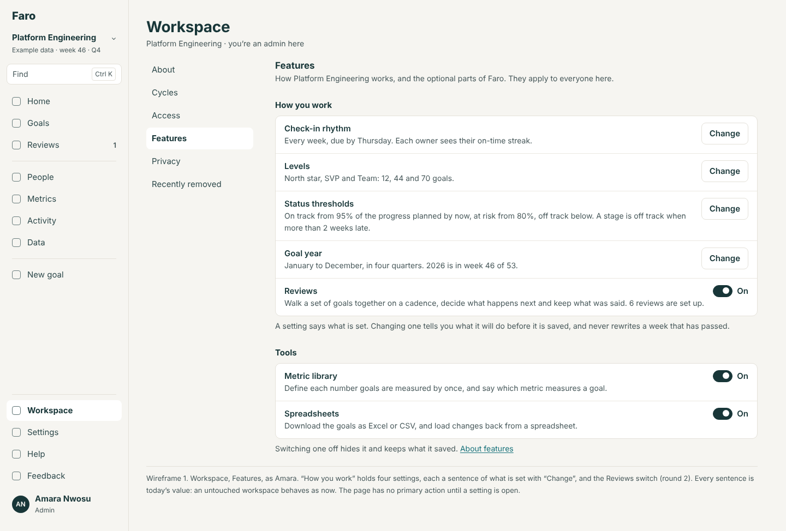
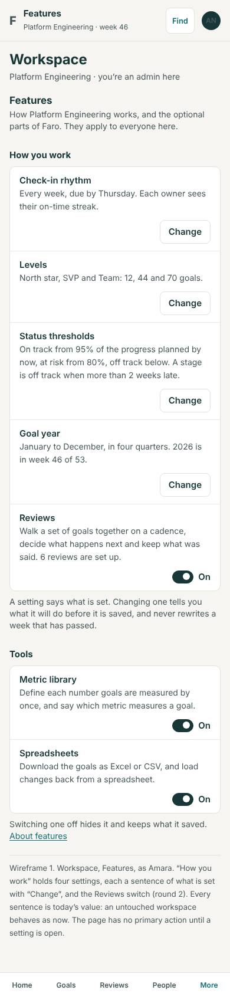

Every sentence is today's value.

**2. Levels: a rename and a level in use being removed**

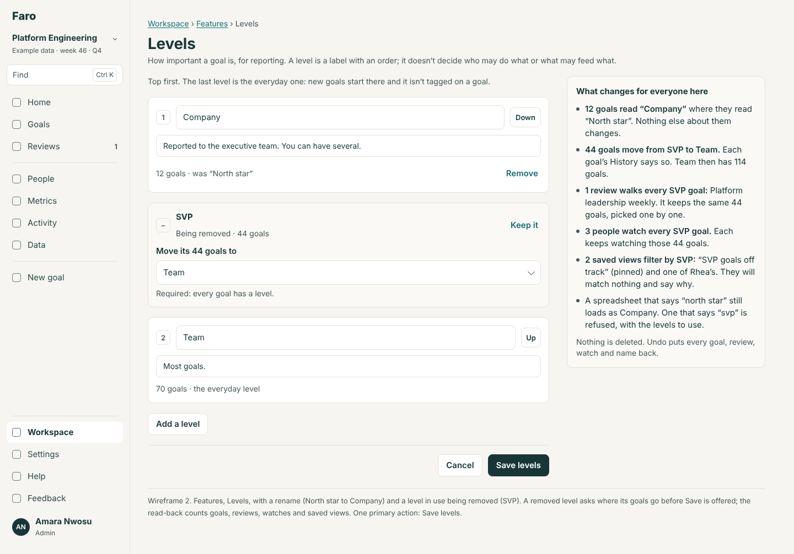
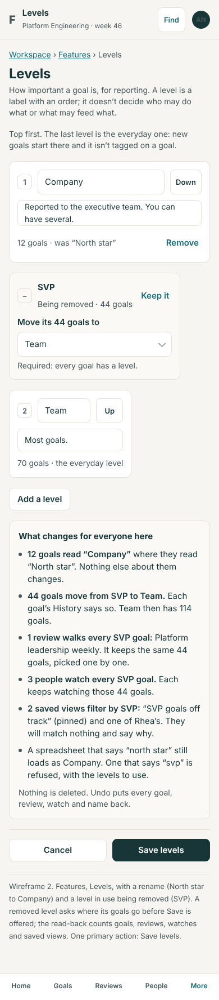

A removed level asks where its goals go. The read-back counts goals, reviews, watches and saved views.

**3. Status thresholds, with the worked example and the read-back**

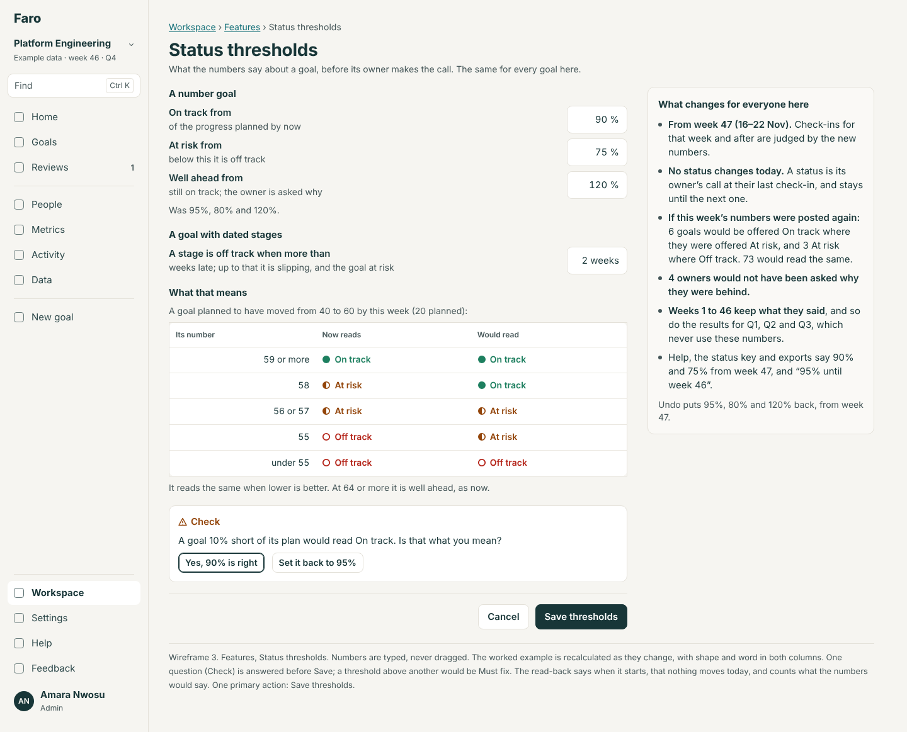
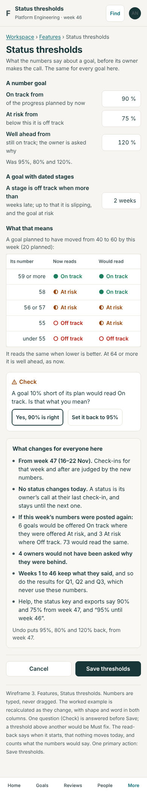

Numbers are typed. The example is worked out again as they change. The phone's order puts the read-back before Save.

**4. The year's shape: on Features, and what set-up's "Change" offers**

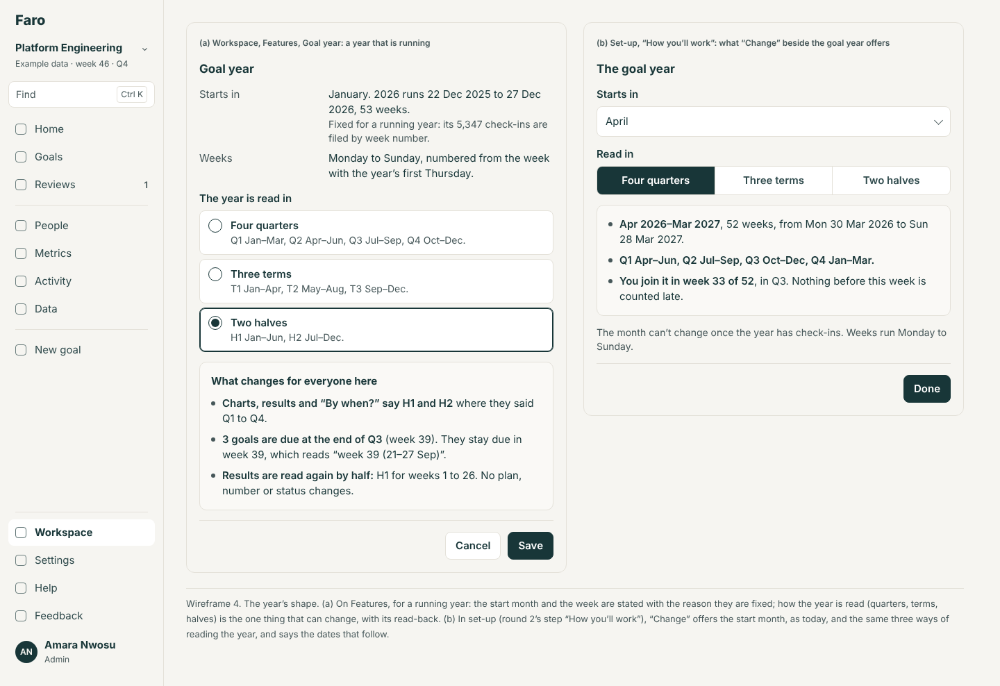
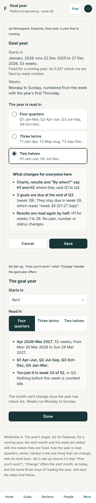

**5. A goal's page under renamed levels**

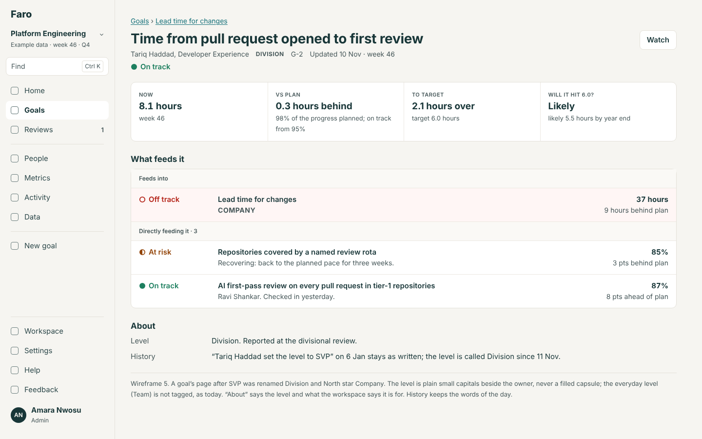
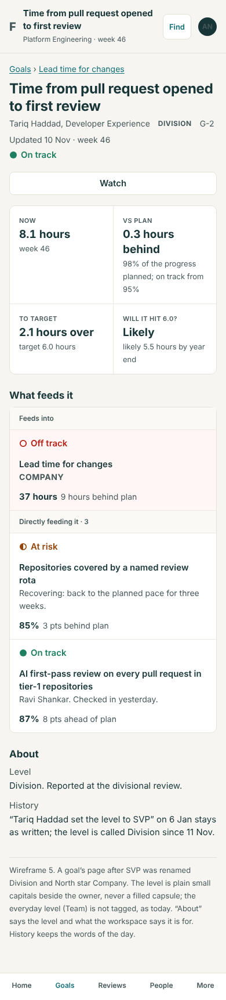

**6. Goals, grouped by level, with four levels**

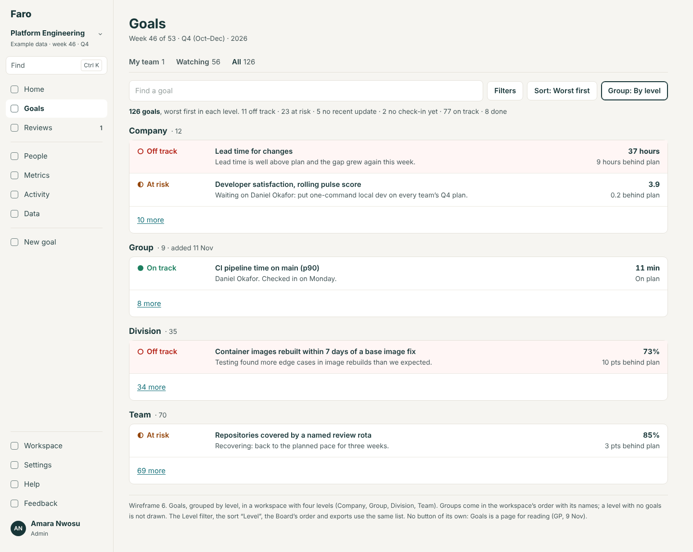
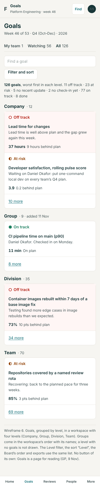

**7. The rhythm's sheet with the streak**

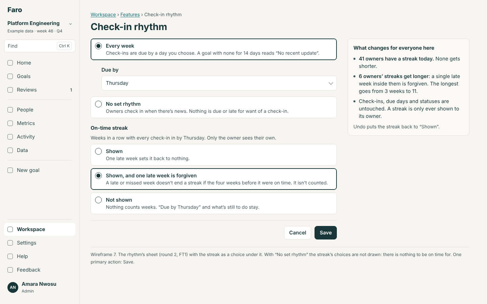
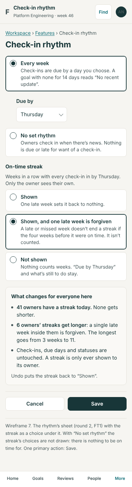

## 5. What the spec and the rebuild kit gain

- **The rules stated with their parameters.** `status.md` says "at least *onTrack* of the planned change, where *onTrack* is the cycle's for the week judged (0.95 unless set)". `goals-page.md`, `map.md` and `finding.md` say "the cycle's levels, in order".
- **A second conformance set**, as FT1 does for the rhythm: `spec/conformance/other-settings/`, the same workspace worked out with four levels and with thresholds of 90, 75, 130 and 3 weeks changed at week 30, so the rows before week 30 equal today's and the rows after differ. Faro's own harness must score 100% on both; the existing files must not move by a byte.
- **A new generated page, `spec/rebuild/before-you-build.md`**: every number and word a rebuild sets once (the vocabulary file, locale, the week's first day, reason lengths, the trend's span, the projection's weeks), each with its file, and the four that are a workspace's settings. The spec's "numbers the rules turn on" table is completed from it (C10).
- **A lint** (`scripts/check-settings.mjs`, in CI): a level's id as a literal, `LEVEL_LABEL`, or `RULES.onTrack`, `.atRisk`, `.wellAhead`, `.lateWeeksOff` outside `src/domain/levels.ts`, `src/domain/thresholds.ts`, the demo's data and tests fails the build.
- **`ports-at-scale.md`**: levels and thresholds are fields of the unit that shares a goals list; a server works out its summary rows with them.

## 6. What this changes in rounds 1 and 2

| Round, area | Change |
|---|---|
| Round 2, toggles (FT1) | Features' "How you work" gains three rows (Levels, Status thresholds, Goal year). The rhythm's sheet gains the streak's three choices and its own address; its row's sentence gains "Each owner sees their on-time streak." FT1's `F20` list of strings absent with no rhythm is unchanged |
| Round 2, toggles (FT1) | `RULES.staleCheckIns` stays FT1's. `thresholds.ts` keeps the defaults; `rulesAt` is added beside FT1's `rhythmOf` |
| Round 2, the field table (IM1) | Level's row: its accepted words are the workspace's level names, their ids and their earlier names, not a fixed list. The error becomes "Level says “vp”. Use Company, Division or Team." The template and README sheet are written per workspace |
| Round 2, goal entry | The level step lists the workspace's levels with each one's hint, everyday level first chosen; with one level the step's Level field is absent. Decision 11 (who may set a level above Team) becomes "above the everyday level" |
| Round 2, set-up (ST3) | "The goal year … Change" offers the start month (as today) and, with CF5, how the year is read. Set-up does not ask about levels or thresholds: the defaults stand, and "Your first week" for an admin gains a row "Name your levels" only while they are the three defaults (decision 6) |
| Round 2, shared decision 6 | Adds a third kind beside a switch and the rhythm: a setting with its own sheet. Nothing is replaced |
| Round 1, Workspace (Cycles, About) | Cycles' running row gains the settings as lines; About's "Year" fact says "2026, January to December, week 46 of 53" |
| Round 1, Goals and the goal page | Every "North star / SVP / Team" in the wireframes is the workspace's name. The level tag is plain small capitals (replacing the filled top-level tag) |
| Round 1, Watching | The empty state's main button is the first level below the top that has goals, not the level called SVP |
| Round 3, shared decision 3 | Kept, with one precision for thresholds: "closed weeks keep the rule of their day" is done by the rules taking the week's thresholds, not by copying statuses |

## 7. Decisions for Lane

The recommended answer is first.

1. **Levels.** (a) Names, number (one to six) and order, per workspace. *Recommended.* (b) Names only, always three. (c) Leave in code; the kit says "rename these three in one file".
2. **Removing a level in use.** (a) Its goals move to a level the admin picks; reviews and watches keep the same goals; one Undo. *Recommended.* (b) A level with goals cannot be removed until they are moved by hand. (c) Retire it: kept on its goals, not offered for new ones.
3. **Thresholds.** (a) Per workspace, from next week, the past read by its own numbers. *Recommended.* (b) Only at the start of a year. (c) Leave in code as rebuild-time constants.
4. **The streak's default.** (a) Keep today's rule as the default and offer "one late week is forgiven" and "not shown". *Recommended, so nothing changes untouched.* (b) Make forgiving the default, as R5 says (changes what owners see on the day it ships). (c) On or off only.
5. **How the year is read.** (a) Later (CF5), when a team asks; show the start month now. *Recommended.* (b) Build quarters, terms and halves with the others. (c) Never; a rebuild-time constant.
6. **Levels at set-up.** (a) Not asked; the three defaults stand and an admin's first week offers "Name your levels". *Recommended.* (b) Asked in "How you'll work". (c) Never mentioned.
7. **The level tag.** (a) Plain small capitals for every level. *Recommended.* (b) Keep the filled tag for the top level.
8. **Order.** (a) CF1 with the next build that touches Goals; CF2 and CF3 after FT1; CF4 with FT1. *Recommended.* (b) All after round 2's first cut. (c) CF3 first.

## 8. Not verified, and not done

- No test or eval was run. File and call counts are from search, not a compiler.
- The read-back's counts in wireframes 2, 3, 4 and 7 (reviews, watches and views by level; goals a threshold would re-read; streaks) are examples. The build works them out.
- Whether dropping the check constraint on `okr_goals.level` is allowed while 0035's redirect views exist was read from `supabase/README.md` (it names dropping or retyping a *column*), not tried.
- The demo's saved views, watches and reviews by level were not counted in the browser.
- The switches area (`docs/design/feature-switches/`) had written nothing when this was finished, so nothing it hands over is answered beyond 3.5.
- CF5 (halves and terms) is designed in outline: the words in 37 files were counted, not each read.
- The talk's script was not re-read; with every default left alone nothing in it changes.
