<!-- Generated by npm run spec from src/App.tsx, src/screens, src/ui, src/help/guide.ts, src/spec/screens.ts and src/mcp/parity.ts. Edit the code, not this file. -->

# The core screens

Each core route (as `src/App.tsx` writes it), the screen behind it, its purpose (its Help article’s summary, `src/help/guide.ts`), its named parts (the headings and labelled regions its markup writes), its one main action (`src/spec/screens.ts`, the one part written by hand), the primary buttons its markup writes (one shows at a time) and the AI tools that read or do the same (`src/mcp/parity.ts`). Every screen has one primary action at a time; a screen that steps through a flow (a check-in, a wizard) shows one per step, so all its primary buttons are listed.

Then three tables, read from the screen’s markup (`src/spec/screenFacts.ts`):

- **Fields:** everything a person types or chooses, by its label, and its kind (an input’s type, `select`, `textarea`, or a picker’s component).
- **States:** what it draws instead of, or as well as, its usual self. *Whole screen*: drawn in place of the screen, under the condition its code tests first (a goal that doesn’t exist, a redirect, an admin-only page). *Loading*: a quiet wait, drawn only after 300 ms. *Empty*: a title for nothing to show. *Error*: an alert or a message beside a field. *Refused*: a sentence saying who may.
- **Buttons, and who sees them:** every button and button-styled link, its kind (`primary`, `button` or `link`), and when it shows: always, or the conditions around it in the markup, outermost first. The ones every screen shares are in words (an admin, the goal’s owner); the rest are the code’s own condition, which names what it tests. Who may *do* each thing is a rule ([goal rights](rules/README.md), R1’s access table); a hidden button is how a screen follows it, not the rule.

Each screen, and the views with a route of their own or a key that opens them, has two pictures, at 390 and 1440 wide, taken from the demo on its conformance day (5 Nov 2026, week 45) as the person named, by `npm run spec:shots` (`SHOTS` in `src/spec/screens.ts`). They show Faro’s look as it is, cut at 2400px tall on a phone and 1800px on a desktop; the tables and the design rules are what a rebuild keeps, the pictures what they add up to.

Words worked out when the screen shows (from the goal, the person or the week) are written “…”. A screen’s look is in [the design rules](design-rules.md), and every Help article in full in [the Help guide](help-guide.md). Views, overlays and pages with no route of their own (the Goals layouts, Find, the shell, the error pages) follow the routes. Feature modules add their own screens: see [the modules](../modules/README.md). **Not self-explanatory:** a condition written as code is the screen’s own; a rebuild reads it for what it means (who is looking, what the goal has), not for its names.

## Start

[src/screens/Start.tsx](../../src/screens/Start.tsx)

- `/join/:workspaceId/*` (`Join`): An invitation is a link that opens one workspace: it says who set it up and what it holds, then asks which one you are. Help: “Joining a workspace you were invited to” (`joining`).
- `/ready` (`Ready`): A workspace holds one organisation’s people, teams, goals and history. Setting one up takes about three minutes. Help: “Setting up a workspace” (`set-up`).
- `/join/:workspaceId/*` (`Join`): An invitation is a link that opens one workspace: it says who set it up and what it holds, then asks which one you are. Help: “Joining a workspace you were invited to” (`joining`).

- **Named parts:** “Which one are you?”, “This invitation doesn’t open a workspace”, “Open another workspace”
- **Main action:** On an invitation, choose which one you are, then go on to Home; on /ready, the one next thing after setting up.
- **Primary buttons in its markup:** “See your goals”, “Set up the first goal”
- **AI tools:** none, on purpose: Saying who you are on an invitation, and the screen right after set-up: a token already acts as one person in one workspace.

**Pictures** (`/join/ws_nope` before anyone has signed up): [390 wide](screens/start-390.jpg), [1440 wide](screens/start-1440.jpg)

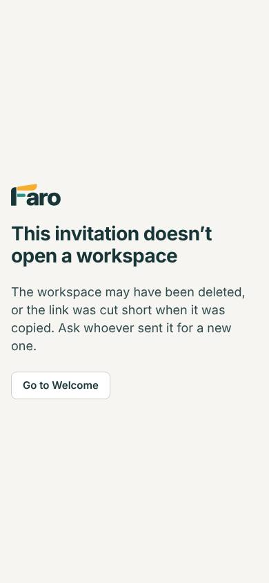 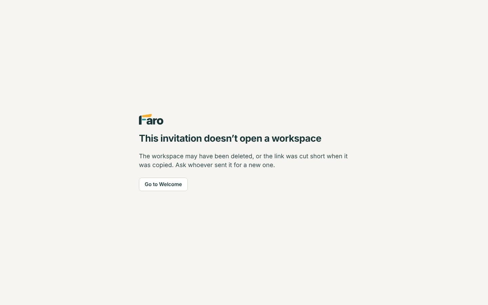

**Fields**

| Field | Kind | Shown when |
|---|---|---|
| “Find your name” | search | `many` |

**States**

| State | What it says | Shown when |
|---|---|---|
| whole screen | “a quiet wait (PageWait)” | `!here` |
| loading | “a quiet wait (PageWait), drawn only after 300 ms” | always |
| refused | “You can’t open” | always |

**Buttons, and who sees them**

| Button | Kind | Shown when |
|---|---|---|
| “Go to Welcome” | link | always |
| “Copied: send it to them / Copy a message for them” | primary | `message` |
| “Try again” | primary | always |
| “Check in on your … / Go to Home” | primary | `mine.due.length + mine.upcoming.length > 0` |
| “See your goals” | primary | `!(mine.due.length + mine.upcoming.length > 0)` and `goals` |
| “Set up the first goal” | primary | `!(mine.due.length + mine.upcoming.length > 0)` and `!goals` |
| “Link copied: paste it into an email or chat / Copy the link to send” | button | always |

## Home

[src/screens/Home.tsx](../../src/screens/Home.tsx)

- `/` (`Home`): Home shows what needs you this week: one main thing to do, what people have asked of you, and the goals you own and watch. Help: “Home and your week at a glance” (`home`).

- **Named parts:** “Your goals”, “Goals you watch”, “Getting started”, “This week (region)”, “For you (region)”
- **Main action:** The lead’s, or none: what is asked of you today (late check-ins, check-ins due tomorrow or before today’s review, the wrap-up, a review on its day), or one quiet line that nothing is.
- **Primary buttons in its markup:** none written as plain text
- **AI tools:** `get_my_work`, `get_overview`

**Pictures** (`/` as rhea): [390 wide](screens/home-390.jpg), [1440 wide](screens/home-1440.jpg)

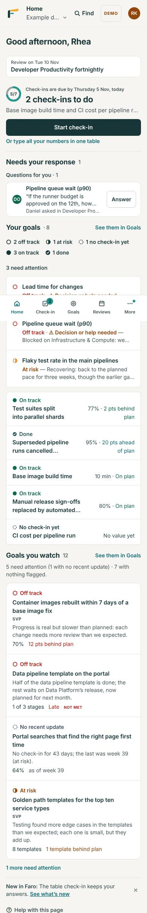 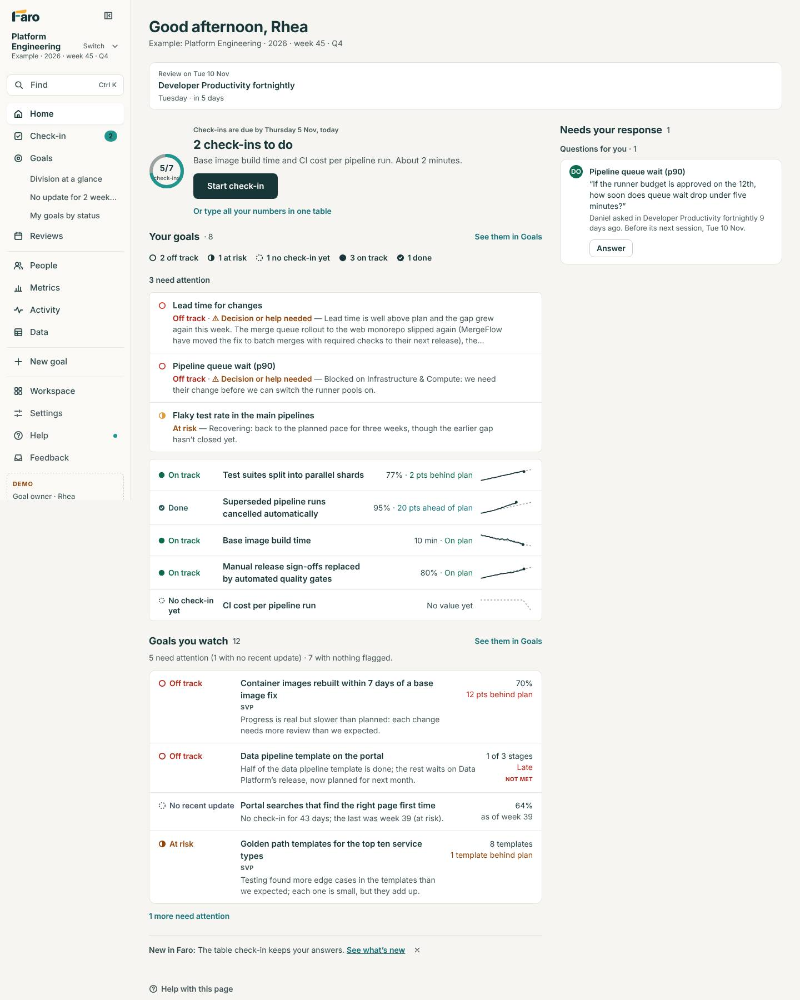

**Fields**

None: nothing to type or choose here.

**States**

None written in its markup beyond the screen itself: it draws what it has.

**Buttons, and who sees them**

| Button | Kind | Shown when |
|---|---|---|
| “… (worked out when it shows)” | primary | always |
| “… (worked out when it shows)” | link | `quiet.buttons.length > 0` |
| “Show the … with nothing flagged” | button | `rest.length > 0` and `rest.length > shown.length` |
| “Show all …” | button | `asks.length > shown.length` |
| “Check in” | link | `a.goal.ownerId === app.viewer.id && a.flags.some((f) => f.kind === 'due' \|\| f.kind === 'stale' \|\| f.kind === …` |
| “See the wrap-up” | link | `wrapUpOpenOn(app.cycle, app.today)` |
| “See Cycles / Start …” | link | always |
| “… (worked out when it shows)” | button | `r.id === 'invite'` |
| “… (worked out when it shows)” | link | `!(r.id === 'invite')` and `r.to` |
| “Hide this” | button | always |

## CheckInFlow

[src/screens/CheckInFlow.tsx](../../src/screens/CheckInFlow.tsx)

- `/check-in` (`CheckInFlow`): A check-in is the owner’s weekly word on a goal: the number or stages, the status, and, when something changed, why and what happens next. Help: “Checking in on a goal” (`check-in`).
- `/check-in/:goalId` (`CheckInFlow`): A check-in is the owner’s weekly word on a goal: the number or stages, the status, and, when something changed, why and what happens next. Help: “Checking in on a goal” (`check-in`).

- **Named parts:** “Posted from the table”, “Check-in saved”, “This week (region)”, “What changed, and what happens next (region)”
- **Main action:** On the week’s list (/check-in), start with the first goal due, or pick any; then post each check-in, one goal at a time.
- **Primary buttons in its markup:** “Open the goal”, “Save and skip”, “Back to home”
- **AI tools:** `post_check_in`, `link_request`

**Pictures** (`/check-in/lead-flaky` as rhea): [390 wide](screens/checkinflow-390.jpg), [1440 wide](screens/checkinflow-1440.jpg)

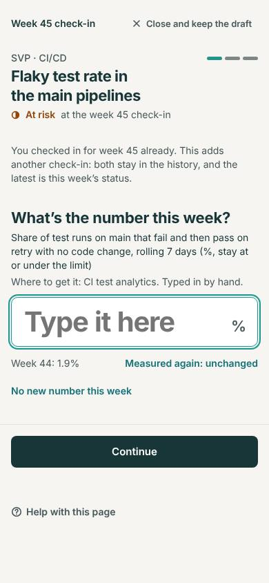 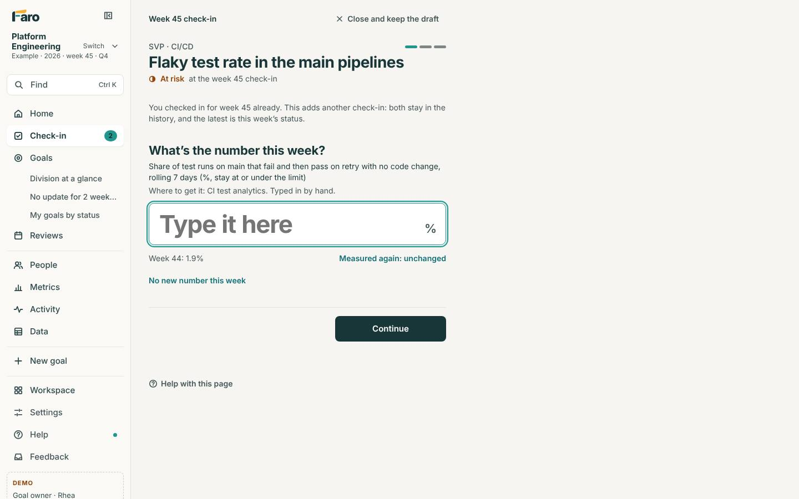

**Fields**

| Field | Kind | Shown when |
|---|---|---|
| “Why? optional” | textarea | always |
| “This week’s value” | text | `step === 'measure'` and `!(goal.kind === 'milestone')` |
| “Why are you changing it? Say why, in a sentence, so anyone reading week … later knows.” | textarea | `step === 'measure'` and `correcting` |
| “Keep this request open on their Home” | checkbox | `step === 'carry'` and `previous` and `priorAsk` |
| “What happened” | textarea | `step === 'account'` and `needsWhy` |
| “Who can decide or help?” | PickOne | `step === 'account'` and `needsWay` and `draft.ptgState === 'help'` |
| “Also need a decision or help? Optional; shown at the top of the goal and in reviews” | text | `step === 'account'` and `needsWay` and `!(draft.ptgState === 'help')` and `showNeeds` |
| “Still true this week” | checkbox | always |
| “Next step Optional” | text | `open` |
| “Why is it better than the numbers?” | text | `e.greener` |

**States**

| State | What it says | Shown when |
|---|---|---|
| empty | “Check-ins start in week 1” | `app.week < 1` |
| empty | “That goal doesn’t exist” | `!goal` |
| empty | “…” | always |
| empty | “Only … checks in on this goal” | always |
| error | “Type this week’s number.” | `step === 'measure' and !(goal.kind === 'milestone') and empty` |
| error | “Choose one: start the plan from this number, or keep it and say why.” | `step === 'measure' and !(goal.kind === 'milestone') and offer and goal.kind === 'metric' and tried` |
| error | “Say why it’s better than the numbers: tap Change.” | `step === 'measure' and valueOk && (goal.kind !== 'milestone' \|\| draft.stages.length > 0) and tried && e.codes.includes('greener-why')` |
| error | “Pick a cause, then write a sentence. / Write a sentence about what happened.” | `step === 'account' and needsWhy and tried and !whyOk` |
| error | “Say a few words about it. / Pick the week it’s back on plan, or choose another option if you don’t know yet.” | `step === 'account' and needsWay and tried and !wayOk` |
| error | “Pick who it goes to.” | `step === 'account' and needsWay and draft.ptgState === 'help' and tried and !helpFrom` |
| error | “Change what’s different, or tick Still true this week.” | `alert` |
| error | “Write a sentence so people watching know why.” | `e.greener and tried and !okWhy` |

**Buttons, and who sees them**

| Button | Kind | Shown when |
|---|---|---|
| “Home” | link | always |
| “Open the goal” | primary | always |
| “Discard draft” | button | `drafting` and `!justPosted` |
| “Cancel” | button | always |
| “Save and skip” | primary | always |
| “Check in on …” | primary | `p.due.length > 0` |
| “Back to home” | primary | always |
| “Next: …” | primary | `left` |
| “Back to home” | primary | `!left` |
| “View the goal” | link | always |
| “Waiting on a decision already asked for another goal?” | button | `othersAsked.length > 0` |
| “… For … · asked by …” | button | `linking` |
| “Keep … for this goal” | button | `step === 'measure'` and `!(goal.kind === 'milestone')` and `shown?.block` and `!(keep == null)` |
| “Measured again: unchanged” | button | `step === 'measure'` and `!(goal.kind === 'milestone')` and `lastNumber?.value != null && !draft.value` |
| “Start from …” | button | `step === 'measure'` and `!(goal.kind === 'milestone')` and `offer` and `goal.kind === 'metric'` |
| “Keep … and say why” | button | `step === 'measure'` and `!(goal.kind === 'milestone')` and `offer` and `goal.kind === 'metric'` |
| “Undo” | button | `step === 'measure'` and `!(goal.kind === 'milestone')` and `rebased === 'start'` and `rebasedFrom` |
| “No new number this week” | button | `step === 'measure'` and `!(goal.kind === 'milestone')` and `!draft.value.trim() && onSkip` |
| “Change” | button | `step === 'measure'` and `valueOk && (goal.kind !== 'milestone' \|\| draft.stages.length > 0)` |
| “Also need a decision or help?” | button | `step === 'account'` and `needsWay` and `!(draft.ptgState === 'help')` and `!showNeeds` |
| “Back” | button | `step !== 'carry'` and `(trail.length > 0 \|\| step !== 'measure')` |
| “… (worked out when it shows)” | primary | `step !== 'carry'` |
| “Back” | button | `!(step !== 'carry')` |
| “Something changed” | button | `!(step !== 'carry')` |
| “Posting… / Still true: post check-in” | primary | `!(step !== 'carry')` |
| “Add a next step” | button | `!open` |
| “from the numbers” | button | always |
| “Done” | primary | always |
| “…, week …, …” | button | always |
| “Hide chart / Show chart” | button | `hasChart` |
| “Show” | button | `done.length > 0` and `!showDone` |
| “… Due … Change” | button | always |

## QuickCheckIn

[src/screens/QuickCheckIn.tsx](../../src/screens/QuickCheckIn.tsx)

- `/quick-check-in` (`QuickCheckIn`): If you own several number goals, type this week’s numbers for all of them on one screen. Help: “Typing all your numbers in one table” (`check-in-table`).

- **Named parts:** “Type all your numbers in one table”
- **Main action:** Post every row of the table that is ready, at once, and land on the check-in’s confirmation.
- **Primary buttons in its markup:** none written as plain text
- **AI tools:** `bulk_change`, `post_check_in`

**Pictures** (`/quick-check-in` as rhea): [390 wide](screens/quickcheckin-390.jpg), [1440 wide](screens/quickcheckin-1440.jpg)

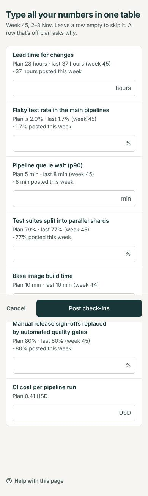 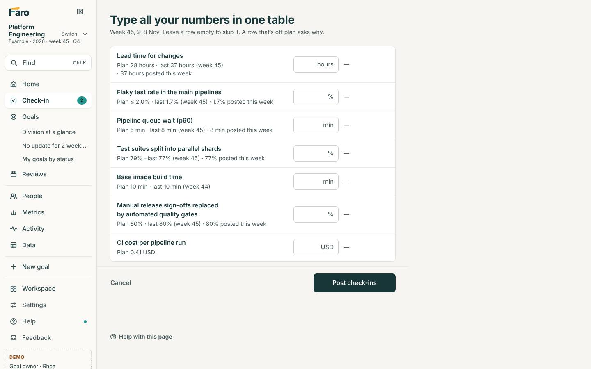

**Fields**

| Field | Kind | Shown when |
|---|---|---|
| “…: this week’s number in …” | text | `goals.length > 0` |
| “In a sentence” | textarea | `goals.length > 0` and `(showWhy \|\| showPath)` and `showWhy` |
| “How it gets back on plan” | textarea | `goals.length > 0` and `(showWhy \|\| showPath)` and `showPath` |

**States**

| State | What it says | Shown when |
|---|---|---|
| empty | “No number goals to update” | `!goals.length` |
| error | “Still needed: ….” | `goals.length > 0 and (showWhy \|\| showPath) and bad and e` |

**Buttons, and who sees them**

| Button | Kind | Shown when |
|---|---|---|
| “Use the normal check-in” | link | `!goals.length` |
| “Start over” | button | `goals.length > 0` and `hasDraft` |
| “Cancel” | link | `goals.length > 0` |
| “Saving… / Post … / Post check-ins” | primary | `goals.length > 0` |

## Research

[src/screens/Research.tsx](../../src/screens/Research.tsx)

- `/research` (`Research`): The demo is a full copy of the app with one example organisation, Platform Engineering (about 100 people), kept in your browser, that you can change and reset freely. Help: “The demo” (`demo`).

- **Named parts:** “Research this app”, “What it is”, “Not built yet, on purpose: access control”, “How to do it”, “Start”, “Tasks”, “Your report”, “Not built yet, on purpose (region)”
- **Main action:** Start the research session.
- **Primary buttons in its markup:** “Start the session”
- **AI tools:** none, on purpose: Research sessions in the demo, for the people building the app.

**Pictures** (`/research` as amara): [390 wide](screens/research-390.jpg), [1440 wide](screens/research-1440.jpg)

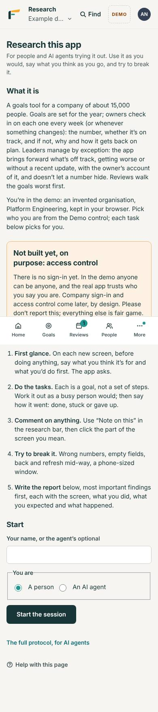 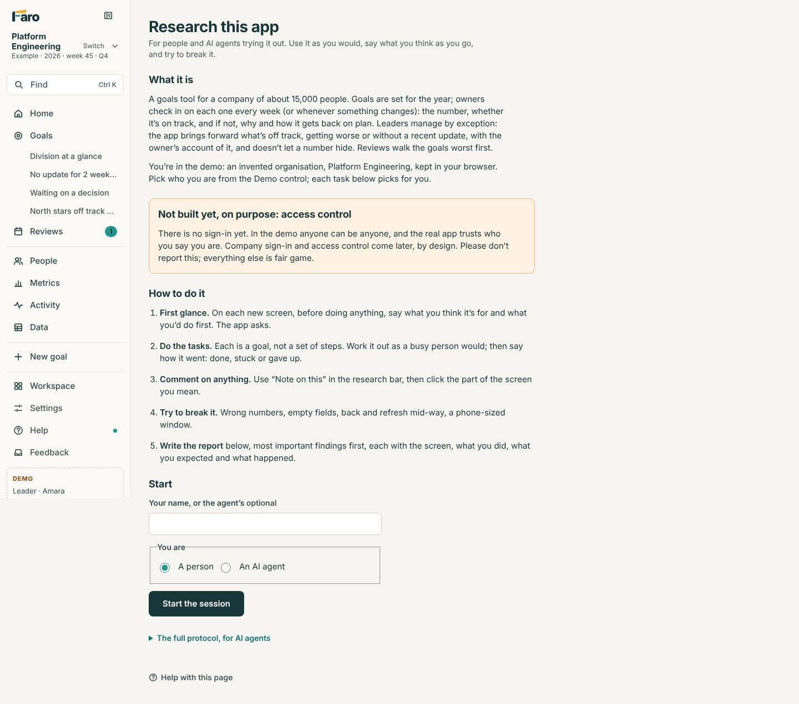

**Fields**

| Field | Kind | Shown when |
|---|---|---|
| “Your name, or the agent’s optional” | text | `!s` |
| “A person” | radio | `!s` |
| “An AI agent” | radio | `!s` |
| “Your report” | textarea | `s` and `!sent` |

**States**

None written in its markup beyond the screen itself: it draws what it has.

**Buttons, and who sees them**

| Button | Kind | Shown when |
|---|---|---|
| “Start the session” | primary | `!s` |
| “Try again / Start / Go” | button | `s` |
| “Download my notes” | button | `s` and `!sent` |
| “Send the report” | primary | `s` and `!sent` |
| “End this session” | button | `s` |

## Review

[src/screens/Review.tsx](../../src/screens/Review.tsx)

- `/review` (`ReviewRedirect`): A review walks a set of goals together on a cadence, worst and stalest first, and keeps what was said. Help: “Reviews” (`reviews`).
- `/reviews` (`Reviews`): A review walks a set of goals together on a cadence, worst and stalest first, and keeps what was said. Help: “Reviews” (`reviews`).
- `/reviews/new` (`ReviewEdit`): A review walks a set of goals together on a cadence, worst and stalest first, and keeps what was said. Help: “Reviews” (`reviews`).
- `/reviews/:reviewId` (`ReviewHome`): A review walks a set of goals together on a cadence, worst and stalest first, and keeps what was said. Help: “Reviews” (`reviews`).
- `/reviews/:reviewId/edit` (`ReviewEdit`): A review walks a set of goals together on a cadence, worst and stalest first, and keeps what was said. Help: “Reviews” (`reviews`).
- `/reviews/:reviewId/summary` (`ReviewSummary`): A review walks a set of goals together on a cadence, worst and stalest first, and keeps what was said. Help: “Reviews” (`reviews`).

- **Named parts:** “Reviews”, “You’re in”, “Other reviews”, “People”, “Decided”, “When”, “Which goals”, “Who takes part”
- **Main action:** Walk the review’s goals worst first and mark each reviewed; on the list, open a review or set one up.
- **Primary buttons in its markup:** “Set up the first review”
- **AI tools:** `list_reviews`, `get_review`, `save_review`, `end_review`, `delete_review`

**Pictures** (`/reviews/weekly` as amara): [390 wide](screens/review-390.jpg), [1440 wide](screens/review-1440.jpg)

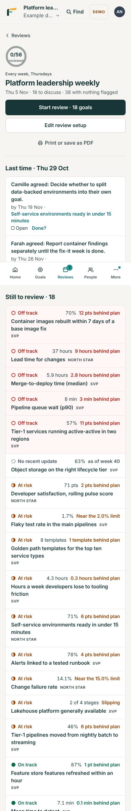 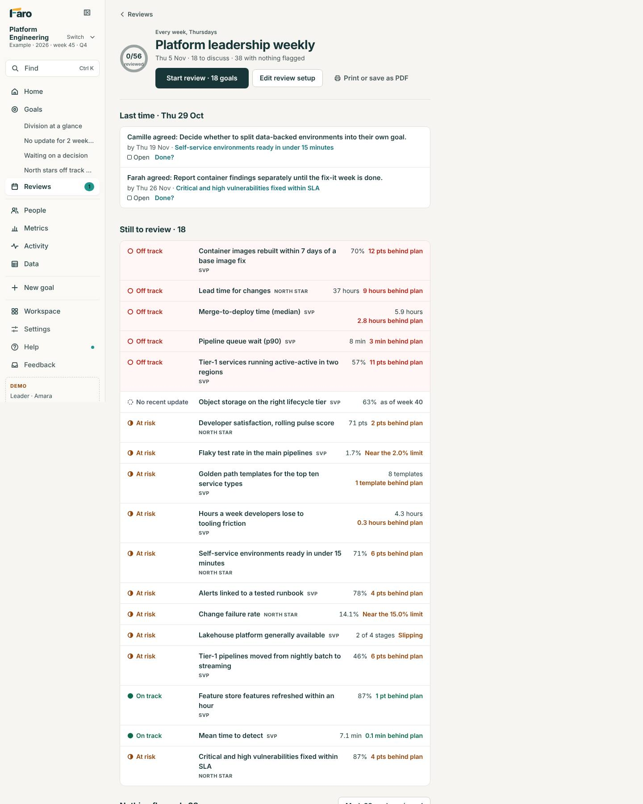

**Fields**

| Field | Kind | Shown when |
|---|---|---|
| “Name” | text | always |
| “On …” | select | always |
| “Single goals” | Pick | always |
| “People” | Pick | always |

**States**

| State | What it says | Shown when |
|---|---|---|
| empty | “No reviews yet” | `!sessions.length` |
| empty | “That review doesn’t exist” | `!review` |

**Buttons, and who sees them**

| Button | Kind | Shown when |
|---|---|---|
| “Set up a review” | link | always |
| “Set up the first review” | primary | `!sessions.length` |
| “All reviews” | link | always |
| “Continue review · … left / Start review · …” | primary | `inIt` and `!done` and `first` |
| “Finish review” | primary | `inIt` and `!done` and `!first` and `healthyLeft.length > 0` |
| “Edit review setup” | link | `canChange` |
| “Print or save as PDF” | link | always |
| “Done?” | button | `last` and `a.state !== 'done' && canMarkDone(a.ask, app.viewer)` |
| “Mark … reviewed” | button | `!done` and `!walkAll` and `exceptions.length > 0` and `healthyLeft.length > 0` and `inIt` and `first` |
| “Walk them one at a time instead” | button | `!done` and `!walkAll` and `exceptions.length > 0` and `healthyLeft.length > 0` and `listHealthy` and `inIt` |
| “Not yet” | button | always |
| “Saving… / Finish the review / Mark … reviewed” | primary | always |
| “Every week / Every … weeks” | button | always |
| “Save changes / Set up the review” | primary | always |

## Watching

[src/screens/Watching.tsx](../../src/screens/Watching.tsx)

- `/watching` (`Watching`): Watch the goals you care about but don’t own, and see what changed in them without opening each one. Help: “Watching goals” (`watching`).

- **Named parts:** “What changed this week”, “What you watch”, “You’re not watching anything yet”, “What changed (region)”
- **Main action:** Open a goal you watch that needs attention.
- **Primary buttons in its markup:** none written as plain text
- **AI tools:** `list_watching`, `find_goals`, `watch`, `unwatch`

**Pictures** (`/goals?scope=watching` as rhea): [390 wide](screens/watching-390.jpg), [1440 wide](screens/watching-1440.jpg)

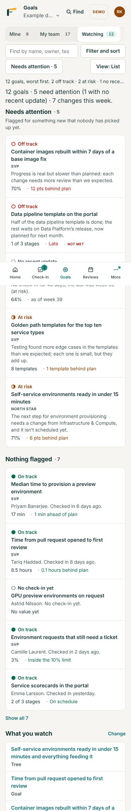 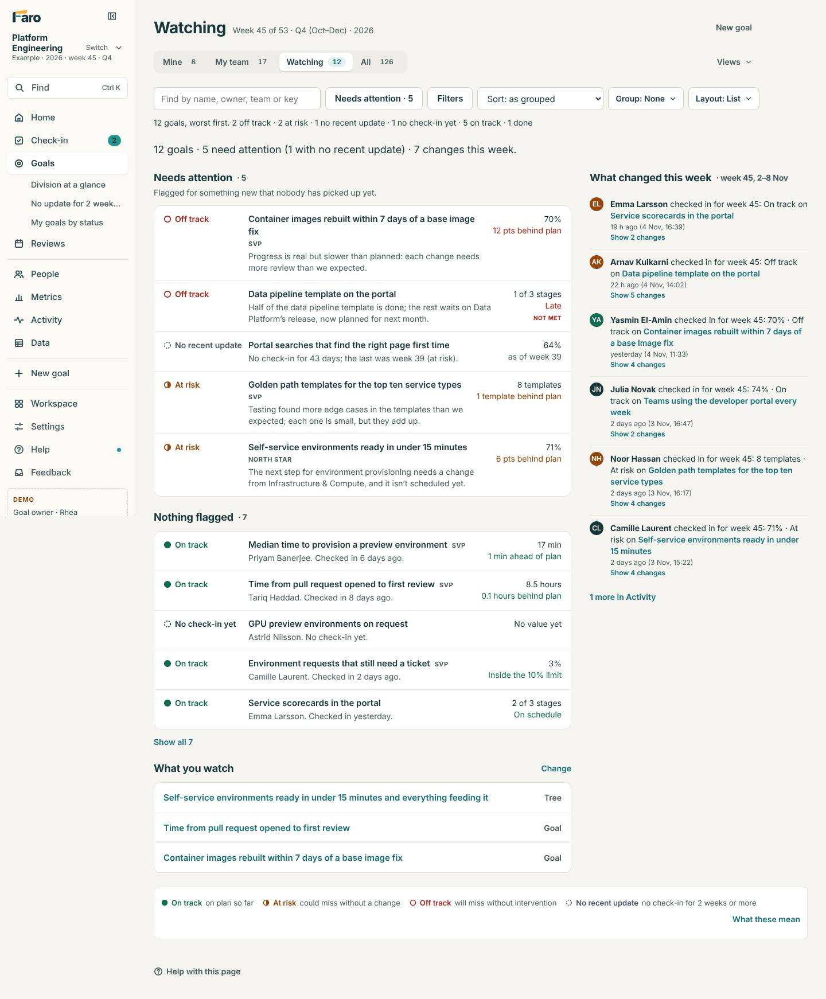

**Fields**

None: nothing to type or choose here.

**States**

None written in its markup beyond the screen itself: it draws what it has.

**Buttons, and who sees them**

| Button | Kind | Shown when |
|---|---|---|
| “Done / Change” | button | always |
| “Show all …” | button | `!open` |
| “Stop” | button | `managing` |
| “Watch …” | button | always |
| “Watch every … goal (…)” | primary | always |
| “Pick goals from the list” | primary | always |

## Retro

[src/screens/Retro.tsx](../../src/screens/Retro.tsx)

- `/retro` (`WrapUp`): In the last two weeks of the year, owners wrap up each goal; then an admin starts the next year. Help: “Wrapping up the year, and the next one” (`wrap-up`).
- `/retro/:goalId` (`RetroGoal`): In the last two weeks of the year, owners wrap up each goal; then an admin starts the next year. Help: “Wrapping up the year, and the next one” (`wrap-up`).

- **Named parts:** none written as plain text
- **Main action:** Wrap up each goal you own: how it landed, what you learned, and carry it on or stop it.
- **Primary buttons in its markup:** none written as plain text
- **AI tools:** `get_wrap_up`, `wrap_up_goal`, `start_next_cycle`

**Pictures** (`/retro` as rhea): [390 wide](screens/retro-390.jpg), [1440 wide](screens/retro-1440.jpg)

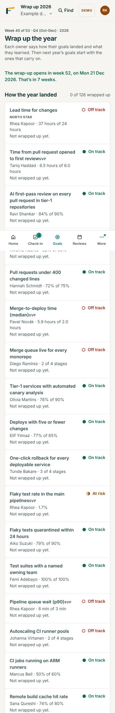 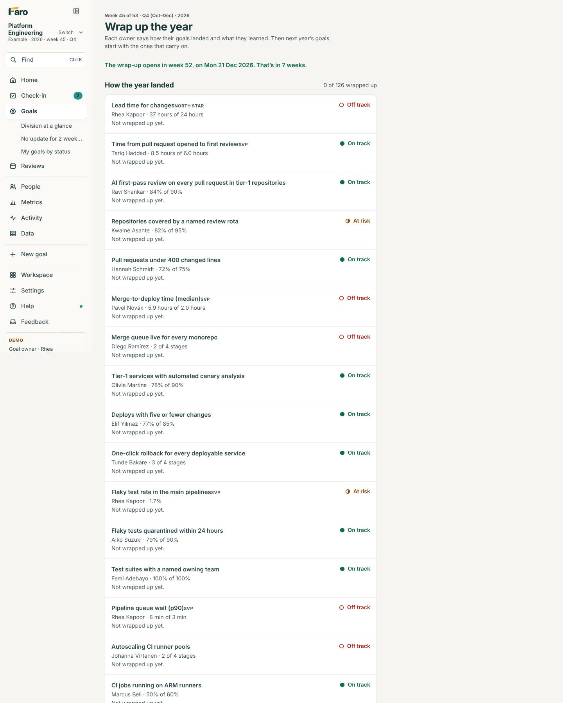

**Fields**

| Field | Kind | Shown when |
|---|---|---|
| “What did you learn?” | textarea | always |

**States**

| State | What it says | Shown when |
|---|---|---|
| empty | “No goals this …” | `!all.length` |
| empty | “This goal isn’t in this …” | `!goal` |
| empty | “Only its owner wraps up this goal” | `goal.ownerId !== app.viewer.id && !app.viewer.admin` |
| error | “Write a sentence about what you learned.” | `tried and !ok` |

**Buttons, and who sees them**

| Button | Kind | Shown when |
|---|---|---|
| “Wrap up …” | primary | `open` and `mine.length > 0` and `myLeft.length > 0` |
| “See Cycles / Start …” | link | `app.viewer.admin && !app.earlier && cycleState(app.cycle, app.today) !== 'before' && cycleState(app.cycle, ap…` |
| “Back to the wrap-up” | link | always |
| “Carry it on” | button | always |
| “Stop it here” | button | always |
| “Saving… / Save changes / Save and continue” | primary | always |

## GoalsScreen

[src/screens/GoalsScreen.tsx](../../src/screens/GoalsScreen.tsx)

- `/goals` (`GoalsScreen`): Goals opens on yours. Tabs choose whose goals (Mine, My team, Watching, All); Group arranges them, Needs attention narrows them, and layouts choose how they look. Help: “Goals and its layouts” (`goals`).

- **Named parts:** “Goals”, “Not linked”
- **Main action:** Find goals (search, filter, sort, lay them out) and open one.
- **Primary buttons in its markup:** “Set up the first goal”, “Done”
- **AI tools:** `find_goals`, `get_overview`

**Pictures** (`/goals` as amara): [390 wide](screens/goalsscreen-390.jpg), [1440 wide](screens/goalsscreen-1440.jpg)

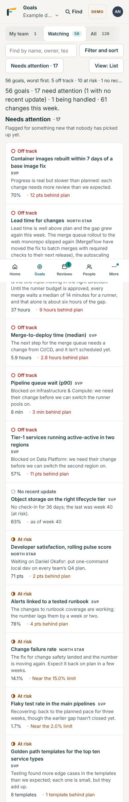 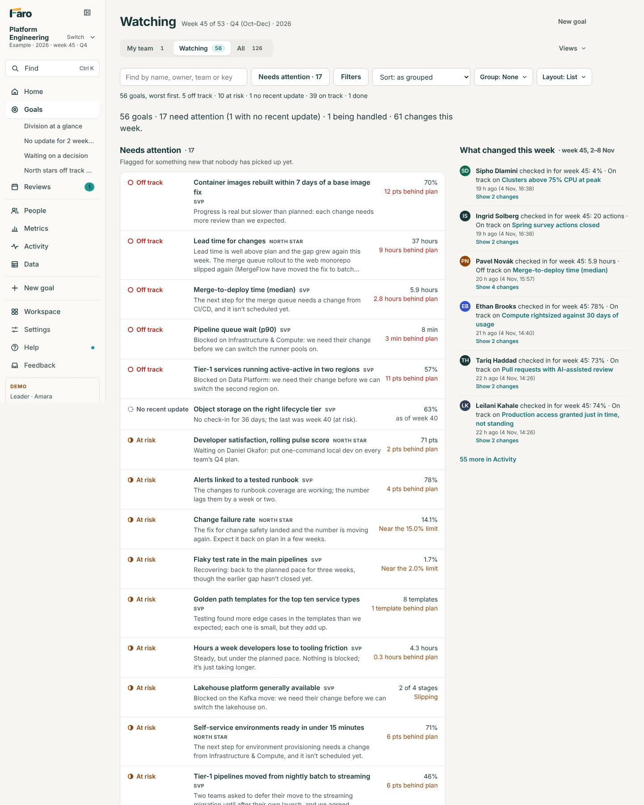

**Fields**

None: nothing to type or choose here.

**States**

| State | What it says | Shown when |
|---|---|---|
| whole screen | “Goals” | `stateOn` |
| empty | “No goals yet” | `!app.snapshot.goals.length` |

**Buttons, and who sees them**

| Button | Kind | Shown when |
|---|---|---|
| “… · …” | button | always |
| “New goal” | link | always |
| “Wrap up” | link | `wrapUpOpenOn(app.cycle, app.today)` |
| “… (worked out when it shows)” | button | `app.snapshot.goals.length > 0` |
| “Set up the first goal” | primary | `!app.snapshot.goals.length` |
| “Save this view…” | button | `canSave` |
| “Copy link” | button | always |
| “… (worked out when it shows)” | button | always |
| “Done” | primary | always |

## GoalWizard

[src/screens/GoalWizard.tsx](../../src/screens/GoalWizard.tsx)

- `/goals/new` (`GoalWizard`): A new goal takes four short steps: what you want to achieve, whose it is and where it fits, how it’s measured, then a check before publishing. Help: “Setting up a goal” (`new-goal`).
- `/goals/new/:step` (`GoalWizard`): A new goal takes four short steps: what you want to achieve, whose it is and where it fits, how it’s measured, then a check before publishing. Help: “Setting up a goal” (`new-goal`).

- **Named parts:** “What do you want to achieve?”, “Whose is it, and where does it fit?”, “Does this read right?”
- **Main action:** Publish the goal, one question a step.
- **Primary buttons in its markup:** none written as plain text
- **AI tools:** `create_goal`

**Pictures** (`/goals/new` as rhea): [390 wide](screens/goalwizard-390.jpg), [1440 wide](screens/goalwizard-1440.jpg)

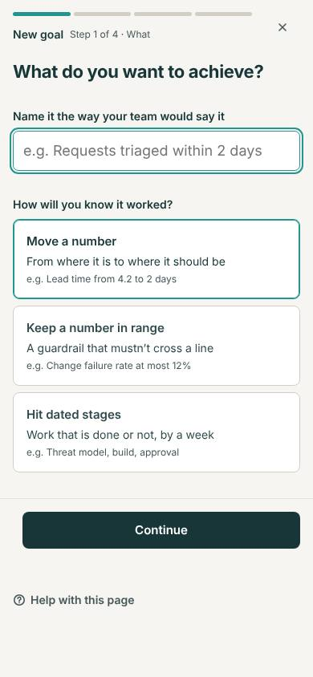 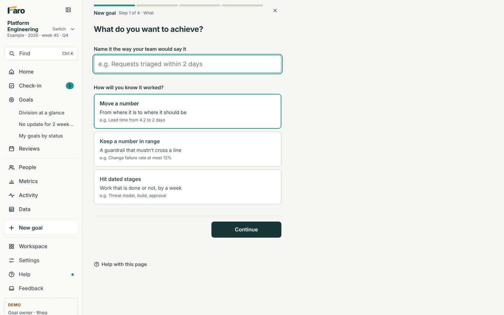

**Fields**

| Field | Kind | Shown when |
|---|---|---|
| “Name it the way your team would say it …” | text | `step === 0` |
| “Owner · checks in weekly” | PickOne | `step === 1` |
| “Team” | PickOne | `step === 1` |
| “Feeds into · optional” | PickOne | `step === 1` |
| “How much will it move “…”? · optional …” | text | `step === 1` and `d.parentId` |
| “Why do we expect it to help? · optional” | textarea | `step === 1` and `d.parentId` |
| “Also helps · optional” | Pick | `step === 1` |
| “It’s a guardrail: protects quality while the rest moves” | checkbox | `step === 1` |
| “Unit …” | text | `step === 2` and `number` and `!filled` |
| “Baseline” | text | `step === 2` and `d.kind === 'metric'` |
| “From” | WeekPick | `step === 2` and `d.kind === 'metric'` |
| “Target” | text | `step === 2` and `d.kind === 'metric'` |
| “To” | WeekPick | `step === 2` and `d.kind === 'metric'` |
| “Lower limit …” | text | `step === 2` and `d.kind === 'range'` and `d.bound === 'between'` |
| “Upper limit / Limit …” | text | `step === 2` and `d.kind === 'range'` |
| “Warn this close … How near the limit counts as at risk, in …. Left empty, it warns only once the limit is cro…” | text | `step === 2` and `d.kind === 'range'` |
| “How it’s measured · optional” | textarea | `step === 2` and `((noMetric && (!measurePlace \|\| saidNone \|\| !!d.definition.trim() \|\| !!d.source.trim())) \|\| d.kind === 'miles…` |
| “Where the number comes from · optional” | text | `step === 2` and `((noMetric && (!measurePlace \|\| saidNone \|\| !!d.definition.trim() \|\| !!d.source.trim())) \|\| d.kind === 'miles…` |

**States**

None written in its markup beyond the screen itself: it draws what it has.

**Buttons, and who sees them**

| Button | Kind | Shown when |
|---|---|---|
| “Keep it at … or under” | button | `hold != null` |
| “Keep it at … or over” | button | `hold != null` |
| “Keep …” | button | `e?.id === 'too-precise' && e.keep != null` |
| “Start a new one” | button | `restored` and `!asking` |
| “Discard it” | button | `asking` |
| “Keep it” | button | `asking` |
| “At most” | button | `step === 2` and `d.kind === 'range'` |
| “At least” | button | `step === 2` and `d.kind === 'range'` |
| “Between” | button | `step === 2` and `d.kind === 'range'` |
| “Change” | button | `step === 3` and `read` and `r.step != null` |
| “Back” | button | `step > 0` |
| “Skip: say how it’s measured later” | button | `step === 1` and `proposing` |
| “Proposed / Published / Saving… / Continue / Propose goal / Publish goal” | primary | always |

## GoalScreen

[src/screens/GoalScreen.tsx](../../src/screens/GoalScreen.tsx)

- `/goals/:goalId` (`GoalScreen`): Everything about one goal: how it’s doing, why, what’s being done, where it’s heading, and what has happened. Help: “A goal’s page” (`goal-page`).

- **Named parts:** “Chart and recent check-ins”, “For you”, “Done lately”, “About this goal”, “First check-in (region)”, “Next steps and asks (region)”, “On this page (region)”, “Respond (region)”, “Chart (region)”, “Show (region)”
- **Main action:** The one main button for whoever is looking: answer what’s asked of you, check in when it’s due, mark your next step done, add a next step when it’s behind with none, or ask for an update; beside it the owner’s Check in again, or Watch.
- **Primary buttons in its markup:** “Post the first check-in”
- **AI tools:** `get_goal`, `add_comment`, `ask_question`, `ask_for_update`, `undo_update_ask`, `withdraw_request`, `mark_action_done`, `watch`, `unwatch`, `stop_goal`, `delete_goal`, `delete_check_in`, `edit_comment`, `delete_comment`

**Pictures** (`/goals/ns-lead` as amara): [390 wide](screens/goalscreen-390.jpg), [1440 wide](screens/goalscreen-1440.jpg)

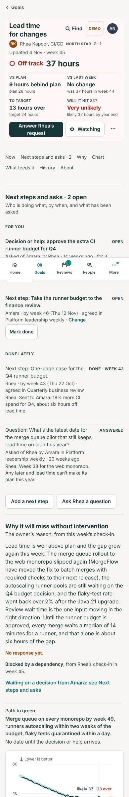 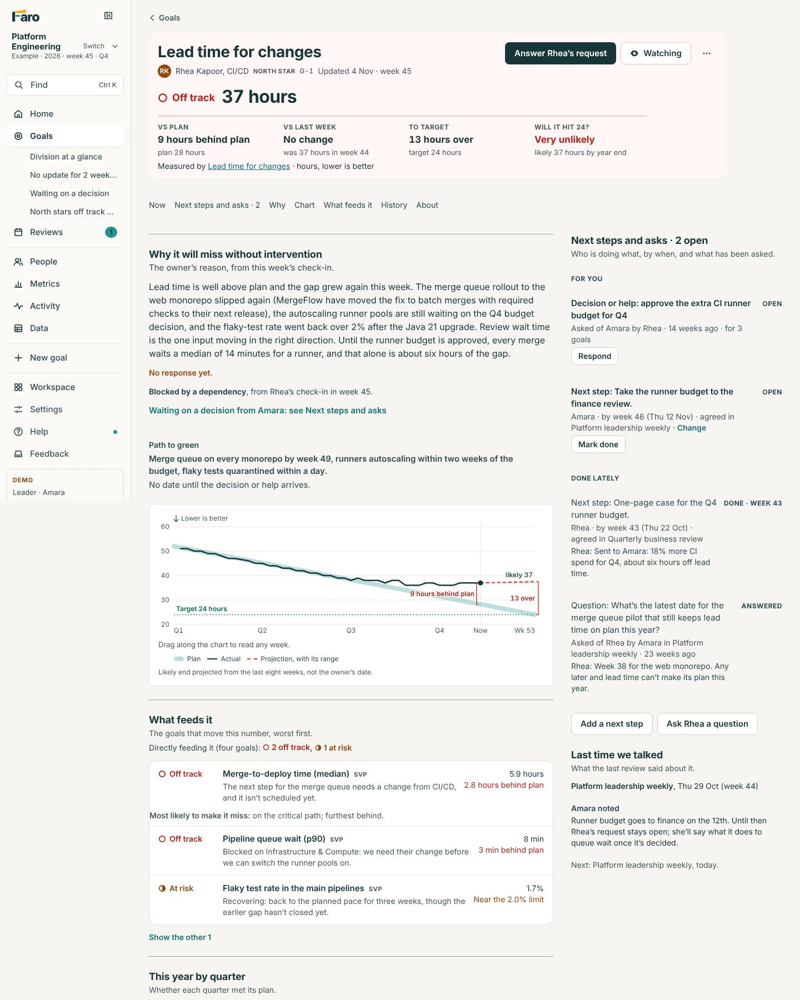

**Fields**

| Field | Kind | Shown when |
|---|---|---|
| “Your question” | textarea | always |
| “Your reply” | textarea | always |
| “Find in this goal’s history” | search | `whole.counts.all > 30` |
| “Go to week” | select | `whole.counts.all > 30` |
| “Add a comment” | textarea | always |

**States**

| State | What it says | Shown when |
|---|---|---|
| empty | “This goal doesn’t exist” | `!goal` |
| error | “Type the question.” | `tried and bad` |
| error | “Write a few words.” | always |
| error | “Couldn’t make the image:” | always |

**Buttons, and who sees them**

| Button | Kind | Shown when |
|---|---|---|
| “All goals” | link | always |
| “… (worked out when it shows)” | primary | `!(!showPrimary \|\| !primary.kind)` and `primary.kind === 'check-in' \|\| primary.kind === 'first-check-in'` |
| “… (worked out when it shows)” | primary | `!(!showPrimary \|\| !primary.kind)` and `!(primary.kind === 'check-in' \|\| primary.kind === 'first-check-in')` and `primary.kind === 'ask-update'` |
| “… (worked out when it shows)” | primary | `!(!showPrimary \|\| !primary.kind)` and `!(primary.kind === 'check-in' \|\| primary.kind === 'first-check-in')` and `!(primary.kind === 'ask-update')` and `primary.kind === 'add-step'` |
| “… (worked out when it shows)” | primary | `!(!showPrimary \|\| !primary.kind)` and `!(primary.kind === 'check-in' \|\| primary.kind === 'first-check-in')` and `!(primary.kind === 'ask-update')` and `!(primary.kind === 'add-step')` |
| “… (worked out when it shows)” | link | `!(review \|\| !standing.kind)` and `standing.kind === 'check-in-again'` |
| “Undo” | button | `!stopped` and not the goal’s owner and `stale` and `!review` and `updateAsk` and `canWithdraw(updateAsk, app.viewer, goal)` |
| “Post the first check-in” | primary | `published` and `!(week < 1)` and the goal’s owner |
| “Later” | button | `published` and `!(week < 1)` and the goal’s owner |
| “Ask …” | button | `published` and `!(week < 1)` and not the goal’s owner |
| “Later” | button | `published` and `!(week < 1)` and not the goal’s owner |
| “Show all …” | button | `steps.done.length > done.length` |
| “Add a next step” | button | `live` |
| “Ask … a question” | button | `live` and not the goal’s owner |
| “Ask for a decision or help” | link | `live` and the goal’s owner and `app.week > 0` |
| “Check in” | link | `!(!x.button \|\| open)` and `x.button === 'Check in'` |
| “Withdraw” | button | `!(!x.button \|\| open)` and `!(x.button === 'Check in')` and `x.button === 'Withdraw'` |
| “… (worked out when it shows)” | button | `!(!x.button \|\| open)` and `!(x.button === 'Check in')` and `!(x.button === 'Withdraw')` |
| “Change” | button | `canChange` |
| “Cancel” | button | always |
| “Asking… / Ask” | primary | always |
| “Not now” | button | always |
| “Posting… / Post your reply” | primary | always |
| “Show the other …” | button | `rest.length > shown.length` |
| “Clear the search” | button | `!shown.length` and `q` |
| “Weeks … – …” | button | always |
| “Add a comment” | button | always |
| “Posting… / Post comment” | button | always |
| “Week … The reason is above, under Why. Same reason …” | button | always |
| “Show all … check-ins” | button | `own.length > limit` and `!all` |

## GoalEdit

[src/screens/GoalEdit.tsx](../../src/screens/GoalEdit.tsx)

- `/goals/:goalId/edit` (`GoalEdit`): Change a goal on one page: what it is, its plan and target, who owns it and where it fits. Once check-ins have started, a plan change needs a reason. Help: “Changing a goal or its plan” (`edit-goal`).

- **Named parts:** “What it is”, “Who and where”
- **Main action:** Save the change; a plan change after check-ins started needs a reason.
- **Primary buttons in its markup:** none written as plain text
- **AI tools:** `update_goal`, `set_plan_numbers`

**Pictures** (`/goals/ns-lead/edit` as rhea): [390 wide](screens/goaledit-390.jpg), [1440 wide](screens/goaledit-1440.jpg)

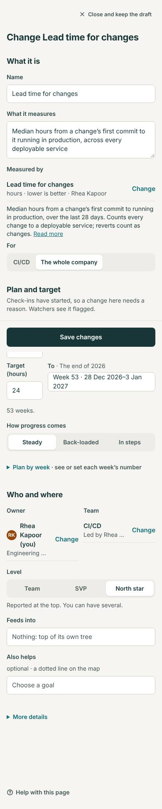 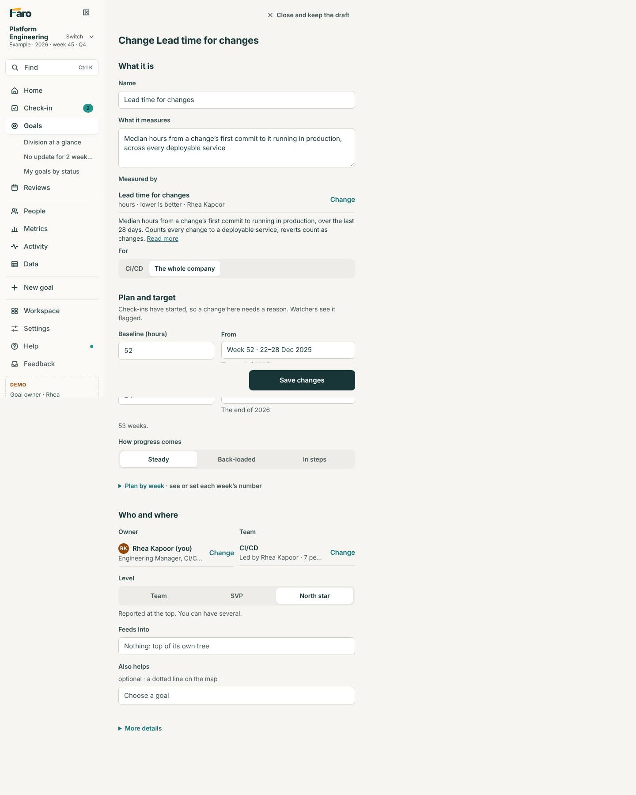

**Fields**

| Field | Kind | Shown when |
|---|---|---|
| “Why change it?” | textarea | `replanning` |
| “Name …” | text | always |
| “What it measures” | textarea | `goal.kind !== 'milestone'` |
| “Baseline (…) …” | text | `goal.kind === 'metric'` |
| “From” | WeekPick | `goal.kind === 'metric'` |
| “Target (…) …” | text | `goal.kind === 'metric'` |
| “To” | WeekPick | `goal.kind === 'metric'` |
| “Lower limit …” | text | `goal.kind === 'range'` and `d.bound === 'between'` |
| “Upper limit / Limit …” | text | `goal.kind === 'range'` |
| “Warn this close …” | text | `goal.kind === 'range'` |
| “Owner” | PickOne | always |
| “Team” | PickOne | always |
| “Feeds into” | PickOne | always |
| “Also helps” | Pick | always |
| “Why do we expect it to help? optional” | textarea | `d.parentId` |
| “How much it moves “…” …” | text | `d.parentId` |
| “It’s a guardrail” | checkbox | always |
| “Data source” | text | always |

**States**

| State | What it says | Shown when |
|---|---|---|
| empty | “This goal doesn’t exist” | `!goal` |
| empty | “Only its owner can change this goal” | always |

**Buttons, and who sees them**

| Button | Kind | Shown when |
|---|---|---|
| “All goals” | link | always |
| “Back to the goal” | link | always |
| “Discard them” | button | `restored` |
| “At most” | button | `goal.kind === 'range'` |
| “At least” | button | `goal.kind === 'range'` |
| “Between” | button | `goal.kind === 'range'` |
| “… (worked out when it shows)” | primary | always |

## Print

[src/screens/Print.tsx](../../src/screens/Print.tsx)

- `/goals/:goalId/print` (`GoalPrint`): A goal or a review session on one clean page, ready to print or save as a PDF. Help: “Printing a goal or a review” (`print`).
- `/reviews/:reviewId/print` (`ReviewPrint`): A goal or a review session on one clean page, ready to print or save as a PDF. Help: “Printing a goal or a review” (`print`).

- **Named parts:** “Latest check-in”, “Decisions or help needed”, “From reviews”, “This year by quarter”, “Contributing goals, worst first”, “Status (region)”, “Chart (region)”, “Latest check-in (region)”, “Requests (region)”, “From reviews (region)”, “This year by quarter (region)”, “Contributing goals (region)”, “Nothing flagged (region)”
- **Main action:** Print the page.
- **Primary buttons in its markup:** none written as plain text
- **AI tools:** `get_goal`, `get_review`

**Pictures** (`/goals/ns-lead/print` as amara): [390 wide](screens/print-390.jpg), [1440 wide](screens/print-1440.jpg)

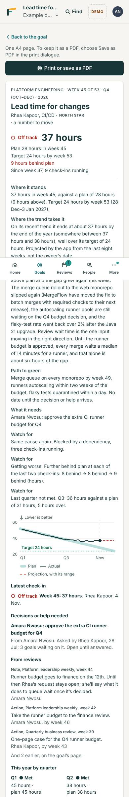 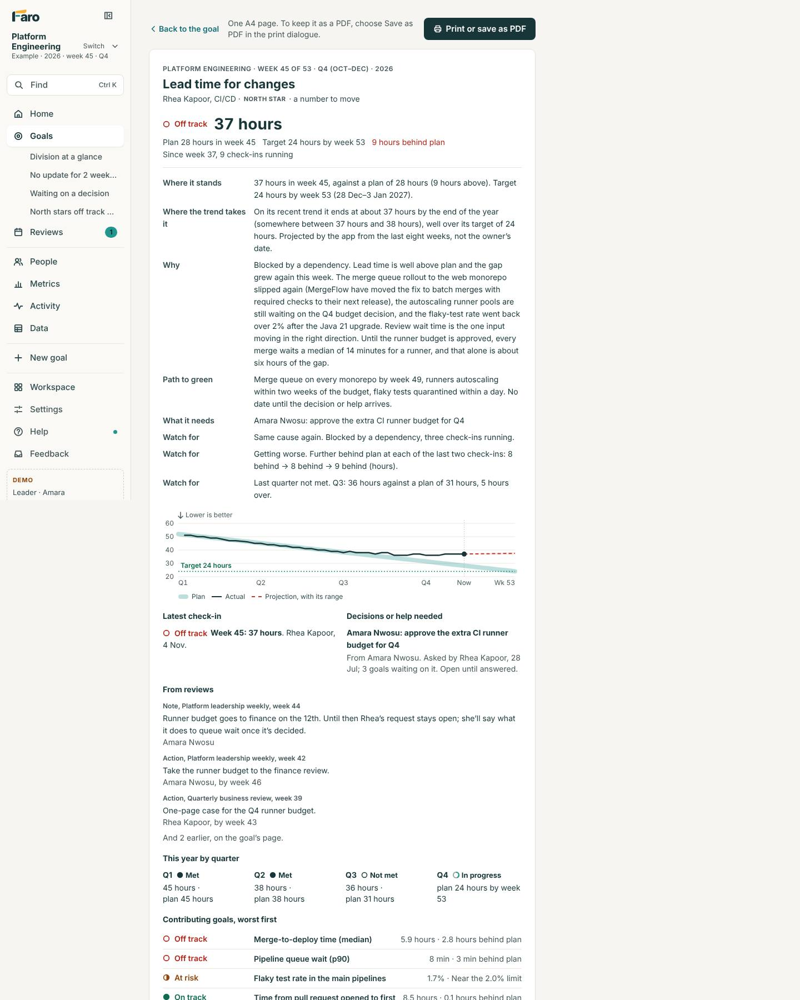

**Fields**

None: nothing to type or choose here.

**States**

| State | What it says | Shown when |
|---|---|---|
| empty | “This goal doesn’t exist” | `!goal` |
| empty | “That review doesn’t exist” | `!review` |

**Buttons, and who sees them**

| Button | Kind | Shown when |
|---|---|---|
| “Print or save as PDF” | primary | always |
| “All goals” | link | always |
| “All reviews” | link | always |

## Activity

[src/screens/Activity.tsx](../../src/screens/Activity.tsx)

- `/activity` (`Activity`): Activity lists every saved change: who made it, when, and each field’s before and after. Help: “The activity log” (`activity`).

- **Named parts:** “Activity”
- **Main action:** Read what changed, filtered to what you need.
- **Primary buttons in its markup:** “Show the changes”
- **AI tools:** `get_activity`, `undo_import`

**Pictures** (`/activity` as amara): [390 wide](screens/activity-390.jpg), [1440 wide](screens/activity-1440.jpg)

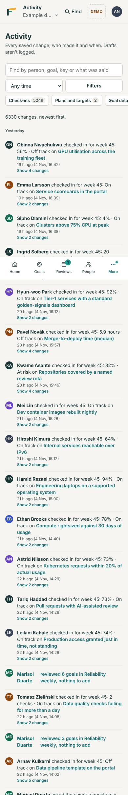 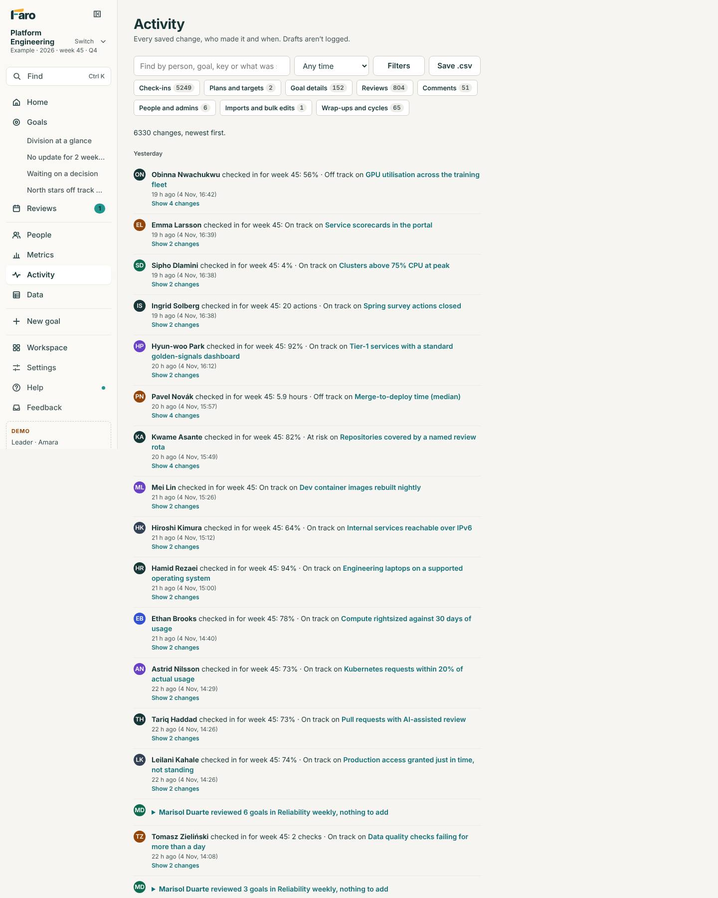

**Fields**

| Field | Kind | Shown when |
|---|---|---|
| “When Any time …” | select | always |
| “Who” | Pick | always |
| “Only my changes” | checkbox | always |
| “Goal” | PickOne | always |
| “And every goal feeding it” | checkbox | `a.goal` |
| “From” | date | always |
| “To” | date | always |

**States**

None written in its markup beyond the screen itself: it draws what it has.

**Buttons, and who sees them**

| Button | Kind | Shown when |
|---|---|---|
| “Show all activity” | button | `a.watching != null` |
| “Filters …” | button | always |
| “Save.csv” | button | always |
| “Show more (… older)” | button | `folded.top.length > shown.length` |
| “Clear filters” | button | always |
| “Show the changes” | primary | always |

## DataTables

[src/screens/DataTables.tsx](../../src/screens/DataTables.tsx)

- `/data` (`DataTables`): Every person, goal, check-in, plan and ask as a table you can search, sort, filter, arrange and export, and the home of spreadsheets in and out. Help: “Data” (`data`).

- **Named parts:** “Data”
- **Main action:** Correct records in a table, every change checked and shown before it’s saved.
- **Primary buttons in its markup:** none written as plain text
- **AI tools:** `list_people`, `bulk_change`, `list_requests`, `list_views`, `save_table_view`, `delete_view`, `pin_view`

**Pictures** (`/data` as amara): [390 wide](screens/datatables-390.jpg), [1440 wide](screens/datatables-1440.jpg)

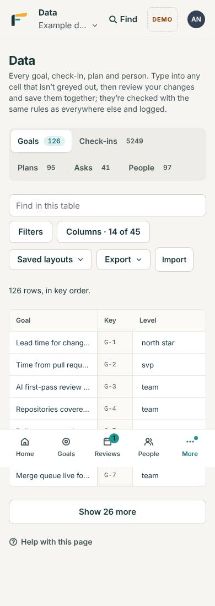 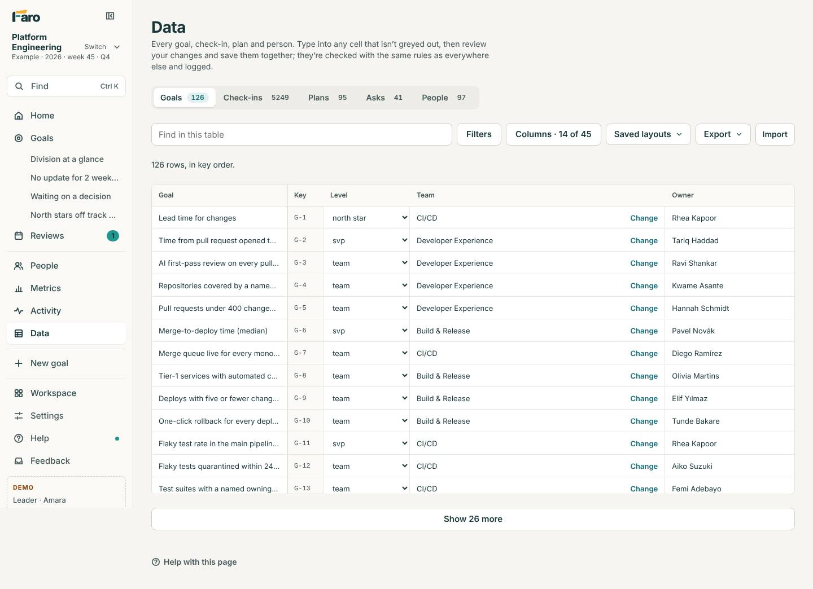

**Fields**

None: nothing to type or choose here.

**States**

None written in its markup beyond the screen itself: it draws what it has.

**Buttons, and who sees them**

| Button | Kind | Shown when |
|---|---|---|
| “…, … changed” | button | always |
| “Filters · … / Filters” | button | always |
| “Columns · … of …” | button | always |
| “Remove the sort” | button | `sort` |
| “Choose columns” | button | `q.trim() && cols.length < all.length + 1` |
| “Show … more” | button | `shown.length > limit` |
| “Discard” | button | `canEdit` and `total > 0` |
| “Review changes” | primary | `canEdit` and `total > 0` |

## Workspace

[src/screens/Workspace.tsx](../../src/screens/Workspace.tsx)

- `/workspace` (`WorkspaceHome`): Workspace opens on About: for admins, what needs sorting out; then the facts about this workspace, each leading to its section. Its other sections are Cycles, Privacy and Recently removed for everyone, and Access and Features for admins. Help: “Workspace: about this one” (`workspace`).
- `/workspace/cycles` (`WorkspaceHome`): The workspace’s goal years, newest first, with their dates, which one is running and the wrap-up; admins can delete one nobody has checked in to yet. Help: “Workspace: Cycles” (`workspace-cycles`).
- `/workspace/access` (`WorkspaceHome`): For admins: who the admins are, and MCP access: the MCP tokens Claude or another AI tool uses to act as someone in this workspace. Help: “Workspace: Access” (`workspace-access`).
- `/workspace/features` (`WorkspaceHome`): Faro is a core (people, teams, goals, plans, check-ins and the status rules) plus features an admin can switch on or off for a workspace, such as Spreadsheets. Help: “Features: switching parts of Faro on or off” (`features`).
- `/workspace/privacy` (`WorkspaceHome`): The app records how it is used, never what you type, so the people building it can see what is slow, broken or hard to use. Help: “What the app records” (`recording`).
- `/workspace/removed` (`WorkspaceHome`): Anything you make can be taken away again: people leave, goals stop, check-ins, reviews, comments and views go, an import can be undone, and nothing is ever lost. Help: “Removing, stopping and undoing” (`removing`).

- **Named parts:** “More in Workspace”, “About this workspace”, “Delete”, “Workspace sections (region)”, “Cycles (region)”, “What the app records (region)”, “Features (region)”
- **Main action:** For an admin, sort out what About lists; for anyone, read the facts and open the section each leads to.
- **Primary buttons in its markup:** none written as plain text
- **AI tools:** `list_people`, `list_tokens`, `create_token`, `revoke_token`, `delete_workspace`, `rename_workspace`, `set_recording`, `set_feature`, `list_removed`, `restore_removed`, `delete_cycle`, `undo_start_cycle`, `start_next_cycle`

**Pictures** (`/workspace` as amara): [390 wide](screens/workspace-390.jpg), [1440 wide](screens/workspace-1440.jpg)

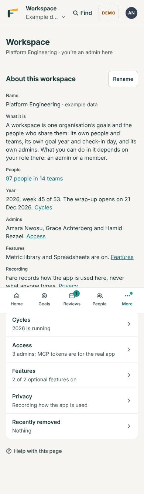 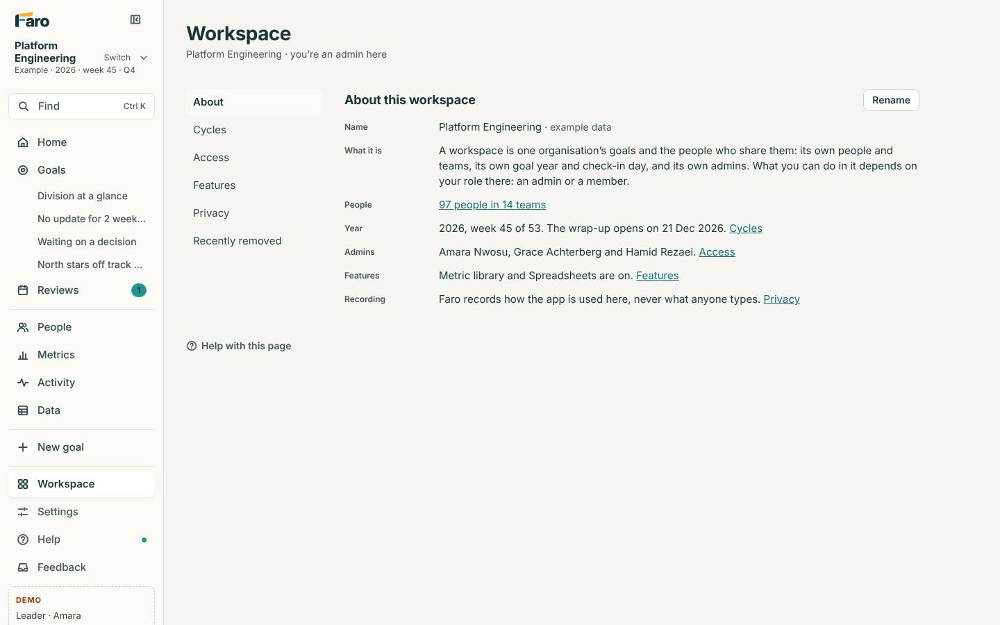

**Fields**

| Field | Kind | Shown when |
|---|---|---|
| “Who” | PickOne | always |
| “Workspace name” | text | always |
| “Record how the app is used here” | checkbox | an admin |
| “… Off until … is on. On / Off” | checkbox | always |
| “Type … to confirm” | text | `open` |

**States**

| State | What it says | Shown when |
|---|---|---|
| whole screen | “goes to /feedback…” | `q.get('inbox') \|\| markup \|\| hash === '#inbox'` |
| whole screen | “goes to …” | `moved` |
| whole screen | “goes to /workspace/…” | `anchor` |

**Buttons, and who sees them**

| Button | Kind | Shown when |
|---|---|---|
| “… (worked out when it shows)” | link | `needs.length > 0` |
| “and … more” | button | `needs.length > 0` and `needs.length > NEEDS_SHOWN` and `!all` |
| “Undo” | button | `later && undo?.ok` and an admin |
| “Start …” | primary | `canStart` |
| “Undo” | button | `admin && can?.ok && c.id !== later?.id` |
| “Open the wrap-up” | link | `!current` and `open` |
| “Open the wrap-up” | link | `current` and `open` |
| “See the wrap-up” | link | `current` and `!open` and `anyCheckIn` |
| “Delete…” | button | an admin and `st.deletable` and `!start` and `asking !== c.id` |
| “Yes, delete it” | button | `asking === c.id` |
| “Cancel” | button | `asking === c.id` |
| “Add an admin” | primary | always |
| “Cancel” | button | always |
| “Make … an admin / Make them an admin” | primary | always |
| “Saving… / Save the name” | button | always |
| “Rename” | button | an admin |
| “Yes, turn it on” | button | an admin and `asking` |
| “Cancel” | button | an admin and `asking` |
| “Delete this workspace…” | button | `!open` |
| “Cancel” | button | `open` |
| “Deleting… / Delete it for good” | button | `open` |

## Onboarding

[src/screens/Onboarding.tsx](../../src/screens/Onboarding.tsx)

- `/workspace/new` (`Onboarding`): A workspace holds one organisation’s people, teams, goals and history. Setting one up takes about three minutes. Help: “Setting up a workspace” (`set-up`).

- **Named parts:** “What’s this workspace for?”, “Who are you?”, “Who else is on it?”, “Where do you want to start?”, “What outcome are you after?”, “What feeds it?”
- **Main action:** Set up a workspace, one question a screen.
- **Primary buttons in its markup:** none written as plain text
- **AI tools:** none, on purpose: Setting up a new workspace happens before there is a token for it.

**Pictures** (`/workspace/new` as amara): [390 wide](screens/onboarding-390.jpg), [1440 wide](screens/onboarding-1440.jpg)

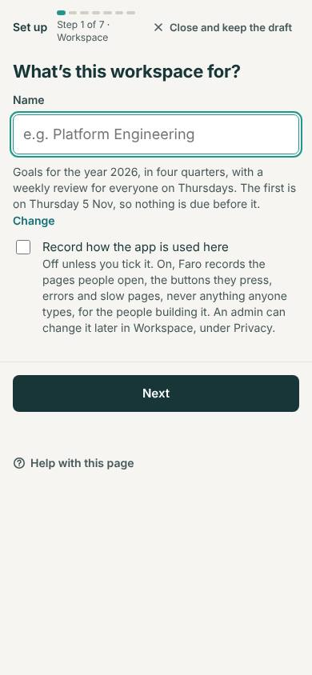 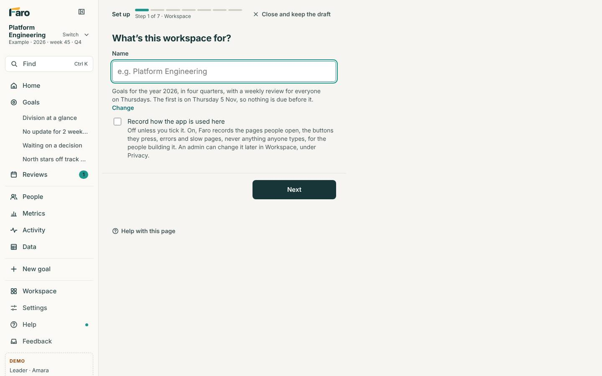

**Fields**

| Field | Kind | Shown when |
|---|---|---|
| “Name” | text | `d.step === 0` |
| “The goal year starts in …” | select | `d.step === 0` and `cycleOpen` |
| “Weekly review on …” | select | `d.step === 0` and `cycleOpen` |
| “Record how the app is used here Off unless you tick it. On, Faro records the pages people open, the buttons t…” | checkbox | `d.step === 0` |
| “Your name” | text | `d.step === 1` |
| “Your team” | text | `d.step === 1` |
| “Your email” | email | `d.step === 1` |
| “Person …: name” | text | `d.step === 2` |
| “Person …: email” | email | `d.step === 2` |
| “Person …: team” | text | `d.step === 2` |
| “Person …: admin” | checkbox | `d.step === 2` |
| “Outcome / Goal” | text | always |
| “Today …” | text | `g.kind === 'metric'` |
| “Target …” | text | `g.kind === 'metric'` |
| “Unit” | text | `g.kind === 'metric'` |
| “Must stay At most At least” | select | `!(g.kind === 'metric')` and `g.kind === 'range'` |
| “Limit …” | text | `!(g.kind === 'metric')` and `g.kind === 'range'` |
| “Warn within” | text | `!(g.kind === 'metric')` and `g.kind === 'range'` |
| “Unit” | text | `!(g.kind === 'metric')` and `g.kind === 'range'` |
| “How it’s measured optional” | text | `g.kind !== 'milestone'` |
| “Owner” | PickOne | always |

**States**

| State | What it says | Shown when |
|---|---|---|
| error | “Couldn’t create the workspace:” | always |

**Buttons, and who sees them**

| Button | Kind | Shown when |
|---|---|---|
| “Start over” | button | `restored` |
| “Change” | button | `d.step === 0` and `!cycleOpen` |
| “Same as above (…)” | button | `d.step === 2` and `!r.team.trim() && above && above !== d.me.team.trim()` |
| “(Remove person …)” | button | `d.step === 2` |
| “Use …” | button | `d.step === 2` and `typo` |
| “It’s a different team” | button | `d.step === 2` and `typo` |
| “Add a person” | button | `d.step === 2` |
| “Download the Excel template” | button | `d.step === 2` |
| “Undo” | button | `d.step === 2` and `fileNote` and `undoUpload` |
| “Goals from your spreadsheet As uploaded, with their plans and check-ins” | button | `d.step === 3` and `!!d.fileTables?.goals?.length` |
| “Start blank Type your own outcome and goals” | button | `d.step === 3` |
| “Set goals up later Each owner adds theirs in the app” | button | `d.step === 3` |
| “Remove this goal” | button | `d.step === 5` |
| “Undo” | button | `d.step === 5` and `removed` |
| “Add a goal” | button | `d.step === 5` |
| “Change name or year” | button | `d.step === 6` |
| “Change people” | button | `d.step === 6` |
| “Change the north star” | button | `d.step === 6` and `result.snapshot.goals.length > 0` and `!skipGoalSteps` |
| “Change the goals” | button | `d.step === 6` and `result.snapshot.goals.length > 0` and `!skipGoalSteps` |
| “Back” | button | `d.step > 0` |
| “… (worked out when it shows)” | primary | always |
| “Move a number” | button | `!headline` |
| “Keep a number in range” | button | `!headline` |
| “Hit dated stages” | button | `!headline` |

## People

[src/screens/People.tsx](../../src/screens/People.tsx)

- `/people` (`PeopleList`): Everyone in the workspace, A to Z: find someone by name, job title or team, open them to see their team, their goals and their reviews. Admins add and change people. Help: “People: finding someone” (`people`).
- `/people/:personId` (`PersonPage`): Everyone in the workspace, A to Z: find someone by name, job title or team, open them to see their team, their goals and their reviews. Admins add and change people. Help: “People: finding someone” (`people`).
- `/teams` (`TeamsList`): The workspace’s teams, A to Z, each with its lead, its people and its goals by status; a team’s page says what it is here to do. Admins add, change and remove teams. Help: “Teams” (`teams`).
- `/teams/:teamId` (`TeamPage`): The workspace’s teams, A to Z, each with its lead, its people and its goals by status; a team’s page says what it is here to do. Admins add, change and remove teams. Help: “Teams” (`teams`).

- **Named parts:** “People”, “For admins”, “What it is here to do”, “Goals”, “People and teams (region)”, “Pages (region)”
- **Main action:** Find a person or a team and go to their goals; for admins, Add a person on People and Add a team on Teams.
- **Primary buttons in its markup:** none written as plain text
- **AI tools:** `list_people`, `save_person`, `save_team`, `remove_team`, `mark_person_left`, `delete_person`, `create_token`, `find_goals`

**Pictures** (`/people` as amara): [390 wide](screens/people-390.jpg), [1440 wide](screens/people-1440.jpg)

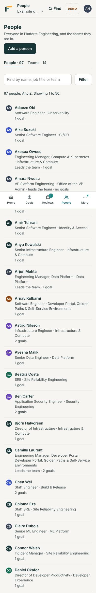 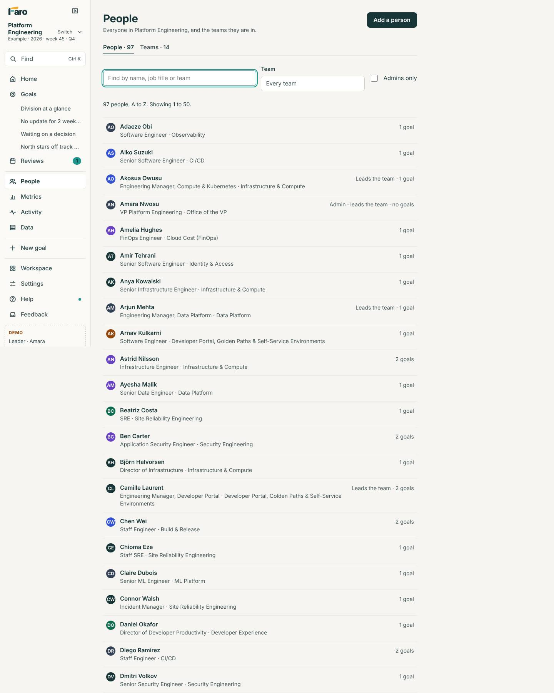

**Fields**

| Field | Kind | Shown when |
|---|---|---|
| “Team” | PickOne | `!(teamId === '-')` |
| “Admins only” | checkbox | always |
| “Team name” | text | always |
| “Team lead (optional)” | PickOne | always |
| “What it is here to do optional” | textarea | always |
| “Move them to” | PickOne | `has` and `others.length` |
| “…: email” | email | always |
| “Name” | text | always |
| “Email not added yet” | email | always |
| “Job title optional” | text | always |
| “Team” | PickOne | always |

**States**

| State | What it says | Shown when |
|---|---|---|
| whole screen | “That person isn’t in ….” | `!p \|\| p.removedAt` |
| whole screen | “That team isn’t in ….” | `!t` |
| error | “Give the team a name.” | `tried and !clean` |
| error | “There’s already a team called ….” | `tried and dup` |
| error | “Choose where they go.” | `has and others.length and tried and !to` |
| error | “Add a name.” | `tried && !p.name.trim()` |

**Buttons, and who sees them**

| Button | Kind | Shown when |
|---|---|---|
| “Remove” | button | `teamId === '-'` |
| “Add a person” | primary | an admin |
| “Filter · …” | button | `narrow` |
| “Add them” | button | an admin and `noEmail > 0` |
| “Previous …” | link | `found.pages > 1` and `found.page > 1` |
| “Next …” | link | `found.pages > 1` and `found.page < found.pages` |
| “… (worked out when it shows)” | primary | `see` and `!left` |
| “Change details” | button | an admin and `!left` |
| “Make an admin” | button | an admin and `!left` and `!p.admin` |
| “Make an MCP token” | button | an admin and `!left` and `app.mode === 'live'` |
| “… (worked out when it shows)” | button | an admin and `!left` and `!you` |
| “Add a team” | primary | an admin |
| “Previous …” | link | `shown.pages > 1` and `shown.page > 1` |
| “Next …” | link | `shown.pages > 1` and `shown.page < shown.pages` |
| “See its goal / See its … goals” | primary | `s.goals.length > 0` |
| “Add it” | button | `(t.objective \|\| admin)` and `!t.objective` |
| “Change its name, lead or purpose” | button | an admin |
| “Remove this team…” | button | an admin |
| “Cancel” | button | always |
| “Saving… / Save / Add the team” | primary | always |
| “Removing… / Move them and remove / Remove the team” | button | `(!has \|\| others.length > 0)` |
| “Show … more” | button | `missing.length > limit` |
| “Saving… / Save … / Save emails” | button | always |
| “Save / Add” | primary | always |

## Feedback

[src/screens/Feedback.tsx](../../src/screens/Feedback.tsx)

- `/feedback` (`Feedback`): Every markup and piece of feedback people send, from every workspace and the demo, on its own page, Feedback, beside Help. Open to anyone with no sign-in: work through it like an inbox, from New to In hand to Closed. Help: “The inbox” (`inbox`).

- **Named parts:** “Feedback”
- **Main action:** Handle the open markup or feedback (in hand, fixed or won’t fix) and go on to the next.
- **Primary buttons in its markup:** none written as plain text
- **AI tools:** `list_markups`, `get_markup`, `update_markup`, `list_feedback`, `get_feedback`, `update_feedback`, `review_inbox`, `send_feedback`

**Pictures** (`/feedback` as amara): [390 wide](screens/feedback-390.jpg), [1440 wide](screens/feedback-1440.jpg)

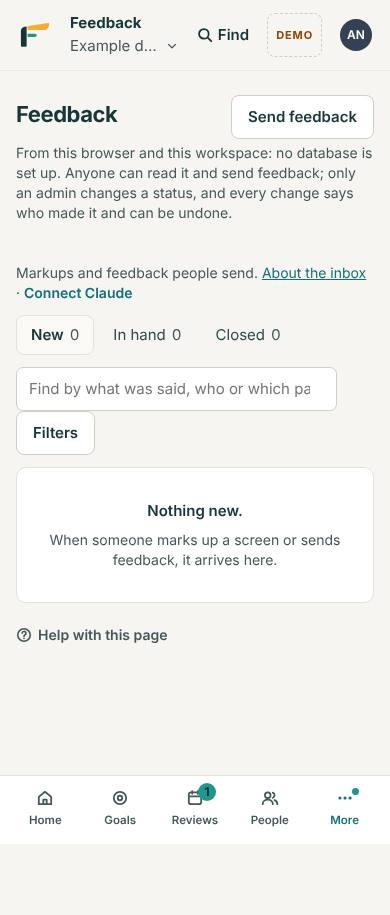 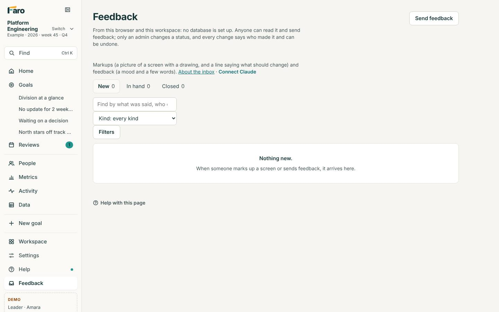

**Fields**

None: nothing to type or choose here.

**States**

None written in its markup beyond the screen itself: it draws what it has.

**Buttons, and who sees them**

| Button | Kind | Shown when |
|---|---|---|
| “Send feedback” | button | `onSend` |

## StartNext

[src/screens/StartNext.tsx](../../src/screens/StartNext.tsx)

- `/workspace/cycles/next` (`StartNext`): An admin sets up next year from the day the wrap-up opens. Nobody moves into it until this year’s last day, and it can be undone until someone uses it. Help: “Starting the next year” (`start-next-year`).

- **Named parts:** “What happens to each goal (region)”
- **Main action:** For an admin, once the wrap-up opens: read what carries on, finishes and stops, then Start the next year (it opens for everyone on its first Monday).
- **Primary buttons in its markup:** none written as plain text
- **AI tools:** `start_next_cycle`, `list_people`

**Pictures** (`/workspace/cycles/next` as amara): [390 wide](screens/startnext-390.jpg), [1440 wide](screens/startnext-1440.jpg)

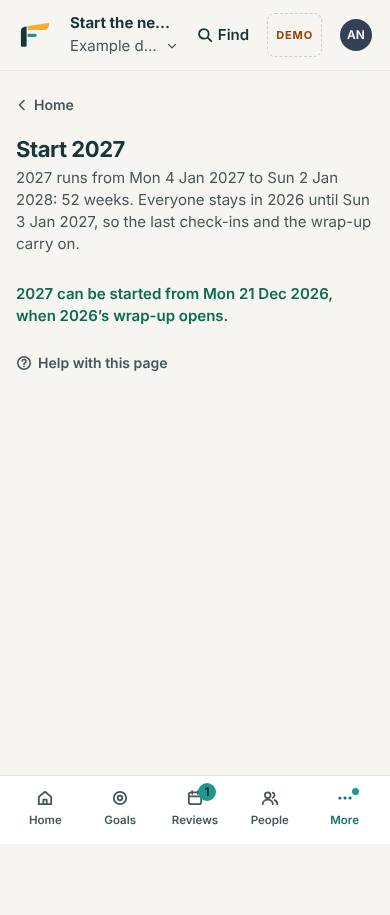 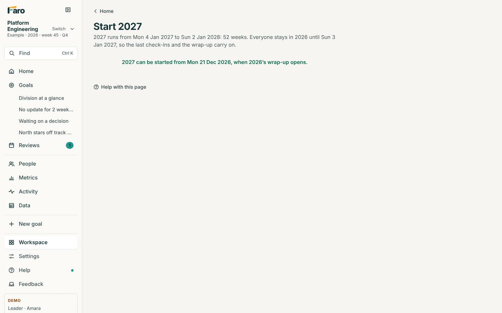

**Fields**

None: nothing to type or choose here.

**States**

| State | What it says | Shown when |
|---|---|---|
| whole screen | “goes to /workspace/cycles” | `laterCycle(app.full.cycles, app.cycle)` |

**Buttons, and who sees them**

| Button | Kind | Shown when |
|---|---|---|
| “Not yet” | link | `page.readBack` and an admin |
| “Starting… / Start …” | primary | `page.readBack` and an admin |

## Settings

[src/screens/Settings.tsx](../../src/screens/Settings.tsx)

- `/settings` (`Settings`): About you: who you are here and your page, your own choices (light or dark, an accent colour, the sidebar, how a goal’s page moves), your MCP tokens, whether recording is on, and leaving the workspace. Help: “Settings” (`settings`).

- **Named parts:** “Settings”, “You”, “Appearance”, “Navigation”, “Motion lab”, “Recording”, “On this page (region)”
- **Main action:** Change your own choices; see who you are here and go to your page.
- **Primary buttons in its markup:** none written as plain text
- **AI tools:** `list_tokens`, `revoke_token`, `get_help`

**Pictures** (`/settings` as rhea): [390 wide](screens/settings-390.jpg), [1440 wide](screens/settings-1440.jpg)

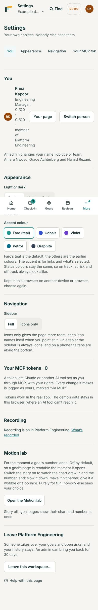 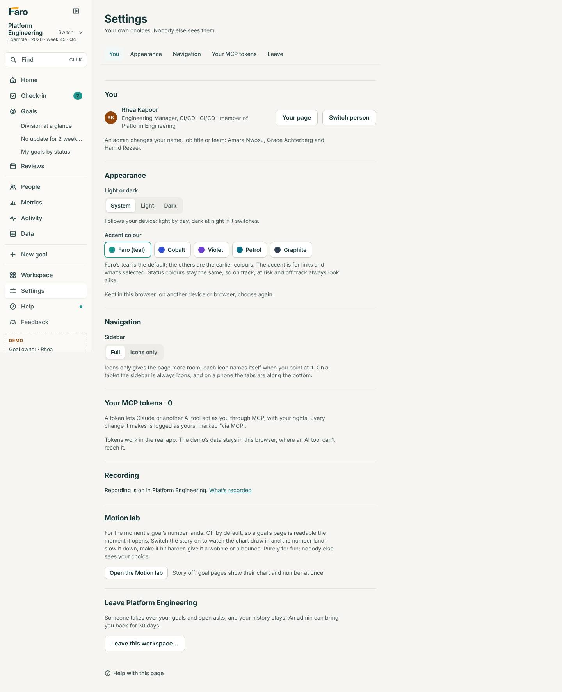

**Fields**

None: nothing to type or choose here.

**States**

None written in its markup beyond the screen itself: it draws what it has.

**Buttons, and who sees them**

| Button | Kind | Shown when |
|---|---|---|
| “Your page” | link | always |
| “Switch person / Not you?” | button | always |
| “Open the Motion lab” | button | always |
| “Leave this workspace…” | button | always |

## Help

[src/screens/Help.tsx](../../src/screens/Help.tsx)

- `/help` (`HelpHome`): This guide says what everything in Faro does. What’s new lists each release, newest first. Help: “Help and what’s new” (`help`).
- `/help/:id` (`HelpArticle`): This guide says what everything in Faro does. What’s new lists each release, newest first. Help: “Help and what’s new” (`help`).
- `/whats-new` (`WhatsNew`): This guide says what everything in Faro does. What’s new lists each release, newest first. Help: “Help and what’s new” (`help`).

- **Named parts:** “Help”, “Search results”, “Related”, “What’s new”, “Search results (region)”
- **Main action:** Find an answer: search, or open an article.
- **Primary buttons in its markup:** none written as plain text
- **AI tools:** `get_help`, `whats_new`

**Pictures** (`/help` as rhea): [390 wide](screens/help-390.jpg), [1440 wide](screens/help-1440.jpg)

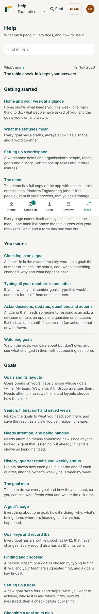 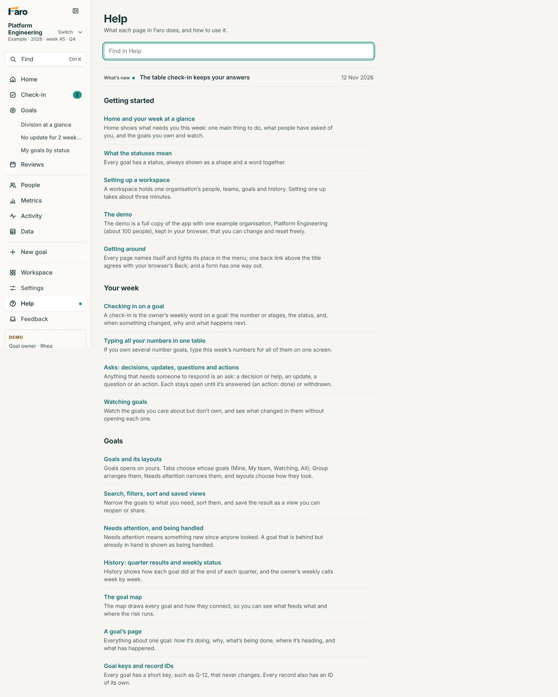

**Fields**

None: nothing to type or choose here.

**States**

| State | What it says | Shown when |
|---|---|---|
| empty | “There’s no help article here” | `!a` |

**Buttons, and who sees them**

| Button | Kind | Shown when |
|---|---|---|
| “See all help” | link | always |

## Welcome

[src/screens/Welcome.tsx](../../src/screens/Welcome.tsx)

- `/welcome` (`Welcome`): Welcome is Faro’s front door, at its own address: set up a workspace, look around the demo, or join a workspace you were invited to. Help: “Welcome: starting, the demo, or an invitation” (`welcome`).

- **Named parts:** “Welcome back”, “On this device”, “Run the company on outcomes, and manage by exception”
- **Main action:** Set up a workspace; coming back, Open the workspace last opened (or Carry on a set-up left unfinished).
- **Primary buttons in its markup:** “Set up a workspace”
- **AI tools:** none, on purpose: The front door, before anyone has chosen a workspace: a token already belongs to one.

**Pictures** (`/welcome` before anyone has signed up): [390 wide](screens/welcome-390.jpg), [1440 wide](screens/welcome-1440.jpg)

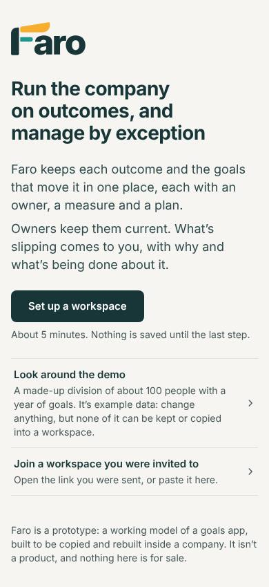 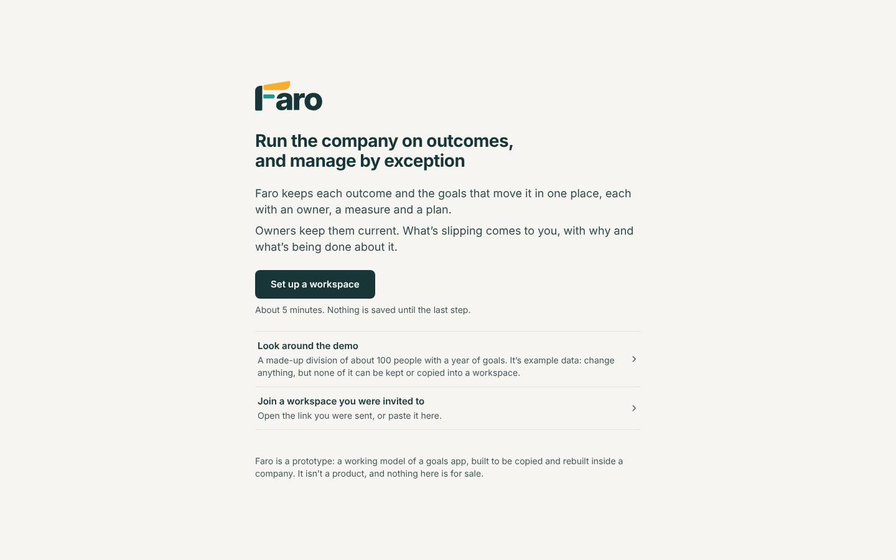

**Fields**

| Field | Kind | Shown when |
|---|---|---|
| “The link you were sent” | text | `joining` |

**States**

None written in its markup beyond the screen itself: it draws what it has.

**Buttons, and who sees them**

| Button | Kind | Shown when |
|---|---|---|
| “Open it” | button | `joining` |
| “Open” | primary | `back` |
| “Keep it” | button | `back` and `draft` and `discarding` |
| “Discard it” | button | `back` and `draft` and `discarding` |
| “Discard” | button | `back` and `draft` and `!discarding` |
| “Carry on” | primary | `back` and `draft` and `!discarding` |
| “Set up a workspace” | primary | `!back` |

## Views, overlays and pages with no route of their own

Each is drawn inside a screen, over every screen, or when nothing else can be (`OTHER_VIEWS` in `src/spec/screens.ts`, its main action written by hand like a route’s; the rest read from its markup).

### The navigation shell

[src/ui/Shell.tsx](../../src/ui/Shell.tsx)

- **Where:** Around every signed-in screen: the sidebar on a desktop, the top bar and menu on a phone.
- **Help:** “Getting around” (`getting-around`): Every page names itself and lights its place in the menu; one back link above the title agrees with your browser’s Back; and a form has one way out.
- **Main action:** None of its own: it lights where you are and takes you to the other screens, Find and Help.

**Fields**

| Field | Kind | Shown when |
|---|---|---|
| “Anything to add? optional” | textarea | always |

**States**

| State | What it says | Shown when |
|---|---|---|
| error | “Choose one first.” | `tried and !mood` |

**Buttons, and who sees them**

| Button | Kind | Shown when |
|---|---|---|
| “Mark up the last screen / Mark up this screen Go back to it, draw / Draw on a picture of it and say what shou…” | button | always |
| “Cancel” | button | always |
| “Sending… / Send” | primary | always |
| “Find” | button | always |
| “Switch person / Not you? (…, admin here)” | button | always |
| “(Show the full sidebar / Collapse the sidebar)” | button | always |
| “Find …” | button | always |
| “… Admin · …” | button | always |
| “More” | button | always |
| “Demo Switch person, walkthroughs, start over” | button | `app.mode === 'demo'` |

### Find

[src/ui/Find.tsx](../../src/ui/Find.tsx)

- **Where:** Over any screen: Ctrl K (Cmd K on a Mac), or Find in the sidebar or the phone’s top bar.
- **Help:** “Finding and choosing” (`finding`): A person, a team or a goal is chosen by typing to find it: you and your team are suggested first, and a goal’s key finds it.
- **Main action:** Type a name, a few words or a goal’s key, and open what it finds.

**Pictures** (`/` as rhea, after Control+K): [390 wide](screens/find-390.jpg), [1440 wide](screens/find-1440.jpg)

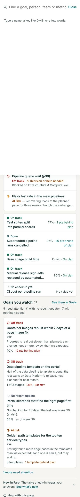 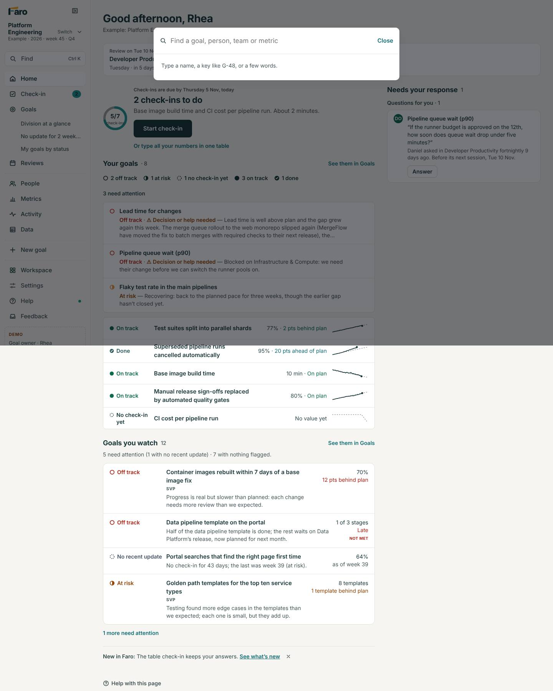

**Fields**

None: nothing to type or choose here.

**States**

| State | What it says | Shown when |
|---|---|---|
| error | “Couldn’t search just now. Try again” | `failed` |

**Buttons, and who sees them**

| Button | Kind | Shown when |
|---|---|---|
| “Close” | button | `!inline` |
| “Try again” | button | `failed` |

### The workspace switcher

[src/ui/WorkspaceSwitch.tsx](../../src/ui/WorkspaceSwitch.tsx) (`WorkspaceSwitcher`)

- **Where:** In the shell, for someone in more than one workspace.
- **Help:** “Workspace: about this one” (`workspace`): Workspace opens on About: for admins, what needs sorting out; then the facts about this workspace, each leading to its section. Its other sections are Cycles, Privacy and Recently removed for everyone, and Access and Features for admins.
- **Main action:** Choose another workspace; you land on the same page there when it has one, else Home.

**Fields**

| Field | Kind | Shown when |
|---|---|---|
| “Find a workspace” | search | `open` and `app.workspaces.length >= 6` |

**States**

None written in its markup beyond the screen itself: it draws what it has.

**Buttons, and who sees them**

| Button | Kind | Shown when |
|---|---|---|
| “… Opening… / … Switch: switch workspace, or set one up” | button | `variant === 'side'` |
| “Opening … / …, …: switch workspace” | button | `!(variant === 'side')` |
| “About …” | button | `open` |
| “Set up a new workspace” | button | `open` |

### Goals: the table

[src/screens/GoalTable.tsx](../../src/screens/GoalTable.tsx)

- **Where:** /goals?view=table
- **Help:** “Goals and its layouts” (`goals`): Goals opens on yours. Tabs choose whose goals (Mine, My team, Watching, All); Group arranges them, Needs attention narrows them, and layouts choose how they look.
- **Main action:** Read the goals in rows and open one; tick several to change them together.

**Pictures** (`/goals?view=table` as amara): [390 wide](screens/goals-the-table-390.jpg), [1440 wide](screens/goals-the-table-1440.jpg)

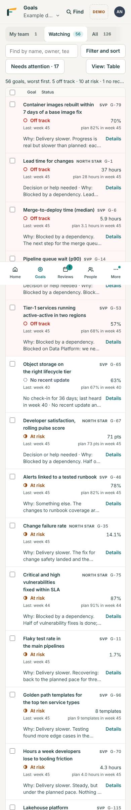 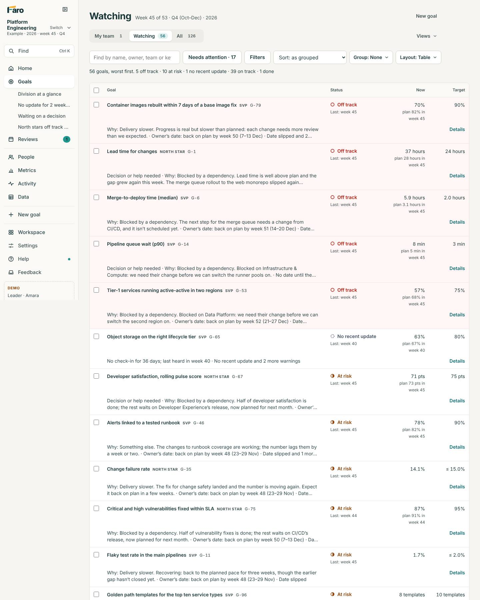

**Fields**

| Field | Kind | Shown when |
|---|---|---|
| “Select every goal in …” | checkbox | always |
| “Select …” | checkbox | always |

**States**

None written in its markup beyond the screen itself: it draws what it has.

**Buttons, and who sees them**

None.

### Goals: changing several at once

[src/screens/BulkEdit.tsx](../../src/screens/BulkEdit.tsx)

- **Where:** On the table, once goals are ticked.
- **Help:** “Goals and its layouts” (`goals`): Goals opens on yours. Tabs choose whose goals (Mine, My team, Watching, All); Group arranges them, Needs attention narrows them, and layouts choose how they look.
- **Main action:** Change the ticked goals’ owner or level, or watch them, checked and shown before it’s saved.

**Fields**

| Field | Kind | Shown when |
|---|---|---|
| “New owner” | PickOne | `kind === 'owner'` |
| “Level Choose…” | select | `!(kind === 'owner')` |

**States**

None written in its markup beyond the screen itself: it draws what it has.

**Buttons, and who sees them**

| Button | Kind | Shown when |
|---|---|---|
| “Change owner” | button | always |
| “Change level” | button | always |
| “Watch” | button | always |
| “Clear” | button | always |
| “Cancel” | button | always |
| “Saving… / Save” | primary | always |

### Goals: the board

[src/screens/GoalBoard.tsx](../../src/screens/GoalBoard.tsx)

- **Where:** /goals?view=board
- **Help:** “Goals and its layouts” (`goals`): Goals opens on yours. Tabs choose whose goals (Mine, My team, Watching, All); Group arranges them, Needs attention narrows them, and layouts choose how they look.
- **Main action:** Read the goals grouped in columns by status, and open one.

**Pictures** (`/goals?view=board` as amara): [390 wide](screens/goals-the-board-390.jpg), [1440 wide](screens/goals-the-board-1440.jpg)

 

**Fields**

None: nothing to type or choose here.

**States**

None written in its markup beyond the screen itself: it draws what it has.

**Buttons, and who sees them**

| Button | Kind | Shown when |
|---|---|---|
| “Show all … / Show fewer” | button | `healthy` and `c.items.length > HEALTHY_SHOWN` |

### Goals: the map

[src/screens/GoalMap.tsx](../../src/screens/GoalMap.tsx)

- **Where:** /goals?view=map
- **Help:** “The goal map” (`goal-map`): The map draws every goal and how they connect, so you can see what feeds what and where the risk runs.
- **Main action:** Follow how goals roll up to the ones above them, and open one.

**Pictures** (`/goals?view=map` as amara): [390 wide](screens/goals-the-map-390.jpg), [1440 wide](screens/goals-the-map-1440.jpg)

 

**Fields**

| Field | Kind | Shown when |
|---|---|---|
| “Troubled trees only Troubled trees” | checkbox | always |

**States**

None written in its markup beyond the screen itself: it draws what it has.

**Buttons, and who sees them**

| Button | Kind | Shown when |
|---|---|---|
| “(Show the … … feeding … / Hide the … … feeding …)” | button | `children > 0` |
| “Unfold all / Fold to the top” | button | always |
| “Tidy up” | button | `Object.keys(moved).length > 0` |
| “(Close)” | button | always |
| “Open the goal” | primary | always |

### Goals: proposed goals

[src/screens/ProposedList.tsx](../../src/screens/ProposedList.tsx)

- **Where:** /goals?state=proposed (the count line’s “· {n} proposed”, or the State filter)
- **Help:** “Proposed goals” (`goal-proposed`): A goal can be proposed before anyone is held to it: everyone can see it and comment, it has no status and nothing is due, and its owner or an admin makes it active when it is agreed.
- **Main action:** Read the proposed goals in the scope, newest first, with what each would measure, and open one.

**Fields**

None: nothing to type or choose here.

**States**

None written in its markup beyond the screen itself: it draws what it has.

**Buttons, and who sees them**

| Button | Kind | Shown when |
|---|---|---|
| “Remove” | button | always |

### A proposed goal’s page

[src/screens/ProposedGoal.tsx](../../src/screens/ProposedGoal.tsx)

- **Where:** /goals/:goalId, for a goal that is proposed, not yet active
- **Help:** “Proposed goals” (`goal-proposed`): A goal can be proposed before anyone is held to it: everyone can see it and comment, it has no status and nothing is due, and its owner or an admin makes it active when it is agreed.
- **Main action:** For its owner or an admin, Make it active (or Finish it, when something is missing); for anyone else, comment, ask or watch.

**Fields**

| Field | Kind | Shown when |
|---|---|---|
| “From” | WeekPick | `goal.kind === 'metric'` |
| “Yes, it was … in week …” | radio | `before` |
| “No, start from this week” | radio | `before` |

**States**

None written in its markup beyond the screen itself: it draws what it has.

**Buttons, and who sees them**

| Button | Kind | Shown when |
|---|---|---|
| “Finish it” | primary | `canActivate` and `missing.length` |
| “Make it active” | primary | `canActivate` and `!missing.length` |
| “Change it” | link | `canActivate` |
| “Withdraw it” | button | `canActivate` |
| “Change it” | link | `!canActivate` and `canChange` |
| “Withdraw it” | button | `!canActivate` and `canChange` |
| “Add a comment” | button | `!canActivate` and `!canChange` |
| “Ask … a question” | button | `!canActivate` and `!canChange` and `goal.ownerId !== app.viewer.id` |
| “Withdraw it” | button | `withdrawing` |
| “Keep it” | button | `withdrawing` |
| “Make it active” | primary | always |
| “Cancel” | button | always |

### Goals: history

[src/screens/GoalHistory.tsx](../../src/screens/GoalHistory.tsx)

- **Where:** /goals?view=history
- **Help:** “History: quarter results and weekly status” (`history`): History shows how each goal did at the end of each quarter, and the owner’s weekly calls week by week.
- **Main action:** Read each goal’s status week by week, and open one.

**Pictures** (`/goals?view=history` as amara): [390 wide](screens/goals-history-390.jpg), [1440 wide](screens/goals-history-1440.jpg)

 

**Fields**

None: nothing to type or choose here.

**States**

None written in its markup beyond the screen itself: it draws what it has.

**Buttons, and who sees them**

| Button | Kind | Shown when |
|---|---|---|
| “Quarter results” | button | `year` |
| “Weekly status” | button | `year` |
| “Whole year” | button | `year` and `show === 'weekly'` |

### Goals: saved views and layouts

[src/screens/GoalViews.tsx](../../src/screens/GoalViews.tsx)

- **Where:** The layout menu on Goals.
- **Help:** “Goals and its layouts” (`goals`): Goals opens on yours. Tabs choose whose goals (Mine, My team, Watching, All); Group arranges them, Needs attention narrows them, and layouts choose how they look.
- **Main action:** Choose how the goals are laid out, or save the filters you have as a view.

**Fields**

None: nothing to type or choose here.

**States**

None written in its markup beyond the screen itself: it draws what it has.

**Buttons, and who sees them**

None.

### Goals: filters

[src/screens/GoalFilters.tsx](../../src/screens/GoalFilters.tsx)

- **Where:** The bar above every Goals layout.
- **Help:** “Goals and its layouts” (`goals`): Goals opens on yours. Tabs choose whose goals (Mine, My team, Watching, All); Group arranges them, Needs attention narrows them, and layouts choose how they look.
- **Main action:** Narrow the goals: search, scope, status, level and the rest.

**Fields**

| Field | Kind | Shown when |
|---|---|---|
| “Sort Sort: as grouped Sort: … Sort: …, reversed” | select | always |
| “Find a goal … No goal by that name or key. Enter shows any that mention it.” | search | always |
| “Name” | text | always |
| “Pin it for everyone in …” | checkbox | `!view` and an admin |

**States**

| State | What it says | Shown when |
|---|---|---|
| error | “Give the view a name.” | `tried && !name.trim()` |
| error | “Couldn’t copy the link. Copy it from the address bar.” | always |

**Buttons, and who sees them**

| Button | Kind | Shown when |
|---|---|---|
| “Filters Filters / Filter and sort · …” | button | always |
| “Rename / Save view” | primary | always |
| “Cancel” | button | always |

### Goals: the filter sheet

[src/screens/GoalFilterSheet.tsx](../../src/screens/GoalFilterSheet.tsx)

- **Where:** Filters, from the bar on Goals (on a phone, every filter is here).
- **Help:** “Goals and its layouts” (`goals`): Goals opens on yours. Tabs choose whose goals (Mine, My team, Watching, All); Group arranges them, Needs attention narrows them, and layouts choose how they look.
- **Main action:** Set the filters, and see the goals they leave.

**Fields**

| Field | Kind | Shown when |
|---|---|---|
| “Sort” | select | `!sortOff` |
| “Only goals that need attention, with those … below them” | checkbox | always |
| “Find an owner” | search | always |
| “Due” | select | always |
| “No update for” | select | always |
| “Last quarter” | select | always |
| “In the tree of” | PickOne | always |
| “With “also helps” links” | checkbox | always |

**States**

None written in its markup beyond the screen itself: it draws what it has.

**Buttons, and who sees them**

| Button | Kind | Shown when |
|---|---|---|
| “(Remove owner …)” | button | always |
| “… (worked out when it shows)” | button | `match.length > 0` |
| “Clear filters” | button | always |
| “Show the goals” | primary | always |

### Check-in: the week’s list

[src/screens/CheckInQueue.tsx](../../src/screens/CheckInQueue.tsx)

- **Where:** /check-in, before a goal is chosen.
- **Help:** “Checking in on a goal” (`check-in`): A check-in is the owner’s weekly word on a goal: the number or stages, the status, and, when something changed, why and what happens next.
- **Main action:** Start with the first goal due, or pick any.

**Pictures** (`/check-in` as rhea): [390 wide](screens/check-in-the-week-s-list-390.jpg), [1440 wide](screens/check-in-the-week-s-list-1440.jpg)

 

**Fields**

None: nothing to type or choose here.

**States**

None written in its markup beyond the screen itself: it draws what it has.

**Buttons, and who sees them**

| Button | Kind | Shown when |
|---|---|---|
| “Check in on … / Start with …” | primary | `first` |
| “Carry on / Check in” | link | `p.due.length > 0` |
| “Correct it” | link | `p.done.length > 0` |

### Check-in: the status sheet

[src/screens/CheckInFlow.tsx](../../src/screens/CheckInFlow.tsx) (`StatusSheet`)

- **Where:** In a check-in, from the status the numbers give, to choose another.
- **Help:** “Checking in on a goal” (`check-in`): A check-in is the owner’s weekly word on a goal: the number or stages, the status, and, when something changed, why and what happens next.
- **Main action:** Choose the status, and say why when it is better than the numbers give.

**Fields**

| Field | Kind | Shown when |
|---|---|---|
| “Why is it better than the numbers?” | text | `e.greener` |

**States**

| State | What it says | Shown when |
|---|---|---|
| error | “Write a sentence so people watching know why.” | `e.greener and tried and !okWhy` |

**Buttons, and who sees them**

| Button | Kind | Shown when |
|---|---|---|
| “from the numbers” | button | always |
| “Done” | primary | always |

### A goal: Respond

[src/screens/Respond.tsx](../../src/screens/Respond.tsx)

- **Where:** On a goal’s page, under “Asked of you”; Home’s buttons open it with its box focused.
- **Help:** “A goal’s page” (`goal-page`): Everything about one goal: how it’s doing, why, what’s being done, where it’s heading, and what has happened.
- **Main action:** Answer what was asked, or mark the step done.

**Fields**

None: nothing to type or choose here.

**States**

| State | What it says | Shown when |
|---|---|---|
| error | “Write a few words.” | `allowed` |

**Buttons, and who sees them**

| Button | Kind | Shown when |
|---|---|---|
| “Check in for week …” | link | `allowed` and `r.kind === 'update' && goals[0] && mayPostCheckIn(app.viewer, goals[0], 'form')` |
| “Answer it” | button | `allowed` and `canAskBack` |
| “Ask the owner first” | button | `allowed` and `canAskBack` |
| “Leave it open” | button | `allowed` |
| “… (worked out when it shows)” | primary | `allowed` |

### A review: one goal at a time

[src/screens/Inspect.tsx](../../src/screens/Inspect.tsx)

- **Where:** A review’s walk (/goals/:goalId?review=…), and a goal’s page during one.
- **Help:** “Reviews” (`reviews`): A review walks a set of goals together on a cadence, worst and stalest first, and keeps what was said.
- **Main action:** Say what the review decided about this goal, and go on to the next.

**Fields**

| Field | Kind | Shown when |
|---|---|---|
| “Your question for … / What happens next / Why the review accepts the risk / Your note” | textarea | always |
| “Who” | PersonPick | `mode === 'action'` |
| “By optional Choose a week / No date This week / Week … · …” | select | `mode === 'action'` |

**States**

| State | What it says | Shown when |
|---|---|---|
| error | “Say why, in a few words. / Write a few words first.” | `tried && text.trim().length < min` |
| error | “Choose the week it’s due by.” | `mode === 'action' and tried and missingDate` |

**Buttons, and who sees them**

| Button | Kind | Shown when |
|---|---|---|
| “(Previous goal)” | button | always |
| “(Next goal, without reviewing this one)” | button | always |
| “(Close the review)” | button | always |
| “Next goal” | button | always |
| “Mark done” | button | `carried.length > 0` and `a.state !== 'done' && canMarkDone(a.ask, app.viewer)` |
| “Edit” | button | `said.length > 0` and `d.byId === app.viewer.id` |
| “Remove” | button | `said.length > 0` and `d.kind === 'note' && (d.byId === app.viewer.id \|\| app.viewer.admin)` |
| “Add the next step” | primary | `mustDecide` |
| “… (worked out when it shows)” | button | `mustDecide` |
| “Reviewed & finish / Reviewed & back to the review / Reviewed & next” | primary | `!mustDecide` |
| “Add a note” | button | `!mustDecide` |
| “Add a note” | button | `mustDecide` |
| “Ask … a question” | button | `!own` |
| “Add an action” | button | `!mustDecide` |
| “Skip for now” | button | `!reviewed` |
| “Cancel” | button | always |
| “Saving… / Save the decision / Save the next step / Save …” | primary | always |

### Data: filters

[src/screens/DataFilters.tsx](../../src/screens/DataFilters.tsx)

- **Where:** Filter, on a table in Data.
- **Help:** “Data” (`data`): Every person, goal, check-in, plan and ask as a table you can search, sort, filter, arrange and export, and the home of spreadsheets in and out.
- **Main action:** Narrow the rows a table shows.

**Fields**

| Field | Kind | Shown when |
|---|---|---|
| “Property …” | select | always |
| “Condition …” | select | always |
| “Value” | text | `!NO_VALUE.includes(op)` and `!(multi && kind !== 'number')` |

**States**

None written in its markup beyond the screen itself: it draws what it has.

**Buttons, and who sees them**

| Button | Kind | Shown when |
|---|---|---|
| “Cancel” | button | always |
| “Change filter / Add filter” | primary | always |

### Data: columns and layouts

[src/screens/DataLayout.tsx](../../src/screens/DataLayout.tsx)

- **Where:** Columns, on a table in Data.
- **Help:** “Data” (`data`): Every person, goal, check-in, plan and ask as a table you can search, sort, filter, arrange and export, and the home of spreadsheets in and out.
- **Main action:** Choose and order the columns, and save the layout.

**Fields**

| Field | Kind | Shown when |
|---|---|---|
| “Name” | text | always |

**States**

None written in its markup beyond the screen itself: it draws what it has.

**Buttons, and who sees them**

| Button | Kind | Shown when |
|---|---|---|
| “(Move … up)” | button | always |
| “(Move … down)” | button | always |
| “The usual columns” | button | always |
| “Every column” | button | always |
| “Done” | primary | always |
| “Delete …” | button | `mine.length > 0` |
| “Cancel” | button | always |
| “Save over it / Save layout” | primary | always |

### Page not found

[src/App.tsx](../../src/App.tsx) (`NotFound`)

- **Where:** Any address that leads nowhere.
- **Main action:** Go to Home.

**Pictures** (`/nowhere` as rhea): [390 wide](screens/page-not-found-390.jpg), [1440 wide](screens/page-not-found-1440.jpg)

 

**Fields**

None: nothing to type or choose here.

**States**

None written in its markup beyond the screen itself: it draws what it has.

**Buttons, and who sees them**

| Button | Kind | Shown when |
|---|---|---|
| “Go to Home” | primary | always |
| “Help” | link | always |

### The error page

[src/telemetry/react.tsx](../../src/telemetry/react.tsx) (`ErrorBoundary`)

- **Where:** Instead of a screen that failed to draw, or a part that can’t load while offline, or while a new version loads.
- **Main action:** Reload, or Try again when offline.

**Fields**

None: nothing to type or choose here.

**States**

| State | What it says | Shown when |
|---|---|---|
| empty | “Loading the new version of Faro” | `this.state.reloading` |
| empty | “This page needs a connection” | `this.state.offline` |
| empty | “Something went wrong on this page” | always |
| error | “Still offline.” | `this.state.stillOffline` |

**Buttons, and who sees them**

| Button | Kind | Shown when |
|---|---|---|
| “Try again” | primary | always |
| “Go back” | button | always |
| “Reload” | primary | always |
| “Home” | link | always |
